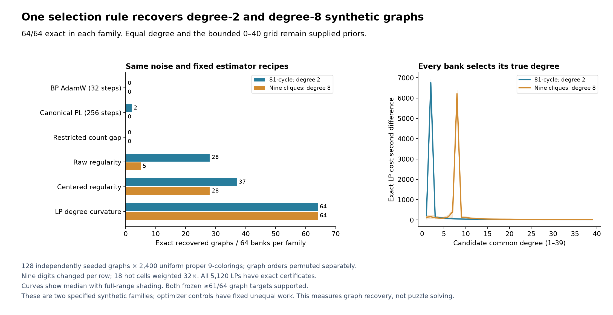

# H4al: degree inference on two synthetic graph families

**The unchanged LP-curvature rule recovers 64/64 cycle graphs and 64/64 nine-clique graphs, selecting degrees two and eight respectively.** Both separately frozen ≥61/64 exact-graph targets are supported. No true degree, edge count, family label or graph order enters estimation; equal degree and the bounded 0–40 search grid remain supplied priors.



| Estimator | 81-cycle: exact / 64 | Nine disjoint K9 cliques: exact / 64 |
|---|---:|---:|
| BP AdamW, 32 updates | 0 | 0 |
| Canonical pseudolikelihood, 256 updates | 2 | 0 |
| Restricted count gap | 0 | 0 |
| Raw regularity | 28 | 5 |
| Centered regularity | 37 | 28 |
| Exact LP degree curvature | **64** | **64** |

These controls use the same corrupted observations and their unchanged finite recipes. Their training work and objectives differ; this is not a matched-compute or optimizer-optimum comparison. Graph recovery is distinct from puzzle-solving accuracy, and this study contains no official Sudoku examples or new solver evaluations.

Each family has 64 independently seeded banks. Every bank draws its own permutation of 81 vertices and 2,400 IID uniform proper nine-colorings. For the cycle, a uniform initial digit and independent nonzero mod-nine increments generate equiprobable proper colorings of the open path. Rejecting equality across the closing edge gives the uniform distribution over proper labeled cycle colorings. The first 2,400 accepted rows are retained using fixed batches of 512 and a frozen 10,000-candidate ceiling; a shortage would make the study incomplete. For the nine cliques, each row uses independent uniform permutations of the nine digits in each block. Duplicate boards would be retained; none occurred within these banks. The two families have different distributions: clique rows contain exactly nine instances of every digit, whereas cycle rows need not.

All graph orders were sealed before coloring and noise generation. Graph, coloring, heatmap, noise and augmentation streams have separately frozen seeds. Every cell is free. Each bank independently draws 18 hot cells with weight 32, then corrupts exactly nine cells per row using the inherited weighted exponential race and nonzero digit offsets. Truth and clean colorings are used for independent evaluation only. The training helpers read noisy labels and free masks; the LP reads equality counts only.

For every bank, 40 fresh LPs minimize raw equality-count cost under a common degree from one to forty, with all 3,240 candidate pairs eligible. Degree zero has an analytic zero witness. The selector maximizes the exact second difference of the optimal cost over degrees one through thirty-nine, breaking ties toward the smaller degree. Any uncertified grid solution makes its bank unresolved; a selected fractional or nonexact graph is a failure. All 128 banks remain in the outcome. Correct-degree selection is a weaker diagnostic implied by exact-graph recovery, not independent corroboration.

All **5,120 LPs** passed independent exact primal/dual certificates, all 128 zero witnesses passed, and **15,360 altered certificates** were rejected. There were 3,466 intermediate fractional optima, which remain valid objective evidence; all selected optima were integral and exact. No numerical degree, geometry or preferred-degree tie rule was supplied. The fixed-degree-twenty diagnostic is retained in every bank receipt, but it is not a target for these families.

The four-GPU fit phase took **21.461 seconds**, with counters progressing through all 128 jobs and a stored midpoint utilization sample of 64%, 71%, 80% and 88%. The eight-worker LP/proof/export phase took **8.172 wall seconds / 54.768 aggregate CPU seconds**; direct independent proof workers avoid repeated interpreter startup per bank. The complete preparation → source audit → GPU gates → fits → selection → controls audit → LP driver took **69.569 seconds**. Preparation took 11.169 seconds and the independent controls audit 17.788 seconds. These are single-run measurements, not general hardware speed claims. All phases stayed within frozen budgets.

Before any study draws, an exhaustive toy cycle gate verified all 30 proper colorings with equal multiplicity, twelve synthetic sampler replays agreed with an independent recurrence, both sampler implementations retained the candidate-cap failure fixture, and corruption, 128-job ordering and unresolved endpoint bounds passed. A separate agent reviewed the source before freeze. The public controls verifier regenerates every graph, coloring, corruption and count from the seeds, then checks all thresholds and graph errors. The degree verifier independently rechecks every exact LP witness and decision. Raw learned checkpoints and full objective histories remain in the local audit archive; they are not replaced by public hashes.

Run from a checkout with NumPy:

```sh
python research/20261114/foureyes/verify_varying_degree_public.py
python research/20261114/foureyes/audit_varying_degree_lp.py
```

These results support transfer across these two specified synthetic families. They do not establish arbitrary degree-two/eight graph recovery, arbitrary graph recovery, an optimal noise threshold, or a universal curvature theorem. The earlier [fresh Sudoku confirmation](REPORT-fresh-curvature.md) uses a separate source distribution.

[Frozen protocol](varying_degree.json) · [Preflight](varying-degree-preflight.json) · [Sampler](varying_degree_sampling.py) · [Independent source and controls audit](audit_varying_degree_controls.py) · [Public controls verifier](verify_varying_degree_public.py) · [Exact LP verifier](audit_varying_degree_lp.py) · [Controls and source evidence](../../../results/research/foureyes/varying_degree/controls/) · [Every LP proof and outcome](../../../results/research/foureyes/varying_degree/degree/) · [Figure provenance](../../../assets/figures/varying-degree-provenance.json)
