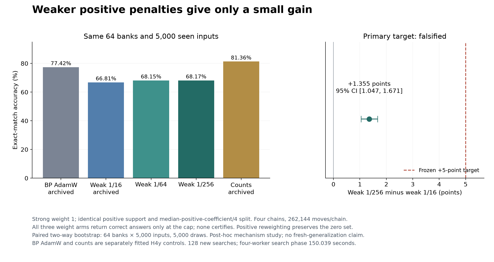

# H4z: weaker positive penalties give a small gain, below the frozen target

**The ≥5-point improvement hypothesis is falsified.** Changing weak weights from 1/16 to 1/256 raises exact-match accuracy from 66.8116% to 68.1663%, a gain of **1.3547 points**, with paired 95% interval **[1.0466, 1.6706]**. This is a mechanism study on all 64 H4y fits and the same already-seen 5,000 puzzles, not a fresh-data confirmation.

| Method | Exact-match accuracy (%) | Correct certified (%) | Correct capped (%) | Invalid certificates |
|---|---:|---:|---:|---:|
| BP AdamW, inherited separately fitted H4y control | 77.4172 | See H4y | See H4y | See H4y |
| Weak weight 1/16, archived H4y | 66.8116 | 0 | 66.8116 | 0 |
| Weak weight 1/64 | 68.1516 | 0 | 68.1516 | 0 |
| Weak weight 1/256 | 68.1663 | 0 | 68.1663 | 0 |
| Restricted counts, inherited separately fitted H4y control | 81.3600 | See H4y | See H4y | See H4y |

The 1/64 comparison is descriptive: gain 1.3400 points, paired interval [1.0262, 1.6500]. Both new arms reuse exactly the positive support and median-positive-coefficient/4 split from H4y. Strong weights remain one. The 64 independently sampled source banks each contain 600 noisy training boards; λ remains 1/30,000. No geometry or test labels enter weight assignment. The BP AdamW and restricted-count controls have different fitted supports and are inherited, not rerun or matched-training-cost controls.

All arms use the same 5,000 official rows [410000,415000), search seed zero, four chains, 262,144 moves per chain, temperature 0.4→0.31, focus threshold 0.45 and stopping tolerance 0.001. These are 64 bank draws sharing the same inputs, not 320,000 independent test examples. Intervals use 5,000 paired two-way bank/input bootstrap draws; primary seed 20261116031, descriptive seed 20261116032. The two intervals are marginal, not simultaneous.

**None of the three weak-weight arms produced any certified stop.** Their correct returns all came at the cap. The zero-invalid-certificate empirical condition is therefore vacuous. Every true Sudoku edge remains positive, which separately establishes soundness of any zero-energy state under these supports. Positive reweighting cannot enlarge their zero sets. None of the 320,000 bank/input canonical targets has zero learned energy; 231,717 (72.4116%) already have a positive conflict between fixed clues. The experiment changes search behavior, not certificate feasibility.

Weights are represented by unsigned integer numerators over 256 and converted to float32 before division. The smallest positive energy, 1/256, exceeds the 0.001 stop tolerance. Independent integer fields, energies and focused-cell flags agree with the GPU states, including 127 unrefreshed moves. Four prefix gates each check three weight levels plus six single-conflict fixtures: unavoidable positive energy never certifies, while zero energy certifies. Each new search also checks 150 general/sparse state values and 132 hidden-target-independent state values. The public gate receipts are linked below.

The 128 new searches are deduplicated only by complete float32 weights with inputs, settings and seed fixed. All 64 archived baseline searches retain their original identities. The separate CPU auditor reconstructs all weights and checks every returned board, clue, exact/valid flag, integer stopping energy, searched model and receipt hash: **960,000 unique search/input outcomes** in total. It also verifies archived outcome identity and certified/capped decomposition. Public packed outcomes allow every reported accuracy and interval to be recomputed without the large board archives; they do not replace the full raw-board validity audit.

The four-worker numerical phase took **4.320 seconds**, and the four-worker search phase **150.039 seconds**, within the frozen 45/255-second ceilings. Their combined elapsed-time envelope is **10.291 GPU-minutes** across four devices; this is an allocation envelope, not a sum of kernel durations. Live samples record advancing job/move counters and productive GPU use. All raw results and source hashes are retained, including this negative result.

[Frozen protocol](weak_weight_study.json) · [Runner](weak_weight_study.py) · [Independent full audit](audit_weak_weight_study.py) · [Public verifier](verify_weak_weight_study.py) · [Summary and packed outcomes](../../../results/research/foureyes/weak_weight_study/) · [H4y controls](REPORT-canonical-confirm.md)
