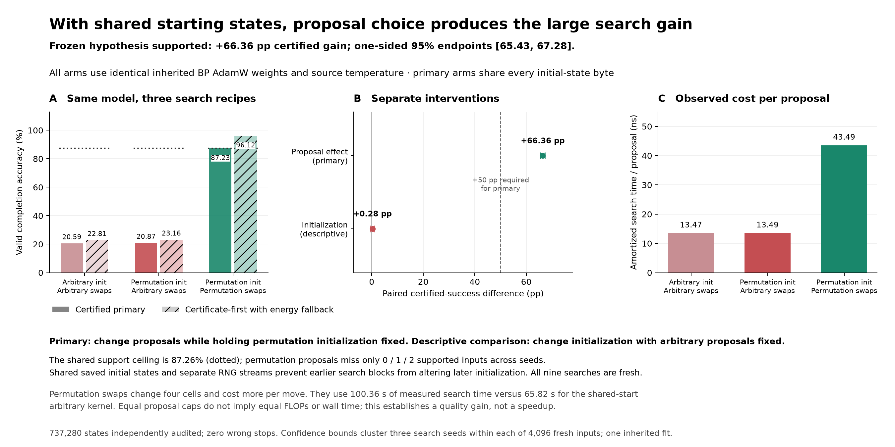

# H3aa: proposal choice, conditional on identical initialization, explains the large gain

**The frozen ≥50-point proposal-effect hypothesis is supported.** With byte-identical permutation initial states, changing arbitrary-cell proposals to permutation proposals raises certified success from **20.874023% to 87.231445%**. The paired gain is **66.357422 percentage points**, with one-sided 95% bootstrap endpoints **[65.429281, 67.277018]**. All three arms have zero wrong stopped chains, and the numerical audit passes.

Changing initialization alone, while retaining arbitrary-cell proposals, gives a descriptive **+0.284831-point** difference, with endpoints **[−0.480550, 1.107178]**. This does not demonstrate a substantial initialization benefit and is not an equivalence proof. The large gain persists when initialization is held fixed.

| Method, all using the same BP AdamW weights | Certified primary (%) | Original / certificate-first fallback (%) | Coverage (%) | Wrong stopped chains |
|---|---:|---:|---:|---:|
| Arbitrary initialization; arbitrary-cell swaps | 20.589193 | 22.810872 | 7.394213 | 0 |
| Permutation initialization; arbitrary-cell swaps | 20.874023 | 23.160807 | 7.467288 | 0 |
| Permutation initialization; permutation swaps | **87.231445** | **96.118164** | **82.770432** | 0 |

The primary returns any independently valid exact zero-conflict stopped completion among 20 chains and otherwise abstains. Fallback accuracy and distinct-solution coverage are secondary. Scores average search seeds 0/1/2; wrong stops sum over seeds. Original lowest-running-energy and certificate-first selectors have identical accuracy counts here. Independent re-selection using recomputed exact energies also leaves every per-seed accuracy count unchanged.

H3w changed initialization and proposals together. This adaptive follow-up separates them with a third arm on a fresh cohort. The primary comparison changes **only the proposal intervention, conditional on the same saved permutation starts**. Its control may subsequently leave the permutation state space, whereas permutation proposals preserve rows and columns. The descriptive middle-versus-first comparison changes initialization while keeping arbitrary-cell proposals. The findings isolate these declared recipe interventions; they do not identify a unique microscopic explanation involving barriers, mixing or individual coefficients.

Every arm copies the same frozen positive BP AdamW energy, including J, h, F, q and unit. The model NPZ SHA is **e893ff379d9394e8437c7c778a45a4d7d0ea57a2587116d42b959e864d96e84a**. There is no refit, support edit, weight change or source-temperature recalibration. The repulsive support F still contains all 3,808 true target attack pairs and 308 false exclusions; unary coefficients and off-support coefficients remain zero. The unit stays **3.0367188453674316**, including source row/column contributions even though those conflicts vanish on permutation states. All searches use

\[
T(k)=3.0367188453674316\,0.01^{k/19999},\qquad k=0,\ldots,19999,
\]

20 chains and a 20,000-proposal cap. Stopping requires an **exact integer zero count of occupied F-edges**, including given–given pairs. No floating energy threshold controls certification.

Initialization is generated once per kind and search seed with a dedicated CPU Torch generator seeded **2026112600 + search seed**. Arbitrary initialization uniformly ranks nongiven cells and adds enough to reach q=13. Permutation initialization assigns randomly ordered unused columns to nongiven rows while preserving all clues. The full initialization arrays are saved, hashed and independently regenerated before launch. Both primary arms load exactly the same saved permutation file for each seed. Proposal generators separately reset to search seeds **0/1/2**. Therefore the second search block's initial states cannot depend on how many random numbers the first block consumed. This split-stream convention applies to all three arms; there is no claim of trajectory identity with historical H3w searches.

The unchanged arbitrary proposal removes one occupied nongiven cell and fills one empty cell. The permutation proposal exchanges the queen columns in two nongiven rows. Their Metropolis rules and conflict updates are copied from the frozen H3v and H3w backends. Only optional explicit initial-state injection is added. Source gates confirm **identical transition-loop syntax trees** and exact legacy output/trace parity when initialization is omitted, including multiple blocks. Explicit-start traces independently check q, givens, fields, full energy and integer conflict counts; permutation traces additionally preserve every row and column. CPU and CUDA gates check 72 explicit initial states each, with 4,549 CPU and 4,494 CUDA traced transitions. The earlier exhaustive permutation, initialization-support and detailed-balance gates remain hash-pinned because the transition loops are unchanged.

Source-only N12 feasibility pilots use 128 inputs, 20 chains and 2,000 steps for each arm. The three CUDA pilots took **0.563849, 0.564547 and 1.256886 seconds**. Shared permutation initial hashes match for the two primary kernels. No target data or outcomes enter these gates. Only after both gates pass are the new target cohort and its initialization files generated; independent preflight reconstructs every input draw and every saved initial-state byte.

The cohort uses seed **2026112514**, excludes all **34,816** prior N13 search keys, and draws 4,096 inputs from 165,409 eligible keys. It contains **2 one-clue, 205 two-clue and 3,889 three-clue inputs**, with **15,152** compatible completions. All nine model–seed searches are actual fresh runs. The data SHA is **f90fb39c8b2244c2f2817910a36c00c074de0250d982ab475b4a8a55bdcbc989**. Confidence bounds use 2,000 paired input resamples, RNG 20261114, retaining all three search seeds inside each input cluster. There is one inherited fitted model and complete source universe; the search seeds are not independent training replicas.

All three arms share the same exact support capacity: **1,548/1,932** complete target solutions, **3,574/4,096** inputs and **12,070/15,152** compatible completions admit zero-conflict answers. The abstaining primary ceiling is **87.255859375%**. Of 522 unsupported inputs, 121 already contain a false F-conflict between their givens. Permutation proposals miss only **0, 1 and 2** supported inputs under seeds 0, 1 and 2. Their fallback returns correct answers on **364, 364 and 362** unsupported inputs, respectively; those answers are independently target-valid but remain uncertified under F. The certified ceiling does not bound fallback accuracy.

| Method, all using the same BP AdamW weights | Proposed swaps, all seeds | Accepted swaps | Measured search seconds | Amortized ns per proposal |
|---|---:|---:|---:|---:|
| Arbitrary initialization; arbitrary-cell swaps | 4,878,618,016 | 170,851,386 | 65.732127 | 13.474 |
| Permutation initialization; arbitrary-cell swaps | 4,878,468,711 | 167,793,578 | 65.821382 | 13.492 |
| Permutation initialization; permutation swaps | 2,307,499,133 | 378,830,407 | 100.359038 | 43.493 |

Permutation proposals change four cells and cost more per move. They perform fewer moves because more chains stop, yet use more measured search time than the shared-start arbitrary kernel. These are amortized batched GPU measurements, not serial move latency. Equal proposal caps do **not** imply equal FLOPs or wall time. The result demonstrates a quality gain for the declared recipes and budgets, not a speedup or equal-compute advantage.

The final audit checks all **737,280 saved states** against exhaustive target membership, givens, q, exact conflict counts, both output selectors, coverage and cap counters. All permutation-kernel outputs have exactly one queen per row and column. Every stopped state has zero reconstructed conflict count and zero exact energy. The maximum running-energy error is **0.001905203**, below the frozen 0.1 diagnostic threshold. Every cap return is retained. Per-seed initial-file and unpacked-array hashes match across the primary arms.

The campaign completes in **234.357562 aggregate GPU-worker seconds**, within the shared 600-second wall deadline and 20 GPU-minute envelope. Live checks show productive work on both Loki GPUs at 66%/66% and later 76%/89%; job receipts confirm progression through all nine jobs. The final single-job tail lasts 12.376 seconds. Both GPUs are idle after all jobs finish. Source pilots are reported separately; no filler jobs, duplicated searches or outcome mappings are used.

[Frozen protocol](protocol.json), [adapter construction](build_adapters.py), [arbitrary kernel](arbitrary_backend.py), [permutation kernel](permutation_backend.py), [shared initialization](initialization.py), [source gates](gate.py), [cohort preparation](prepare.py), [independent preflight](preflight.py), [bounded runner](driver.py), [full audit](analyze.py), [tracked summary](../../../../results/research/loki/h3aa/summary.json), [per-seed counts](../../../../results/research/loki/h3aa/per_seed.csv), [exact per-input capacity](../../../../results/research/loki/h3aa/per-input-capacity.npz), [figure provenance](../../../../results/research/loki/h3aa/plot-provenance.json).
