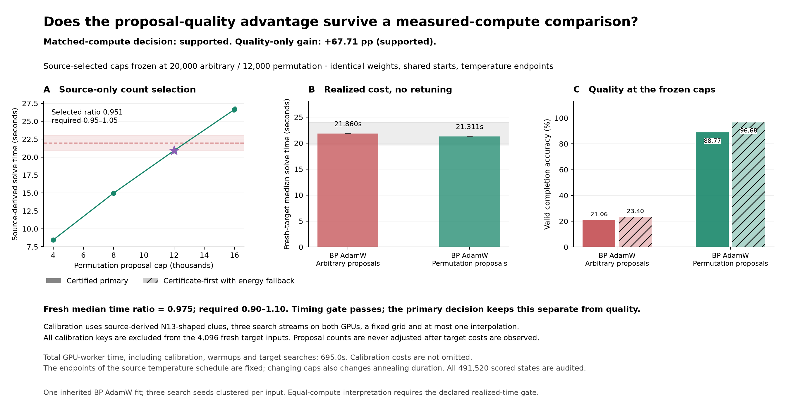

# H3ab: the proposal-quality gain persists at matched measured solve time

**Both the frozen matched-compute and quality hypotheses are supported.** At source-selected caps of **20,000 arbitrary-cell proposals versus 12,000 permutation proposals**, certified success is **21.061198% versus 88.769531%**. The gain is **67.708333 percentage points**, with one-sided 95% bootstrap endpoints **[66.788330, 68.563232]**, exceeding the required 50 points. Both arms have zero wrong stopped chains and pass the numerical audit.

Fresh-target median solve times are **21.859988 seconds versus 21.311479 seconds**, a permutation/arbitrary ratio of **0.974908**. This passes the frozen **0.90–1.10** matching gate without any target retuning. The quality gain therefore persists at comparable measured solve time for this hardware, model, cohort and declared recipe. It is not a claim of equal FLOPs or a general speedup across hardware.

| Method, same BP AdamW weights and permutation starts | Proposal cap | Certified primary (%) | Original / certificate-first fallback (%) | Coverage (%) | Fresh median solve seconds | Wrong stops |
|---|---:|---:|---:|---:|---:|---:|
| Arbitrary-cell proposals | 20,000 | 21.061198 | 23.404948 | 7.361008 | 21.859988 | 0 |
| Permutation proposals | 12,000 | **88.769531** | **96.679688** | **82.273538** | **21.311479** | 0 |

H3aa isolated the proposal intervention using identical starting states, but equal proposal caps did not give equal compute: permutation search took more time. H3ab chooses a fixed permutation cap using source-derived timing workloads, seals that choice, then tests the two recipes on fresh targets. The original frozen positive BP AdamW J, h, F, q and unit are unchanged; there is no fit, support change, reweighting or temperature recalibration.

Calibration uses **4,096 unique N13-shaped clue inputs derived from the 176 complete N12 source boards**. Source cell (r, c) is embedded at N13 cell 13r+c. The program enumerates unique one-, two- and three-clue subsets and draws **2, 205 and 3,889** inputs of those types, respectively, using seed **2026112602**. It does not use target labels or target accuracy to select counts. Every calibration key is excluded from the later target cohort.

The frozen protocol's no-target-access wording requires one clarification: the shared integrity guard **reads historical target artifact bytes to verify SHA-256 hashes**. Calibration does not decode those target arrays, keys or labels and does not compute target accuracy. Thus “source-only” describes the information used for calibration, not filesystem isolation. The original protocol and receipts remain unchanged; the [access note](CALIBRATION_ACCESS_NOTE.md) records this distinction explicitly.

The arbitrary reference uses 20,000 proposals. The fixed permutation grid is **4,000, 8,000, 12,000 and 16,000** proposals. Each configuration runs streams **101/102/103 on both physical Loki GPUs**, giving six balanced timing measurements. Configuration order reverses by GPU and stream index. Each kernel receives exactly the same complete saved permutation initialization for a given stream. The source timing measurements are:

| Method, same BP AdamW model | Cap | Median solve seconds | Minimum–maximum seconds | GPU 0 median | GPU 1 median |
|---|---:|---:|---:|---:|---:|
| Arbitrary proposals, reference | 20,000 | 21.975317 | 21.926630–22.091955 | 21.934489 | 22.041221 |
| Permutation proposals | 4,000 | 8.446657 | 8.381269–8.501491 | 8.407510 | 8.500660 |
| Permutation proposals | 8,000 | 14.985678 | 14.896775–15.102167 | 14.899381 | 15.089605 |
| **Permutation proposals, selected** | **12,000** | **20.906519** | **20.734927–21.079635** | **20.754931** | **21.048839** |
| Permutation proposals | 16,000 | 26.637290 | 26.436153–26.864730 | 26.496644 | 26.814237 |

The selector minimizes absolute relative deviation from the reference median, with ties favoring the smaller cap. The selected ratio is **0.951364**, passing the prespecified **±5% point-median gate**. No interpolation is needed. The protocol permitted only one deterministic interpolated count if the grid failed, followed by a stop if that count still failed; no additional tuning was available.

The source timing uncertainty is visible. A 2,000-draw bootstrap over the three streams, retaining both devices inside each stream, gives 5th/95th ratio endpoints **[0.949337, 0.952639]**. The lower endpoint is slightly outside the 0.95 matching boundary. The declared selection gate uses the measured point median, not that interval. Six timings represent **three search streams repeated on two devices**, not six independent learning replicas. All individual timings and counters are retained in the tracked calibration receipt.

The selected counts were sealed before fresh target reservation. The calibration-selection SHA is **a428e3cf217c17c1063d5c6486c782badfc73650265b1e2cb013bba5f306fcc1**. Both recipes keep source unit **u=3.0367188453674316** and temperature endpoints, but their schedules are

\[
T(k)=u\,0.01^{k/(\mathrm{cap}-1)}.
\]

Changing cap therefore also changes annealing duration; this is explicitly part of the matched-compute recipe. The comparison does not claim to vary proposal type while holding the entire temperature-versus-proposal trajectory fixed.

The new target cohort uses seed **2026112515**, excludes **38,912 prior search keys plus all 4,096 calibration keys**, and draws from 158,058 eligible inputs. It contains **4 one-clue, 214 two-clue and 3,878 three-clue inputs**, with **15,604** compatible completions. There is zero overlap with either exclusion set. The data SHA is **8fe9c8052803eaa260ea4e30b99118503b293a2fe9cfaeaff0dcbefa3de4027d**. The two arms share saved initial bytes for every input, chain and seed, use 20 chains and search seeds 0/1/2, and stop only at an exact integer zero count of occupied F-edges, including given–given pairs.

Target assignments cross over the physical GPUs: GPU 0 runs arbitrary seed 0, permutation seed 1 and arbitrary seed 2; GPU 1 runs the complementary jobs. There are **six scored searches** and **six unscored 32-proposal warmups**. Warmups do not contribute accuracy outcomes or count selection. Both calibration and target measurements synchronize the GPU before and after the complete solve call, including transfer of initial states and returned CPU arrays. Output validity scoring and serialization are outside solve-call timing but inside aggregate worker cost. Calibration has four full-shape warmups before its timed trials. All warmup costs count toward the study budget.

| Fresh-target compute, same BP AdamW model | Arbitrary proposals | Permutation proposals |
|---|---:|---:|
| Solve time range, seconds | 21.844127–21.932028 | 21.230747–21.311698 |
| Median solve seconds | 21.859988 | 21.311479 |
| Total measured solve seconds, three seeds | 65.636143 | 63.853924 |
| Proposed swaps | 4,878,390,042 | 1,667,232,998 |
| Accepted swaps | 167,771,779 | 242,374,974 |
| Amortized ns per proposal | 13.454 | 38.299 |
| Capped chains | 242,699 | 106,345 |

The frozen fresh-time gate uses the ratio of the two three-seed medians. It passes at 0.974908. Had the fresh ratio fallen outside 0.90–1.10, the matched-compute conclusion would have been inconclusive even if the quality gain remained large. Target costs were reported without retuning. Confidence bounds for quality use 2,000 paired input resamples, RNG 20261114, keeping all three search seeds inside each input cluster. The model is one inherited source fit; neither timing repeats nor search seeds are independent training draws.

The unchanged F support permits **1,548/1,932** complete target solutions and **3,640/4,096** fresh inputs, with **12,560/15,604** compatible completions. The abstaining certified ceiling is **88.8671875%**. Of 456 unsupported inputs, 88 contain a false F-conflict between their givens. Permutation proposals miss **3, 3 and 6** supported input cases across seeds. Their correct fallback answers on **324, 321 and 324** unsupported inputs are target-valid but remain uncertified under F. The support error is unchanged.

The independent audit checks all **491,520 scored target states** for exhaustive target membership, q, givens, exact conflict counts, output selectors, coverage, cap limits and per-seed shared initialization identities. Every permutation output preserves rows and columns. Every stopped state has zero reconstructed conflict count and zero exact energy. The maximum running-energy discrepancy is **0.001168966**, below the frozen 0.1 limit. Recomputing selection with exact energies leaves every per-seed fallback accuracy count unchanged. All cap returns are retained.

The full cost is **694.981729 aggregate GPU-worker seconds**: **561.060409 seconds for calibration workers** and **133.921320 seconds for fresh target workers**. Timed source calls total 557.906172 seconds; calibration warmups total 1.744536 seconds; target warmups total 1.870707 seconds. The remaining worker time includes loading, checks, scoring and serialization. Calibration is a substantial one-time overhead and is not silently amortized out of the total experiment cost. The matched-time endpoint concerns the scored solve calls after calibration, not the total cost of developing the recipe.

One shared 600-second wall deadline covers calibration, preparation gaps, target workers and warmups; no new target-phase deadline is created. The campaign finishes after **381.597678 wall seconds**, with total worker time below the 20 GPU-minute envelope. Live checks show calibration at 80%/73% and 79%/77% GPU utilization, then fresh searches at 81%/89%, with completed-trial proposal counts confirming forward progress. The last target workers finish less than half a second apart. Both GPUs are idle after completion.

[Frozen protocol](protocol.json), [calibration and fixed selector](calibration.py), [shared budget helpers](common.py), [fresh-data preparation](prepare.py), [target runner](driver.py), [independent audit](analyze.py), [access clarification](CALIBRATION_ACCESS_NOTE.md), [tracked summary](../../../../results/research/loki/h3ab/summary.json), [complete calibration receipt](../../../../results/research/loki/h3ab/calibration-selection.json), [per-seed scores and costs](../../../../results/research/loki/h3ab/per_seed.csv), [per-input capacity](../../../../results/research/loki/h3ab/per-input-capacity.npz), [figure provenance](../../../../results/research/loki/h3ab/plot-provenance.json).
