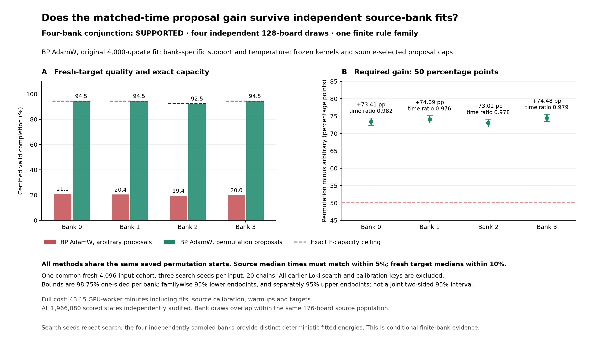

# H3ac: independent source-bank fits at source-calibrated compute

**The prespecified all-four-bank conjunction is supported.** This study draws four separate 128-board banks from the complete 176-board N12 queen-plus-camel population, refits the original grouped BP AdamW recipe independently for each bank, and compares fixed permutation proposals with arbitrary-cell proposals on the same fresh 4,096-input N13 cohort.

The primary requires at least a 50-percentage-point certified-success gain for **every** bank, zero wrong stops, a passed numerical audit, source median solve times within ±5%, and fresh-target median solve times within ±10%. The kernels, initialization, fitting recipe, temperature endpoints, selection rule, cohort seed and budget were frozen before drawing any bank. There is no target tuning, bank replacement or failed-outcome removal.

| Bank | BP AdamW method | Proposal cap | Certified primary (%) | Certificate-first fallback (%) | Coverage (%) | Median solve seconds | Wrong stops |
|---|---|---:|---:|---:|---:|---:|---:|
| 0 | BP AdamW arbitrary | 20,000 | 21.061198 | 22.265625 | 7.185948 | 21.896932 | 0 |
| 0 | BP AdamW permutation | 12,000 | 94.474284 | 99.414062 | 86.797531 | 21.504806 | 0 |
| 1 | BP AdamW arbitrary | 20,000 | 20.402018 | 21.793620 | 7.072254 | 21.923917 | 0 |
| 1 | BP AdamW permutation | 12,000 | 94.490560 | 99.454753 | 86.918186 | 21.402067 | 0 |
| 2 | BP AdamW arbitrary | 20,000 | 19.449870 | 20.890299 | 6.714929 | 21.928752 | 0 |
| 2 | BP AdamW permutation | 12,000 | 92.472331 | 98.177083 | 85.463363 | 21.442670 | 0 |
| 3 | BP AdamW arbitrary | 20,000 | 20.003255 | 21.085612 | 6.682445 | 21.930294 | 0 |
| 3 | BP AdamW permutation | 12,000 | 94.482422 | 99.422201 | 87.103810 | 21.469624 | 0 |

| Bank | Permutation gain (pp) | 98.75% one-sided lower / upper endpoints (pp) | Quality decision | Fresh time ratio | Matched-compute decision |
|---|---:|---:|---|---:|---|
| 0 | 73.413086 | 72.355143 / 74.479167 | supported | 0.982092 | supported |
| 1 | 74.088542 | 73.071187 / 75.146484 | supported | 0.976197 | supported |
| 2 | 73.022461 | 71.915690 / 74.112956 | supported | 0.977834 | supported |
| 3 | 74.479167 | 73.429362 / 75.537109 | supported | 0.978994 | supported |

The 8,000-draw paired-input bootstrap uses RNG 20261114 and retains all three search seeds within each input cluster. The 1.25th and 98.75th percentiles are **98.75% one-sided endpoints per bank**. Bonferroni adjustment gives familywise 95% lower endpoints across the four banks and, separately, familywise 95% upper endpoints. They are **not simultaneous 95% two-sided intervals**. These intervals measure target-input uncertainty conditional on each fitted model; they do not turn four bank draws into a population-level guarantee over future training sets.

Each bank is sampled without replacement internally, with independent draw seeds 2026112700–2026112703. The banks share 93–97 of their 128 records in pairwise comparisons. They are independent random subsets conditional on the same finite population, rather than independent rule families. All four fitted weight arrays differ; banks 0, 1 and 3 share the same F support, while bank 2 has a second support. Search seeds 0/1/2 repeat search and are not optimizer or source-bank replicas.

| Bank | Observed-zero source offsets | Retained source F offsets | Source native minimum margin | Source temperature unit | False / missed target F pairs | Source fit seconds |
|---|---:|---:|---:|---:|---:|---:|
| 0 | 69 | 52 | 3.611705 | 3.148997307 | 220 / 0 | 1.455440 |
| 1 | 65 | 52 | 3.779014 | 3.152597189 | 220 / 0 | 1.840706 |
| 2 | 66 | 53 | 3.885491 | 3.124283075 | 242 / 0 | 1.349160 |
| 3 | 64 | 52 | 3.988178 | 3.165217876 | 220 / 0 | 1.374297 |

All banks infer the same four primitive lines and use 224 grouped couplings plus one shared unary. Source counts, marginals, exposure, lines and grouping are recomputed from each bank. F retains zero-count finite offsets whose marginal exposure is at least ln(264/0.01), together with the inferred lines. The positive-F derivative keeps learned positive coefficients on that support, sets unary/off-support weights to zero, extends lines to N13 and gives newly representable off-line offsets zero weight. Its temperature unit is the float32 mean coefficient across unique retained canonical **source** offsets. This derivative is distinct from the native soft BP AdamW energy.

Each fit uses zero initialization, 4,000 AdamW updates, learning rate 0.3 with the original cosine denominator 4,000, decay 0.01, betas (0.9,0.999), epsilon 1e-8, float32, TF32 disabled and no preconditioner. The hash-pinned H3u PL function exactly aggregates all 298 one/two/three-clue subsets per source board: occupied free-cell multiplicity 231 and empty-cell multiplicity 298. All four fits pass finite-parameter, positive native-margin, positive retained-weight and transferred-edge gates. Literal expanded-clue losses/gradients and actual-bank CPU/GPU gradients were checked before fitting; all source counts, exposure, grouping and transferred weights were independently reconstructed.

For each bank, source calibration embeds its N12 source boards into N13 coordinates and samples 4,096 unique clue inputs: 2 one-clue, 205 two-clue and 3,889 three-clue inputs, with seeds 2026112710–2026112713. Calibration opens no target data arrays, keys or labels and computes no target accuracy. Its integrity guard checks source files and source-only historical validation receipts; target artifact hashes are checked only in the later target phase. Every new calibration key, including overlaps and any failed-bank keys, enters the target exclusion union.

The reference cap is 20,000 arbitrary proposals; the fixed permutation grid is 8,000/12,000/16,000. Each configuration runs source streams 101/102/103 on both physical GPUs, with reversed configuration order by GPU and stream parity. Selection minimizes absolute relative median-time error, ties favoring the smaller cap. The protocol permits one deterministic interpolation, rounded to a multiple of 128, only if the fixed grid misses ±5%; it forbids extrapolation or further adjustment. Each chosen cap and full timing receipt is sealed before any common fresh target is reserved.

| Bank | Selected permutation cap | Source arbitrary / permutation median seconds | Source ratio | Source ratio 5th/95th bootstrap endpoints | Interpolation |
|---|---:|---:|---:|---:|---|
| 0 | 12,000 | 21.998083 / 21.030476 | 0.956014 | 0.955122 / 0.956139 | False |
| 1 | 12,000 | 22.022110 / 20.938539 | 0.950796 | 0.949134 / 0.951749 | False |
| 2 | 12,000 | 22.063424 / 20.987257 | 0.951224 | 0.950739 / 0.952892 | False |
| 3 | 12,000 | 22.050789 / 20.973077 | 0.951126 | 0.950783 / 0.953741 | False |

The source matching gate is a point-median gate, separate from its uncertainty. The source bootstrap resamples three streams while retaining both devices per stream; six timings are not six independent learning or search draws. All individual source timings, proposals and acceptances are retained in the tracked calibration export. The schedule is T(k)=u·0.01^(k/(cap−1)); varying the cap changes annealing duration while keeping bank-specific endpoints fixed. Thus this compares declared matched-compute recipes, not proposal type at an identical proposal-index schedule.

The fresh target cohort uses seed **2026112516**, excludes **46,485** historical search/calibration keys plus the union of **12,924** new calibration keys, and draws from **145,436** remaining inputs. The exclusion union has 55,504 distinct keys. The cohort has 2 / 205 / 3889 one/two/three-clue inputs, 14,954 compatible completions, and zero overlap with the exclusion union. Data SHA: `b08df2705067216b2129fd3e12aac7f196a28abd7282252ec3d69db4d53cd528`.

Every bank and method receives the same complete saved permutation initialization for each input/chain/search seed. The initializer uses a separate CPU stream; GPU proposal generators are reset separately. There are 20 chains and seeds 0/1/2. Physical-device crossover is preserved for every bank. The strict certificate is an exact integer zero count of occupied F edges, including given–given pairs, with q=13 preserved. Independently valid stopped outputs define the abstaining primary. Certificate-first energy fallback and distinct-solution coverage remain secondary.

| Bank | Inputs with valid zero-F completion / 4,096 | Certified ceiling (%) | Compatible zero-F / all completions | Complete zero-F / 1,932 target solutions | Given-given F conflicts |
|---|---:|---:|---:|---:|---:|
| 0 | 3872 | 94.531250 | 13531 / 14954 | 1748 | 37 |
| 1 | 3872 | 94.531250 | 13531 / 14954 | 1748 | 37 |
| 2 | 3791 | 92.553711 | 13085 / 14954 | 1692 | 50 |
| 3 | 3872 | 94.531250 | 13531 / 14954 | 1748 | 37 |

These are exact exhaustive capacity ceilings for the certified primary only. Valid fallbacks can lie outside the zero-F set. Every model contains all 3,808 true target attack pairs but also false exclusions, so this study tests search quality without solving support identification. More bank draws or successful searches cannot remove those structural limits.

The independent audit checks all **1,966,080 scored target states** against exhaustive target membership, q/givens, output selectors, distinct coverage, proposal/acceptance limits, full integer conflict counts and direct float64 energies. All permutation outputs preserve rows and columns. There are **0 wrong stopped chains**; every stopped state has exact zero conflict count and exact zero energy. Maximum running-energy error is **0.001503944**, below the frozen 0.1 gate. Exact-energy reselection changes certificate-first correct counts in **0 of 24** scored jobs; individual outcomes remain in the tracked diagnostics. All capped outputs remain in the analysis.

Total GPU-worker cost is **2589.071593 seconds (43.151 GPU-minutes)**, and whole-study elapsed wall time is **1308.083163 seconds**. The four timed fits total 6.019604 seconds. Worker costs by phase are fit: 9.634820s, grid: 2042.793090s, target: 536.643683s. Every fit/loss validation, source grid/refinement, warmup and target worker is charged. CPU input preparation preceded the first fit; the single 1,800-second wall deadline then remained in force, with no reset and a 3,600 aggregate GPU-worker-second ceiling.

Calibration and target solve timings both synchronize before/after the complete solve call, including transfers and returned CPU arrays. Validity scoring and serialization are outside solve-call timing but inside worker cost. Source calibration performs both-kernel full-shape 32-proposal warmups per phase; every scored target search has a separate unscored 32-proposal warmup. Source calibration is a substantial experimental overhead, included in total costs rather than amortized away. The matched-time endpoint concerns scored solve calls, not equal end-to-end cost to develop the recipes.

All four banks come from one finite rule family, and their incomplete banks do not inherit the completeness-derived negative evidence of H3x. These results are conditional finite-bank research evidence for the fixed positive-F derivative and this hardware/cohort, not a reproduction claim for the original paper or a claim over arbitrary future rule families. Fresh timing failures, if present, remain inconclusive matched-compute outcomes even when quality improves; no target cap is adjusted.

[Frozen protocol](protocol.json), [source banks and fitting](source.py), [calibration](calibration.py), [campaign queue](campaign.py), [fresh cohort](prepare.py), [target runner](driver.py), [independent audit](analyze.py), [tracked summary](../../../../results/research/loki/h3ac/summary.json), [per-seed scores/costs](../../../../results/research/loki/h3ac/per_seed.csv), [all calibration receipts](../../../../results/research/loki/h3ac/calibration-selections.json), [source draws](../../../../results/research/loki/h3ac/source-banks.json), [per-input capacity](../../../../results/research/loki/h3ac/per-input-capacity.npz), [figure provenance](../../../../results/research/loki/h3ac/plot-provenance.json).
