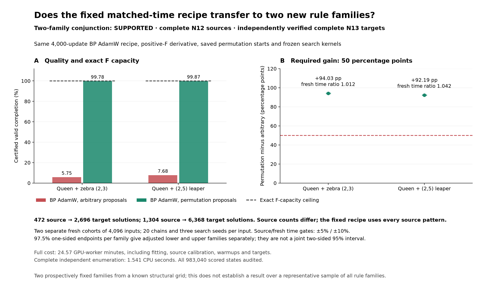

# H3ad: the fixed search recipe on two new rule families

**The frozen two-family conjunction is supported.** The study extends the positive-F BP AdamW search comparison to two fixed new families: ordinary queens plus a zebra leaper (2,3), and ordinary queens plus a (2,5) leaper. Each uses its complete N12 source bank, the unchanged 4,000-update fit, and source-calibrated arbitrary versus permutation proposals on a fresh N13 cohort. No families are replaced or chosen using target search results.

| Family | Complete N12 source boards | Complete N13 target boards | Source/target completeness | Decision |
|---|---:|---:|---|---|
| queen-plus-zebra | 472 | 2,696 | Independently verified | supported |
| queen-plus-2-5-leaper | 1,304 | 6,368 | Independently verified | supported |

The primary requires **both** families to gain at least 50 percentage points in abstaining valid certified success, with zero wrong stopped chains, a passed numerical audit, source median solve times within ±5%, and fresh median solve times within ±10%. Failed source eligibility, calibration, numerical checks and timing gates remain outcomes. A timing failure is inconclusive for the matched-compute claim even if quality improves. There is no target cap adjustment.

| Family | Method | Cap | Certified primary (%) | Certificate-first fallback (%) | Valid coverage (%) | Median solve seconds | Wrong stops |
|---|---|---:|---:|---:|---:|---:|---:|
| queen-plus-zebra | BP AdamW arbitrary | 20,000 | 5.745443 | 5.745443 | 1.627446 | 21.415315 | 0 |
| queen-plus-zebra | BP AdamW permutation | 11,264 | 99.780273 | 99.780273 | 86.705437 | 21.666458 | 0 |
| queen-plus-2-5-leaper | BP AdamW arbitrary | 20,000 | 7.682292 | 7.682292 | 1.244745 | 21.517777 | 0 |
| queen-plus-2-5-leaper | BP AdamW permutation | 12,000 | 99.869792 | 99.869792 | 82.301322 | 22.415480 | 0 |

| Family | Gain (pp) | 97.5% one-sided lower / upper endpoints (pp) | Quality decision | Fresh time ratio |
|---|---:|---:|---|---:|
| queen-plus-zebra | 94.034831 | 93.619792 / 94.449870 | supported | 1.011727 |
| queen-plus-2-5-leaper | 92.187500 | 91.691081 / 92.675781 | supported | 1.041719 |

The 8,000 paired-input bootstrap draws use RNG 20261114, retaining all three search seeds inside each input cluster. The 2.5th and 97.5th percentiles are 97.5% one-sided endpoints per family. Bonferroni adjustment gives familywise 95% lower endpoints over the two families and, separately, familywise 95% upper endpoints. They are not a simultaneous 95% two-sided interval. The two families are fixed choices from a previously studied N12 structural grid; no interval here estimates performance over a representative population of rule families.

The complete-universe gate took **1.541097 CPU seconds** and 1.542053 wall seconds under the frozen aggregate 120 CPU-second ceiling. A general future-row blocked-bit enumerator generated each N13 leaper family. An independent ordinary-queen three-bitmask enumerator produced all **14,200 N12** and **73,712 N13** queen boards; literal leaper-pair filtering exactly matched both known complete N12 sources and both new N13 target arrays. Unique boards and complete array equality were required. No partial universe was used.

Complete input preparation enumerates all 377 one/two/three-clue subsets per N13 solution and counts distinct keys. Vectorized generation agrees exactly with literal subset enumeration on the first 17 boards of each family. Input enumeration took 0.266627 CPU seconds and 0.266628 wall seconds. All CPU preparation, including source designs and source calibration inputs, took 5.800258 wall seconds and 11.072793 aggregate child CPU seconds, before the GPU deadline.

The model producer recomputes canonical source-offset counts, marginal exposures, primitive homogeneous zero-count lines and grouped coefficients from each complete source bank. It receives no family leaper rule. Each inferred line shares a coefficient; each remaining finite offset has its own; one shared unary is fitted. The unchanged hash-pinned H3u PL objective exactly aggregates 298 clue subsets per source board using occupied/empty free-cell multiplicities 231/298. Every source pattern receives equal weighting within its family. The two source counts differ (472 versus 1,304), so this is neither a matched-sample-count comparison nor two source-bank draws from a shared population.

BP AdamW uses zero initialization, 4,000 updates, learning rate 0.3 and the original cosine schedule denominator 4,000, decay 0.01, betas (0.9,0.999), epsilon 1e-8, float32, TF32 disabled and no preconditioner. Each family has a 120-second fit ceiling. Finite parameters, a positive native source margin and strictly positive retained/transferred F weights are required. Literal expanded-clue PL/gradient checks and actual-source CPU/GPU loss/gradient checks precede each fit; source counts, exposure, grouping and every transferred edge are independently reconstructed.

| Family index | Source retained F offsets | Source native minimum margin | Source temperature unit | Target true / false / missed F pairs | Fit seconds |
|---|---:|---:|---:|---:|---:|
| 0 | 48 | 4.147335 | 3.493975878 | 3768 / 0 / 0 | 1.823490 |
| 1 | 48 | 4.372948 | 3.547349930 | 3680 / 0 / 0 | 1.459696 |

The positive-F derivative retains zero-count finite source offsets whose marginal exposure is at least ln(264/0.01), union inferred lines. It keeps learned positive coefficients on F, zeroes unary/off-support weights, extends lines to N13, and assigns newly representable off-line offsets zero. Source temperature is the float32 mean learned coefficient across unique retained canonical source offsets. Its certificate is an exact integer zero count of occupied F edges, including given–given pairs, with q=13 preserved. This derivative differs from the native soft fitted energy.

Each family’s source calibration uses 4,096 unique N13-shaped inputs derived only from its N12 source bank: 2 one-clue, 205 two-clue and 3,889 three-clue inputs, seeds 2026112810/2026112811. The arbitrary reference cap is 20,000; the fixed permutation grid is 8,000/12,000/16,000. Source streams 101/102/103 run on both physical GPUs with balanced configuration order, yielding six timings per configuration. A fixed closest-median rule selects a cap within ±5%; at most one deterministic interpolated cap, rounded to a multiple of 128, is allowed. No extrapolation or additional tuning is available. Calibration does not open target arrays, keys or labels, and never computes target accuracy.

| Family index | Source selection status | Permutation cap | Source median ratio | Source ratio 5th/95th endpoints | Interpolation |
|---|---|---:|---:|---:|---|
| 0 | matched_source_median_times | 11,264 | 1.001351 | 1.000623 / 1.002212 | True |
| 1 | matched_source_median_times | 12,000 | 1.031554 | 1.030591 / 1.034484 | False |

The source point-median gate is separate from its uncertainty. The source bootstrap resamples three streams, keeping both devices per stream; six timings are not six independent learning replicas. All timing trials, proposals and acceptances are retained. Temperature follows T(k)=u·0.01^(k/(cap−1)); changed caps also change annealing duration, while endpoints remain source-fixed. Both source and target timings synchronize around the complete solve call, including transfers and returned CPU arrays. Output scoring/serialization are outside solve timing but inside worker cost.

| Family | Fresh cohort seed | Clue counts 1 / 2 / 3 | Eligible unique inputs | Excluded historical/calibration/new-family keys | Compatible completions | Data SHA |
|---|---:|---:|---:|---:|---:|---|
| queen-plus-zebra | 2026112517 | 1 / 136 / 3959 | 204,808 | 65,946 | 15,667 | `b61115636ccf7f46b6a43ab061e104a0800446513c5a2dd643a6c4cb8020c08c` |
| queen-plus-2-5-leaper | 2026112518 | 0 / 123 / 3973 | 237,424 | 70,042 | 29,871 | `cd9676b00b64fa86f25b5eef4dd6a427b860b86b62d75b46905bee216153ac22` |

All family caps/outcomes are sealed before cohort reservation. Each family excludes the entire final H3ac search/calibration exclusion history, H3ac’s own test keys, and the union of both new source-calibration key sets. The second family also excludes the first family’s newly reserved target keys. Cohorts therefore share no new target keys, and each has zero overlap with its full exclusion union. Every method within a family receives identical saved permutation starts for every input, chain and seed; there are 20 chains and search seeds 0/1/2. Initializer and GPU proposal random streams are separate. Physical-device assignment crosses methods/seeds on both GPUs.

| Family | Inputs with valid zero-F completion / 4,096 | Certified ceiling (%) | Compatible zero-F / all completions | Complete zero-F / full target bank | Given-given F conflicts |
|---|---:|---:|---:|---:|---:|
| queen-plus-zebra | 4096 | 100.000000 | 15667 / 15667 | 2696 / 2696 | 0 |
| queen-plus-2-5-leaper | 4096 | 100.000000 | 29871 / 29871 | 6368 / 6368 | 0 |

Exact capacity is a ceiling for the abstaining certified primary; it does not bound valid energy fallback accuracy. Fallback and distinct valid solution coverage include capped returns and remain secondary. Supplied family geometry enters only independent dataset generation and diagnostic/audit calculations, never model weights, temperature or cap selection.

All **983,040 scored states** were audited for complete target membership, q/givens, permutation invariants, exact integer conflict counts, output selection, coverage, cap limits and direct float64 energy. There are **0 wrong stopped chains**. Maximum running-energy error is **0.002732038**, below the frozen 0.1 gate. Exact-energy reselection changes correct certificate-first counts in **0 of 12** scored jobs; all per-seed diagnostics remain tracked.

Total GPU-worker time is **1474.365144 seconds (24.573 GPU-minutes)**, with whole-study elapsed GPU-phase wall time **749.252876 seconds**. The two timed fits total 3.283186 seconds. Worker time by phase: fit: 6.307320s, grid: 1066.186169s, refinement: 132.138110s, target: 269.733545s. The separate 900-second wall/1,800 aggregate-worker-second envelope starts only after H3ac releases both GPUs. Fit/loss validation, calibration/refinement, full-shape 32-proposal warmups and scored target workers all count. There is no deadline reset. CPU preparation overlaps H3ac, but H3ad GPU work does not overlap it.

Calibration is included in total experimental cost and is not silently amortized away. The matched-time endpoint concerns scored solve calls after source selection, not the end-to-end cost to develop a recipe. These two fixed families retain the queens permutation structure; they do not establish transfer to tasks where that supplied structure is absent. This is a research derivative of the fitted energy and a prospective extension of the previous experiments, not a new reproduction claim for the paper.

[Frozen protocol](protocol.json), [complete enumeration gate](generate.py), [source producer and fitting](source.py), [source calibration](calibration.py), [fresh cohorts](prepare.py), [target runner](driver.py), [independent audit](analyze.py), [tracked summary](../../../../results/research/loki/h3ad/summary.json), [calibration receipts](../../../../results/research/loki/h3ad/calibration-selections.json), [per-input capacity](../../../../results/research/loki/h3ad/per-input-capacity.npz), [figure provenance](../../../../results/research/loki/h3ad/plot-provenance.json).
