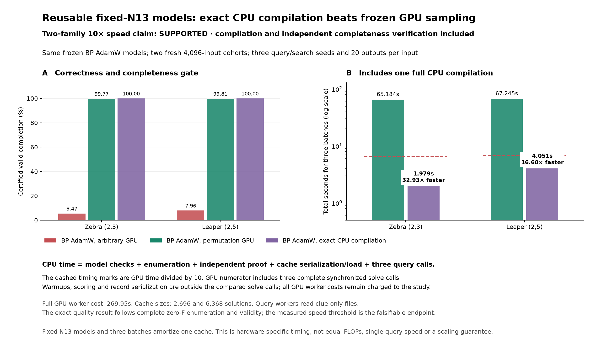

# H3ae: reusable fixed-N13 models, exact CPU compilation versus GPU search

**The prespecified two-family ≥10× speed claim is supported.** For the same two frozen N13 positive-F BP AdamW models, complete CPU zero-F compilation plus cache loading and three 4,096-input query calls is **32.934434×** faster than the three frozen permutation GPU solve calls for zebra, and **16.601405×** faster for the (2,5) leaper. The CPU denominator includes both enumeration algorithms and independent completeness verification, model checks, index construction and cache serialization. It does not hide the preprocessing cost.

The empirical discriminator is the measured speed threshold. Once complete zero-F enumeration succeeds and the resulting states are independently valid, certified-capacity coverage follows from completeness. It is a correctness consequence, not new evidence that a model learned more from its source data. The two inherited H3ad models and source-selected caps are unchanged; no optimizer fit, model tuning, source recalibration or GPU kernel change occurs.

| Family | BP AdamW inference method | Cap | Certified primary (%) | Capped distinct-solution coverage (%) | Wrong stops |
|---|---|---:|---:|---:|---:|
| queen-plus-zebra | BP AdamW arbitrary | 20000 | 5.468750 | 1.572521 | 0 |
| queen-plus-zebra | BP AdamW permutation | 11264 | 99.772135 | 86.719160 | 0 |
| queen-plus-zebra | BP AdamW exact zero-F compilation | Complete cache | 100.000000 | 100.000000 | 0 |
| queen-plus-2-5-leaper | BP AdamW arbitrary | 20000 | 7.958984 | 1.305248 | 0 |
| queen-plus-2-5-leaper | BP AdamW permutation | 12000 | 99.812826 | 82.611268 | 0 |
| queen-plus-2-5-leaper | BP AdamW exact zero-F compilation | Complete cache | 100.000000 | 100.000000 | 0 |

Capped distinct-solution coverage is 100 × Σ_s Σ_i d(i,s) / [3 × Σ_i min(N_i,20)], where d(i,s) counts distinct independently valid returned completions for input i and search/query seed s, and N_i is its number of compatible true solutions. This is the mean over the three seeds with the same capped denominator. A value of 100% means returning min(N_i,20) distinct valid completions per input, not returning every compatible solution when N_i exceeds 20. Certified input success is a separate metric: at least one valid certified return among the 20 outputs.

| Family | Primary enumeration (s) | Independent reverse enumeration (s) | Complete compilation, including checks/index/save (s) | Cache load (s) | Three queries (s) | Full CPU denominator (s) | Three permutation GPU calls (s) | Speed ratio |
|---|---:|---:|---:|---:|---:|---:|---:|---:|
| queen-plus-zebra | 0.176604 | 1.566505 | 1.842468 | 0.002718 | 0.134014 | 1.979200 | 65.183830 | 32.934434× |
| queen-plus-2-5-leaper | 0.357386 | 3.331412 | 3.897031 | 0.001672 | 0.151879 | 4.050581 | 67.245336 | 16.601405× |

The speed ratio is the sum of three synchronized permutation GPU solve-call wall times divided by one complete CPU compile/load stage plus three complete query-call wall times. Both solver-call scopes include their returned CPU arrays. GPU initial transfer is included. Input-file loading, target-label validity scoring and output record serialization are outside both compared query/solve calls; GPU warmups are also outside those calls but charged to total GPU-worker cost. The CPU compilation itself includes serialization of its reusable cache. There is one compilation per model and three query-selection seeds; this is a point workload measurement, not a confidence interval derived from repeated compilations.

The compiler reads only each frozen model NPZ and source-code/model-selection integrity inputs. It checks q=13, symmetric binary F with zero diagonal, zero unary, and J strictly positive exactly on F. It also requires complete row and column cliques in F. These cliques imply that a zero-F state with 13 occupied cells has exactly one cell in every row and column. Therefore exhaustive row-wise F-consistent recursion enumerates every cardinality-13 zero-energy state, rather than merely a subset chosen by an extra permutation restriction.

The primary enumerator uses forward rows and precomputed future-row forbidden-column masks derived directly from F. A second enumerator traverses rows in reverse order and checks each candidate cell against every previously selected cell using literal F entries. It shares neither the forward masks nor the traversal direction. Complete sorted outputs must match exactly and contain unique boards; every cached board also passes a literal occupied-pair F check. No target solution bank, target label, target input key, target accuracy or supplied leaper rule is used in these algorithms.

Both complete caches were sealed before the fresh cohorts were reserved. They contain **2,696** and **6,368** boards. The aggregate compilation/proof gate took **5.738743 CPU seconds** and **5.739890 wall seconds**, below the frozen 120 CPU-second ceiling. A failed/partial enumeration would have prevented the GPU study; no partial cache was substituted. After sealing, independent target-label audits confirm that each cache is byte-identical to the complete true target bank for these two exact-support models.

The cache stores a cell-to-solution incidence index. A query intersects the bitsets for its given cells, enumerates all matching IDs, and uniformly chooses up to 20 different completions without replacement. When fewer than 20 matches exist, it includes every match and pads the output by uniform resampling. With no match it returns an explicit abstention, sentinel boards and −1 indices, never a certificate. Search/query seeds are 0/1/2; the exact selection stream is NumPy default_rng(2026112900+100·family+seed). A synthetic query gate separately verifies matching counts, uniqueness-before-padding, abstention and reproducibility.

Query workers open only a separate clue-only `query-inputs.npy` and the model cache. They do not open the NPZ containing target labels, a target solution bank or an accuracy file. Their timing/return receipts record no target accuracy; the later audit supplies labels. The 20-output contract is shared, but without-replacement selection differs from the GPU chains and can improve distinct-solution coverage. No identical RNG semantics are claimed across the exact and GPU algorithms.

| Family | Fresh seed | Clues 1 / 2 / 3 | Eligible inputs | Full exclusion union | Compatible completions | Exact minus GPU permutation accuracy (pp) |
|---|---:|---:|---:|---:|---:|---:|
| queen-plus-zebra | 2026112519 | 1 / 140 / 3955 | 197,809 | 74,138 | 15,338 | 0.227865 |
| queen-plus-2-5-leaper | 2026112520 | 4 / 119 / 3973 | 229,866 | 78,234 | 31,218 | 0.187174 |

Both new 4,096-input cohorts exclude all final H3ad historical search/calibration keys and both H3ad test cohorts. The second new family additionally excludes the first new family’s new test keys. Every cohort is drawn uniformly from its complete family input universe after both cache seals. All exclusion intersections are empty. The GPU controls receive exactly the same saved permutation starts within each family/seed and use 20 chains, their source unit and original temperature endpoints. Arbitrary cap remains 20,000; permutation caps remain 11,264 and 12,000. Physical-device assignment crosses methods and seeds.

Exact certified accuracy must be no more than 0.1 percentage point below the frozen GPU permutation method on either cohort, and wrong stopped chains must be zero. Both gates pass. Exact zero-F capacity is 100% for all 4,096 inputs in both current cohorts; no query abstains. More generally, compilation would abstain outside learned zero-F capacity. GPU positive-energy fallback can produce valid answers outside that set, so this benchmark does not transfer such fallback accuracy to the cache method. Here F equals the true attack support, so the reported GPU fallback and certified accuracy coincide.

All **983,040 GPU states** undergo the existing independent q/givens, true-validity, integer-conflict, selector, coverage and direct float64 energy audit. Maximum running-energy error is **0.002688169**, below 0.1; exact reselection changes correct counts in 0 of 12 jobs. All **491,520 exact returned states** are checked byte-for-byte against their cache IDs, whose distinct cached boards were independently F-verified. Literal clue-match counts, q/givens, unique/padding rules, sentinel abstentions and independent target validity are checked for every returned batch. This avoids recomputing the same exact F certificate for repeated identical cache boards without weakening the check.

Full GPU-worker cost, including all 12 scored control jobs, their 12 full-shape 32-proposal warmups, loading, scoring and serialization, is **269.952736 seconds**. Device totals are **133.980623 / 135.972113 seconds**, below the enforced 150-second cumulative allowance per physical GPU. GPU-phase wall time is **136.768705 seconds**, within the separate 180-second deadline. Together the device ceilings enforce the 300 aggregate GPU-worker-second budget. H3ae begins after H3ad’s GPU campaign finishes; CPU queries overlap the new GPU controls, while compilation precedes them.

This result is specific to two fixed N13 models with small complete zero sets and three batches of 4,096 queries that reuse one cache. It compares CPU wall time with GPU wall time on the available host, not equal FLOPs, device energy or universal hardware performance. It is not a single-puzzle speed claim. Full compilation may grow sharply with board size, and the independent verification cost is a large part of the conservative CPU denominator. The next useful question is where this advantage stops scaling, rather than treating success on these two small zero sets as a general solver result.

[Frozen protocol](protocol.json), [model-only compiler](compiler.py), [label-free query implementation](query.py), [synthetic query gate](validate_query.py), [fresh cohorts](prepare.py), [GPU controls](driver.py), [independent audit](analyze.py), [tracked summary](../../../../results/research/loki/h3ae/summary.json), [GPU per-seed costs/scores](../../../../results/research/loki/h3ae/gpu_per_seed.csv), [exact per-seed costs/scores](../../../../results/research/loki/h3ae/exact_per_seed.csv), [capacity](../../../../results/research/loki/h3ae/per-input-capacity.npz), [figure provenance](../../../../results/research/loki/h3ae/plot-provenance.json).
