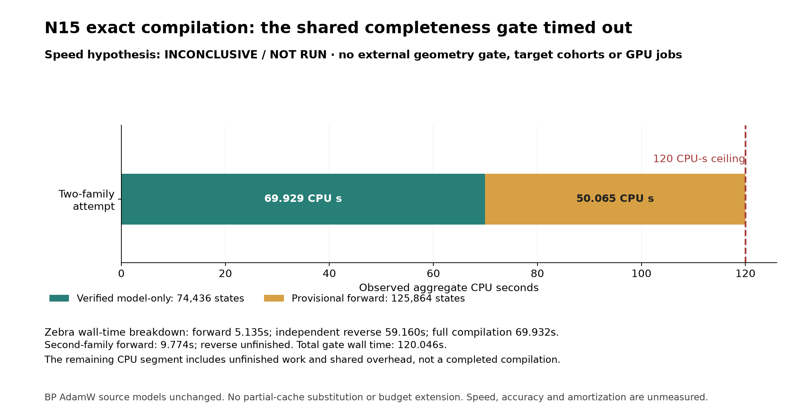

# H3af: N15 compilation gate did not finish

**The ≥10× speed hypothesis is inconclusive: the CPU completeness gate stopped the study before any target cohort, external graph validation, exact query or GPU comparison.** The frozen 120 aggregate CPU-second budget expired during the second family's independent reverse enumeration. It is not an accuracy failure or a measured speed falsification.

| Family | BP AdamW method | Complete verified model-only states | Provisional forward states | Forward time (s) | Independent reverse time (s) | Complete compilation wall time (s) |
|---|---|---:|---:|---:|---:|---:|
| Queen + zebra (2,3) | Exact zero-F compilation | 74,436 | — | 5.135469 | 59.160337 | 69.932409 |
| Queen + leaper (2,5) | Exact zero-F compilation | Unavailable | 125,864 | 9.774452 | Unfinished | Unfinished |

The complete two-family attempt consumed **119.993922 CPU seconds** and **120.046468 wall seconds**. Zebra's compilation consumed 69.928947 CPU seconds. The remaining 50.064974 observed CPU seconds include second-family transfer, forward enumeration and unfinished reverse verification plus shared overhead; they are not a completed second-family compilation duration. The reverse verifier accounts for 84.60% of zebra's measured compilation wall time. It tests literal F entries in Python for every candidate against all previously selected cells.

Both models extend exactly the same frozen H3ad N12 recipes to N15, including source temperature units. N13 reconstruction was byte-identical before transfer. No fitting, recalibration, target tuning or GPU kernel change occurred. Forward and reverse enumerator abstract syntax trees match H3ae. The planned comparison retained arbitrary cap 20,000 and permutation caps 11,264 / 12,000: it was a heterogeneous CPU/GPU fixed-cap comparison, not newly matched N15 time.

Zebra's complete forward and independent reverse solution arrays matched exactly; the cache passed uniqueness, dense all-cell-pair zero-F verification, incidence-index construction and serialization within the compilation timer. Its 74,436 states are **verified model-only zero-F states**. The separate supplied-geometry equality gate was forbidden until both caches completed, so these states are not described here as externally validated N15 puzzle solutions. The second family's 125,864 forward states remain explicitly provisional and have no complete cache or proof receipt.

No partial cache was substituted, no family was omitted and no deadline was extended. The stopped campaign left no target cohort, external graph-gate receipt, query-worker output, GPU budget or GPU search output. Both Loki GPUs were observed idle (0% utilization, 2 MiB each) after the stop; the concrete blocker was the required global completeness gate. **GPU work consumed 0 seconds.** Certified accuracy, distinct-solution coverage, CPU/GPU speed ratios and amortization break-even points were not measured.

The post-run audit checks frozen file hashes, the completed cache's identity/index/occupied-pair certificates, provisional array dimensions/count and absence of forbidden downstream outputs. It does not rerun enumeration or execute the external graph gate. Its separate 0.129588 CPU seconds / 0.138699 wall seconds are reporting overhead and do not extend the experimental gate. The tracked exports retain both provisional forward arrays under their explicit names and the one completed model-only cache for audit; none is eligible for H3af querying.

A future separately frozen study may test a compiled implementation of the same independent reverse algorithm, charging build and equivalence-validation costs. H3af remains the unchanged failed gate; optimization cannot retroactively make it a successful speed comparison.

[Frozen protocol](protocol.json), [unchanged compiler](compiler.py), [failure audit](analyze.py), [tracked summary](../../../../results/research/loki/h3af/summary.json), [compilation costs](../../../../results/research/loki/h3af/compilation.csv), [figure provenance](../../../../results/research/loki/h3af/plot-provenance.json).
