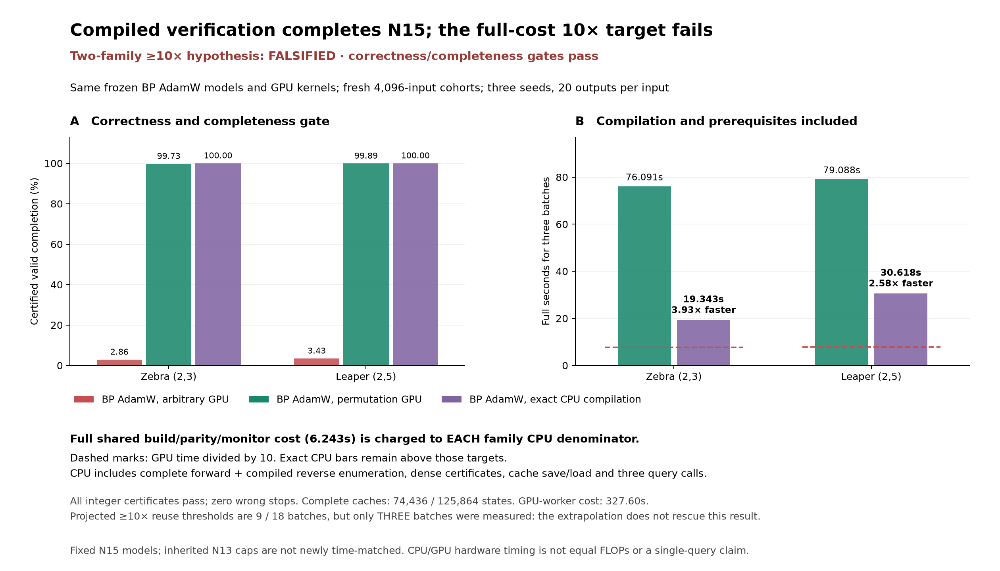

# H3ag: compiled verification completes N15, but the 10× speed threshold fails

**The prospective ≥10× full-cost speed hypothesis is falsified for both fixed N15 families.** Exact CPU compilation plus shared build/parity costs, external graph validation, cache loading and three query calls is 3.933717× faster than three GPU permutation calls for zebra, and 2.583035× faster for the (2,5) leaper. All correctness/completeness gates pass. This is a useful speedup, but below the declared threshold.

Only the independent reverse enumerator changed relative to H3af: it is now a single-thread C++ translation of the same literal-F algorithm. Rows traverse from 14 to 0; candidate columns traverse from 0 to 14; every candidate is tested against previously selected cells using F[cell,old]. It shares no forward masks and uses no supplied leaper geometry. The Python forward enumerator and dense all-cell-pair certificate formula remain unchanged. The two frozen N12 BP AdamW recipes, source temperature units, GPU kernels and inherited N13 caps are also unchanged. H3af remains a separate failed 120 CPU-second gate; its provisional outputs were not compiler inputs here.

| Family | BP AdamW inference method | Cap | Certified input success (%) | Capped distinct-solution coverage (%) | Wrong stops |
|---|---|---:|---:|---:|---:|
| queen-plus-zebra | BP AdamW arbitrary | 20000 | 2.864583 | 0.153835 | 0 |
| queen-plus-zebra | BP AdamW permutation | 11264 | 99.731445 | 46.541092 | 0 |
| queen-plus-zebra | BP AdamW exact zero-F compilation | Complete cache | 100.000000 | 100.000000 | 0 |
| queen-plus-2-5-leaper | BP AdamW arbitrary | 20000 | 3.426107 | 0.178442 | 0 |
| queen-plus-2-5-leaper | BP AdamW permutation | 12000 | 99.894206 | 55.378223 | 0 |
| queen-plus-2-5-leaper | BP AdamW exact zero-F compilation | Complete cache | 100.000000 | 100.000000 | 0 |

Capped distinct-solution coverage is 100 × Σ_s Σ_i d(i,s) / [3 × Σ_i min(N_i,20)], where d counts distinct valid returns and N is the number of compatible true solutions. A value of 100% returns min(N_i,20) distinct completions, not every compatible solution when N_i exceeds 20. Exact selection samples without replacement up to 20 matches, then pads by resampling when needed; GPU chains do not share those RNG semantics.

| Family | Shared prerequisites charged (s) | Complete compile (s) | External graph gate (s) | Cache load (s) | Three CPU queries (s) | Full CPU denominator (s) | Three GPU permutation calls (s) | Speed ratio |
|---|---:|---:|---:|---:|---:|---:|---:|---:|
| queen-plus-zebra | 6.243275 | 11.774933 | 0.002644 | 0.020072 | 1.302407 | 19.343331 | 76.091188 | 3.933717× |
| queen-plus-2-5-leaper | 6.243275 | 21.117103 | 0.000590 | 0.030971 | 3.226126 | 30.618065 | 79.087531 | 2.583035× |

Shared prerequisites cost 6.243275 wall seconds, including C++ build, equivalence validation, the synthetic query gate, monitor/import and shared overhead. This full cost is conservatively charged to **each** family denominator, although actually incurred once. The C++ build alone took 0.373769 seconds. The complete two-family compilation gate consumed 39.299929 aggregate CPU seconds and 39.135311 wall seconds. Both remained within the fresh 120-second limits. CPU accounting includes monitor and subprocess descendants, with final self-plus-children resource usage and a separate conservative wall guard.

| Family | Python forward (s) | Compiled literal reverse (s) | Unchanged dense certificate (s) | Full per-family compilation (s) | Complete states |
|---|---:|---:|---:|---:|---:|
| queen-plus-zebra | 5.102786 | 1.011530 | 4.461154 | 11.774933 | 74,436 |
| queen-plus-2-5-leaper | 9.843057 | 1.837696 | 7.929383 | 21.117103 | 125,864 |

The bottleneck moved. For the identical zebra model/cache, H3af recorded 59.160337 seconds in Python reverse verification; H3ag records 1.011530 seconds including compiled invocation/input/output. This historical single-run contrast is about 58.49×, not a repeated timing estimate. Python forward enumeration and the unchanged dense certificate now dominate. No certificate formula or other optimization was introduced after freezing.

The compiled verifier passed full solution-set equality on 42 prospectively specified small fixtures: q=2…7, random off-clique densities 0/0.1/0.5/0.9/1, and explicit one-edge addition/removal cases while preserving row/column cliques. Each fixture compares original Python reverse, compiled reverse, original forward and an independent exhaustive-permutation literal-pair reference. Both existing complete N13 models were also re-enumerated in Python and C++, comparing all outputs with their prior sealed caches. These 44 cases, all build work and synthetic query tests run inside the shared CPU gate. Prior N13 caches are validation references; no prior N15 arrays enter compilation. The compiler receipt’s generic no-target-array field refers to the new N15 target stage, not those explicitly permitted historical N13 parity references.

The build uses g++ 13.3.0, -O3 -std=c++17 -DNDEBUG -Wall -Wextra -Werror, one thread. Source and binary digests, compiler version, flags and every parity case are retained. Both N15 models are rebuilt from the frozen N12 parameters/source designs; their N13 reconstruction is byte-identical to H3ad. Model eligibility requires symmetric binary F, positive J exactly on F, zero unary terms and complete row/column cliques. At cardinality 15, those cliques imply exactly one cell per row and column, so exhaustive row recursion covers all zero-energy states.

Both complete forward and independent reverse N15 arrays must agree before caching. Caches pass uniqueness and the unchanged dense all-cell-pair certificate check, then index construction and serialization. Only after both cache seals does the supplied queen-plus-leaper graph gate compare the full supports; it finds zero false and zero missed edges for each family. Completeness plus this equality establishes complete true target universes of 74,436 and 125,864 solutions. No target labels or puzzle rules drive either enumerator.

| Family | Fresh input seed | Clues 1 / 2 / 3 | Remaining eligible keys | Compatible completions in 4,096 inputs |
|---|---:|---:|---:|---:|
| queen-plus-zebra | 2026112523 | 1 / 90 / 4005 | 861,261 | 202,093 |
| queen-plus-2-5-leaper | 2026112524 | 0 / 88 / 4008 | 871,655 | 325,965 |

Each cohort is uniform over its remaining eligible N15 clue keys, after excluding the first new family cohort from the second. H3af generated no N15 cohort; N13 encodings are a different domain. All 575 one/two/three-clue subsets per complete solution are enumerated, and the independent audit rebuilds the entire key/count universe and replays sampling. Shared cohort/initial-state preparation took 10.787263 wall seconds and is reported separately from both solver denominators. GPU methods share exact saved permutation starts within seed; seeds are 0/1/2, with 20 chains. Arbitrary cap is 20,000; permutation caps remain 11,264 / 12,000, with no N15 timing calibration. This is a fixed-cap hardware comparison, not matched N15 compute.

Exact query workers read only the clue-only input file and cache. They intersect clue incidence bitsets, uniformly select unique IDs up to 20, pad as needed and abstain explicitly when none match. No target-label file is opened. The complete cache guarantees certified capacity on these exact-support cohorts; its 100% quality is a correctness consequence, not evidence of additional learning.

The independent post-run audit checks all 983,040 saved GPU states for cardinality, givens, truth membership, integer conflicts, direct float64 energy, stopping, selectors and distinct coverage. Maximum running-energy error is 0.002496958, below 0.1; exact energy reselection changes certified accuracy in 0 of 12 jobs. All 491,520 exact returns map byte-identically to independently F-verified cache IDs and satisfy literal clue counts and unique/padding contracts. No wrong stops occur.

The 12 GPU jobs and 12 short full-shape warmups consumed 327.598590 total worker seconds, including loading, scoring and serialization. Per-device totals were 164.648813 / 162.949777 seconds; phase wall time was 165.453121 seconds. These satisfy the 600 aggregate worker-second, 300 per-device and 360 wall-second limits. GPU solve-call numerator timings include synchronization, transfer and returned CPU arrays; warmup/scoring/record serialization are outside those calls but charged to the study budget.

| Family | Fixed CPU cost C (s) | Mean CPU query (s) | Mean GPU solve (s) | Break-even batches, fractional / ceiling | 10× batches, fractional / ceiling |
|---|---:|---:|---:|---:|---:|
| queen-plus-zebra | 18.040924 | 0.434136 | 25.363729 | 0.723675 / 1 | 8.581773 / 9 |
| queen-plus-2-5-leaper | 27.391939 | 1.075375 | 26.362510 | 1.083236 / 2 | 17.549083 / 18 |

These are **descriptive extrapolations**, not measured results beyond three batches. Break-even is C/(tGPU−tCPU); the 10× threshold is 10C/(tGPU−10tCPU), when the denominator is positive. The projected ceilings of 9 / 18 batches do not change the failed three-batch hypothesis. A prospective new study would be required to test them.

The scope remains two fixed N12-derived N15 models, one complete compilation each, two 4,096-input cohorts and three query/search seeds. CPU/GPU wall time reflects heterogeneous hardware, not equal FLOPs, energy or universal performance. No single-query or general scaling guarantee is established.

[Frozen protocol](protocol.json), [compiled verifier](reverse_literal.cpp), [equivalence gate](cpp_verifier.py), [CPU budget monitor](compile_gate.py), [compiler](compiler.py), [independent audit](analyze.py), [GPU state audit](gpu_audit.py), [tracked summary](../../../../results/research/loki/h3ag/summary.json), [GPU seed results](../../../../results/research/loki/h3ag/gpu_per_seed.csv), [per-input metrics](../../../../results/research/loki/h3ag/per-input-metrics.npz), [figure provenance](../../../../results/research/loki/h3ag/plot-provenance.json).
