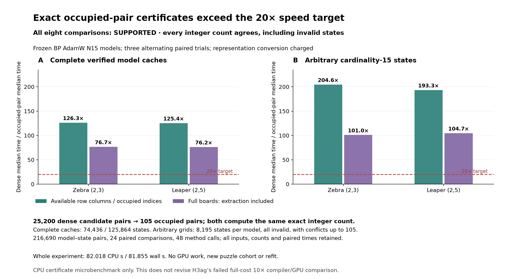

# H3ah: exact occupied-pair certificates exceed the 20× speed target

**All eight prospective comparisons support the ≥20× certificate-validation speed hypothesis, with every integer conflict count unchanged.** Measured ratios range from 76.20× to 204.56×. This is a CPU certificate microbenchmark on the two frozen N15 BP AdamW models, not a new GPU search or full solver comparison.

| BP AdamW model | Input states | Input representation | Dense median (s) | Occupied-pair median (s) | Speed ratio | Integer mismatches |
|---|---|---|---:|---:|---:|---:|
| queen-plus-zebra | 74,436 complete_cache | Available row columns | 4.704165 | 0.037242 | 126.31× | 0 |
| queen-plus-zebra | 74,436 complete_cache | Full Boolean boards | 4.439888 | 0.057879 | 76.71× | 0 |
| queen-plus-zebra | 8,195 arbitrary_cardinality15 | Available occupied indices | 0.579027 | 0.002831 | 204.56× | 0 |
| queen-plus-zebra | 8,195 arbitrary_cardinality15 | Full Boolean boards | 0.572308 | 0.005666 | 101.01× | 0 |
| queen-plus-2-5-leaper | 125,864 complete_cache | Available row columns | 7.616322 | 0.060746 | 125.38× | 0 |
| queen-plus-2-5-leaper | 125,864 complete_cache | Full Boolean boards | 7.608320 | 0.099844 | 76.20× | 0 |
| queen-plus-2-5-leaper | 8,195 arbitrary_cardinality15 | Available occupied indices | 0.571995 | 0.002959 | 193.33× | 0 |
| queen-plus-2-5-leaper | 8,195 arbitrary_cardinality15 | Full Boolean boards | 0.577120 | 0.005510 | 104.75× | 0 |

The dense implementation is the unchanged H3ag formula: enumerate all 225 choose 2 = 25,200 cell pairs, materialize their co-occupancy and sum against binary F with int32 arithmetic. The optimized implementation enumerates only the 15 choose 2 = 105 occupied pairs and sums the same literal F entries with int64 arithmetic. Since F is binary, every count is between 0 and 105; both integer types are exact here. Zero/nonzero agreement alone was insufficient: the protocol required equality of every integer count.

The two formulas are algebraically identical: unoccupied pairs contribute zero to the dense sum, leaving exactly the unordered pairs in the occupied set. That identity explains correctness. Runtime improvement is measured, and its magnitude depends on the implementation, representation and hardware. The 240-fold reduction in candidate pairs is not itself a runtime claim.

Both input paths charge representation work. With available row columns, both methods construct cell indices; the dense method also reconstructs the 225-cell Boolean boards inside its timed call. For arbitrary states, the ready representation is sorted occupied indices, not row columns. With full Boolean boards, the optimized call includes np.nonzero extraction and reshape before checking pairs; the dense call receives boards directly. Pair-index construction, counting and returned count arrays are timed in both methods. No representation conversion is free.

The complete-cache datasets include all 74,436 zebra and 125,864 (2,5) states, byte-identical to the independently proved H3ag caches. Each model also receives 8,192 independent uniform subsets of 15 distinct cells out of 225, using seeds 2026113102 / 2026113103, followed by a full row, full column and main diagonal. These arbitrary states need not be permutations. All 8,195 arbitrary states in each family have positive conflict counts; the final three each have exactly 105. Together there are 216,690 distinct model–state pairs, counting each family separately, including 16,390 invalid-state cases.

Every dataset/path/family combination has three prospectively fixed paired trials. The first method alternates by trial, family, dataset and path; every order and wall/CPU time is retained. The reported ratio divides the median dense time by the median optimized time. No full-size warmup or unfavorable trial was discarded, no timing-dependent repetitions were added, and no confidence interval is claimed from these three paired trials. All 24 pairs compare every integer count; all 48 method calls retain count hashes.

The run separately checks a scalar combinations reference on the first 128 states of every dataset. The post-run audit independently recomputes all complete-cache counts by accumulating individual row-pair interactions, and every arbitrary-state count with scalar occupied-cell combinations. It replays all randomized input draws, verifies complete-cache identities, reconstructs full boards from ready representations, checks all input/count hashes and recomputes every timing ratio and decision.

The whole monitored experiment consumed **82.017796 CPU seconds** and **81.855380 wall seconds**, within the frozen 120 CPU-second / 180 wall-second budget. This total includes input loading/generation, scalar reference checks, all trials, comparison/checksum work and output serialization. Those setup/audit operations are outside individual solve-call timings. The later publication audit took 0.435504 wall seconds and is reported separately. GPU work consumed **0 seconds**; no new puzzle cohorts or GPU reruns were eligible for this CPU-only study.

This result identifies an exact replacement for the expensive dense certificate operation. It does not modify frozen H3ag code, prove an end-to-end speedup, or rescue H3ag’s failed three-batch ≥10× CPU/GPU hypothesis. Its descriptive 9 / 18-batch amortization estimates remain separate. Integrating this certificate into a new compiler would require a new prospective full-cost experiment.

[Frozen protocol](protocol.json), [benchmark](benchmark.py), [budget monitor](gate.py), [independent audit](analyze.py), [tracked summary](../../../../results/research/loki/h3ah/summary.json), [all paired timings](../../../../results/research/loki/h3ah/paired_trials.csv), [comparison table](../../../../results/research/loki/h3ah/comparisons.csv), [figure provenance](../../../../results/research/loki/h3ah/plot-provenance.json).
