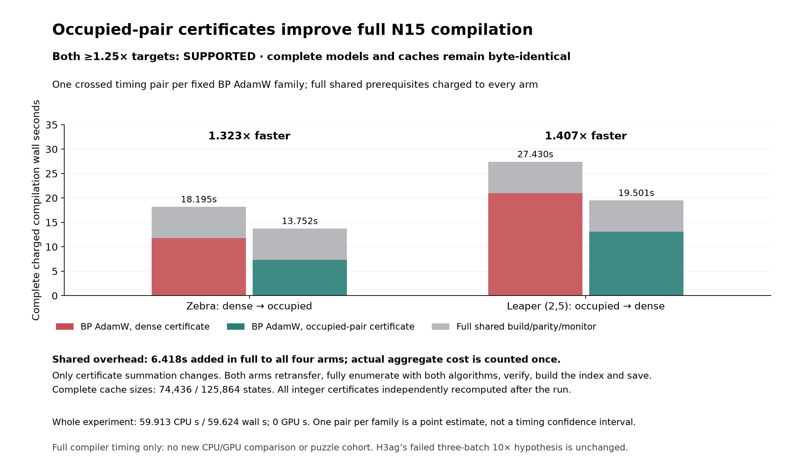

# H3ai: occupied-pair certificates improve complete compilation

**Both fixed N15 models support the prospective ≥1.25× full-compilation speed target.** The measured ratios are 1.323083× for zebra and 1.406597× for the (2,5) leaper, after the complete shared build/parity/monitor cost is charged to both arms. Complete model and cache files are byte-identical. This is one paired point timing per family, not a runtime confidence interval.

| Family | BP AdamW compilation method | Full per-arm compile (s) | Shared cost charged (s) | Full charged denominator (s) | Certificate component (s) | Complete states |
|---|---|---:|---:|---:|---:|---:|
| queen-plus-zebra | BP AdamW dense certificate | 11.777442 | 6.417738 | 18.195180 | 4.399604 | 74,436 |
| queen-plus-zebra | BP AdamW occupied certificate | 7.334366 | 6.417738 | 13.752104 | 0.042523 | 74,436 |
| queen-plus-2-5-leaper | BP AdamW dense certificate | 21.011891 | 6.417738 | 27.429629 | 8.029433 | 125,864 |
| queen-plus-2-5-leaper | BP AdamW occupied certificate | 13.082969 | 6.417738 | 19.500707 | 0.066126 | 125,864 |

The experiment changes only the certificate summation. The dense control enumerates all 225 choose 2 cell pairs and counts their F-weighted co-occupancy. The optimized arm sums F over 15 choose 2 occupied-cell pairs. Both arms already construct occupied indices to build their cached boards, and that construction is charged in both certificate components. The pair counts are exact integers bounded by 105. H3ah separately established exact equality on complete caches and invalid cardinality-15 states, including representation costs; that historical development microbenchmark is referenced, not rerun or disguised as inference cost.

Each arm independently rebuilds its N15 model from frozen N12 parameters/source design, checks byte-identical N13 reconstruction, verifies model eligibility, exhaustively enumerates with the unchanged Python forward masks and independent compiled reverse literal-F algorithm, checks full array equality and uniqueness, constructs boards/index and serializes its complete cache. No H3ag or H3ah N15 cache is a compiler input. Zebra executes dense then occupied; (2,5) executes occupied then dense. There is no timing-dependent repetition or dropped arm.

The C++ verifier is freshly built and the full 44-case H3ag equivalence suite plus synthetic query gate is repeated. Shared build/parity, monitor/import and pair-identity overhead totals **6.417738 wall seconds**. This is measured as total gate wall time minus the four full per-arm compilation durations, and the entire shared amount is conservatively added to each of the four arm denominators. Actual aggregate experiment cost is reported once; these deliberately duplicated denominator charges are not summed as actual machine usage.

| Family | Dense / occupied full charged cost | Speed ratio | Threshold | Decision | Execution order |
|---|---:|---:|---:|---|---|
| queen-plus-zebra | 18.195180 / 13.752104 s | 1.323083× | 1.25× | supported | dense → occupied |
| queen-plus-2-5-leaper | 27.429629 / 19.500707 s | 1.406597× | 1.25× | supported | occupied → dense |

The post-run audit checks every frozen input/source hash, both forward/reverse output arrays, uniqueness, cache representation/index and complete model/cache byte identity. It independently recomputes every integer certificate using individual row-pair accumulation. All four newly built files also match H3ag’s prior complete model/cache digests in a post-run comparison; those prior caches were not used by compilation. The result therefore preserves exactly the same complete zero-F state sets.

The experiment consumes **59.913184 aggregate CPU seconds** and **59.624406 wall seconds**, below the frozen 120 CPU-second / 180 wall-second limits. Accounting includes the monitor and subprocess descendants, with final self-plus-children resource usage. The separate post-run publication audit took 0.595513 wall seconds. GPU work is **0 seconds**; no new puzzle cohort, query timing, fitting or GPU control was part of this integration experiment.

The isolated certificate speedups from H3ah become a smaller but measurable whole-compiler improvement because Python forward enumeration and the other unchanged operations remain. This is an end-to-end **compiler** comparison only. It does not measure a new CPU/GPU ratio or alter H3ag’s failed ≥10× three-batch claim; its 9 / 18-batch amortization estimates remain descriptive and unchanged. The two fixed models are not independent learning replicas, and the crossed single pairs do not supply a general timing distribution.

[Frozen protocol](protocol.json), [paired compiler](compiler.py), [shared verifier validation](cpp_verifier.py), [budget monitor](compile_gate.py), [independent audit](analyze.py), [tracked summary](../../../../results/research/loki/h3ai/summary.json), [component timings](../../../../results/research/loki/h3ai/compilation.csv), [figure provenance](../../../../results/research/loki/h3ai/plot-provenance.json).
