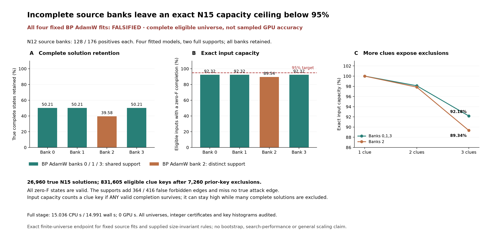

# H3aj: incomplete-bank N15 capacity stays below 95%

**The prospective ≥95% certified-capacity hypothesis is falsified for all four fixed source fits.** Banks 0, 1 and 3 cover 92.319310% of the complete remaining eligible N15 camel input universe; bank 2 covers 89.538062%. These are exact finite-universe fractions, not sampled GPU accuracies. Every learned zero-F state is valid, but false learned exclusions remove many true completions.

| BP AdamW source bank | Support group | Complete true states retained | True-state retention (%) | Eligible inputs with a valid zero-F completion | Exact input capacity (%) | False / missed forbidden edges | Decision |
|---|---:|---:|---:|---:|---:|---:|---|
| 0 | 0 | 13,536 / 26,960 | 50.207715 | 767,732 / 831,605 | 92.319310 | 364 / 0 | falsified |
| 1 | 0 | 13,536 / 26,960 | 50.207715 | 767,732 / 831,605 | 92.319310 | 364 / 0 | falsified |
| 2 | 1 | 10,671 / 26,960 | 39.580861 | 744,603 / 831,605 | 89.538062 | 416 / 0 | falsified |
| 3 | 0 | 13,536 / 26,960 | 50.207715 | 767,732 / 831,605 | 92.319310 | 364 / 0 | falsified |

All four H3ac fits are retained. They came from independently drawn overlapping 128-of-176 N12 source banks, with seeds 2026112700–2026112703 and the original BP AdamW recipe. Their fitted weight arrays differ, but banks 0/1/3 share one complete support F and bank 2 has another. Deduplication saves only exact enumeration of byte-equal supports; it does not turn four rows into four independent constraint structures or four rule families.

| Support group / banks | Clue count | Eligible inputs | Inputs with valid zero-F completion | Exact capacity (%) |
|---|---:|---:|---:|---:|
| 0 / 0, 1, 3 | 1 | 224 | 224 | 100.000000 |
| 0 / 0, 1, 3 | 2 | 19,173 | 18,811 | 98.111928 |
| 0 / 0, 1, 3 | 3 | 812,208 | 748,697 | 92.180451 |
| 1 / 2 | 1 | 224 | 224 | 100.000000 |
| 1 / 2 | 2 | 19,173 | 18,759 | 97.840714 |
| 1 / 2 | 3 | 812,208 | 725,620 | 89.339184 |

State retention and input capacity are different quantities. The two supports retain only 50.207715% and 39.580861% of all true solutions. A clue input still has capacity whenever at least one of its compatible true completions survives. This redundancy preserves 100% capacity for eligible one-clue inputs and about 98% for two clues, but three-clue capacity falls to 92.180451% / 89.339184%. Three-clue inputs dominate the declared uniform-key universe, so the overall ≥95% endpoint fails.

Each source model is transferred unchanged using the original zero-count/exposure mask union inferred lines, positive learned coefficients on F, zero unary/off-F weights, unchanged source unit and finite-offset rule. N13 J/F/h/unit reconstruction must match the inherited H3ac model byte-for-byte before the N15 extension. No new fit, source replacement, radius selection, target-label repair or temperature calibration occurs. All four independently transferred models pass positive-F, symmetry and complete row/column-clique eligibility.

Each unique learned zero set is completely enumerated with the unchanged Python forward masks and independent compiled literal reverse traversal; their full arrays must match. Occupied-pair integer certificates, uniqueness, boards/index construction and cache serialization follow. These learned enumerators take only their model support F, not the supplied true geometry. Strictly positive J exactly on F makes the zero set depend on F rather than its positive weight magnitudes, which justifies exact full-support deduplication.

The separate supplied true N15 task is ordinary queens plus camel moves (1,3)/(3,1). Vectorized and literal coordinate predicates must agree for every graph edge. Three independent complete algorithms then agree on all 26,960 solutions: general forward-F recursion, compiled reverse literal-F recursion, and a separate compiled ordinary-queen bitboard recursion with direct camel row-distance checks. Both compiled programs are freshly built. The preliminary verification includes 42 small random/edge fixtures, eight supplied-rule size cases including independently known complete N12/N13 universes, and original-Python/compiled parity for every unique inherited N13 learned support.

All complete learned and true universes are sealed before capacity calculation. For each true solution, every one/two/three-clue subset is enumerated: 15 + 105 + 455 = 575 keys. The complete true universe contains 838,865 distinct keys. The fixed exclusion set is exactly the union of the two H3ag N15 cohorts: 8,192 distinct prior keys, of which 7,260 occur in the true camel universe. This leaves **831,605 eligible keys**, shared by all four fits. Encoding uses 225 cells and base 226; prior N13 encodings are a different domain. H3af created no cohort, and H3ah arbitrary states/H3ai compiler caches are not puzzle-input cohorts.

Capacity for a key means that its exact histogram of compatible **valid learned zero-F** completions is nonzero. The histograms count every completion for every key. Invalid learned zero-F states are independently checked and would prevent support even if the capacity fraction reached 95%; here there are zero. Both supports miss no true attack edge, while adding 364 / 416 false exclusions. Accordingly, all learned zero-F solutions are true solutions, and the loss comes from excluding true alternatives. This finite-universe statement bounds an abstaining zero-F primary; it does not bound positive-energy fallback answers or diagnose a stochastic search run that was not performed.

The monitored stage consumed **15.035580 CPU seconds** and **14.991060 wall seconds**, inside the frozen 120 CPU-second / 180 wall-second envelope. These totals include both C++ builds, all parity checks, every model transfer, complete enumerations, full key histograms, count calculations and serialization. The independent publication audit took another 6.655964 wall seconds, reported separately. GPU work consumed **0 seconds**, and no fresh GPU cohort was created.

The post-run audit replays all four source-bank draws, independently reconstructs all transferred J/F arrays, verifies learned and three-way true enumeration arrays, independently recomputes every cached integer certificate, replays exclusions from public H3ag keys and rebuilds every full clue histogram with separate loop nesting. It then recomputes every bank’s overall and per-clue fractions, true-state retention and graph errors. Public exports preserve every complete cache, model, eligible key and count.

H3ac’s earlier N13 cohort ceilings were approximately 94.53% / 92.55%; those sampled cohorts are context, not a paired exact N13-to-N15 comparison. H3aj establishes failure at N15 for these fixed banks and this finite eligible-key distribution. It does not establish a general monotonic law with board size or broad reliability across rule families.

[Frozen protocol](protocol.json), [source transfer](transfer.py), [capacity stage](study.py), [independent truth enumerator](truth_camel.cpp), [build/parity validation](verification.py), [post-run audit](analyze.py), [public complete-census verifier](verify_public.py), [tracked summary](../../../../results/research/loki/h3aj/summary.json), [bank capacities](../../../../results/research/loki/h3aj/capacity.csv), [per-clue capacities](../../../../results/research/loki/h3aj/per_clue_capacity.csv), [complete input universe](../../../../results/research/loki/h3aj/input-universe.npz), [figure provenance](../../../../results/research/loki/h3aj/plot-provenance.json).
