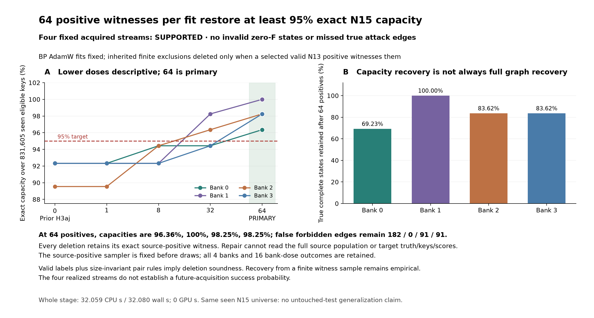

# H3ak: 64 positive witnesses per fit restore at least 95% capacity

**All four fixed draws support the prospective ≥95% N15 capacity endpoint at 64 acquired N13 positives.** Capacities are 96.357405%, 100%, 98.252536% and 98.252536% for banks 0–3. Every deletion is justified by a selected positive witness, and no repaired zero-F state is invalid. This is recovery on the same previously examined finite N15 universe, with newly acquired intermediate-size positive supervision.

| BP AdamW bank | Previously measured H3aj baseline (%) | After 64 positives (%) | Gain (pp) | True states retained (%) | Removed finite classes | False / missed forbidden edges left | Primary decision |
|---|---:|---:|---:|---:|---:|---:|---|
| 0 | 92.319310 | 96.357405 | 4.038095 | 69.228487 | 2 | 182 / 0 | supported |
| 1 | 92.319310 | 100.000000 | 7.680690 | 100.000000 | 4 | 0 / 0 | supported |
| 2 | 89.538062 | 98.252536 | 8.714474 | 83.620178 | 4 | 91 / 0 | supported |
| 3 | 92.319310 | 98.252536 | 5.933226 | 83.620178 | 3 | 91 / 0 | supported |

The H3aj baseline values are explicitly imported prior exact-capacity results, not new optimizer or GPU measurements. Each inherited N12 fit remains fixed. The intervention changes only J/F entries on inherited finite displacement classes that occur in newly acquired valid positives; all other weights, unary terms, target cardinality and the original source temperature unit remain unchanged. It adds no exclusions, refits no optimizer, recalculates no exposure threshold and selects no minimum-size rule.

| Bank | 1 positive, descriptive (%) | 8 positives, descriptive (%) | 32 positives, descriptive (%) | 64 positives, primary (%) |
|---|---:|---:|---:|---:|
| 0 | 92.319310 | 94.429086 | 94.429086 | 96.357405 |
| 1 | 92.319310 | 92.319310 | 98.252536 | 100.000000 |
| 2 | 89.538062 | 94.429086 | 96.357165 | 98.252536 |
| 3 | 92.319310 | 92.319310 | 94.430769 | 98.252536 |

Only the 64-positive endpoint is confirmatory. The 1/8/32 results are descriptive nested dose points; their published decision fields are labeled descriptive. Every bank is unchanged at one positive. At 32 positives, banks 0 and 3 remain below 95%, while banks 1 and 2 exceed it. These four realized streams do not establish a success probability for future random acquisitions.

The source population contains 1,932 complete valid N13 camel boards in a frozen order. Before drawing or inspecting recovery, seeds 2026113105–2026113108 specify four independent default_rng draws of 64 distinct population indices without replacement. Order is retained, with prefixes 1/8/32/64. Overlap across banks is allowed, retained and reported in the source-positive seal. No stream, prefix, source board or bank is replaced based on its witness content or target outcome.

A separate acquisition process validates each selected positive using literal N13 queen/camel predicates before releasing the selected arrays. Acquisition also checks frozen inherited model/design digests as integrity inputs; it does not inspect N15 evaluation labels, input keys, truth graphs or scores. The repair process never opens the full N13 population. It reads only the frozen inherited model/design, its selected positives/indices and its own newly written model files. An artifact/result read allowlist is enforced and the actual read paths are retained in the repair seal. All repair outcomes are sealed before target-reference integrity reads or evaluation.

For each prefix, repair lists the canonical occupied-cell displacements in the selected positives. It removes every inherited finite displacement class that appears, preserving a first exact witness: population index, selected position, both occupied source cells and displacement. The audit independently reconstructs every deletion from those selected arrays, checks every witness and verifies that all other model entries remain exactly unchanged. There are 16 bank-dose outcomes and nine distinct full repaired support graphs; only byte-equal complete supports share enumeration.

**Conditional soundness statement:** if the source labels are valid and the same translation-shared pair prohibition applies at both board sizes, an offset witnessed in a valid positive cannot be a true forbidden pair at N15. Deleting that class is sound under those assumptions. This does not guarantee that a finite positive sample will witness every false exclusion or restore any particular capacity; recovery is the empirical endpoint. The experiment does not use source completeness as negative evidence, target labels to choose deletions, or a sparse-rule prior.

Each repaired support passes positive-F and row/column-clique eligibility, then complete forward and independently compiled reverse enumeration, uniqueness and exact occupied-pair certificates. Fresh C++ builds and 42 small random/edge parity fixtures are included. All learned enumerations finish before target evaluation. The existing complete H3aj true census is then re-enumerated with two compiled algorithms and its full clue histogram is rebuilt. Every repaired cache is scored against the same 831,605 eligible N15 keys and exact H3aj exclusions; no fresh puzzle cohort is created.

At 64 positives, retained true-state fractions are 69.228487%, 100%, 83.620178% and 83.620178%. Bank 1 removes all its false exclusions and recovers the entire true solution set. The other banks retain 182 / 91 / 91 false edges, so crossing 95% input capacity is not complete graph recovery. All 16 outcomes have zero invalid zero-F states and zero missed true attack edges. Capacity and state retention are nondecreasing along each prefix, as required by deletion-only repair.

The complete monitored stage consumes **32.058858 CPU seconds** and **32.080434 wall seconds**, within the frozen 120 CPU-second / 180 wall-second envelope. This includes acquisition, source-positive validation, repair, builds/parity, complete learned enumeration, reference checks, all capacity histograms and serialization. The independent publication audit took 6.000701 additional wall seconds. GPU work is **0 seconds**; this is neither a search-performance nor optimizer-improvement result.

The post-run audit replays all four source draws, validates every acquired positive, checks the repair read allowlist, reconstructs all 16 models and all witness records, verifies every cache/forward/reverse identity and recomputes all integer certificates, true memberships, full key histograms, per-clue capacities and primary decisions. The inference remains conditional on four fixed fits and a known finite source population; it does not estimate acquisition reliability or untouched-test generalization.

[Frozen protocol](protocol.json), [source acquisition](acquire.py), [isolated witness repair](repair.py), [complete enumeration](compiler.py), [stage/evaluation order](study.py), [independent audit](analyze.py), [public complete-census verifier](verify_public.py), [tracked summary](../../../../results/research/loki/h3ak/summary.json), [all dose outcomes](../../../../results/research/loki/h3ak/capacity.csv), [deletion witnesses and access receipt](../../../../results/research/loki/h3ak/repair-seal.json), [figure provenance](../../../../results/research/loki/h3ak/plot-provenance.json).
