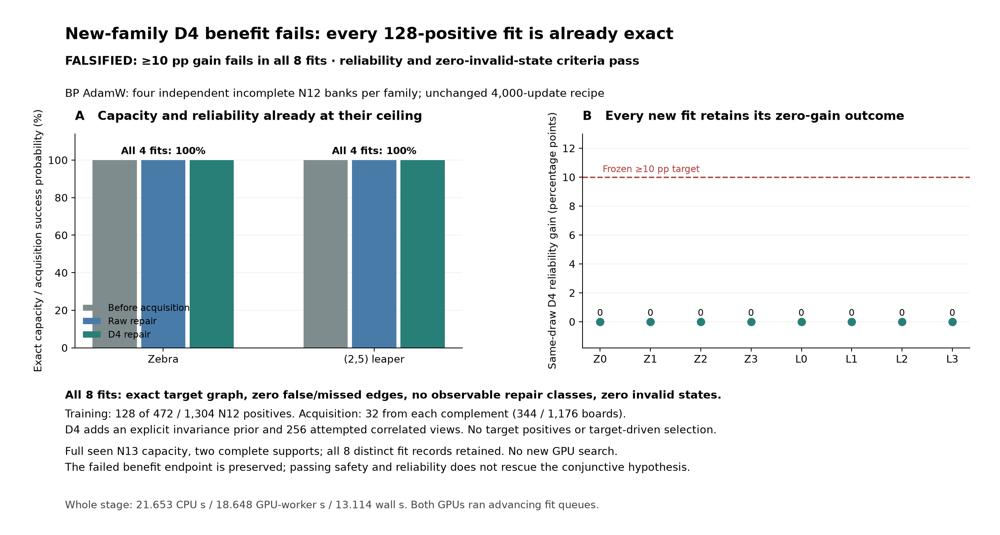

# H3an: new incomplete-bank fits falsify portable D4 benefit

**The prospective ≥10-percentage-point D4 improvement claim is falsified for all eight new fits because every unaugmented baseline already has 100% exact N13 capacity.** All four 128-positive zebra fits and all four 128-positive (2,5)-leaper fits recover the exact target support graph before acquiring further labels. Raw and D4 repair therefore both have 100% success probability, with exactly zero gain. The ≥90% reliability and zero-invalid-state conditions pass; the full conjunctive hypothesis fails.

| BP AdamW family / bank | Baseline exact capacity (%) | Raw 32-positive reliability (%) | D4 same-draw reliability (%) | Gain (pp) | False / missed edges | Decision |
|---|---:|---:|---:|---:|---:|---|
| Zebra / 0 | 100.0 | 100.0 | 100.0 | 0.0 | 0 / 0 | falsified |
| Zebra / 1 | 100.0 | 100.0 | 100.0 | 0.0 | 0 / 0 | falsified |
| Zebra / 2 | 100.0 | 100.0 | 100.0 | 0.0 | 0 / 0 | falsified |
| Zebra / 3 | 100.0 | 100.0 | 100.0 | 0.0 | 0 / 0 | falsified |
| (2,5) leaper / 0 | 100.0 | 100.0 | 100.0 | 0.0 | 0 / 0 | falsified |
| (2,5) leaper / 1 | 100.0 | 100.0 | 100.0 | 0.0 | 0 / 0 | falsified |
| (2,5) leaper / 2 | 100.0 | 100.0 | 100.0 | 0.0 | 0 / 0 | falsified |
| (2,5) leaper / 3 | 100.0 | 100.0 | 100.0 | 0.0 | 0 / 0 | falsified |

The training budget was fixed before any new bank draw or fit: four independent uniform 128-board N12 subsets from each family, seeds 2026113200–2026113207. The source populations contain 472 zebra and 1,304 leaper boards, so the common label budget uses 27.118644% and 9.815951% of the respective populations. Within-family overlaps are retained and published. The eight source banks and optimizer trajectories are new; no bank is replaced after observing its graph or capacity.

Each conditional acquisition distribution draws 32 distinct raw positives uniformly from that fit’s N12 complement, excluding its 128 training boards. The remaining populations have 344 and 1,176 boards. A realized fit plus repair uses 160 raw labels. Raw and D4 arms share each acquisition draw; D4 attempts 256 correlated rotations/reflections before whole-board deduplication. The D4-invariance prior is supplied explicitly. This experiment uses additional same-size N12 positives and transfers to N13, unlike H3am’s intermediate N13 acquisition followed by N15 evaluation.

Every fit uses the unchanged H3ad grouped BP AdamW recipe: zero initialization, 4,000 updates, learning rate 0.3, cosine denominator 4,000, decay 0.01, betas (0.9,0.999), epsilon 1e−8, float32, TF32 disabled and no preconditioner. The exact pseudolikelihood aggregates all 298 one/two/three-clue subsets per source board, using occupied/free multiplicities 231/298. Counts, marginal exposures, inferred primitive lines and coefficient grouping are rebuilt independently for each bank. Before fitting, literal expanded-clue and actual-bank CPU/GPU loss/gradient checks pass. All eight fitted native source margins and retained weights are positive.

The positive-F derivative retains source-zero finite offsets with exposure at least ln(264/0.01), union the inferred lines. It keeps the fitted positive coefficients on F, zeroes unary/off-support entries, extends inferred lines and assigns newly representable off-line offsets zero. This supplied derivative is distinct from the native soft fitted energy. Support selection is based on source counts, exposure and the line prior; this study does not identify an optimizer advantage over an identically constructed count support.

The repair algorithm remains source-only: only inherited finite classes witnessed in selected positives or their D4 views may be deleted. All eight complements contain **zero observable inherited repair classes**, so every possible raw or D4 draw leaves its fitted support unchanged. The eight fitted models remain distinct parameter records, while their complete supports reduce to two graphs, one per family. Every positive-mass paired outcome is retained. There is one reachable paired union per fit and no favorable-outcome selection.

The evaluator computes exact without-replacement masses with a grouped binomial union dynamic program. It checks normalization at every dose 0–32; large integers are stored as decimal strings. The frozen complexity caps are 16 observable classes per fit, 512 reachable paired unions per dose per fit, and 256 full supports per family. Any cap failure would stop the entire study, with no pruning or extension. The independent audit cross-checks exact masses using a different closure/contained-union poset inversion. Here the single union has all choose(344,32) or choose(1176,32) mass.

| Family | Complete true N13 states | Complete 1/2/3-clue keys | Valid zero-F states | Invalid zero-F states | Exact graph fits |
|---|---:|---:|---:|---:|---:|
| Zebra | 2696 | 252061 | 2696 | 0 | 4 / 4 |
| (2,5) leaper | 6368 | 301337 | 6368 | 0 | 4 / 4 |

All models and source-only repair distributions are sealed before target evaluation. The complete N13 references agree between independent ordinary-queen enumeration plus literal leaper filtering and compiled literal-F enumeration. Every support equals the true graph, so filtering the complete true census is exhaustive. The frozen fallback requires independent forward and compiled reverse zero-F enumeration if any support fails true-graph inclusion; that fallback was not needed. Any positive-probability invalid zero-state outcome would have falsified safety rather than being discarded.

Capacity covers every one/two/three-clue key from the full true N13 universe, with zero exclusions. Every valid state contributes 377 clue subsets. This is a complete, previously examined finite target universe, not a new held-out search cohort or a claim about a population of rule families. These two families were fixed in advance. No GPU search was launched after the capacity ceiling became known.

The complete monitored experiment used **21.652793 aggregate CPU seconds**, **18.647927 aggregate GPU-worker seconds** and **13.114260 wall seconds**, within the frozen 600 CPU /120 GPU-worker /900 wall-second envelope. The individual fit cap was 30 seconds; all eight fits finished their 4,000 updates in 1.343182–1.823757 seconds. GPU-worker cost includes imports, numerical gates, fitting, construction and serialization; CPU accounting includes all descendants, builds, source preparation, distributions and complete capacity evaluation. The separate publication audit took 1.435603 wall seconds.

Both Loki GPUs ran independent four-fit queues. Twenty live samples record utilization and advancing update/loss counters; examples show 67–68% on GPU 0 and 83–85% on GPU 1 while updates advance through 1,000, 2,250 and 4,000. Idle GPUs afterward reflect completion of all eligible fitting and the absence of an authorized search stage. No duplicate runs were added for utilization.

The public-only audit replays all eight training and complement draws, reconstructs every literal count/exposure/line/group design, recomputes the final native margins and complete fitted transfer, verifies all numerical-gate receipts, reconstructs every paired source mask and concrete learner call, independently re-enumerates both complete source and target populations plus both zero-F supports, rebuilds every integer clue histogram and recomputes every exact probability and frozen decision.

[Frozen protocol](protocol.json), [new bank preparation and fitting](source.py), [pure repair](learner.py), [exact source distributions](source_outcomes.py), [complete evaluation](evaluate.py), [resource monitor](gate.py), [public-only verifier](verify_public.py), [tracked summary](../../../../results/research/loki/h3an/summary.json), [all eight comparisons](../../../../results/research/loki/h3an/reliability.csv), [live utilization and update counters](../../../../results/research/loki/h3an/live-utilization.json), [figure provenance](../../../../results/research/loki/h3an/plot-provenance.json).
