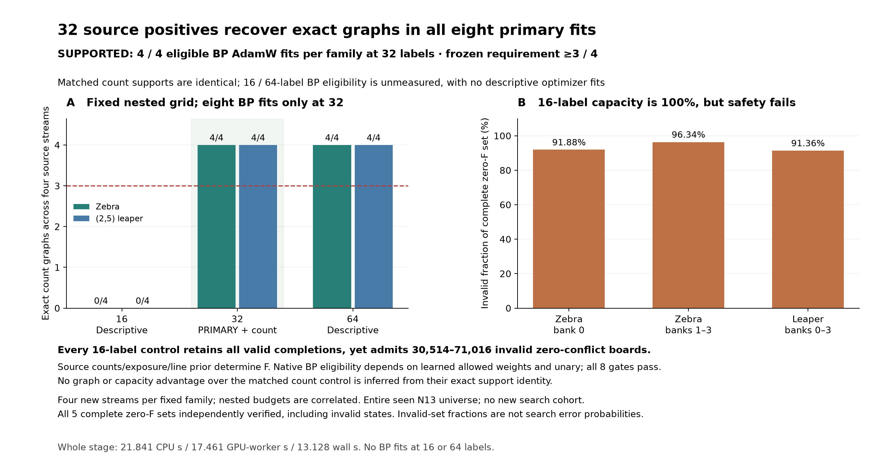

# H3ao: 32 source positives suffice in all eight primary fits

**The frozen primary is supported: all four 32-positive BP AdamW fits per family pass the original native-margin eligibility gate and recover the exact N13 graph**, exceeding the required three of four for both zebra and (2,5)-leaper families. The matched optimizer-free count control has the identical graph on each source bank. This establishes the declared finite-draw sample-efficiency result; graph and capacity recovery are not an advantage of learned weights over the matched count construction.

| Method | Raw N12 labels | Zebra exact graphs / 4 | Leaper exact graphs / 4 | Exact valid-input capacity | Invalid zero-F states | Role |
|---|---:|---:|---:|---:|---:|---|
| BP AdamW positive-F | 32 | 4 / 4 | 4 / 4 | 100% for every fit | 0 | Frozen primary; all native gates pass |
| Matched optimizer-free count | 16 | 0 / 4 | 0 / 4 | 100% for every bank | 30,514–71,016 | Descriptive |
| Matched optimizer-free count | 32 | 4 / 4 | 4 / 4 | 100% for every bank | 0 | Matched primary control |
| Matched optimizer-free count | 64 | 4 / 4 | 4 / 4 | 100% for every bank | 0 | Descriptive |

There are **eight new optimizer fits, all at 32 labels**. No BP fit is run at 16 or 64 labels; native eligibility and learned weights at those budgets are unmeasured. Conditional equivalence with a positive-F BP model at those doses is not an observed optimizer outcome. The 24 nested count controls and eight primary BP records remain separate, and the count copies do not increase the number of independent source streams.

Each of the four independent streams per family draws 64 distinct N12 population indices in a fixed random order, seeds 2026113400–2026113407. The 16/32/64 source sets are the exact prefixes of that order. All settings and the primary 32-label endpoint are frozen before any of these draws or fits; neither a dose nor a failed stream is replaced. Within-family overlaps are published. Zebra and leaper source populations have 472 and 1,304 complete positives. The four observed streams per family support a finite fixed-draw statement, not a claim that a population recovery probability exceeds 75% or 90%.

Every dose recomputes canonical displacement counts, source-cell marginals, exposures and the unchanged primitive-line inference. The optimizer-free model sets J=F, unary zero, target cardinality 13 and unit 1. Its F retains source-zero finite offsets whose exposure is at least ln(264/0.01), union inferred lines; lines extend to N13 and new off-line offsets receive zero. It receives exactly the same observed boards and geometric prior as the BP positive-F derivative. There is no D4 augmentation, extra positive acquisition, supplied source-completeness negative evidence or minimum-rule prior in this study.

The eight primary fits use the unchanged H3ad/H3an BP AdamW recipe: zero initialization, 4,000 updates, learning rate 0.3 with cosine denominator 4,000, decay 0.01, betas (0.9,0.999), epsilon 1e−8, float32, TF32 disabled and no preconditioner. The original exact pseudolikelihood aggregates 298 clue subsets per source board. Literal expanded-clue and actual-bank CPU/GPU loss/gradient gates precede every fit. Source native minimum flip margins range from **3.908663 to 4.705428**; all parameters, retained coefficients and source units pass their finite/positive checks.

The learned native margin is δ=min over observed source boards and cells of (1−2x)×(xJ+b), before unary/off-support weights are discarded by the positive-F derivative. It depends on learned allowed coefficients and the shared unary, and is not implied by the count support. That train-dependent eligibility gate justifies the eight primary fits. For source-zero coefficient groups, the exact PL gradient is nonpositive; a zero-start AdamW update with a positive shrink factor preserves the sign under finite arithmetic. That sign argument alone does not guarantee δ>0. A fit failing the original gate would count as a primary failure even if its source-derived count F were exact.

The BP and count F arrays are identical by construction at the same bank, and all primary fitted F coefficients are positive. Therefore their cardinality-13 zero-F sets and exact capacities coincide. Learned magnitudes could affect downstream search, but no search endpoint is measured here. The positive-F derivative and count support are distinct from a native soft BP energy with its learned unary and allowed interactions.

| Descriptive 16-label count case | Missed true edges | Valid zero-F states | Invalid zero-F states | Invalid fraction of complete zero-F set (%) |
|---|---:|---:|---:|---:|
| Zebra bank 0 | 330 | 2696 | 30514 | 91.881963 |
| Zebra banks 1–3 | 440 | 2696 | 71016 | 96.342522 |
| Leaper banks 0–3 | 352 | 6368 | 67344 | 91.360972 |

At 16 labels, the exposure filter removes true leaper constraints. No false edges remain, so every true solution is still admitted and valid-input capacity stays at 100%, while many invalid boards also receive zero F conflicts. Thus existential capacity alone is insufficient to establish certificate safety or exact rule recovery. These invalid-set fractions describe complete finite state sets; they are not measured probabilities of a search algorithm returning an invalid answer. At 32 and 64 labels, every observed control graph is exact and all invalid-state counts are zero.

All source controls and primary fit records are sealed before target diagnosis. To avoid losing invalid leaper states, the evaluator first independently enumerates all **73,712 ordinary-queen N13 boards**, checks every support contains ordinary-queen constraints, and filters that complete superset. Each resulting complete zero-F set is independently re-enumerated with compiled literal-F recursion and must match exactly. The family truth sets are separately verified, and all valid/invalid memberships plus full 377-subset-per-valid-state integer clue histograms are retained. There are five distinct full supports, deduplicated within family only.

The target comprises every true one/two/three-clue N13 input for each family, with zero exclusions. It is the same previously examined finite universe, not a new search cohort or unseen rule-family population. All 16/64-label results remain descriptive, even though the 64-label controls are exact. The earlier H3k study tested ordinary-queen primitive-line inference without BP fits; H3g used one different nested ordinary-queen bank and different energies; H3u used the complete camel source. Those results do not replace this new two-family, eight-stream experiment.

The whole monitored study used **21.841399 aggregate CPU seconds**, **17.460723 aggregate GPU-worker seconds** and **13.127650 wall seconds**, within the frozen 600 /120 /900-second limits. The eight individual 4,000-update fits took 1.345677–1.463332 seconds, below their 30-second caps. Costs include source preparation, numerical gates, all fit-worker imports/construction, builds, complete enumerations, capacities and serialization. The separate publication audit took 2.334728 wall seconds.

Both Loki GPUs ran four-fit queues. Eighteen live samples include 82%/85% and 84%/81% utilization while recorded updates advance from 1,250 to 2,500/2,750. No redundant descriptive BP fits or GPU searches were launched. The public-only audit replays all ordered draws and 24 nested designs, reconstructs all eight native margins and full learned transfers, re-enumerates every source/target population and all five supports, rebuilds invalid-state memberships and every integer capacity census, and checks the primary/descriptive decisions.

[Frozen protocol](protocol.json), [nested source controls and primary fit worker](source.py), [source sealing](source_outcomes.py), [complete evaluation](evaluate.py), [public-only independent verifier](verify_public.py), [tracked summary](../../../../results/research/loki/h3ao/summary.json), [full nested results](../../../../results/research/loki/h3ao/nested-results.csv), [live progress](../../../../results/research/loki/h3ao/live-utilization.json), [figure provenance](../../../../results/research/loki/h3ao/plot-provenance.json).
