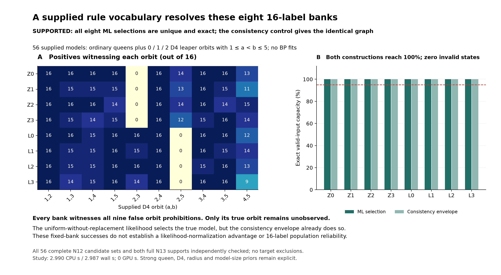

# H3ar: a supplied rule vocabulary resolves eight 16-label banks

**The all-bank safety and ≥95% exact-capacity hypothesis is supported.** Every one of the eight fixed banks selects one exact N13 graph, has zero invalid zero-F states, and covers 100% of the full valid-input universe. However, its consistency-envelope control produces the identical graph in every case. These observations therefore show no graph or capacity advantage attributable specifically to likelihood normalization.

| Method at 16 raw positives | Exact valid-input capacity | Invalid zero-F states | Interpretation |
|---|---:|---:|---|
| BP AdamW | Not measured | Not measured | No 16-label optimizer fit |
| Finite-candidate maximum likelihood | 100% in all eight banks | 0 | Primary supported; unique exact selection in every bank |
| Consistency envelope in the same vocabulary | 100% in all eight banks | 0 | Identical full graph to each ML selection |

| Family / bank | Selected orbit | Complete candidate N12 states | Tied maximizers | Full N13 states | Covered / all input keys | ML = control F |
|---|---|---:|---:|---:|---:|---|
| Zebra / 0 | (2, 3) | 472 | 1 | 2696 | 252061 / 252061 | Yes |
| Zebra / 1 | (2, 3) | 472 | 1 | 2696 | 252061 / 252061 | Yes |
| Zebra / 2 | (2, 3) | 472 | 1 | 2696 | 252061 / 252061 | Yes |
| Zebra / 3 | (2, 3) | 472 | 1 | 2696 | 252061 / 252061 | Yes |
| (2,5) leaper / 0 | (2, 5) | 1304 | 1 | 6368 | 301337 / 301337 | Yes |
| (2,5) leaper / 1 | (2, 5) | 1304 | 1 | 6368 | 301337 / 301337 | Yes |
| (2,5) leaper / 2 | (2, 5) | 1304 | 1 | 6368 | 301337 / 301337 | Yes |
| (2,5) leaper / 3 | (2, 5) | 1304 | 1 | 6368 | 301337 / 301337 | Yes |

The source observations are the same eight H3ao 16-positive N12 prefixes: four per fixed family. No labels are added, no D4 views are counted as additional observations, and their order is explicitly ignored. The candidate prior supplies ordinary-queen row, column and diagonal constraints plus zero, one or two D4 leaper orbits from the ten pairs 1≤a<b≤5. This gives exactly 56 candidate graphs. The queen rules, D4 symmetry, radius-five vocabulary and at-most-two-orbit bound are strong supplied assumptions. The experiment controller knows both true families lie in this class; the selector receives no family identity.

Under each candidate, the observations are assumed to be a uniform 16-element subset drawn without replacement from that candidate’s complete N12 population. An inconsistent candidate has likelihood zero. A consistent candidate with M states has unordered-set likelihood 1 / binomial(M,16), so maximizing likelihood is exactly minimizing M among consistent candidates. There is no model-size penalty. Every tied maximizer must be retained, and the primary hypothesis requires every maximizer for every bank to have zero invalid N13 zero-F states and at least 95% exact valid-input capacity. Uniqueness and exact graph recovery are descriptive outcomes.

Each of the 56 normalization populations is computed by a solver under the candidate’s supplied rules, then independently checked with a compiled literal-F enumerator. Such hypothetical solver populations are not additional observed training labels and do not assert completeness of the observed source. H3x/H3y/H3z instead used supplied complete sources, closed-world negatives and a minimum-orbit-count criterion. This experiment tests a different observation model, while retaining explicit structural priors.

The control retains every orbit in the same ten-orbit vocabulary that is unwitnessed by the positive sample, together with ordinary queens. It may contain more than two orbits and then lies outside the candidate class; it is not silently included as a likelihood candidate. For all eight realized banks, exactly one orbit is unwitnessed: (2,3) for the zebra family and (2,5) for the leaper family. Thus the control already selects the exact graph. Only two candidates per bank are consistent: ordinary queens alone, with 14,200 N12 states, and the correct singleton, with 472 or 1,304 states. The latter has the larger likelihood. These realized witness patterns explain the result but do not estimate their probability in new random samples.

All 56 normalization records, all 448 bank/candidate score records, all tied selections and all control mappings are sealed before any target truth is scored. Target models use J=F, zero unary term, cardinality 13 and unit 1. Full-F equality within each family permits evaluation of two distinct supports while retaining all 16 logical outcomes. Complete N13 truth contains 2,696 zebra states or 6,368 leaper states. The evaluator checks every support contains queen constraints, filters all 73,712 ordinary-queen states, and independently enumerates the resulting support using literal F. All invalid states are retained. All 377 one-, two- and three-clue subsets of every valid state enter an exact integer census. The complete seen input universes contain 252,061 and 301,337 keys, with zero exclusions.

This is a prospective follow-up on previously examined banks, families and target universes. It establishes success only for these fixed cases under the stated prior. It does not show generic rule discovery, an optimizer advantage, untouched-test generalization, or reliable 16-label recovery throughout a finite population. No target-selected tie breaking, threshold tuning, bank replacement or candidate pruning is used.

The monitored study used **2.990202 aggregate CPU seconds / 2.986576 wall seconds**, within 120 / 180-second caps, with zero GPU work. Publication audit is separately charged: 1.545229 wall seconds. Loki’s GPUs were idle because this solver-only protocol has no eligible GPU computation.

The independent public audit rebuilds every coordinate graph and source witness, replays all eight original uniform source draws, re-enumerates all 56 candidate populations, recomputes all exact integer likelihood denominators and every tied minimizer, rebuilds the consistency controls and all memberships, and re-enumerates both complete target supports and integer clue censuses. It recomputes every row, bank decision and conjunction, and checks all frozen and exported hashes. It needs only the tracked repository snapshot, NumPy and a C++17 compiler.

Run `upstream/.venv/bin/python research/20261114/loki/h3ar/verify_public.py --root SNAPSHOT` from an environment with NumPy to independently verify a snapshot.

[Frozen protocol](protocol.json), [source selection](source.py), [complete evaluation](study.py), [independent verifier](verify_public.py), [tracked summary](../../../../results/research/loki/h3ar/summary.json), [all 448 likelihood records](../../../../results/research/loki/h3ar/source-selection.json), [all outcomes](../../../../results/research/loki/h3ar/capacity.csv), [figure provenance](../../../../results/research/loki/h3ar/plot-provenance.json).
