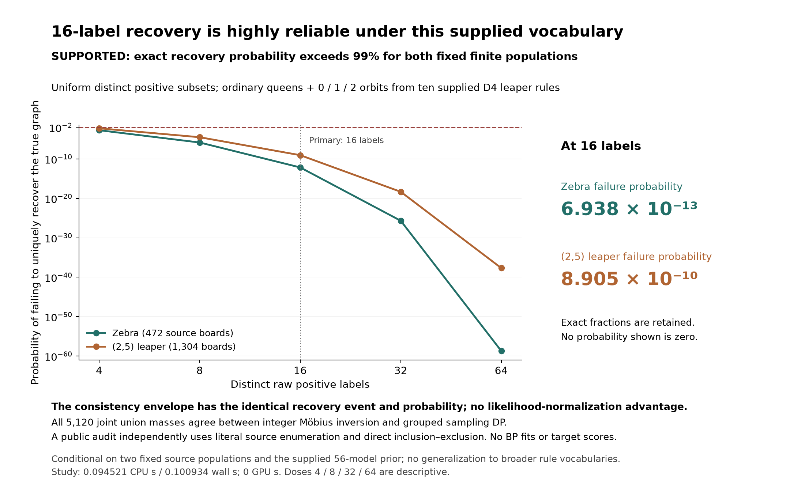

# H3as: exact finite-population reliability under the supplied vocabulary

**The prospective ≥99% unique-recovery probability at 16 labels is supported for both fixed families.** The exact probability of failure is approximately 6.938052521488×10⁻¹³ for zebra and 8.905027572626×10⁻¹⁰ for the (2,5) leaper. These probabilities refer to all possible uniform 16-element subsets of each fixed N12 source population, not only the eight realized H3ar banks. The consistency-envelope control has exactly the same recovery event and probability, so this result establishes no likelihood-normalization advantage.

| Method at 16 positives | Zebra unique exact graph recovery | (2,5) leaper unique exact graph recovery | Status |
|---|---:|---:|---|
| BP AdamW | Not measured | Not measured | No optimizer fit at any dose |
| Supplied finite-candidate maximum likelihood | 1 − 6.938052521488×10⁻¹³ | 1 − 8.905027572626×10⁻¹⁰ | Primary supported for both families |
| Consistency envelope in the same vocabulary | Identical probability | Identical probability | Same event, not an independent benefit |

| Labels | Zebra failure probability | (2,5) leaper failure probability | Role |
|---:|---:|---:|---|
| 4 | 1.8965027327344728E-3 | 5.8138057710033942E-3 | Descriptive |
| 8 | 1.4573604451951058E-6 | 3.1885864362508435E-5 | Descriptive |
| 16 | 6.9380525214883208E-13 | 8.9050275726260289E-10 | Primary, ≥99% success required |
| 32 | 2.0813847432303519E-26 | 4.5995561683624336E-19 | Descriptive |
| 64 | 1.9388256048647432E-59 | 2.0845934145719406E-38 | Descriptive |

At four labels, descriptive success probabilities already exceed 99%: 99.8103497267% for zebra and 99.4186194229% for the leaper. This does not establish the minimum required dose because smaller doses were not included. Every failure probability in the table is positive. Ordinary floating-point success probabilities at 32 and 64 labels round to 1.0; the report, CSV and figure use exact integer failure counts instead of presenting those rounded values as certainty. The full successful/total and reduced failure fractions are retained.

The candidate class is exactly the H3ar prior: ordinary-queen constraints plus zero, one or two orbits among the ten D4 leaper pairs 1≤a<b≤5. All 56 graphs are distinct at both N12 and N13. Under a candidate with M source states, a consistent unordered k-element subset has likelihood 1/binomial(M,k); an inconsistent subset has likelihood zero. Every likelihood tie is preserved. Complete source populations contain 472 zebra boards and 1,304 leaper boards. These populations are evaluator inputs for exact acquisition reliability, not extra labels given to a learner. There are no new draws, target truth reads, target scores, BP fits or GPU searches.

**Recovery lemma.** Let t be the true singleton orbit. The true population is a proper subset of the 14,200 ordinary-queen boards. If some other orbit u is unwitnessed by the supplied positives, the candidate {t,u} is consistent. If u is witnessed anywhere in the complete true source population, {t,u} has strictly fewer states than {t} and therefore strictly higher likelihood. If u is never witnessed in that population, the two candidates have equal normalizers and tie; their distinct graphs still defeat unique true-graph recovery. In either case, {t} cannot be the unique maximizer. Conversely, if all nine other orbits are witnessed, the only consistent candidates are the empty orbit set and {t}; the latter has fewer source states and wins uniquely. Therefore unique recovery is equivalent to witnessing every other orbit. The consistency envelope equals the true graph under exactly the same condition.

The study explicitly checks the conditions of this argument, rather than discarding unobservable orbits: all 56 N12/N13 candidate graphs are distinct, each true source is strictly smaller than the ordinary-queen source, every true-plus-other graph is strictly larger than the true graph, and its source cardinality is exactly M minus the number of true-population boards witnessing the added orbit. In these two populations all nine other orbits are observable. All 512 possible nine-bit witness-union patterns are independently classified under all 56 candidate normalizers, retaining every tied maximizer, and checked against the lemma. Impossible patterns remain with zero probability.

Each true board contributes one nine-bit joint witness mask. For a mask S, let A(S) be the number of population boards whose witness mask is contained in S. Then binomial(A(S),k) counts k-element subsets whose union is contained in S. Integer Möbius inversion gives the exact count of subsets with each union. The success count is the mass at the all-nine-bits mask, divided by binomial(M,k). An independent grouped dynamic program samples j boards from each equal-mask group with weight binomial(group size,j), preserving all joint dependencies and sampling without replacement. Every one of the 5,120 masses (512 masks × five doses × two families) agrees exactly. No independent-orbit approximation or Monte Carlo uncertainty is involved.

The protocol, primary threshold, fixed populations, descriptive doses and budgets were frozen before inspecting population witness frequencies. The two integer methods also agree with exhaustive literal sampling on five small synthetic populations and 45 dose cases within the charged run. Grouped-DP work totals 41,065 and 103,395 inner updates for the two families. The full raw source histograms, per-board masks, 1,024 selection-pattern records with all ties, and all exact probability masses are public.

This is a conditional finite-population result under strong queen, D4, radius-five and at-most-two-orbit priors. It resolves the random-draw reliability question left by eight fixed-bank successes; it does not estimate reliability for a broader vocabulary, new rule families, corrupted labels, a different observation process or an unconstrained learner. Exact N13 graph identity follows structurally from correctly selecting the supplied rule, but this study performs no new target capacity or search experiment.

The full monitored study used **0.094521 CPU seconds / 0.100934 wall seconds**, within 120 / 180-second limits, and zero GPU work. The separate independent publication audit took 1.245362 wall seconds. It re-enumerates all 56 complete N12 candidate populations with literal F, rebuilds every source-board witness and joint histogram, checks all graph-distinctness and lemma conditions, verifies all ties for all 512 patterns per family, and recomputes every union mass using direct inclusion–exclusion rather than the study’s transform or grouped DP.

Run `upstream/.venv/bin/python research/20261114/loki/h3as/verify_public.py --root SNAPSHOT` from a NumPy environment with a C++17 compiler.

[Frozen protocol](protocol.json), [two exact counting algorithms](distribution.py), [study](study.py), [independent public audit](verify_public.py), [summary](../../../../results/research/loki/h3as/summary.json), [exact fractions and decimal presentation](../../../../results/research/loki/h3as/reliability.csv), [zebra full distribution](../../../../results/research/loki/h3as/family0/exact-distribution.json), [leaper full distribution](../../../../results/research/loki/h3as/family1/exact-distribution.json), [figure provenance](../../../../results/research/loki/h3as/plot-provenance.json).
