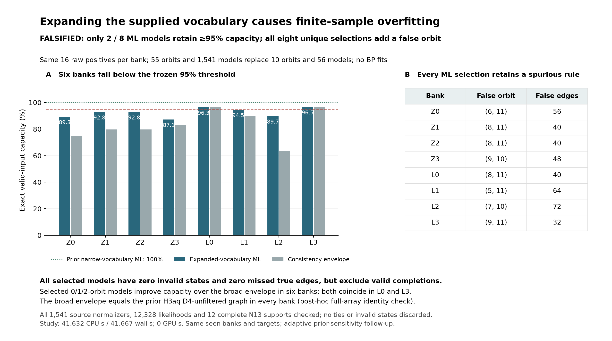

# H3at: a broader vocabulary makes likelihood overfit the same 16 positives

**The all-bank ≥95% capacity and zero-invalid-state hypothesis is falsified: only two of eight banks pass.** Every maximum-likelihood selection is unique, but every selected graph is wrong: it adds one spurious long-range orbit to the true rule. Exact valid-input capacities fall to 87.130099%–96.538095%, although all eight selected models still have zero invalid states. Thus H3ar’s exact recovery and H3as’s high acquisition reliability depend materially on their narrow supplied vocabulary.

| Method at 16 positives | Valid-input capacity | Invalid zero-F states | Exact graphs | Status |
|---|---:|---:|---:|---|
| BP AdamW | Not measured | Not measured | Not measured | No 16-label optimizer fit |
| H3ar narrow-vocabulary ML | 100% in all eight banks | 0 | 8 / 8 | Imported same-bank reference |
| Expanded-vocabulary ML | 87.130099%–96.538095% | 0 | 0 / 8 | Primary falsified; 2 / 8 pass capacity |
| Expanded consistency envelope | 63.503984%–96.538095% | 0 | 0 / 8 | Descriptive control |

| Family / bank | Added false orbit | Candidate N12 states | ML capacity (%) | Envelope capacity (%) | ML false / missed edges | Decision |
|---|---|---:|---:|---:|---:|---|
| Zebra / 0 | (6, 11) | 416 | 89.250221 | 74.701362 | 56 / 0 | falsified |
| Zebra / 1 | (8, 11) | 440 | 92.785873 | 79.747759 | 40 / 0 | falsified |
| Zebra / 2 | (8, 11) | 440 | 92.785873 | 79.747759 | 40 / 0 | falsified |
| Zebra / 3 | (9, 10) | 424 | 87.130099 | 82.762903 | 48 / 0 | falsified |
| (2,5) leaper / 0 | (8, 11) | 1200 | 96.319071 | 96.319071 | 40 / 0 | supported |
| (2,5) leaper / 1 | (5, 11) | 1096 | 94.541659 | 89.571808 | 64 / 0 | falsified |
| (2,5) leaper / 2 | (7, 10) | 1056 | 89.660745 | 63.503984 | 72 / 0 | falsified |
| (2,5) leaper / 3 | (9, 11) | 1236 | 96.538095 | 96.538095 | 32 / 0 | supported |

This prospective experiment changes the supplied prior while fixing all eight previously examined H3ao 16-positive banks and the same complete N13 target universes. The vocabulary expands from the ten pairs 1≤a<b≤5 to all 55 pairs 1≤a<b≤11. Candidates still contain ordinary-queen constraints plus zero, one or two D4 leaper orbits, giving 1+55+binomial(55,2)=1,541 candidates. Every added orbit has a representable N12 displacement; this is not an example involving a new displacement that cannot occur at the source size. D4 symmetry, the finite vocabulary and the at-most-two-orbit bound remain strong supplied assumptions.

The observation model and decision rule are unchanged: the sixteen distinct raw positives form an unordered uniform subset sampled without replacement. A consistent candidate with M complete N12 states has likelihood 1/binomial(M,16); an inconsistent candidate has likelihood zero. A candidate with fewer than sixteen states cannot contain the sixteen distinct observations and is explicitly checked to be inconsistent. Selection minimizes M among consistent candidates. Every tied maximizer is retained; no model-size penalty, target-favored tie break, candidate pruning or extra labels are introduced. All eight realized maxima happen to be unique.

The complete ordinary-queen N12 population has 14,200 boards. Every candidate population is computed by filtering it under the supplied rules, then checked independently against compiled literal-F enumeration. These hypothetical solver populations provide likelihood normalizers, not additional observed training labels or completeness negatives. All 1,541 full candidate sets are retained losslessly as packed validity masks over the public ordinary-queen population, with cardinalities and raw complete-column and graph hashes. This avoids hundreds of megabytes of duplicated arrays. All 12,328 bank/candidate scores, including zero likelihoods, and every selection/control membership are public.

The mechanism is visible in the source-only selections: each added orbit is absent from the sixteen observed boards but excludes some other boards in the true source population. It therefore shrinks M and increases the likelihood of the observed subset. For example, zebra bank 0 selects the true (2,3) orbit plus false (6,11), reducing its source population from 472 to 416 boards. At N13, those extra exclusions remove valid completions and reduce capacity to 89.250221%. The added orbits cause 32–72 false target edges, with no missed true edges. This is finite-sample overfitting under the expanded model class; no post-hoc penalty or new threshold is used to repair it in this experiment.

The expanded consistency control retains every one of the 55 orbits unwitnessed by the positive sample, together with ordinary queens. It may contain more than two orbits and is explicitly outside the candidate class in those cases. ML has higher capacity than this broad envelope in six banks and exactly the same graph in leaper banks 0 and 3. Its advantage here combines selection within the at-most-two-orbit class and the likelihood criterion; this experiment does not isolate likelihood normalization from the supplied complexity restriction.

A separately labeled post-hoc full-array comparison finds that the broad envelope equals H3aq’s D4-unfiltered graph for every bank. It therefore has the same previously observed safety/capacity tradeoff. The comparison receipt pins the earlier model files and checks every F array; this is a descriptive identity, not an additional prospective endpoint or independent replication. H3ar’s narrow model files are also pinned by that receipt and differ from every expanded ML selection.

In these realized selections the true orbit is retained, so their extra exclusions preserve safety while reducing capacity. Zero invalid states is checked by complete enumeration; it is not asserted as a universal guarantee of expanded maximum likelihood. The envelope’s safety remains conditional on valid positive labels, actual D4 invariance and inclusion of the true rules in the supplied vocabulary.

Every source score, maximizer, control and support mapping is sealed before target truth is scored. Full-F equality within family reduces the 16 logical outcomes to 12 distinct target supports, without dropping any candidate, tie or bank. Every support contains ordinary-queen constraints, allowing filtering of all 73,712 N13 queen states. Each filtered result must equal an independent compiled literal-F enumeration. All invalid states are retained. Exact integer histograms cover all 377 one-, two- and three-clue subsets of every valid state. The full seen universes contain 252,061 zebra keys and 301,337 leaper keys, with zero exclusions. The primary test uses 20×covered keys≥19×all keys and requires every maximizer in every bank.

The monitored study used **41.632306 aggregate CPU seconds / 41.667429 wall seconds**, within 600 / 900-second caps, with zero GPU work. The full-support cap was 3,084; hitting any cap would have left the study incomplete rather than pruned its candidate set. Coordinate graph construction was vectorized and checked against literal edge loops on six frozen synthetic fixtures inside the charged run. Those fixtures measured 0.000793 versus 0.018510 seconds, a 23.35× improvement for graph construction only, not an end-to-end study speedup.

The separate public audit took 54.698745 wall seconds. It rebuilds all coordinate graphs and source witnesses, replays the original eight uniform draws, re-enumerates all 1,541 source populations, checks lossless masks and every normalizer, recomputes all 12,328 exact likelihoods and all ties, reconstructs every complete N13 census and capacity flag, and verifies every primary decision and post-hoc full-graph identity. It requires only the tracked snapshot, NumPy and a C++17 compiler.

This follow-up was chosen adaptively after narrow-vocabulary success. The expanded recipe, thresholds, tie handling, budgets and absence of pruning were frozen before expanded candidate counts or target outcomes were inspected. These same-bank, same-target results are a sensitivity test of the supplied prior, not untouched-test generalization or generic rule discovery.

Run `upstream/.venv/bin/python research/20261114/loki/h3at/verify_public.py --root SNAPSHOT`.

[Frozen protocol](protocol.json), [source selector](source.py), [target evaluator](study.py), [public verifier](verify_public.py), [summary](../../../../results/research/loki/h3at/summary.json), [all scores and selections](../../../../results/research/loki/h3at/source-selection.json), [all outcomes](../../../../results/research/loki/h3at/capacity.csv), [post-hoc graph identities](../../../../results/research/loki/h3at/posthoc-control-comparison.json), [figure provenance](../../../../results/research/loki/h3at/plot-provenance.json).
