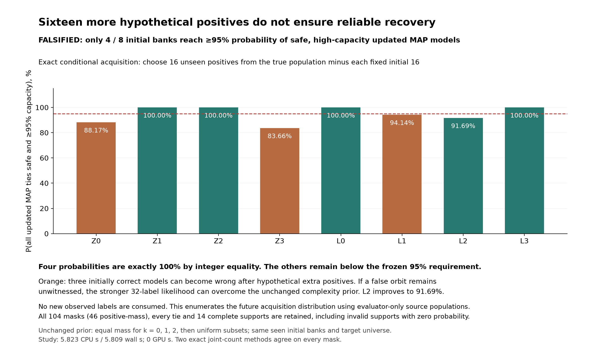

# H3av: hypothetical additional positives can reverse a correct MAP choice

**The per-bank ≥95% reliability hypothesis is falsified: only four of eight initial banks pass.** Exact probabilities that all updated MAP maximizers remain safe and retain at least 95% valid-input capacity range from 83.656393% to exactly 100%. Three initially correct H3au banks can become wrong after sixteen hypothetical additional positives because the stronger likelihood can favor an unwitnessed false orbit over the unchanged complexity prior. The previously failed leaper bank 2 improves to 91.691887% success probability but remains below the threshold.

| Method / scope | Probability of safe ≥95%-capacity output | Status |
|---|---:|---|
| BP AdamW | Not measured | No optimizer fits |
| Fixed H3au MAP at initial 16 labels | Seven fixed outputs pass; one fails | Published fixed-bank observations, not acquisition probabilities |
| Same MAP prior after hypothetical 16 additional positives | 83.656393%–100% | New exact conditional distribution; primary falsified in four banks |

| Family / bank | Complement size | Abstract / positive-mass masks | Exact success probability (%) | Decision |
|---|---:|---:|---:|---|
| Zebra / 0 | 456 | 16 / 6 | 88.166228218 | falsified |
| Zebra / 1 | 456 | 16 / 6 | 100.000000000 | supported |
| Zebra / 2 | 456 | 16 / 6 | 100.000000000 | supported |
| Zebra / 3 | 456 | 8 / 4 | 83.656393475 | falsified |
| (2,5) leaper / 0 | 1288 | 4 / 2 | 100.000000000 | supported |
| (2,5) leaper / 1 | 1288 | 8 / 4 | 94.135049789 | falsified |
| (2,5) leaper / 2 | 1288 | 32 / 16 | 91.691887034 | falsified |
| (2,5) leaper / 3 | 1288 | 4 / 2 | 100.000000000 | supported |

For zebra banks 1 and 2 and leaper banks 0 and 3, the successful-subset integer equals the total-subset integer, so 100% is exact, not floating-point rounding. The remaining success probabilities are 88.1662282177%, 83.6563934753%, 94.1350497887% and 91.6918870338% for indices 0, 3, 5 and 6. In this study the safe-capacity event has the same exact mass as unique true-graph recovery. That equality is an observed classification of all relevant supports, not a general equivalence between graph recovery and capacity.

**No new observed labels are consumed.** This study enumerates every hypothetical uniform sixteen-element subset from each true N12 source population after removing that bank’s fixed initial sixteen boards. The complements contain 456 zebra boards or 1,288 leaper boards. The complete true populations are evaluator-only data used to compute conditional acquisition probabilities. They are not extra labels supplied to the source selector. There is no selected future draw, targeted acquisition, independence approximation or Monte Carlo uncertainty.

The prior and candidate class are unchanged from H3au: 1,541 ordinary-queen models with zero, one or two D4 leaper orbits among all 55 pairs 1≤a<b≤11; P(k)=1/3 and uniform subsets within each k. The prior is not strengthened after the previous failure. For a candidate with M states consistent with both initial and additional samples, the sequential unnormalized posterior weight is proportional to 1/[3×binomial(55,k)×binomial(M,16)×binomial(M−16,16)]. The identity binomial(M,16)×binomial(M−16,16)=binomial(M,32)×binomial(32,16) makes pooled 32-label MAP equivalent. Every eligible M is checked with exact integers.

Selection therefore minimizes binomial(55,k)×binomial(M,32), preserving every tied maximizer. Models with M<32 are ineligible for thirty-two distinct observations; every positive-probability mask is checked not to contain an otherwise consistent such model. The source stage reads the initial sixteen boards and hypothetical solver normalizers, and constructs a lookup for every joint witness mask among initially unwitnessed orbits. It includes the true orbit, even though valid future positives can never witness it. Every mask, all posterior ties, complete support models and membership records are sealed before the evaluator reads true source acquisition populations or target truth. This is function/process dataflow separation, not an OS sandbox.

The evaluator removes each fixed initial sample from its complete source population, assigns a joint witness mask to every remaining board, and counts every sixteen-element subset by witness union. Integer Möbius inversion and an independent grouped without-replacement dynamic program agree on every mass. Their inputs preserve all within-board and across-orbit dependencies. The charged run includes literal exhaustive subset validation on five synthetic populations. All exact numerators, denominators, mask counts and selected candidates are exported.

There are 104 abstract masks, of which 46 have positive acquisition probability, and fourteen distinct target supports. All fourteen are fully evaluated, including zero-probability patterns that witness the true forbidden orbit. Those impossible patterns select graphs with invalid states; the invalid-state sets are preserved and never counted as feasible acquisition outcomes. Every positive-mass selected model has zero invalid states, so the probability failures arise from excess exclusions and reduced capacity. Retaining the impossible masks makes this distinction auditable.

The nonmonotonic behavior is conditional on the fixed initial banks. H3au correctly selected the true rule for zebra bank 0, zebra bank 3 and leaper bank 1. With sixteen additional hypothetical positives, the true rule is still always consistent, but an unwitnessed false orbit can remain consistent too. The larger likelihood exponent can overcome the fixed 27:1 singleton-to-pair prior odds, making the false pair win. On these events, capacity falls to 89.250221%, 87.130099% or 94.541659%, respectively. Extra data does not create a contradictory label; it changes relative support for still-consistent models. This does not assert that learning is generally nonmonotonic under all priors or data distributions.

The previously failed leaper bank 2 can select either of two false-pair graphs on unsuccessful events: true (2,5) plus (7,10), or true (2,5) plus (6,11). Their capacities are 89.660745% and 94.031931%. All successful acquisition events select the true graph. All possible selections, including these failures, remain in the frozen study; there is no post-hoc prior tuning or mask exclusion.

Fresh target evaluation filters all 73,712 ordinary-queen N13 states after checking every support contains queen constraints. Each full support set must match an independent compiled literal-F enumeration. Complete true state sets and every invalid state are preserved. Exact integer histograms count all 377 one-, two- and three-clue subsets of every valid state over the full seen input universes, with no exclusions. Each mask’s primary event requires zero invalid states and 20×covered keys≥19×all keys for every tied maximizer. Each bank then requires 20×successful hypothetical subsets≥19×all hypothetical subsets.

This adaptive follow-up uses the same already examined initial banks, known finite source families and target universes. Its prospective calculation covers the entire hypothetical conditional acquisition distribution under a fixed observation model and unchanged prior. It is not new-label empirical validation, untouched-target testing or a general rule-discovery claim.

The monitored study used **5.822717 aggregate CPU seconds / 5.808523 wall seconds**, within 120 / 180-second caps, with zero GPU work. The 3,084-support cap was not reached. Publication audit is separate: 44.624912 wall seconds. It independently re-enumerates all 1,541 complete source candidate sets and all fourteen target supports, replays every initial draw, checks every sequential posterior identity and tie, rebuilds every source-complement witness mask, and recomputes every conditional union mass by direct inclusion–exclusion.

Run `upstream/.venv/bin/python research/20261114/loki/h3av/verify_public.py --root SNAPSHOT`.

[Frozen protocol](protocol.json), [source-only hypothetical selection](source.py), [conditional evaluator](study.py), [exact counting algorithms](distribution.py), [independent verifier](verify_public.py), [summary](../../../../results/research/loki/h3av/summary.json), [all reliability fractions](../../../../results/research/loki/h3av/reliability.csv), [all abstract selections](../../../../results/research/loki/h3av/source-selection.json), [figure provenance](../../../../results/research/loki/h3av/plot-provenance.json).
