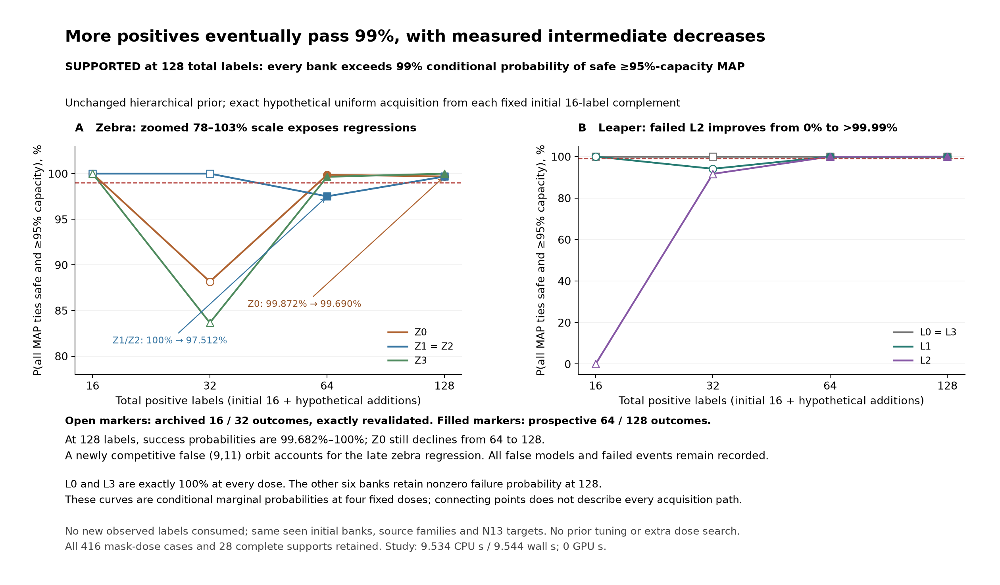

# H3aw: exact acquisition dose curves pass at 128 but remain nonmonotonic

**The prospective 128-label primary is supported: all eight fixed banks exceed 99% conditional probability of safe, at-least-95%-capacity MAP output.** The lowest probability is 99.6819998641%. However, the exact curves retain several decreases as hypothetical positive-label count increases. Zebra bank 0 falls from 99.8723676998% at 64 labels to 99.6903062843% at 128; zebra banks 1 and 2 fall from exactly 100% at 32 to 97.5122490834% at 64. Earlier 16→32 regressions also remain.

| Method / scope | Evidence |
|---|---|
| BP AdamW | Not measured; no optimizer fits |
| Fixed hierarchical MAP | Exact conditional probability curve at frozen totals 16 / 32 / 64 / 128 |
| Archived H3au / H3av | 16 / 32 outcomes explicitly revalidated, including every choice, complete F and event mass |

| Family / bank | 16 labels (%) | 32 labels (%) | 64 labels (%) | 128 labels (%) | 128 primary |
|---|---:|---:|---:|---:|---|
| Zebra / 0 | 100.000000000 | 88.166228218 | 99.872367700 | 99.690306284 | supported |
| Zebra / 1 | 100.000000000 | 100.000000000 | 97.512249083 | 99.681999864 | supported |
| Zebra / 2 | 100.000000000 | 100.000000000 | 97.512249083 | 99.681999864 | supported |
| Zebra / 3 | 100.000000000 | 83.656393475 | 99.649370420 | 99.999944587 | supported |
| (2,5) leaper / 0 | 100.000000000 | 100.000000000 | 100.000000000 | 100.000000000 | supported |
| (2,5) leaper / 1 | 100.000000000 | 94.135049789 | 99.982090197 | 99.999999900 | supported |
| (2,5) leaper / 2 | 0.000000000 | 91.691887034 | 99.984758216 | 99.999999957 | supported |
| (2,5) leaper / 3 | 100.000000000 | 100.000000000 | 100.000000000 | 100.000000000 | supported |

| Family / bank | Exact-derived failure probability at total 128 |
|---|---:|
| Zebra / 0 | 3.096937156831E-3 |
| Zebra / 1 | 3.180001359202E-3 |
| Zebra / 2 | 3.180001359202E-3 |
| Zebra / 3 | 5.541270608510E-7 |
| (2,5) leaper / 0 | 0 (exact) |
| (2,5) leaper / 1 | 1.003939565922E-9 |
| (2,5) leaper / 2 | 4.284284142629E-10 |
| (2,5) leaper / 3 | 0 (exact) |

Leaper banks 0 and 3 have exact success probability one at every frozen dose: their successful-subset counts equal total-subset counts. All other banks retain nonzero failure probability at 128, including the two whose decimal percentage is very close to 100%. The full exact counts and reduced fractions are exported, so small failures are not replaced by rounded certainty. The original fixed outcome at sixteen labels is a degenerate conditional distribution with no additional draw: its success probability is one for seven banks and zero for leaper bank 2.

**These are hypothetical acquisition distributions; zero new observed labels are consumed.** Every curve is conditional on its fixed initial sixteen positives. For a total dose t, the evaluator enumerates every uniform distinct (t−16)-element subset from that bank’s complete true N12 population after removing its initial sample. The frozen totals are exactly 16, 32, 64 and 128, corresponding to 0, 16, 48 and 112 additional positives. The initial complements contain 456 zebra boards or 1,288 leaper boards. Connecting the marginal probabilities does not specify a joint acquisition path or claim that every individual path improves or declines.

The class and prior remain unchanged: 1,541 ordinary-queen models with zero, one or two D4 leaper orbits among all 55 pairs 1≤a<b≤11; P(k)=1/3 and uniform orbit subsets within k. For a model with M source states and k orbits, a consistent t-element sample has unnormalized posterior weight 1/[3×binomial(55,k)×binomial(M,t)]. Selection minimizes binomial(55,k)×binomial(M,t) exactly, retaining every tied maximizer. Models with M<t are ineligible for t distinct observations. The sequential identity binomial(M,16)×binomial(M−16,t−16)=binomial(M,t)×binomial(t,16) is checked at every eligible M and dose. There is no prior tuning or extra dose search.

Source-only selection reconstructs and checks every hypothetical candidate normalizer from the audited H3at packed support evidence. It then seals all posterior choices for every abstract witness mask at every dose before the evaluator reads true acquisition populations or target truth. The mask vocabulary includes all initially unwitnessed orbits, including the true orbit. Thus impossible masks that purport to witness a true prohibition remain in the evidence with probability zero. All ties and supports selected by those zero-probability patterns are retained.

The evaluator preserves each board’s full joint witness mask. Integer subset Möbius inversion and a grouped without-replacement dynamic program agree on every mass for all four additional doses. One grouped DP per bank computes all sizes through 112, avoiding separate repeated group recursions. There are 416 mask-dose cases and 28 distinct complete target supports. Every support is freshly enumerated, even if it existed in an earlier study: no target census cache is used. The full ordinary-queen N13 filter must equal compiled literal-F enumeration, and exact integer histograms count all 377 one-, two- and three-clue subsets of every valid state over the full seen input universe. All invalid states and zero-mass supports remain public.

Archived totals 16 and 32 are explicitly revalidated. At sixteen, every selected candidate and full F must match H3au, and the fixed safety/capacity event is recomputed. At thirty-two, every abstract mask’s choices, complete graphs, exact subset counts, safe-capacity event mass and exact-graph event mass must match H3av. The archive receipt records these identities. Total 64 is prospective descriptive evidence; total 128 alone carries the prospective ≥99% per-bank reliability requirement. The old H3au and H3av falsifications are unchanged.

The later decreases have the same finite-sample mechanism as the earlier failures: an unwitnessed false orbit can remain sample-compatible while the increasing likelihood advantage overcomes a fixed complexity preference. At 64, failed zebra-bank-0 events select true (2,3) plus false (6,11). At 128, true (2,3) plus the rarer false (9,11) also becomes competitive, adding failed events and reducing success probability despite the larger sample. Zebra banks 1 and 2 first acquire positive failure probability at 64 through false (8,11); at 128 false (9,11) can also win, although their overall probability improves relative to 64. The prospective final-dose requirement can hold while intermediate reliability is nonmonotonic.

The dose curve was chosen adaptively after H3av demonstrated regression at 32. All four doses, the unchanged prior, the final-dose threshold, full mask/tie handling and resource limits were frozen before new 64/128 posterior choices or probabilities were computed. These are results for the same already examined initial banks, finite source families and N13 targets. They do not establish a minimum dose, reliability on a new family, generic rule discovery, or empirical validation using new acquired labels.

The monitored study used **9.533852 aggregate CPU seconds / 9.543717 wall seconds**, within 120 / 180-second limits, with zero GPU work. The 3,084-support cap was not reached; any cap/budget failure would leave the study incomplete without pruning. The separate publication audit took 48.318813 wall seconds. It independently re-enumerates all 1,541 source populations and all 28 target supports, checks every sequential posterior identity and tie, reconstructs every source-complement mask, recomputes all exact conditional masses using direct inclusion–exclusion and verifies all archival identities and primary decisions.

Run `upstream/.venv/bin/python research/20261114/loki/h3aw/verify_public.py --root SNAPSHOT`.

[Frozen protocol](protocol.json), [source selection at all doses](source.py), [conditional evaluator](study.py), [independent verifier](verify_public.py), [summary](../../../../results/research/loki/h3aw/summary.json), [all exact curve fractions](../../../../results/research/loki/h3aw/reliability.csv), [archive revalidation](../../../../results/research/loki/h3aw/archive-revalidation.json), [figure provenance](../../../../results/research/loki/h3aw/plot-provenance.json).
