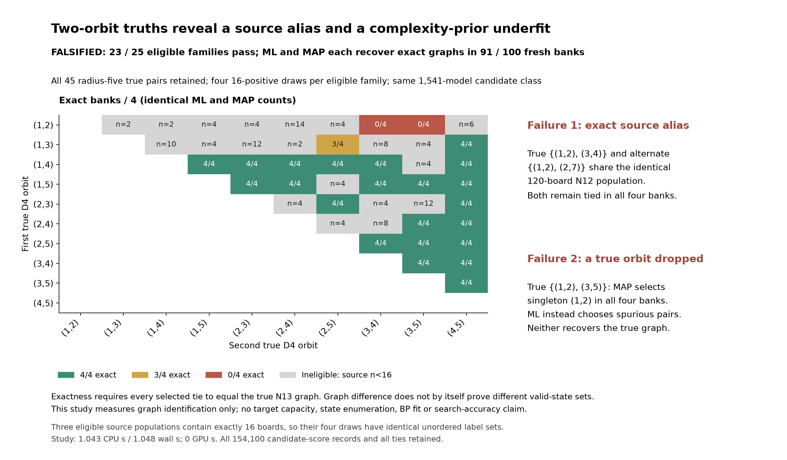

# H3ax: two-orbit truths expose a source alias and prior underfitting

**The all-family graph-recovery hypothesis is falsified.** Of the fixed 45 two-orbit truth families, 25 have enough N12 states for a sixteen-positive draw and 20 remain explicitly ineligible. Across 100 fresh eligible banks, ML and hierarchical MAP each exactly recover 91 true N13 graphs. Twenty-three of 25 eligible families meet the ≥3/4 MAP-exact requirement; two fail with 0/4. MAP is never worse than ML in exact-bank count here, but the all-family minimum is not met.

| Method | Exact banks / 100 | Eligible families with ≥3/4 exact banks | Scope |
|---|---:|---:|---|
| BP AdamW | Not measured | Not measured | No optimizer fit |
| Broad-class ML | 91 | 23 / 25 | Fresh positive-only selections |
| Unchanged hierarchical MAP | 91 | 23 / 25 | Primary falsified in two families |

Every exact-bank decision requires **every** tied selected graph to equal the true literal N13 graph. A true model merely appearing among tied maxima is insufficient. There are 96 unique selections and four two-way ties for each method. ML and MAP have equal exactness counts, but their selected models differ in four failed banks, so equal aggregate accuracy is not model identity.

The fixed truth grid contains all 45 unordered pairs from the ten D4 leaper orbits 1≤a<b≤5, always alongside ordinary-queen constraints. The supplied candidate class is still the much broader 1,541 models with zero, one or two orbits among 55 pairs 1≤a<b≤11. ML maximizes 1/binomial(M,16) for a consistent candidate of complete source size M. MAP uses the unchanged H3au hierarchical prior P(k)=1/3, uniform within orbit-count class, and minimizes binomial(55,k)×binomial(M,16). All inconsistent candidates, exact integer scores and tied maxima are retained.

Eligibility is fixed by complete source cardinality M≥16. Every family with M<16 is retained as ineligible and is neither a success nor an evaluated failure. If none had been eligible, the overall decision would have been inconclusive rather than supported. For each eligible family, four independent seeded generators draw sixteen distinct positives uniformly without replacement; seeds 2026116000+4×family+bank were frozen before the draws. Draws across banks may overlap. Three eligible families have M=16, so their four unordered label sets are necessarily identical even though their random orderings differ. These are not four independent information sets.

**Failure family 6: observationally identical complete N12 sources.** True {(1,2),(3,4)} and alternate {(1,2),(2,7)} each have exactly the same 120 N12 boards, not merely the same cardinality. Both remain tied maxima under ML and MAP in all four banks. Their N13 rule graphs differ, so the every-tie exact-graph criterion fails 0/4. Because the complete N12 populations are identical, no amount of positive or negative N12 membership data alone can distinguish these two supplied deterministic rule models under this observation setting. This is an identifiability limit for the model/rule graph. Graph difference alone does not prove that their N13 valid-state populations or capacities differ; those are not evaluated here.

**Failure family 7: a genuine second orbit is dropped by MAP.** The true {(1,2),(3,5)} source has 148 boards. MAP chooses singleton (1,2), whose source has 156 boards, in all four banks. The singleton’s fixed prior advantage outweighs the likelihood gain from the true second rule. ML fails for a different reason: it selects false pair {(1,2),(8,10)} in banks 0 and 3, {(1,2),(5,10)} in bank 1, and {(1,2),(3,9)} in bank 2, with source sizes 140, 140 and 144. Thus both methods score 0/4 exact while making different errors. No prior coefficient is retuned after observing underfitting.

The remaining failed bank is family 13, true {(1,3),(2,5)}, bank 3. Both methods choose {(1,3),(4,8)}, with source cardinality 104 instead of the true 124. That family still meets its per-family threshold at 3/4. All other eligible families have 4/4 exact selections. These source-set overlaps and selected-graph edge differences are separately exported as post-hoc descriptive failure diagnostics; they do not alter the primary criterion.

| Family | True orbit pair | Source M | Eligible | ML exact / 4 | MAP exact / 4 | Decision |
|---:|---|---:|---|---:|---:|---|
| 0 | [(1, 2), (1, 3)] | 2 | No | — | — | ineligible_source_fewer_than16 |
| 1 | [(1, 2), (1, 4)] | 2 | No | — | — | ineligible_source_fewer_than16 |
| 2 | [(1, 2), (1, 5)] | 4 | No | — | — | ineligible_source_fewer_than16 |
| 3 | [(1, 2), (2, 3)] | 4 | No | — | — | ineligible_source_fewer_than16 |
| 4 | [(1, 2), (2, 4)] | 14 | No | — | — | ineligible_source_fewer_than16 |
| 5 | [(1, 2), (2, 5)] | 4 | No | — | — | ineligible_source_fewer_than16 |
| 6 | [(1, 2), (3, 4)] | 120 | Yes | 0 | 0 | falsified |
| 7 | [(1, 2), (3, 5)] | 148 | Yes | 0 | 0 | falsified |
| 8 | [(1, 2), (4, 5)] | 6 | No | — | — | ineligible_source_fewer_than16 |
| 9 | [(1, 3), (1, 4)] | 10 | No | — | — | ineligible_source_fewer_than16 |
| 10 | [(1, 3), (1, 5)] | 4 | No | — | — | ineligible_source_fewer_than16 |
| 11 | [(1, 3), (2, 3)] | 12 | No | — | — | ineligible_source_fewer_than16 |
| 12 | [(1, 3), (2, 4)] | 2 | No | — | — | ineligible_source_fewer_than16 |
| 13 | [(1, 3), (2, 5)] | 124 | Yes | 3 | 3 | supported |
| 14 | [(1, 3), (3, 4)] | 8 | No | — | — | ineligible_source_fewer_than16 |
| 15 | [(1, 3), (3, 5)] | 4 | No | — | — | ineligible_source_fewer_than16 |
| 16 | [(1, 3), (4, 5)] | 112 | Yes | 4 | 4 | supported |
| 17 | [(1, 4), (1, 5)] | 40 | Yes | 4 | 4 | supported |
| 18 | [(1, 4), (2, 3)] | 52 | Yes | 4 | 4 | supported |
| 19 | [(1, 4), (2, 4)] | 88 | Yes | 4 | 4 | supported |
| 20 | [(1, 4), (2, 5)] | 64 | Yes | 4 | 4 | supported |
| 21 | [(1, 4), (3, 4)] | 60 | Yes | 4 | 4 | supported |
| 22 | [(1, 4), (3, 5)] | 4 | No | — | — | ineligible_source_fewer_than16 |
| 23 | [(1, 4), (4, 5)] | 58 | Yes | 4 | 4 | supported |
| 24 | [(1, 5), (2, 3)] | 16 | Yes | 4 | 4 | supported |
| 25 | [(1, 5), (2, 4)] | 16 | Yes | 4 | 4 | supported |
| 26 | [(1, 5), (2, 5)] | 4 | No | — | — | ineligible_source_fewer_than16 |
| 27 | [(1, 5), (3, 4)] | 80 | Yes | 4 | 4 | supported |
| 28 | [(1, 5), (3, 5)] | 84 | Yes | 4 | 4 | supported |
| 29 | [(1, 5), (4, 5)] | 20 | Yes | 4 | 4 | supported |
| 30 | [(2, 3), (2, 4)] | 4 | No | — | — | ineligible_source_fewer_than16 |
| 31 | [(2, 3), (2, 5)] | 76 | Yes | 4 | 4 | supported |
| 32 | [(2, 3), (3, 4)] | 4 | No | — | — | ineligible_source_fewer_than16 |
| 33 | [(2, 3), (3, 5)] | 12 | No | — | — | ineligible_source_fewer_than16 |
| 34 | [(2, 3), (4, 5)] | 88 | Yes | 4 | 4 | supported |
| 35 | [(2, 4), (2, 5)] | 4 | No | — | — | ineligible_source_fewer_than16 |
| 36 | [(2, 4), (3, 4)] | 8 | No | — | — | ineligible_source_fewer_than16 |
| 37 | [(2, 4), (3, 5)] | 48 | Yes | 4 | 4 | supported |
| 38 | [(2, 4), (4, 5)] | 34 | Yes | 4 | 4 | supported |
| 39 | [(2, 5), (3, 4)] | 36 | Yes | 4 | 4 | supported |
| 40 | [(2, 5), (3, 5)] | 16 | Yes | 4 | 4 | supported |
| 41 | [(2, 5), (4, 5)] | 360 | Yes | 4 | 4 | supported |
| 42 | [(3, 4), (3, 5)] | 212 | Yes | 4 | 4 | supported |
| 43 | [(3, 4), (4, 5)] | 20 | Yes | 4 | 4 | supported |
| 44 | [(3, 5), (4, 5)] | 72 | Yes | 4 | 4 | supported |

This study evaluates source parameter identification and literal N13 graph identity only. It does not enumerate target valid states, measure capacity, run retrieval/search, or fit BP. The true family label is used to generate its source positives and evaluate selections; it is not supplied to the score rule or used to break ties. Candidate populations are hypothetical solver computations under supplied rules, not additional observed training labels or an assumption that each sample is complete.

All 1,541 complete source supports are reused from hash-pinned H3at evidence and fully rechecked within the charged run: every packed mask, cardinality, complete-column hash and source-graph hash. Every one of the 1,541 literal N13 graphs is constructed, and all are distinct. All 154,100 bank/candidate score records are exported as deterministic gzip files containing the exact original JSON bytes; decompressed SHA-256 must equal the original study receipt. This is lossless compression, not a summary or score-table omission.

This stress test was chosen adaptively because the recent prior results used singleton truth. The complete 45-family grid, eligibility rule, four fixed seeds per family, exact tie criterion and budgets were frozen before drawing the new banks or computing their selections. Some source populations had already appeared as hypothetical candidates in prior studies. The result therefore tests a fixed set of genuine two-orbit truths and fresh positive draws, not arbitrary-rule generalization or a new target-state benchmark.

The monitored study used **1.042713 CPU seconds / 1.047772 wall seconds**, within 120 / 180-second limits, with zero GPU work. The maximum bank budget was 180; 100 were eligible and no family was pruned. The separate public audit took 45.913649 wall seconds. It independently enumerates all 1,541 N12 candidate populations with compiled literal F, reconstructs every literal N13 graph, replays all 100 source draws and 154,100 score records, checks every tie and all 45 eligibility/decision records, and independently verifies the source alias and selected-rule failure diagnostics.

Run `upstream/.venv/bin/python research/20261114/loki/h3ax/verify_public.py --root SNAPSHOT`.

[Frozen protocol and all seeds](protocol.json), [study](study.py), [independent verifier](verify_public.py), [summary](../../../../results/research/loki/h3ax/summary.json), [all 45 family outcomes](../../../../results/research/loki/h3ax/family-results.csv), [source alias and failure diagnostics](../../../../results/research/loki/h3ax/failure-diagnostics.json), [figure provenance](../../../../results/research/loki/h3ax/plot-provenance.json).
