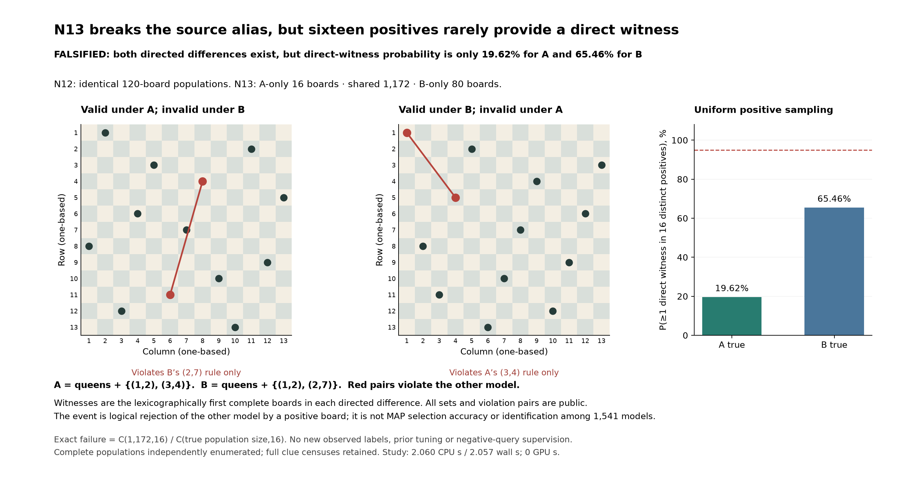

# H3ay: N13 separates the N12 alias, but random positives rarely witness it

**The 16-positive ≥95% pairwise distinguishing hypothesis is falsified.** Both directed N13 valid-state differences are nonempty, proving that the two N12-equivalent rules actually behave differently at N13. But a uniform sixteen-board positive sample contains a board that logically rejects the other rule with probability only 19.6150848985% when A is true and 65.4612436331% when B is true. Neither reaches 95%.

A is ordinary queens plus D4 leaper orbits {(1,2),(3,4)}. B is ordinary queens plus {(1,2),(2,7)}. The study is restricted to this fixed pair; it does not claim unique identification among the full 1,541-model class. No optimizer is fitted, no prior is changed, and no new observed positives or negative membership labels are acquired.

| Method / evidence | Result | Scope |
|---|---|---|
| BP AdamW | Not measured | No training or search run |
| Exact complete N12 populations | A = B, 120 states | Pairwise membership-identifiability limit |
| Exact complete N13 populations | A 1,188; B 1,252; overlap 1,172 | Actual behavior differs in both directions |
| Hypothetical 16-positive N13 draw | A 19.615085%; B 65.461244% direct-witness probability | Primary falsified |

| N13 set | Complete boards |
|---|---:|
| A only | 16 |
| A ∩ B | 1,172 |
| B only | 80 |
| A △ B | 96 |

Both complete N12 populations are independently re-enumerated and byte-identical, with 120 boards. Hence any N12 board receives the same membership label under A and B, including boards outside their shared population. Complete N12 membership evidence cannot distinguish the two deterministic rule models. Their uniform-positive N12 sampling distributions are also identical. This statement concerns the fixed pair and source size, not every possible source domain.

H3ax established different N13 graphs, which was insufficient to prove different N13 valid-state sets. This experiment closes that gap by enumerating the actual complete sets. Both directed set differences are nonempty, so positive N13 evidence can logically distinguish either true model from the other. The asymmetry matters: A has only sixteen exclusive states among 1,188, whereas B has eighty among 1,252.

The event called “distinguishing” is specifically **at least one positive sample board lies outside the alternative model’s valid set**. Such a board logically rejects that alternative. If all sixteen sampled boards lie in the intersection, both remain compatible. This does not imply that the sample supplies no likelihood evidence: the two uniform-positive N13 distributions have different normalizers. The reported probabilities are therefore not MAP accuracy, posterior-confidence rates, or a general-purpose classifier’s error rate.

For a true population of M boards and intersection size I=1,172, an unordered uniform sixteen-element subset is indistinguishable in that logical sense exactly when all its boards belong to the intersection. The exact failure probability is binomial(I,16)/binomial(M,16), and the direct-witness probability is its complement. Sampling is without replacement. Both populations exceed sixteen, so neither dose is ineligible. Exact integer successful, failed and total subset counts are retained, and decisions use 20×successful subsets≥19×all subsets. No Monte Carlo or independent-board approximation is used.

The following concrete witnesses use one-based columns, with the list position denoting the one-based row. Each is the lexicographically first board of its directed difference:

- Valid under A, invalid under B: `[2, 11, 5, 8, 13, 4, 7, 1, 12, 9, 6, 3, 10]`.
  The other model forbids occupied cells (4, 8) and (11, 6), with absolute displacement (7, 2).
- Valid under B, invalid under A: `[1, 5, 13, 9, 4, 12, 8, 2, 11, 7, 3, 10, 6]`.
  The other model forbids occupied cells (1, 1) and (5, 4), with absolute displacement (4, 3).

The first board violates B’s (2,7) orbit and no A rule; the second violates A’s (3,4) orbit and no B rule. Every occupied pair is checked, and all violations under the rejected model are recorded. These witnesses are evaluator-generated examples from complete set differences, not additional randomly observed training labels.

Both N12 and N13 ordinary-queen universes are completely enumerated. Each family population is obtained by filtering the corresponding ordinary-queen set and must exactly match an independent compiled literal-F enumerator. The shared source, complete target populations, intersection and both directed differences are exported. Full integer clue censuses are also retained descriptively: A has 135,529 distinct one-, two- or three-clue keys, B has 142,029. All 377 clue subsets per state contribute. These population descriptions are not retrieval accuracy or learned-model capacity claims.

This follow-up was chosen after H3ax exposed the N12 observational alias. The two families, requirement for both directed differences, sixteen-positive dose, ≥95% threshold, eligibility handling and resource budget were frozen before the N13 states or outcomes were inspected. The failure is preserved; no additional dose or stronger supervision is substituted into its primary result.

The complete monitored study used **2.060139 aggregate CPU seconds / 2.056611 wall seconds**, within 120 / 180-second caps, with zero GPU work and exactly two N13 supports. The separate publication audit took 2.839166 wall seconds. It independently reconstructs the coordinate graphs, re-enumerates all four family/size populations, verifies exact N12 identity and every N13 set operation, checks both concrete witnesses, recomputes all clue counts and independently verifies the subset probability by summing the hypergeometric counts for one through sixteen exclusive boards.

Run `upstream/.venv/bin/python research/20261114/loki/h3ay/verify_public.py --root SNAPSHOT`.

[Frozen protocol](protocol.json), [complete set study](study.py), [independent verifier](verify_public.py), [summary](../../../../results/research/loki/h3ay/summary.json), [exact pairwise fractions](../../../../results/research/loki/h3ay/pairwise-reliability.csv), [concrete boards and violation pairs](../../../../results/research/loki/h3ay/distinguishing-witnesses.json), [figure provenance](../../../../results/research/loki/h3ay/plot-provenance.json).
