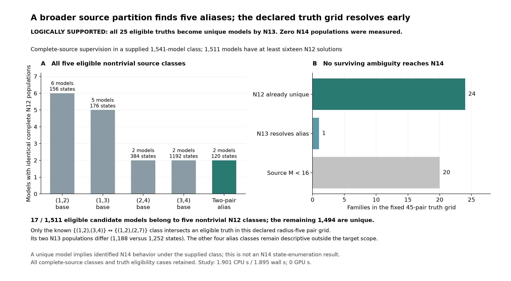

# H3az: complete source partition resolves the declared truth grid before N14

**The primary is logically supported, with zero N14 populations enumerated and no new N14 empirical evidence.** Among the fixed 45 radius-five two-orbit truths, 25 are eligible. Complete N12 evidence already uniquely identifies 24 within the supplied 1,541-model class; complete N13 evidence separates the remaining known two-model alias. Thus every eligible truth has a unique surviving model, which implies identified N14 behavior under that class. No nontrivial pooled alias remains to trigger the frozen N14 enumeration stage.

The broader complete N12 partition is the new descriptive result: 1,541 supplied models form 1,518 distinct complete-population classes. Of the 1,511 models with at least sixteen N12 solutions, 17 belong to five nontrivial classes; 1,494 are unique. Those eligible models form 1,499 classes. The entire partition, including empty and other ineligible populations, is retained.

| Method / scope | Result |
|---|---|
| BP AdamW | Not measured; no optimizer fits |
| Complete N12 model partition | 17 eligible models in five nontrivial classes |
| Declared 45-pair truth grid | 24 N12-unique, one N13-resolved, 20 ineligible |
| N13 complete population evaluation | Two models, 1,188 and 1,252 states |
| N14 complete population evaluation | Zero models; no surviving ambiguity in this grid |

| Eligible N12 alias class | Complete source states | Candidate models (added orbit sets) |
|---:|---:|---|
| 1 | 156 | [(1, 2)]; [(1, 2), (6, 11)]; [(1, 2), (8, 11)]; [(1, 2), (9, 10)]; [(1, 2), (9, 11)]; [(1, 2), (10, 11)] |
| 2 | 176 | [(1, 3)]; [(1, 3), (2, 8)]; [(1, 3), (2, 11)]; [(1, 3), (8, 9)]; [(1, 3), (10, 11)] |
| 12 | 384 | [(2, 4)]; [(2, 4), (9, 11)] |
| 20 | 1192 | [(3, 4)]; [(3, 4), (10, 11)] |
| 67 | 120 | [(1, 2), (2, 7)]; [(1, 2), (3, 4)] |

The first four classes contain a singleton rule and additional long-range prohibitions that do not remove any of its valid N12 boards. Their graphs differ while their complete N12 state populations agree. This establishes source redundancy of those added constraints; it does not establish their redundancy at N13 or N14. None of these four classes contains an eligible true pair from the predeclared radius-five grid, so their later-size states are outside this study’s target scope. They are not discarded from the descriptive partition.

Only class 67, {(1,2),(2,7)} versus {(1,2),(3,4)}, intersects an eligible truth in the declared grid. Its identical 120-state N12 population splits into two different N13 populations of 1,252 and 1,188 states, rechecking the earlier pairwise result. Both pooled N12+N13 classes are singletons. The N14 model list is therefore empty by the frozen procedure; there are no new N14 witnesses or population counts to report.

The primary asks whether every candidate agreeing with a true model’s complete N12 and N13 populations has the same N14 valid population. When exactly one candidate remains, this statement follows by identity of the model. We separately label 24 cases `N12_unique_model_vacuous`, one case `N13_unique_model_vacuous`, and twenty cases `ineligible`. There are zero `remaining_alias_N14_behavior_compared` cases. The word “supported” must not be interpreted as a nontrivial N14 generalization test having been run.

Supervision is much stronger than the recent sixteen-positive experiments: complete source populations provide closed-world membership information, including absence of boards from a complete valid set. These results therefore do not show that sixteen positives identify the model or that arbitrary sources suffice. The candidate class still supplies ordinary queens plus zero, one or two D4 orbits among all 55 pairs 1≤a<b≤11. The true-family grid is exactly all 45 pairs among the ten radius-five orbits, with M12≥16 eligibility. No optimizer, likelihood ranking or complexity-prior preference is used.

All 1,541 source populations are reconstructed from complete ordinary-queen N12 states, checking every packed support, cardinality, full-column hash and source-graph hash against audited H3at evidence. Equivalence uses exact entire population identity, not counts alone. The frozen N13 scope includes every member of every nontrivial N12 class intersecting any eligible truth, without selection inside a class. The frozen N14 scope would include every member of every nontrivial refined class after N13. Every actual N13/N14 population must agree between filtering a complete ordinary-queen universe and compiled literal-F enumeration.

The caps were 256 N13 models, 128 N14 models, 600 aggregate CPU seconds and 900 wall seconds. Any cap or budget failure would stop the whole study as incomplete rather than truncate a class. The complete N12 partition and relevant-stage lists are sealed before later-size evaluation. This adaptive follow-up was motivated by the known pairwise alias, but the full partition and stage counts were not inspected before freezing. No new board size was added when N14 proved unnecessary.

The monitored study used **1.901255 aggregate CPU seconds / 1.895211 wall seconds**, with zero GPU work. The separate public audit took 43.060363 wall seconds. It independently re-enumerates all 1,541 complete N12 populations, reconstructs every equivalence class and all 45 truth eligibility/scope records, re-enumerates both required N13 populations, checks the pooled refinement and empty N14 scope, and recomputes every primary case and decision.

Run `upstream/.venv/bin/python research/20261114/loki/h3az/verify_public.py --root SNAPSHOT`.

[Frozen protocol](protocol.json), [bounded partition study](study.py), [independent verifier](verify_public.py), [summary](../../../../results/research/loki/h3az/summary.json), [full N12 partition](../../../../results/research/loki/h3az/N12-partition.json), [all truth cases](../../../../results/research/loki/h3az/family-identifiability.csv), [pooled refinement](../../../../results/research/loki/h3az/pooled-N12-N13-partition.json), [explicit N14 comparison receipt](../../../../results/research/loki/h3az/N14-behavior-comparison.json), [figure provenance](../../../../results/research/loki/h3az/plot-provenance.json).
