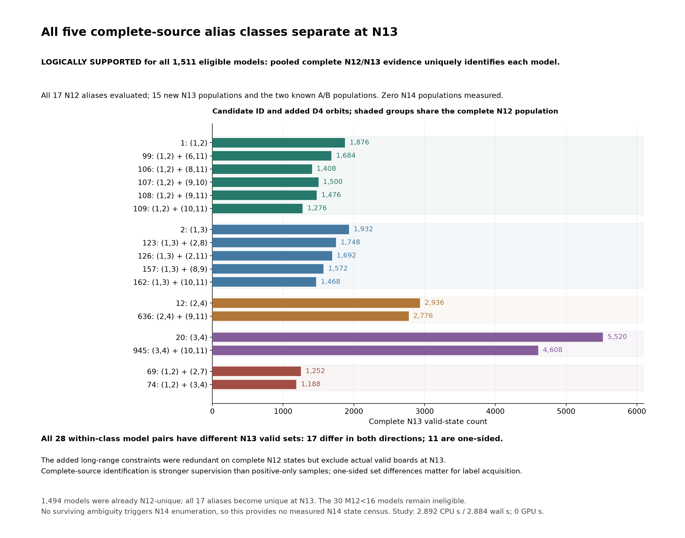

# H3ba: complete N12 and N13 evidence identifies every eligible supplied model

**The primary is logically supported for all 1,511 eligible models, with zero N14 populations enumerated.** Every one of the seventeen models in the five nontrivial N12 source-alias classes has a distinct N13 population within its original class. Together with the 1,494 models already unique at N12, all eligible models therefore become unique under pooled complete N12/N13 evidence. A unique model determines its N14 behavior under the supplied class; no ambiguity remains to trigger the frozen N14 census.

The new empirical evidence is fifteen complete N13 populations, plus independent re-enumeration of the two known A/B populations. This extends H3az’s truth-grid-restricted target evaluation to all five eligible alias classes. There is no new N14 state measurement, and the primary must not be read as an enumerated N14 generalization result.

| Method / scope | Result |
|---|---|
| BP AdamW | Not measured; no fitting or search |
| Complete N12 evidence | 1,494 eligible models already unique; 17 aliases in five classes |
| Complete N12 + N13 evidence | All 1,511 eligible models unique within the supplied class |
| Actual N13 enumeration | All 17 aliases; all 28 within-class model pairs state-distinct |
| Actual N14 enumeration | Zero populations; no pooled aliases remain |

| N12 alias class | Candidate | Added D4 orbit set | Shared N12 states | N13 states |
|---:|---:|---|---:|---:|
| 1 | 1 | [(1, 2)] | 156 | 1876 |
| 1 | 99 | [(1, 2), (6, 11)] | 156 | 1684 |
| 1 | 106 | [(1, 2), (8, 11)] | 156 | 1408 |
| 1 | 107 | [(1, 2), (9, 10)] | 156 | 1500 |
| 1 | 108 | [(1, 2), (9, 11)] | 156 | 1476 |
| 1 | 109 | [(1, 2), (10, 11)] | 156 | 1276 |
| 2 | 2 | [(1, 3)] | 176 | 1932 |
| 2 | 123 | [(1, 3), (2, 8)] | 176 | 1748 |
| 2 | 126 | [(1, 3), (2, 11)] | 176 | 1692 |
| 2 | 157 | [(1, 3), (8, 9)] | 176 | 1572 |
| 2 | 162 | [(1, 3), (10, 11)] | 176 | 1468 |
| 12 | 12 | [(2, 4)] | 384 | 2936 |
| 12 | 636 | [(2, 4), (9, 11)] | 384 | 2776 |
| 20 | 20 | [(3, 4)] | 1192 | 5520 |
| 20 | 945 | [(3, 4), (10, 11)] | 1192 | 4608 |
| 67 | 69 | [(1, 2), (2, 7)] | 120 | 1252 |
| 67 | 74 | [(1, 2), (3, 4)] | 120 | 1188 |

All 28 unordered model pairs within the five N12 classes have different complete N13 valid-state sets. Seventeen have nonempty directed differences in both directions; eleven are one-sided subset relations. Every directed-difference size and the lexicographically first board of each nonempty difference is retained. Empty directions are explicitly represented with size zero and no witness. These are actual valid-state comparisons, not deductions from differing constraint graphs alone.

In the four classes containing a singleton rule plus additional long-range orbits, the extra constraints were redundant over the complete N12 valid population. At N13 they remove real boards from the singleton population, so they become observable in the valid-state behavior. The one-sided differences explain why complete membership information and positive-only evidence are different supervision: a positive from a strict subset cannot by itself reject its superset, even though complete populations separate the models. This study does not calculate finite positive-sample probabilities or add membership queries.

The fixed supplied class remains ordinary queens plus zero, one or two D4 leaper orbits among the 55 pairs 1≤a<b≤11, totaling 1,541 models. Eligibility is complete N12 population size at least sixteen, leaving 1,511 eligible and thirty ineligible models. All 1,541 case records are retained. The 1,494 `N12_unique_model_vacuous` cases and seventeen `N13_unique_model_vacuous` cases are separated from actual remaining-alias N14 comparison; the latter count is zero. The claim does not extend to the thirty ineligible models or rules outside this supplied class.

The primary asks whether every model sharing a candidate’s complete N12 and N13 populations has the same N14 valid-state population. It is true here by unique-model identity, which is stronger identification within the finite class but requires complete-source supervision. Complete populations provide closed-world membership evidence and are substantially stronger than sixteen uniform positives. No actual new observed labels, likelihood ranking, prior preference, trained optimizer or retrieval/search benchmark is involved.

The H3az source partition was already known and explicitly motivates this adaptive expansion. The protocol pins and reconstructs its entire 1,541-model partition, then freezes all seventeen eligible aliases and all five classes before reading the fifteen new N13 populations. All known A/B populations are rechecked as well. For every N13 model, filtering the entire 73,712-board ordinary-queen universe must exactly equal independent compiled literal-F enumeration. Complete populations and graph arrays are public. If any pooled class had remained nontrivial, every member would have received the same full N14 filter/literal comparison. No new size is added when the N14 scope is empty.

Caps were seventeen models at each of N13 and N14, 600 aggregate CPU seconds and 900 wall seconds. Any cap or error would stop the whole study as incomplete without pruning a class. Every member, empty population and pair comparison is retained. Graph identity, state-population identity and logical uniqueness are kept distinct.

The monitored study used **2.892164 aggregate CPU seconds / 2.884156 wall seconds**, with zero GPU work. The separate public audit took 56.050526 wall seconds. It independently re-enumerates all 1,541 N12 populations and all seventeen N13 populations, rebuilds the source partition and exact pooled refinement, recomputes all 28 pairwise state comparisons and witnesses, verifies every eligibility and primary case, and checks the explicitly empty N14 stage.

Run `upstream/.venv/bin/python research/20261114/loki/h3ba/verify_public.py --root SNAPSHOT`.

[Frozen protocol](protocol.json), [complete alias study](study.py), [independent verifier](verify_public.py), [summary](../../../../results/research/loki/h3ba/summary.json), [full model-case results](../../../../results/research/loki/h3ba/family-identifiability.csv), [all N13 pair comparisons and witnesses](../../../../results/research/loki/h3ba/N13-pair-comparison.json), [pooled partition](../../../../results/research/loki/h3ba/pooled-N12-N13-partition.json), [empty N14 comparison receipt](../../../../results/research/loki/h3ba/N14-behavior-comparison.json), [figure provenance](../../../../results/research/loki/h3ba/plot-provenance.json).
