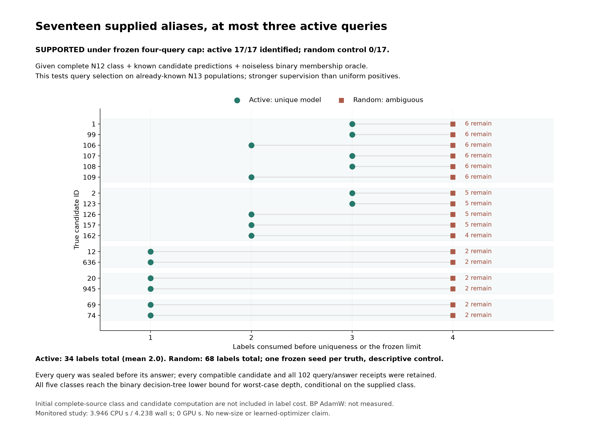

# H3bb: adaptive membership queries identify every supplied N12 alias

**The frozen four-query hypothesis is supported: all seventeen models were uniquely identified in at most three adaptive N13 membership queries.** The active policy used 34 labels in total. The descriptive random control used four labels for each model (68 total) and identified zero of seventeen models.

These results assume the true model’s complete N12 equivalence class is already given, the finite candidate rule definitions are known, and a noiseless binary membership oracle answers selected ordinary-queen N13 boards. Both positive and negative labels are allowed. The initial class and candidate predictions are substantial supplied information whose cost is not included in the reported query counts. This is not a same-oracle comparison to sixteen uniformly positive examples.

| Method | Models uniquely identified | Labels used |
|---|---:|---:|
| BP AdamW | Not measured; no fitting | Not measured |
| Adaptive balance, cap four | 17/17 | 34 total; 1–3 per model |
| Random four without replacement | 0/17 | 68 total; four per model |

| N12 class | True candidate | Active labels (+ / −) | Random labels | Random candidates remaining |
|---:|---:|---:|---:|---:|
| 1 | 1 | 3 (3 / 0) | 4 | 6 |
| 1 | 99 | 3 (2 / 1) | 4 | 6 |
| 1 | 106 | 2 (0 / 2) | 4 | 6 |
| 1 | 107 | 3 (1 / 2) | 4 | 6 |
| 1 | 108 | 3 (2 / 1) | 4 | 6 |
| 1 | 109 | 2 (1 / 1) | 4 | 6 |
| 2 | 2 | 3 (3 / 0) | 4 | 5 |
| 2 | 123 | 3 (2 / 1) | 4 | 5 |
| 2 | 126 | 2 (1 / 1) | 4 | 5 |
| 2 | 157 | 2 (0 / 2) | 4 | 5 |
| 2 | 162 | 2 (1 / 1) | 4 | 4 |
| 12 | 12 | 1 (1 / 0) | 4 | 2 |
| 12 | 636 | 1 (0 / 1) | 4 | 2 |
| 20 | 20 | 1 (1 / 0) | 4 | 2 |
| 20 | 945 | 1 (0 / 1) | 4 | 2 |
| 67 | 69 | 1 (1 / 0) | 4 | 2 |
| 67 | 74 | 1 (0 / 1) | 4 | 2 |

All compatible candidates survive each update; no empty candidate populations or inconvenient outcomes are filtered. Every tie at the four-label limit would have failed the primary. All seventeen truths and all five classes were fixed in advance. Stopping occurs as soon as the compatible set is a singleton.

| Given N12 class size | Class ID | Observed worst active label count | Binary decision-tree lower bound |
|---:|---:|---:|---:|
| 6 | 1 | 3 | 3 |
| 5 | 2 | 3 | 3 |
| 2 | 12 | 1 | 1 |
| 2 | 20 | 1 | 1 |
| 2 | 67 | 1 | 1 |

Descriptively, each class reaches the information-theoretic minimum worst-case depth: a binary tree distinguishing K candidates needs at least ceil(log2 K) levels. This bound is conditional on the supplied candidate set and noiseless binary answers; it is not a guarantee for larger classes or new rule families.

For every step, the selector scans all 73,712 ordinary-queen N13 boards except previously queried boards. It minimizes the absolute difference between the number of positive and negative candidate predictions, then chooses the lexicographically first row-to-column vector. The selector runs in a separate process and receives only the candidate prediction matrix, its candidate-ID ordering, the current compatible candidates, and earlier query IDs. It has no true-model argument or oracle interface. This is source-level interface isolation, not an adversarial operating-system sandbox.

Every selected query and its candidate predictions are written, flushed and fsynced before the evaluator calls the hidden-truth oracle. The query receipt is made read-only; the subsequent answer receipt references its hash and records both UTC and monotonic timestamps. The public audit independently reconstructs the minimum balance and full lexicographic tie set, verifies the chosen board and label, and retains every compatible candidate. All 102 selected queries and answers are public.

The random control freezes a full four-board order before any answer for each truth, using NumPy default_rng with seed 2026118000 + candidate ID. It samples uniformly without replacement from the full ordinary-queen universe and would also stop early at uniqueness. Only 1 of its 68 labels was positive; for true candidate 162 that positive removed candidate 157 but left four candidates. The other sixteen random runs retained their full starting class. This is one predeclared seed per truth, so 0/17 is a descriptive realized outcome, not an estimate of a universal random-query failure rate. The earlier positive-only studies use a different oracle and cannot be compared as equal-cost supervision.

H3ba had already established that the complete N13 populations distinguish these models. H3bb therefore tests a query strategy on known populations, not an unseen-size or unseen-model prediction. It adds no N14 census, no learned CRAM optimizer result, and no search-throughput comparison. The initial complete N12 class remains a strong assumption; the next useful test removes it while preserving the same finite candidate vocabulary.

The monitored whole study used **3.946313 aggregate CPU seconds / 4.237665 wall seconds**, under frozen 120 CPU / 180 wall second limits; zero GPU work. Exact boolean membership arrays let the selector scan all boards without repeated rule enumeration. The budget includes independent literal enumeration of all seventeen N13 populations, ordinary-universe parity, and selector-process overhead. The separate public audit took 1.449841 wall seconds and passed 683 checks. It re-enumerates all seventeen N12 source and N13 target populations, validates the supplied-class memberships, and independently replays every active and random step. The full 1,541-model N12 partition is hash-pinned from the independently audited H3ba study; H3bb takes that class as given rather than rediscovering it.

Run `upstream/.venv/bin/python research/20261114/loki/h3bb/verify_public.py --root SNAPSHOT`.

[Frozen protocol](protocol.json), [selector without true-ID input](selector.py), [sealed study](study.py), [independent verifier](verify_public.py), [summary](../../../../results/research/loki/h3bb/summary.json), [label-cost table](../../../../results/research/loki/h3bb/label-results.csv), [all query and answer receipts](../../../../results/research/loki/h3bb/cases), [figure provenance](../../../../results/research/loki/h3bb/plot-provenance.json).
