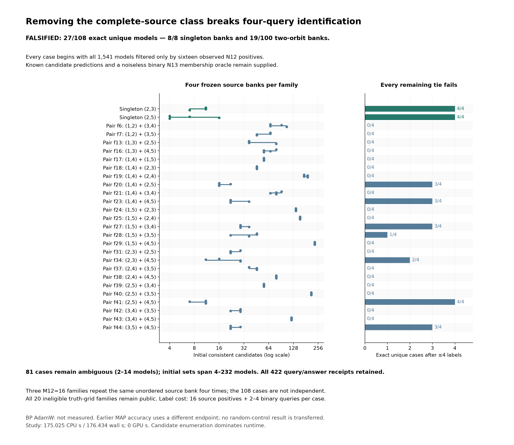

# H3bc: four membership queries fail without a supplied complete-source class

**The primary is falsified: only 27 of 108 cases uniquely identify the exact true model within four N13 membership queries.** All eight singleton-rule cases succeed, but only nineteen of one hundred genuine two-orbit cases do. Eighty-one cases remain ambiguous, with two to fourteen compatible models each.

H3bb supplied the true model’s complete N12 equivalence class and identified all seventeen aliases within three queries. H3bc removes that information: each case starts with every model in the full 1,541-model vocabulary that accepts the sixteen observed positive N12 boards. Those initial sets contain four to 232 models. The same balance-based selector still receives the supplied candidate predictions and a noiseless binary N13 membership oracle, but no complete-source class or negative N12 examples.

| Method / source evidence | Exact unique identification |
|---|---:|
| BP AdamW | Not measured for this query study |
| Sixteen positive N12 boards, all consistent candidates retained | 0/108 initially unique |
| Plus at most four adaptive binary N13 labels | 27/108 |
| Singleton-rule source banks within the above | 8/8 |
| Genuine two-orbit source banks within the above | 19/100 |

These are exact-unique-consistency endpoints. Earlier ML/MAP studies choose a ranked model from a larger consistent set, so their graph-selection accuracy cannot be compared to 27/108 as if the endpoint were the same. No new random control was run, and H3bb’s realized random result does not transfer to this larger starting class.

| Archived truth family | Added D4 orbit set | Initial candidates (min–max) | Exact cases | Largest final tie |
|---|---|---:|---:|---:|
| H3ao family 0 | [(2, 3)] | 7–11 | 4/4 | 1 |
| H3ao family 1 | [(2, 5)] | 4–16 | 4/4 | 1 |
| H3ax family 6 | [(1, 2), (3, 4)] | 67–106 | 0/4 | 7 |
| H3ax family 7 | [(1, 2), (3, 5)] | 46–67 | 0/4 | 4 |
| H3ax family 13 | [(1, 3), (2, 5)] | 37–79 | 0/4 | 5 |
| H3ax family 16 | [(1, 3), (4, 5)] | 56–79 | 0/4 | 6 |
| H3ax family 17 | [(1, 4), (1, 5)] | 56–56 | 0/4 | 4 |
| H3ax family 18 | [(1, 4), (2, 3)] | 46–46 | 0/4 | 2 |
| H3ax family 19 | [(1, 4), (2, 4)] | 172–191 | 0/4 | 12 |
| H3ax family 20 | [(1, 4), (2, 5)] | 16–22 | 3/4 | 2 |
| H3ax family 21 | [(1, 4), (3, 4)] | 67–92 | 0/4 | 6 |
| H3ax family 23 | [(1, 4), (4, 5)] | 22–37 | 3/4 | 2 |
| H3ax family 24 | [(1, 5), (2, 3)] | 137–137 | 0/4 | 9 |
| H3ax family 25 | [(1, 5), (2, 4)] | 154–154 | 0/4 | 9 |
| H3ax family 27 | [(1, 5), (3, 4)] | 29–37 | 3/4 | 3 |
| H3ax family 28 | [(1, 5), (3, 5)] | 22–46 | 1/4 | 3 |
| H3ax family 29 | [(1, 5), (4, 5)] | 232–232 | 0/4 | 14 |
| H3ax family 31 | [(2, 3), (2, 5)] | 22–29 | 0/4 | 2 |
| H3ax family 34 | [(2, 3), (4, 5)] | 11–29 | 2/4 | 2 |
| H3ax family 37 | [(2, 4), (3, 5)] | 37–46 | 0/4 | 3 |
| H3ax family 38 | [(2, 4), (4, 5)] | 79–79 | 0/4 | 6 |
| H3ax family 39 | [(2, 5), (3, 4)] | 56–56 | 0/4 | 3 |
| H3ax family 40 | [(2, 5), (3, 5)] | 211–211 | 0/4 | 13 |
| H3ax family 41 | [(2, 5), (4, 5)] | 7–11 | 4/4 | 1 |
| H3ax family 42 | [(3, 4), (3, 5)] | 22–29 | 0/4 | 2 |
| H3ax family 43 | [(3, 4), (4, 5)] | 121–121 | 0/4 | 8 |
| H3ax family 44 | [(3, 5), (4, 5)] | 22–29 | 3/4 | 2 |

The source examples are reused, not newly drawn: eight H3ao sixteen-positive prefixes from the two singleton families, and all one hundred eligible H3ax draws from the fixed radius-five two-orbit truth grid. All forty-five H3ax family records remain public, including the twenty ineligible families with fewer than sixteen source states. The three eligible families with exactly sixteen source states necessarily repeat the same unordered positive sample in all four banks; those cases and their identical query outcomes are retained, not counted as independent draws. The audit reconstructs every source seed and every sample.

All 1,541 models are considered initially, including the empty additional-orbit set and both one- and two-orbit rules. A model is removed initially only if it rejects at least one observed positive board. There is no source-normalizer ranking, assumed true orbit count, complete-source identity filter, or target-empty-population exclusion. Every source-compatible model remains available to the query policy.

The selector considers all 73,712 ordinary-queen N13 boards except earlier queries. It minimizes abs(2 × positive prediction count − current candidate count), then selects the lexicographically first board among all optimal ties. Every candidate agreeing with the revealed binary label survives. It stops at a unique model or four labels; every unresolved tie fails the primary. Query receipts are fsynced and made read-only before the hidden-truth oracle is called. The selector’s process interface carries no true-model ID. All 422 query and answer receipts are retained and independently replayed.

The experiment used 422 binary membership labels across the 108 reused banks. Three cases stopped after two queries, four after three, and 101 used all four. Per case, the declared label cost is sixteen positive source examples plus two to four binary target labels, totaling eighteen to twenty observed labels in this run. Reused duplicate source boards are not newly acquired labels; summing per-case accounting would overstate a pooled acquisition budget. Candidate rule definitions, complete prediction computation, and the change from a positive-only oracle remain explicit assumptions.

A large remaining candidate set creates an information constraint: a binary decision tree distinguishing every one of K possible candidates requires worst-case depth at least ceil(log2 K), which exceeds four when K > 16. This is not itself a proof that a particular declared truth needs more than four queries; the observed failures are established by the retained trajectories. No claim is made that a different acquisition policy cannot identify those truths within the same budget.

The whole study used **175.024728 aggregate CPU seconds / 176.434330 wall seconds**, within frozen 600 CPU / 900 wall second limits; zero GPU work. Computing and independently enumerating all 1,541 N13 candidate populations dominated runtime at 153.912064 CPU / 155.292808 wall seconds. The complete ordinary universe is generated once, displacement incidence is reused, and every candidate’s filtered population must equal compiled literal-graph enumeration.

The query process memory-maps packed predictions and unpacks only current candidate rows. A frozen two-repetition microbenchmark on the first seventeen rows confirmed exact parity and took 0.000314752 seconds versus 0.019290796 seconds for unpacking all rows (61.29× for this operation only). The expanded arrays contain 1,253,104 versus 113,590,192 bytes. This is not an end-to-end study speedup; literal enumeration remains the bottleneck.

The separate independent public audit passed 5800 checks in 154.830830 wall seconds. It reconstructs every N12 candidate mask and metadata record, independently enumerates every full N13 candidate population, verifies all source seeds and positive-only filters, replays all 422 global balance/lexicographic choices and sealed answers, retains all twenty ineligible families, and checks the duplicate-bank trajectories.

Run `upstream/.venv/bin/python research/20261114/loki/h3bc/verify_public.py --root SNAPSHOT`.

[Frozen protocol](protocol.json), [selector](selector.py), [sealed study](study.py), [independent verifier](verify_public.py), [summary](../../../../results/research/loki/h3bc/summary.json), [all 108 case results](../../../../results/research/loki/h3bc/label-results.csv), [all source/query receipts](../../../../results/research/loki/h3bc/cases), [all 1,541 target population receipts](../../../../results/research/loki/h3bc/preparation.json), [figure provenance](../../../../results/research/loki/h3bc/plot-provenance.json).
