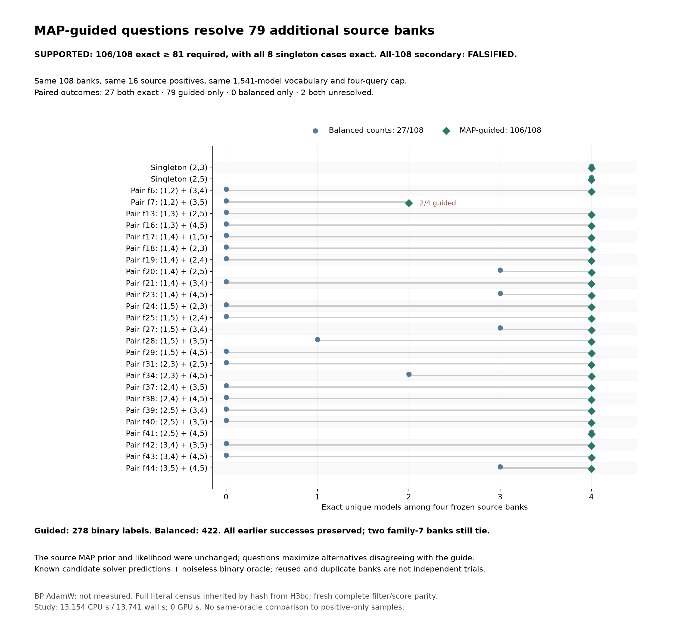

# H3bd: source-MAP-guided questions identify 106 of 108 models

**Both prospective primary endpoints are supported: 106/108 exact unique models exceed the required 81/108, and all eight singleton cases remain exact.** The separate stronger secondary criterion, all 108 exact, is falsified. Two cases remain ambiguous after four queries.

On the same 108 sixteen-positive source banks, MAP-guided verification uniquely identifies 79 cases that the balanced-query policy leaves unresolved. Every one of the balanced policy’s 27 successes is retained; there are zero reverse losses. The guided policy consumes 278 binary membership labels, compared with 422 for balancing. These are paired finite-case outcomes on reused banks, not an independent-sample success-rate estimate.

| Method | Exact unique models | Binary membership labels |
|---|---:|---:|
| BP AdamW | Not measured in this query study | Not measured |
| Balanced candidate counts, H3bc | 27/108 | 422 |
| Source-MAP-guided verification, H3bd | 106/108 | 278 |

| Paired outcome on the same bank | Cases |
|---|---:|
| Both policies exact | 27 |
| Guided exact, balanced unresolved | 79 |
| Balanced exact, guided unresolved | 0 |
| Both unresolved | 2 |

The initial candidate set is unchanged: every model in the supplied 1,541-model vocabulary that accepts all sixteen observed N12 positives. No complete-source equivalence class, assumed true orbit count, or target-empty-population filter is supplied. Every candidate agreeing with each binary answer survives, regardless of its posterior score.

The source posterior is also unchanged from H3au: P(k)=1/3 for k=0,1,2, uniform within each orbit-count class; a consistent model with M source states gives the sixteen distinct positives likelihood 1/C(M,16). The current MAP score is therefore the exact integer C(55,k) × C(M,16), minimized over surviving candidates. Every MAP tie is recorded, with the smallest candidate ID used only as the query guide. No prior strength or likelihood parameter is fitted or retuned.

For every unqueried ordinary-queen N13 board, the policy counts how many current candidates predict the opposite binary label from the MAP guide. It chooses the largest disagreement count, then the lexicographically first board. If the guide is correct, its answer rejects as many current alternatives as possible in that step. If the guide is wrong, the oracle can reject it and the next step recomputes the MAP guide. This is a heuristic conditional on the source ranking; it is not a worst-case-optimal decision tree.

| Archived truth family | Added D4 orbits | Balanced exact | Guided exact |
|---|---|---:|---:|
| H3ao family 0 | [(2, 3)] | 4/4 | 4/4 |
| H3ao family 1 | [(2, 5)] | 4/4 | 4/4 |
| H3ax family 6 | [(1, 2), (3, 4)] | 0/4 | 4/4 |
| H3ax family 7 | [(1, 2), (3, 5)] | 0/4 | 2/4 |
| H3ax family 13 | [(1, 3), (2, 5)] | 0/4 | 4/4 |
| H3ax family 16 | [(1, 3), (4, 5)] | 0/4 | 4/4 |
| H3ax family 17 | [(1, 4), (1, 5)] | 0/4 | 4/4 |
| H3ax family 18 | [(1, 4), (2, 3)] | 0/4 | 4/4 |
| H3ax family 19 | [(1, 4), (2, 4)] | 0/4 | 4/4 |
| H3ax family 20 | [(1, 4), (2, 5)] | 3/4 | 4/4 |
| H3ax family 21 | [(1, 4), (3, 4)] | 0/4 | 4/4 |
| H3ax family 23 | [(1, 4), (4, 5)] | 3/4 | 4/4 |
| H3ax family 24 | [(1, 5), (2, 3)] | 0/4 | 4/4 |
| H3ax family 25 | [(1, 5), (2, 4)] | 0/4 | 4/4 |
| H3ax family 27 | [(1, 5), (3, 4)] | 3/4 | 4/4 |
| H3ax family 28 | [(1, 5), (3, 5)] | 1/4 | 4/4 |
| H3ax family 29 | [(1, 5), (4, 5)] | 0/4 | 4/4 |
| H3ax family 31 | [(2, 3), (2, 5)] | 0/4 | 4/4 |
| H3ax family 34 | [(2, 3), (4, 5)] | 2/4 | 4/4 |
| H3ax family 37 | [(2, 4), (3, 5)] | 0/4 | 4/4 |
| H3ax family 38 | [(2, 4), (4, 5)] | 0/4 | 4/4 |
| H3ax family 39 | [(2, 5), (3, 4)] | 0/4 | 4/4 |
| H3ax family 40 | [(2, 5), (3, 5)] | 0/4 | 4/4 |
| H3ax family 41 | [(2, 5), (4, 5)] | 4/4 | 4/4 |
| H3ax family 42 | [(3, 4), (3, 5)] | 0/4 | 4/4 |
| H3ax family 43 | [(3, 4), (4, 5)] | 0/4 | 4/4 |
| H3ax family 44 | [(3, 5), (4, 5)] | 3/4 | 4/4 |

The two remaining failures both concern true candidate 75, ordinary queens plus D4 orbits {(1,2),(3,5)}, in H3ax family 7 banks 0 and 1. Their exact final sets are {75,108} and {75,78,107}. Both begin with 67 consistent candidates. All four query receipts and labels are retained; no extra question is added to rescue these failures.

| Failed case | MAP guide IDs over four queries | Compatible-set sizes, including initial |
|---:|---|---|
| 12 | [1, 1, 1, 105] | [67, 11, 5, 3, 2] |
| 13 | [1, 1, 93, 79] | [67, 11, 6, 5, 3] |

A label agreeing with the guide can be negative: it may reject many less restrictive models at once. In the failed trajectories the source MAP guide initially favors the simpler candidate 1, then later queries eliminate it. A changing guide is expected posterior conditioning, not access to the true ID. The selector process receives only current candidates, query history, shared predictions and the shared fixed source-score table. Every source score is sealed before querying, and every query is fsynced before the evaluator calls the hidden-truth oracle.

Sixty-eight cases use two membership labels, eighteen use three, and twenty-two use four. Per-case observed label accounting is sixteen positive source examples plus two to four binary N13 labels. The three M12=16 families retain four identical unordered source banks each, and all twenty source-ineligible truth-grid families remain explicitly outside the denominator. These archived samples and all candidate populations were already known; this study tests a new acquisition policy, not an unseen-size or real-world oracle. It does not establish a same-cost comparison to additional uniformly positive examples.

The policy would stop unresolved if no unqueried board could distinguish any current candidate from its guide. Such a terminal identity ambiguity is a scientific failure, not a numerical error, and receives no extra budget. No such state occurred here. Stopping at uniqueness or four labels was enforced in every case.

The whole study used **13.153548 aggregate CPU seconds / 13.740689 wall seconds**, within frozen 120 CPU / 180 wall limits; zero GPU work. All 1,541 packed N13 populations and the successful full literal-enumeration audit are inherited by hash from H3bc. Fresh complete graph-filter, metadata and source-score validation took 1.151278 CPU / 1.151812 wall seconds. No new literal enumeration was performed. This reuse removes the measured 155-second census bottleneck without weakening the pinned evidence.

The independent public audit passed 4927 checks in 1.132748 wall seconds. It independently rebuilds all 1,541 source scores and graph filters, verifies every source seed and initial candidate set, replays all 278 guided choices and seals, checks all MAP and board ties, and reconstructs the 108 paired outcomes and separate primary/secondary decisions. The full population-completeness proof remains the explicitly inherited H3bc audit.

Run `upstream/.venv/bin/python research/20261114/loki/h3bd/verify_public.py --root SNAPSHOT`.

[Frozen protocol](protocol.json), [truth-blind guided selector](selector.py), [sealed study](study.py), [independent verifier](verify_public.py), [summary](../../../../results/research/loki/h3bd/summary.json), [all paired cases](../../../../results/research/loki/h3bd/paired-label-results.csv), [exact source scores](../../../../results/research/loki/h3bd/score-table.json), [all query receipts](../../../../results/research/loki/h3bd/cases), [figure provenance](../../../../results/research/loki/h3bd/plot-provenance.json).
