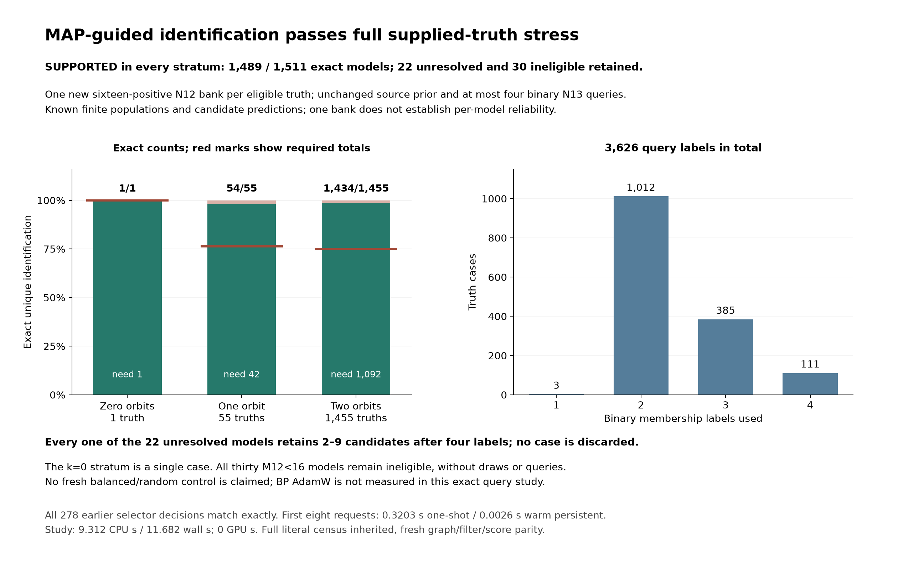

# H3be: MAP-guided identification passes the full supplied-truth stress test

**All three prospective stratum thresholds are supported: 1/1 zero-orbit, 54/55 one-orbit, and 1,434/1,455 eligible two-orbit truths are uniquely identified within four membership queries.** The total is 1,489/1,511; twenty-two truths remain ambiguous. All thirty ineligible models remain explicitly recorded.

Each eligible model receives one new sixteen-positive N12 source bank from its already-known complete population, with seed 2026120000 + candidate ID. The test expands beyond H3bd’s two singleton and radius-five pair truths to every eligible truth in the supplied 1,541-model vocabulary. The MAP prior, positive likelihood, acquisition policy, N13 board universe, and four-query cap are unchanged. These are new simulated draws from known finite populations, not previously unseen populations or real-world label acquisition.

| Method / true orbit count | Eligible truths | Exact unique models | Required exact count | Decision |
|---|---:|---:|---:|---|
| BP AdamW | Not measured | Not measured | — | — |
| MAP-guided, k=0 | 1 | 1 | 1 | supported |
| MAP-guided, k=1 | 55 | 54 | 42 | supported |
| MAP-guided, k=2 | 1,455 | 1,434 | 1,092 | supported |

Thresholds are the exact finite integers ceil(3n/4): 1, 42, and 1,092. The overall decision requires every stratum to pass. The zero-orbit stratum contains one case; 1/1 is not an estimate of a population reliability rate. One bank per truth also does not establish a 75% success probability for each individual model.

All 1,541 candidates are available to each case before filtering. Initial elimination uses only the sixteen observed positives; it does not use the true orbit count, complete-source class, or source-negative labels. The source MAP minimizes C(55,k) × C(M,16), using the unchanged equal mass over k=0,1,2 and uniform model prior within each k. All MAP ties are retained and the smallest ID guides the next question. That question maximizes the number of current candidates disagreeing with the guide’s prediction, with lexicographic board ties. Every candidate consistent with the oracle answer survives.

The source examples and membership labels are different supervision: each case receives sixteen uniform distinct positive N12 boards and one to four noiseless binary N13 labels on selected ordinary-queen boards. Known candidate solver predictions remain supplied. There is no new balanced or random control in this study, so the earlier narrow-study paired advantage is not transferred to the broader truth class. Exact unique consistency is also a different endpoint from selecting the highest-scoring model.

| Membership labels consumed | Cases |
|---:|---:|
| 1 | 3 |
| 2 | 1,012 |
| 3 | 385 |
| 4 | 111 |

The total is 3,626 binary membership labels. Three cases stop after one query, 1,012 after two, 385 after three, and 111 consume all four. Per-case total accounting is therefore seventeen to twenty observations, with the sixteen positive-source and binary-target components kept separate. All twenty-two failures reach the four-query cap with two to nine compatible candidates; no no-information terminal stop occurs.

| Unresolved true candidate | True added D4 orbits | Complete N12 population | Final compatible candidates |
|---:|---|---:|---|
| 2 | [(1, 3)] | 176 | [2, 162] |
| 78 | [(1, 2), (3, 8)] | 148 | [75, 78, 107] |
| 79 | [(1, 2), (3, 9)] | 144 | [79, 106] |
| 86 | [(1, 2), (4, 9)] | 148 | [73, 78, 86, 87, 103, 107] |
| 107 | [(1, 2), (9, 10)] | 156 | [99, 106, 107] |
| 108 | [(1, 2), (9, 11)] | 156 | [75, 108] |
| 123 | [(1, 3), (2, 8)] | 176 | [123, 157] |
| 126 | [(1, 3), (2, 11)] | 176 | [2, 126] |
| 160 | [(1, 3), (9, 10)] | 168 | [126, 160] |
| 636 | [(2, 4), (9, 11)] | 384 | [636, 637] |
| 1309 | [(4, 10), (10, 11)] | 8,192 | [1306, 1309] |
| 1492 | [(6, 11), (8, 11)] | 11,072 | [1492, 1493, 1535] |
| 1494 | [(6, 11), (9, 11)] | 11,696 | [1494, 1495, 1540] |
| 1495 | [(6, 11), (10, 11)] | 11,824 | [55, 1494, 1495, 1536, 1537, 1540] |
| 1523 | [(7, 11), (9, 10)] | 10,888 | [52, 53, 1522, 1523, 1525, 1535, 1537, 1539] |
| 1524 | [(7, 11), (9, 11)] | 11,816 | [1524, 1525, 1540] |
| 1525 | [(7, 11), (10, 11)] | 11,984 | [1524, 1525, 1540] |
| 1534 | [(8, 10), (10, 11)] | 11,024 | [1533, 1534] |
| 1535 | [(8, 11), (9, 10)] | 11,600 | [54, 1522, 1523, 1524, 1535, 1536, 1537, 1538, 1540] |
| 1536 | [(8, 11), (9, 11)] | 12,768 | [1536, 1537, 1540] |
| 1537 | [(8, 11), (10, 11)] | 12,888 | [1536, 1537, 1540] |
| 1539 | [(9, 10), (10, 11)] | 12,392 | [54, 55, 1524, 1525, 1538, 1539, 1540] |

The failures span both small source populations near the earlier aliases and large populations under long-range constraints. These observed trajectories do not establish that the models are intrinsically unidentifiable or that more queries would fail. No question beyond the frozen four-label budget is added. Repeated fresh banks on this explicitly selected failure set would distinguish rare sample-specific failures from persistent model-specific difficulty.

The persistent selector process caches only immutable packed predictions and the fixed source-score table. Each request supplies all current candidate IDs and queried-board IDs; case-dependent state is local to that request. There is no true-model ID or oracle input. Before any new source draw, the persistent process reproduces all 278 complete selection dictionaries from H3bd exactly, including MAP ties, query tie counts and candidate predictions. The independent public verifier repeats that process-level parity test and independently replays every fresh question.

For the frozen first eight archival requests, the original one-shot process took 0.320316088 seconds and the warm persistent process took 0.002623385 seconds (122.10× for this operation). Persistent startup plus its first response took 0.030630362 seconds; replaying all 278 warm requests took 0.305561027 seconds. These timings are charged to the study. They are not an end-to-end speedup estimate over a different experiment scope.

The whole study used **9.312489 aggregate CPU seconds / 11.682008 wall seconds**, within frozen 600 CPU / 900 wall limits; zero GPU work. Full N13 population completeness is inherited by hash from H3bc’s literal-enumeration audit, with fresh complete graph-filter, metadata, and exact score parity here. No new literal census was performed. The separate public audit passed 26,358 checks in 4.207895 seconds, covering all 1,541 truth eligibilities, every fresh seed and source filter, all 3,626 query/answer seals, the 278 archival process-parity cases, all thirty ineligible records, and the separate stratum thresholds.

Run `upstream/.venv/bin/python research/20261114/loki/h3be/verify_public.py --root SNAPSHOT`.

[Frozen protocol](protocol.json), [persistent truth-blind selector](selector.py), [sealed study](study.py), [independent verifier](verify_public.py), [summary](../../../../results/research/loki/h3be/summary.json), [all 1,541 truth records](../../../../results/research/loki/h3be/all-truth-results.csv), [all draws and query receipts](../../../../results/research/loki/h3be/cases), [runtime parity evidence](../../../../results/research/loki/h3be/runtime-parity.json), [figure provenance](../../../../results/research/loki/h3be/plot-provenance.json).
