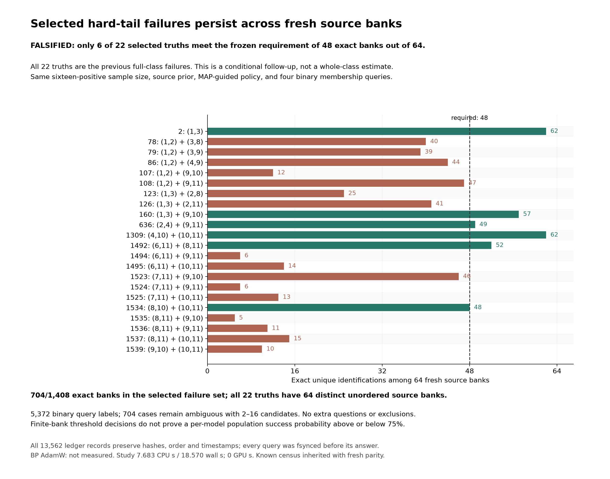

# H3bf: selected hard-tail failures persist across new source banks

**The primary is falsified: only six of the twenty-two selected truths reach the required 48 exact identifications in 64 fresh banks.** Across this explicitly postselected failure set, 704/1,408 banks identify the exact model within four membership queries. Every truth has 64 distinct unordered source banks.

The twenty-two truths are exactly those that failed H3be’s one-bank full-class test. This conditional follow-up asks whether those failures recur under new source draws. It is not a new estimate of success over the full 1,511 eligible truth class. A count of 704/1,408 here must not be substituted for H3be’s 1,489/1,511 broad-class result.

| Method / scope | Result |
|---|---|
| BP AdamW | Not measured; no fitting in this query study |
| Unchanged MAP-guided policy, all 22 selected truths | 6/22 satisfy the frozen 48/64 endpoint |
| All 1,408 selected-tail banks | 704 exact; 704 unresolved after four queries |
| Whole-class success rate | Not estimated by this postselected study |

| True candidate | Added D4 orbits | N12 population | Exact / 64 | Unique unordered banks | Decision |
|---:|---|---:|---:|---:|---|
| 2 | [(1, 3)] | 176 | 62/64 | 64/64 | supported |
| 78 | [(1, 2), (3, 8)] | 148 | 40/64 | 64/64 | falsified |
| 79 | [(1, 2), (3, 9)] | 144 | 39/64 | 64/64 | falsified |
| 86 | [(1, 2), (4, 9)] | 148 | 44/64 | 64/64 | falsified |
| 107 | [(1, 2), (9, 10)] | 156 | 12/64 | 64/64 | falsified |
| 108 | [(1, 2), (9, 11)] | 156 | 47/64 | 64/64 | falsified |
| 123 | [(1, 3), (2, 8)] | 176 | 25/64 | 64/64 | falsified |
| 126 | [(1, 3), (2, 11)] | 176 | 41/64 | 64/64 | falsified |
| 160 | [(1, 3), (9, 10)] | 168 | 57/64 | 64/64 | supported |
| 636 | [(2, 4), (9, 11)] | 384 | 49/64 | 64/64 | supported |
| 1309 | [(4, 10), (10, 11)] | 8,192 | 62/64 | 64/64 | supported |
| 1492 | [(6, 11), (8, 11)] | 11,072 | 52/64 | 64/64 | supported |
| 1494 | [(6, 11), (9, 11)] | 11,696 | 6/64 | 64/64 | falsified |
| 1495 | [(6, 11), (10, 11)] | 11,824 | 14/64 | 64/64 | falsified |
| 1523 | [(7, 11), (9, 10)] | 10,888 | 46/64 | 64/64 | falsified |
| 1524 | [(7, 11), (9, 11)] | 11,816 | 6/64 | 64/64 | falsified |
| 1525 | [(7, 11), (10, 11)] | 11,984 | 13/64 | 64/64 | falsified |
| 1534 | [(8, 10), (10, 11)] | 11,024 | 48/64 | 64/64 | supported |
| 1535 | [(8, 11), (9, 10)] | 11,600 | 5/64 | 64/64 | falsified |
| 1536 | [(8, 11), (9, 11)] | 12,768 | 11/64 | 64/64 | falsified |
| 1537 | [(8, 11), (10, 11)] | 12,888 | 15/64 | 64/64 | falsified |
| 1539 | [(9, 10), (10, 11)] | 12,392 | 10/64 | 64/64 | falsified |

The singleton candidate 2 succeeds in 62/64 new banks, suggesting its earlier observed failure was unusual among these new draws. Several long-range two-orbit models remain difficult: candidates 1494 and 1524 succeed in 6/64, and 1535 in 5/64. Candidate 1534 meets the threshold exactly at 48/64, while candidate 108 reaches 47/64. These are frozen finite-sample endpoint decisions, not proofs of a population success probability above or below 75%.

For every selected truth and bank index, the seed is 2026200000 + 64 × candidate ID + bank. Each stream draws sixteen distinct positive N12 states uniformly without replacement from the known complete source population. All 64 banks and every failure remain in the denominator. Every truth has 64 different unordered samples, although individual boards can overlap across banks. This is new simulated sampling from already-known finite populations, not acquisition from an external oracle.

The supplied 1,541-model vocabulary, source MAP prior and likelihood, query strategy, and four-label cap are unchanged. The selector begins with all models accepting the sixteen positives. It minimizes C(55,k) × C(M,16) to obtain a source MAP guide, preserving every MAP tie and using the smallest candidate ID to guide only the next query. It then maximizes the number of remaining models disagreeing with that guide on an unqueried ordinary-queen N13 board, breaking board ties lexicographically. Every model agreeing with the revealed answer survives. No true complexity, source-equivalence class, or empty-population filter is supplied.

The study uses 5,372 binary membership labels: three cases stop after two queries, 254 after three, and 1,151 consume all four. The 704 unresolved cases retain two to sixteen candidates each. No no-information terminal stop occurs. Per-case label cost is sixteen uniform positive source examples plus two to four selected binary target labels. Known candidate solver predictions and the noiseless binary oracle remain substantial assumptions; there is no new balanced/random comparison or same-cost positive-only claim.

The evidence format is now one append-only ledger. Each record contains a sequence number, previous-record SHA-256, UTC and monotonic timestamps, event kind, and data; its own hash covers canonical sorted JSON. Each append flushes and fsyncs before returning. A query is therefore committed before the evaluator calls the oracle, and the immediately following answer names that query hash. Source draws, complete initial candidate sets, every intermediate candidate set, all case results, and final counts are included. Receipts are never regenerated after answers.

Before any fresh source draw, a synthetic gate reproduces eight existing query/answer pairs in both the old separate-file format and the new ledger. Each oracle callback reads and validates the committed query from disk before returning its known test label. The gate rejects four corruptions: a changed answer, swapped query/answer order, a broken hash chain, and a rehashed answer naming the wrong query. The independent public audit repeats the logical parity and corruption tests with its own parser.

The gate’s sixteen legacy-file writes with fsync take 0.017337494 seconds; sixteen ledger appends take 0.010902001 seconds. This small paired format timing is charged to the study and is not an end-to-end speedup claim. The actual ledger has 13,562 records and 12,325,227 raw bytes. Its deterministic gzip export is 1,642,382 bytes and preserves the exact original byte stream, checked by decompressed SHA-256.

The monitored study uses **7.683478 aggregate CPU seconds / 18.570093 wall seconds**, within frozen 600 CPU / 900 wall limits; zero GPU work. It inherits the hash-pinned H3bc complete literal census and H3be’s unchanged persistent selector, with fresh whole-class graph-filter and exact score parity. The public audit passes 35,631 checks in 2.865033 seconds, reconstructing every source seed, unique-bank count, all 5,372 policy decisions and labels, the complete 13,562-record hash/time chain, and every per-truth endpoint.

These results do not yet establish whether a failed case is identifiable by any N13-only query sequence. The next diagnostic should intersect its initial candidate set with the true model’s complete N13 prediction-equivalence class. That separates query-budget or policy failures from unavoidable ambiguity without acquiring extra labels.

Run `upstream/.venv/bin/python research/20261114/loki/h3bf/verify_public.py --root SNAPSHOT`.

[Frozen protocol](protocol.json), [append-only ledger writer](ledger.py), [synthetic ledger gate](ledger_gate.py), [study](study.py), [independent verifier](verify_public.py), [summary](../../../../results/research/loki/h3bf/summary.json), [per-truth results](../../../../results/research/loki/h3bf/truth-results.csv), [all 1,408 cases](../../../../results/research/loki/h3bf/case-results.json), [exact compressed ledger](../../../../results/research/loki/h3bf/query-ledger.jsonl.gz), [raw-byte export receipt](../../../../results/research/loki/h3bf/ledger-export.json), [figure provenance](../../../../results/research/loki/h3bf/plot-provenance.json).
