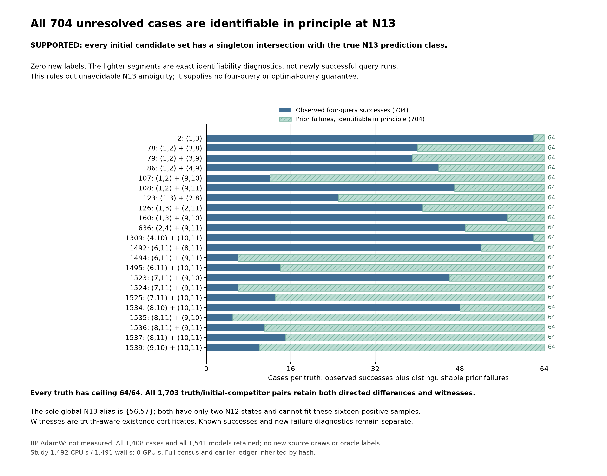

# H3bg: every unresolved hard-tail case is identifiable in principle at N13

**The universal primary is supported: all 704 H3bf four-query failures remain identifiable by some N13-only membership-query sequence.** Every one of the 1,408 initial source-consistent candidate sets intersects the true model’s complete N13 prediction-equivalence class in exactly the true singleton. There are zero unavoidable identity ambiguities in these cases.

This is an exact finite-class ceiling calculation, not additional successful acquisition. The 704 previously successful cases provide a known-success consistency check; the new diagnostic concerns the 704 failed cases. No new source bank or oracle label is acquired, and no query budget or policy is changed. The result rules out unavoidable N13 prediction equivalence as the explanation for these failures, but does not distinguish a short-budget limitation from a suboptimal query policy.

| Method / evidence | Result |
|---|---|
| BP AdamW | Not measured; no fitting |
| Observed H3bf policy with at most four queries | 704/1,408 exact |
| New complete-prediction diagnostic on prior failures | 704/704 identifiable in principle |
| Previously successful cases, separate consistency check | 704/704 identifiable in principle |
| Unavoidable N13 ambiguity within the initial candidate sets | 0/1,408 cases |
| Newly acquired labels | Zero |

| True candidate | Observed four-query exact / 64 | Newly diagnosed failures identifiable | Exact identifiability ceiling / 64 |
|---:|---:|---:|---:|
| 2 | 62/64 | 2/2 | 64/64 |
| 78 | 40/64 | 24/24 | 64/64 |
| 79 | 39/64 | 25/25 | 64/64 |
| 86 | 44/64 | 20/20 | 64/64 |
| 107 | 12/64 | 52/52 | 64/64 |
| 108 | 47/64 | 17/17 | 64/64 |
| 123 | 25/64 | 39/39 | 64/64 |
| 126 | 41/64 | 23/23 | 64/64 |
| 160 | 57/64 | 7/7 | 64/64 |
| 636 | 49/64 | 15/15 | 64/64 |
| 1309 | 62/64 | 2/2 | 64/64 |
| 1492 | 52/64 | 12/12 | 64/64 |
| 1494 | 6/64 | 58/58 | 64/64 |
| 1495 | 14/64 | 50/50 | 64/64 |
| 1523 | 46/64 | 18/18 | 64/64 |
| 1524 | 6/64 | 58/58 | 64/64 |
| 1525 | 13/64 | 51/51 | 64/64 |
| 1534 | 48/64 | 16/16 | 64/64 |
| 1535 | 5/64 | 59/59 | 64/64 |
| 1536 | 11/64 | 53/53 | 64/64 |
| 1537 | 15/64 | 49/49 | 64/64 |
| 1539 | 10/64 | 54/54 | 64/64 |

For each case, let C be the entire candidate set accepting its sixteen observed N12 positives. Two models are prediction-equivalent if they give identical binary membership answers on every one of the 73,712 ordinary-queen N13 boards. The calculation intersects C with the equivalence class of the true model. If another model remains in that intersection, no adaptive N13-only strategy can distinguish it: every possible answer is identical. If the intersection is a singleton, each competitor differs from the truth on at least one board, so a finite distinguishing sequence exists. This argument supplies neither an optimal sequence nor a bound of four or eight queries.

The complete 1,541-model N13 partition contains 1,540 classes. Its sole nontrivial class is candidates 56 and 57, both with exactly twenty-six N13 valid boards. Their added orbit sets are {(1,2),(1,3)} and {(1,2),(1,4)}. Each has only two N12 valid states, so both are outside the sixteen-distinct-positive eligible truth population and cannot survive any of these initial source filters. They are retained in the global partition. There are no empty N13 populations.

The global partition also implies, descriptively within the supplied vocabulary, that every source-eligible truth has a unique complete N13 prediction row. This is a logical consequence of the complete fixed-class partition; it is not a measured low-label guarantee or a claim about arbitrary rules outside the vocabulary.

All 1,703 distinct ordered truth-versus-initial-competitor pairs required by the 1,408 cases are retained. For each pair, both directed difference counts and the lexicographically first board in every nonempty direction are public; zero directions explicitly have no witness. There are 1,626 two-sided pairs and seventy-seven one-sided pairs. These are comparisons of complete valid-state behavior, not just differing constraint graphs. The independent audit computes directed counts and first witnesses through packed-byte bit operations, separately from the study’s boolean-mask implementation.

Witness construction uses the known true model to diagnose existence. It is not a selector that can be deployed without that identity, and its computed labels are not new oracle observations. One-sided differences also reinforce the supervision distinction: positive-only examples can fail to reject a strict superset, whereas a binary membership query can use a negative witness. No equal-cost positive-only comparison is made.

All 1,408 original source seeds, samples, and complete initial candidate sets are reconstructed. The 704 known successes and 704 new failure diagnostics are kept separate in every case record. Only repeated pair calculations are deduplicated; no case, alias, empty direction or required pair is pruned. A whole-study cap would have yielded an incomplete result rather than a reduced pair scope.

The study uses **1.492282 aggregate CPU seconds / 1.490719 wall seconds**, under frozen 120 CPU / 180 wall limits; zero GPU work and zero new labels. Complete population enumeration and the original query ledger are inherited by hash from H3bc and H3bf. Fresh complete source-mask and target-graph-filter parity checks cover all 1,541 models. The public audit passes 7,627 checks in 1.073571 seconds, reconstructing the global equivalence partition independently, all case intersections, and all 3,406 directed difference counts and lexicographic witnesses.

Run `upstream/.venv/bin/python research/20261114/loki/h3bg/verify_public.py --root SNAPSHOT`.

[Frozen protocol](protocol.json), [ceiling study](study.py), [independent verifier](verify_public.py), [summary](../../../../results/research/loki/h3bg/summary.json), [per-truth ceilings](../../../../results/research/loki/h3bg/truth-ceilings.csv), [all case intersections](../../../../results/research/loki/h3bg/case-ceilings.json), [full global partition](../../../../results/research/loki/h3bg/N13-partition.json), [every directed difference and witness](../../../../results/research/loki/h3bg/pair-difference-witnesses.json), [figure provenance](../../../../results/research/loki/h3bg/plot-provenance.json).
