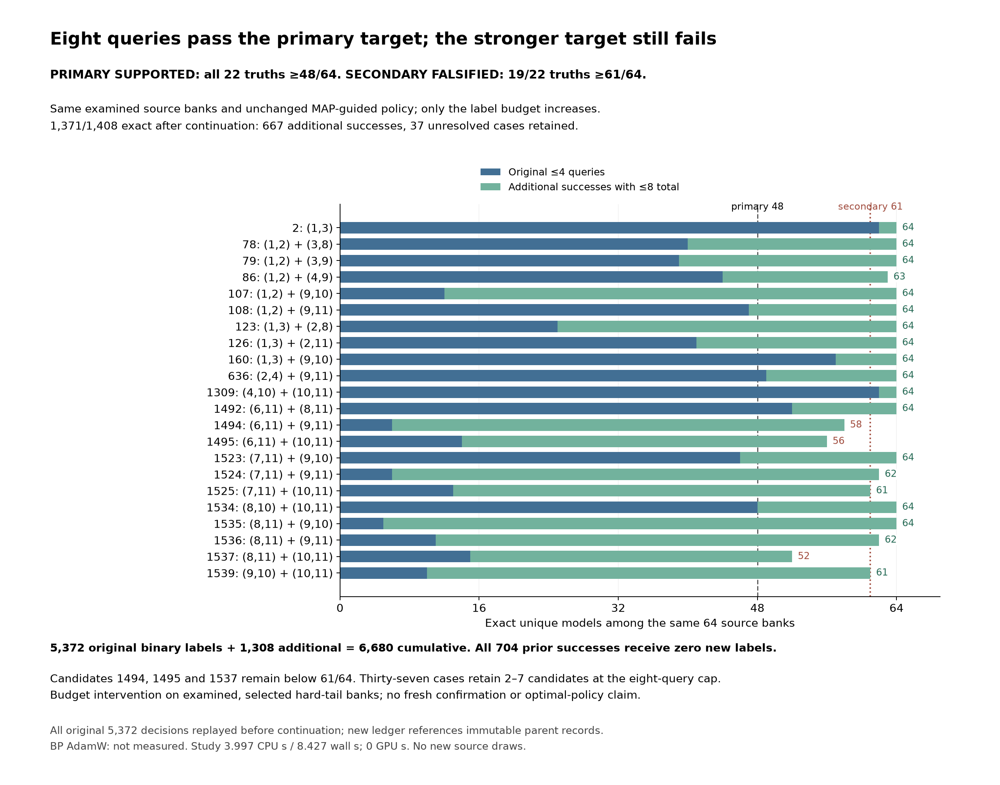

# H3bh: eight queries pass the 48/64 target but not the stronger 61/64 target

**The primary is supported for all twenty-two truths: each reaches at least 48 exact cases out of 64 with at most eight total membership queries.** The separate stronger secondary is falsified: nineteen truths reach 61/64, but candidates 1494, 1495 and 1537 reach only 58/64, 56/64 and 52/64.

The continuation identifies 1,371/1,408 models in the same examined hard-tail banks, resolving 667 of the 704 previous failures. The 704 earlier successes receive zero new labels and remain unchanged. Thirty-seven cases still retain ties after the eight-query cap. This is a label-budget intervention on already examined, postselected source banks; it is not fresh confirmation or a whole-class success estimate.

| Method / budget | Exact unique cases | Binary membership labels |
|---|---:|---:|
| BP AdamW | Not measured | Not measured |
| Original H3bf, at most four queries | 704/1,408 | 5,372 inherited |
| Same policy, at most eight total queries | 1,371/1,408 | 1,308 additional; 6,680 cumulative |

| True candidate | Exact after ≤4 | Exact after ≤8 | Additional labels | ≥48 primary | ≥61 secondary |
|---:|---:|---:|---:|---|---|
| 2 | 62/64 | 64/64 | 2 | supported | supported |
| 78 | 40/64 | 64/64 | 48 | supported | supported |
| 79 | 39/64 | 64/64 | 36 | supported | supported |
| 86 | 44/64 | 63/64 | 33 | supported | supported |
| 107 | 12/64 | 64/64 | 87 | supported | supported |
| 108 | 47/64 | 64/64 | 27 | supported | supported |
| 123 | 25/64 | 64/64 | 44 | supported | supported |
| 126 | 41/64 | 64/64 | 29 | supported | supported |
| 160 | 57/64 | 64/64 | 9 | supported | supported |
| 636 | 49/64 | 64/64 | 17 | supported | supported |
| 1309 | 62/64 | 64/64 | 2 | supported | supported |
| 1492 | 52/64 | 64/64 | 24 | supported | supported |
| 1494 | 6/64 | 58/64 | 118 | supported | falsified |
| 1495 | 14/64 | 56/64 | 128 | supported | falsified |
| 1523 | 46/64 | 64/64 | 25 | supported | supported |
| 1524 | 6/64 | 62/64 | 96 | supported | supported |
| 1525 | 13/64 | 61/64 | 122 | supported | supported |
| 1534 | 48/64 | 64/64 | 20 | supported | supported |
| 1535 | 5/64 | 64/64 | 92 | supported | supported |
| 1536 | 11/64 | 62/64 | 92 | supported | supported |
| 1537 | 15/64 | 52/64 | 127 | supported | falsified |
| 1539 | 10/64 | 61/64 | 130 | supported | supported |

The lower endpoint remains exactly the H3bf threshold, 48/64 for every truth. The stronger 61/64 endpoint is frozen separately before new query outcomes; its overall conjunction requires all twenty-two truths. Reporting the high aggregate count does not replace that per-truth secondary failure. These are finite-bank endpoint decisions, not proofs of population reliability.

Every continuation starts from the original sealed four-query candidate set and complete query history. Only the 704 unresolved cases are eligible for more questions, with at most four additional labels each. The source prior, uniform-positive likelihood, MAP guide, maximum-disagreement query rule, lexicographic ties, candidate retention, and no-repeat rule are unchanged. No source examples are added or resampled. There is no extension beyond eight to rescue the remaining failures.

| Additional labels | Cases |
|---:|---:|
| 0 | 704 |
| 1 | 312 |
| 2 | 245 |
| 3 | 82 |
| 4 | 65 |

The zero-additional group is exactly the 704 prior successes. Of the unresolved cases, 312 stop after one new label, 245 after two, eighty-two after three, and sixty-five use all four. The total of 1,308 new labels is kept separate from the 5,372 inherited labels. Each case retains its original sixteen positive source examples; cumulative per-case observations range from eighteen to twenty-four. These positive-source and selected binary-target labels remain different supervision.

The thirty-seven final failures retain two to seven candidates. Six concern truth 1494, eight truth 1495, twelve truth 1537, three each truths 1525 and 1539, two each truths 1524 and 1536, and one truth 86. H3bg already showed every original case is identifiable in principle at N13, so these residual ties are not unavoidable prediction equivalence. This intervention does not establish whether eight labels are insufficient for an optimal policy or the unchanged MAP-guided heuristic is inefficient.

Before making any new continuation decision, the study reads and validates the complete immutable H3bf ledger hash chain, timestamps and query-answer references; reconstructs all 1,408 source seeds, initial filters and final candidate states; and replays all 5,372 original selector requests in the persistent process. Every full selection dictionary must match its original receipt. This deterministic replay does not reacquire those labels.

The new ledger begins with the parent ledger and summary hashes. Each case checkpoint references the exact original case-result record, original source record, all inherited query and answer hashes, remaining candidates and previously queried boards. New queries are fsynced before the oracle is called and their answers reference the query hash. The old ledger and receipts are not rewritten. The ledger writer and selector are byte-identical to H3bf; its synthetic durability and tamper tests are inherited by hash.

The new ledger contains 5,434 records, 5,177,958 raw bytes, and 1,055,512 deterministic gzip bytes. Its decompressed SHA-256 verifies the exact original byte stream. The monitored continuation, including original-history replay, fresh parity and serialization, uses **3.997135 aggregate CPU seconds / 8.426845 wall seconds**, below frozen 120 CPU / 180 wall limits; zero GPU work.

The independent public audit passes 22,168 checks in 1.717177 seconds. It independently replays all 5,372 original policy decisions, all 1,408 checkpoints, and all 1,308 new query/answer events; verifies both ledger hash/order/time chains; confirms every prior success receives no new labels; and recomputes separate primary, secondary and label-cost totals. Full population completeness remains inherited from the pinned H3bc literal census, with fresh graph-filter and score parity.

Run `upstream/.venv/bin/python research/20261114/loki/h3bh/verify_public.py --root SNAPSHOT`.

[Frozen protocol](protocol.json), [original-history checkpoint gate](checkpoints.py), [continuation study](study.py), [independent verifier](verify_public.py), [summary](../../../../results/research/loki/h3bh/summary.json), [per-truth continuation results](../../../../results/research/loki/h3bh/truth-continuations.csv), [all cases including failures](../../../../results/research/loki/h3bh/case-results.json), [parent-bound checkpoints](../../../../results/research/loki/h3bh/continuation-checkpoints.json), [exact new ledger](../../../../results/research/loki/h3bh/query-ledger.jsonl.gz), [figure provenance](../../../../results/research/loki/h3bh/plot-provenance.json).
