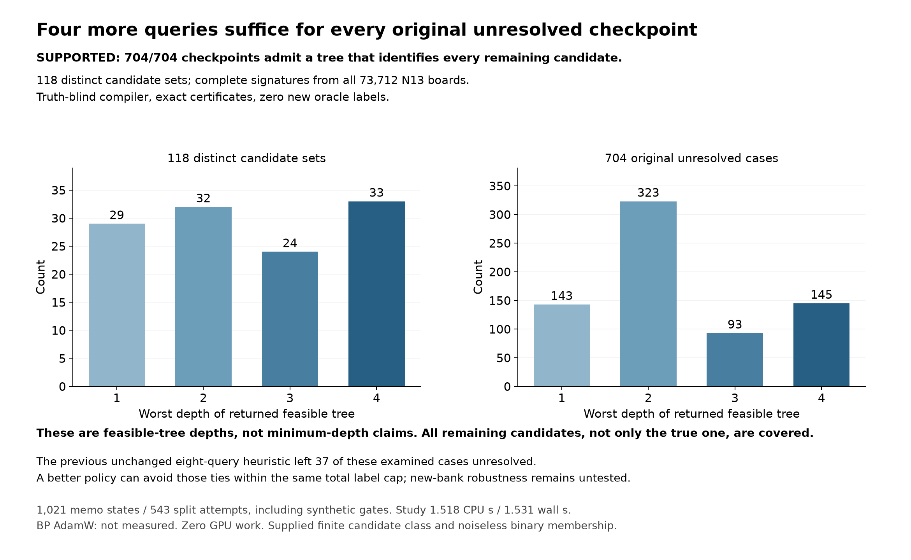

# H3bi: four additional queries suffice for every examined checkpoint

**The universal finite primary is supported: all 704 original unresolved H3bf checkpoints admit an adaptive decision tree of depth at most four that identifies every remaining candidate.** The checkpoints reduce to 118 distinct candidate sets. This certifies that the thirty-seven ties left by the unchanged eight-query MAP heuristic are avoidable within the same total label cap on these examined banks.

| Method or certificate | Examined original cases | New labels in this study |
|---|---:|---:|
| BP AdamW | Not measured | Not measured |
| Original MAP heuristic, at most four queries | 704/1,408 exact | 0; inherited result |
| Unchanged MAP heuristic, at most eight total queries | 1,371/1,408 exact | 0; inherited H3bh result |
| Four-query tree after original unresolved checkpoints | 704/704 unresolved cases certified for every candidate | 0; policy feasibility only |

Every original case is retained: 704 prior successes require no new tree, and all 704 unresolved cases map to a certified root. The compiler receives only a sorted remaining-candidate list, its complete board-signature catalog, depth, and shared resource counters. It receives no true model, bank identity, case identity, realized label or posterior weight. The supplied class contains ordinary queens plus zero, one or two D4 leaper orbits among the 55 pairs 1 ≤ a < b ≤ 11. This is a known finite model class with complete predictions, not arbitrary-rule learning or a learned optimizer.

For each distinct checkpoint set, every one of the 73,712 ordinary N13 boards is assigned its full local prediction signature. All distinct signatures are retained, including unanimous signatures, multiplicities, and the first board in lexicographic order. Recursive states use a candidate-subset bitmask and remaining depth. The search considers every induced nontrivial bipartition, merges complement-equivalent partitions using the first board, and tries partitions in board order. A singleton succeeds; a subset larger than 2 to the remaining depth fails by the binary information bound. Every attempted split and decisive child proof is preserved.

The first feasible split yields a witness tree. **The returned depth is not asserted to be minimal.** An infeasible state requires either the information bound or exhaustion of all canonical partitions, each with a retained failing child or child-size bound. No real root was infeasible, but the synthetic fixtures include independently verified infeasible cases.

| Worst branch depth of returned tree | Distinct sets | Original unresolved cases |
|---:|---:|---:|
| 1 | 29 | 143 |
| 2 | 32 | 323 |
| 3 | 24 | 93 |
| 4 | 33 | 145 |

Every remaining candidate is followed to its correct singleton leaf using its complete prediction row. Original queries are unanimous at each checkpoint; subsequent chosen queries are nontrivial on the current subset. Independent replay confirms that no branch repeats a query and no tree contains a query from any mapped original case history. All equal candidate sets share compilation, while their case mappings remain explicit.

Eight synthetic gates cover lexicographic complement ties, singleton-only query sets, duplicate predictions, sixteen binary-code models, and insufficient depth. A separate brute-force recursion agrees with every fixture. Deliberate zero-state and zero-split caps raise an incomplete exception rather than a false infeasibility result. Synthetic work is charged to shared counters, including the one state created during the split-cap test.

The monitored study used **1.517644 aggregate CPU seconds / 1.530708 wall seconds**, 1,021 memo states and 543 canonical split attempts, including synthetic tests. Frozen limits were 600 CPU seconds, 900 wall seconds, 250,000 states and 10,000,000 split attempts. A cap would make the entire study incomplete, never certify infeasibility. Zero GPUs, source draws and new membership labels were used.

The independent public audit passed 19,907 checks in 1.005990 seconds. It reconstructs all 118 complete catalogs, all 1,408 source/checkpoint histories, all 970 real proof states and 518 real split attempts, and all 544 candidate branches across distinct sets. It verifies global accounting and all case mappings without importing the compiler. Full population completeness and the original durable policy ledger remain inherited by pinned hashes from H3bc/H3bf, while all 1,541 N12 and N13 graph filters receive fresh independent parity checks.

The exact conclusion concerns these examined, postselected checkpoints and noiseless binary membership. It is not fresh-bank confirmation, a population reliability estimate, or a guarantee outside the supplied class. Binary target membership provides different and stronger supervision than sixteen uniform positive source examples; no equal-oracle comparison is implied. Trees were compiled and checked, not executed to acquire new labels.

Run `upstream/.venv/bin/python research/20261114/loki/h3bi/verify_public.py --root SNAPSHOT`.

[Frozen protocol](protocol.json), [truth-blind compiler](compiler.py), [independent verifier](verify_public.py), [summary](../../../../results/research/loki/h3bi/summary.json), [all mappings](../../../../results/research/loki/h3bi/checkpoint-groups.json), [group table](../../../../results/research/loki/h3bi/tree-groups.csv), [synthetic certificates](../../../../results/research/loki/h3bi/synthetic-gate.json), [figure provenance](../../../../results/research/loki/h3bi/plot-provenance.json). Each `groupN` result directory includes the complete catalog, compiler inputs, full proof and runtime receipt.
