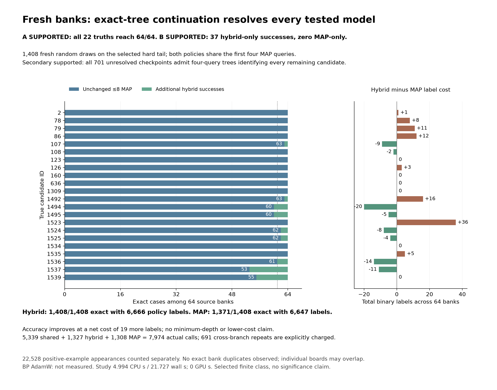

# H3bj: fresh-bank exact-tree continuation resolves all 1,408 tested cases

**Both separate primary hypotheses are supported.** The hybrid identifies 64/64 cases for every one of the twenty-two selected truths, exceeding the frozen 61/64 requirement. It also strictly beats unchanged eight-query MAP in aggregate: 1,408/1,408 versus 1,371/1,408, with thirty-seven hybrid-only successes and zero MAP-only successes. The separate universal secondary is supported: all 701 fresh unresolved four-query checkpoints admit depth-at-most-four trees that identify every remaining candidate.

| Method | Exact cases | Per-policy binary label cost |
|---|---:|---:|
| BP AdamW | Not measured | Not measured |
| Unchanged MAP, at most eight total queries | 1,371/1,408 | 6,647 |
| Four MAP queries, then at most four compiled-tree queries | 1,408/1,408 | 6,666 |

The hybrid costs nineteen more labels in aggregate. This study supports an accuracy advantage within the shared eight-query cap, not a lower-label-cost or minimum-depth claim. These are finite paired counts; no significance or population reliability claim is made.

| True candidate | MAP exact /64 | Hybrid exact /64 | MAP label cost | Hybrid label cost |
|---:|---:|---:|---:|---:|
| 2 | 64 | 64 | 253 | 254 |
| 78 | 64 | 64 | 306 | 314 |
| 79 | 64 | 64 | 265 | 276 |
| 86 | 64 | 64 | 261 | 273 |
| 107 | 63 | 64 | 351 | 342 |
| 108 | 64 | 64 | 281 | 279 |
| 123 | 64 | 64 | 299 | 299 |
| 126 | 64 | 64 | 284 | 287 |
| 160 | 64 | 64 | 238 | 238 |
| 636 | 64 | 64 | 247 | 247 |
| 1309 | 64 | 64 | 222 | 222 |
| 1492 | 63 | 64 | 296 | 312 |
| 1494 | 60 | 64 | 355 | 335 |
| 1495 | 60 | 64 | 367 | 362 |
| 1523 | 64 | 64 | 270 | 306 |
| 1524 | 62 | 64 | 339 | 331 |
| 1525 | 62 | 64 | 361 | 357 |
| 1534 | 64 | 64 | 256 | 256 |
| 1535 | 64 | 64 | 346 | 351 |
| 1536 | 61 | 64 | 333 | 319 |
| 1537 | 53 | 64 | 372 | 361 |
| 1539 | 55 | 64 | 345 | 345 |

All twenty-two truths are the complete failure tail selected by H3be. Each receives sixty-four newly seeded source banks, using `default_rng(2026300000 + 64*candidateID + bank).choice(M, 16, replace=False)`. No banks, seeds or truths are excluded or redrawn. The protocol describes these as fresh random draws, not guaranteed disjoint data. Each truth has sixty-four unique unordered banks in this realization; none matches any other bank in this study or the pinned H3bf/H3be/H3bc history. Individual boards can overlap. Every draw and historical-match list is preserved.

All 1,408 source banks are drawn and durably logged before any new target membership label. Each contains sixteen uniform distinct N12 positives, giving 22,528 positive-example appearances. The supplied candidate class and its complete predictions are unchanged: ordinary queens plus zero, one or two D4 leaper orbits among all 55 pairs 1 ≤ a < b ≤ 11. Source compatibility and the exact H3au prior/likelihood MAP rule are unchanged.

Both policies share the first at most four MAP queries and the resulting candidate set. The 707 cases already identified at that point require no continuation. For every unresolved checkpoint, the truth-blind compiler receives only candidate IDs, the complete N13 signature catalog, depth four, and resource counters. Compilation is bound in the ledger before either branch receives additional labels. The hybrid executes the first feasible lexicographic tree; baseline MAP independently continues from the same checkpoint and original history. No infeasible or capped checkpoint can receive a fallback policy.

The 701 unresolved checkpoints reduce to 125 distinct candidate sets. Every remaining model, not only the realized truth, reaches its correct singleton leaf within four tree queries. Equal sets share compilation, while every case mapping remains explicit. Complete signatures cover all 73,712 ordinary N13 boards with multiplicity and lexicographic representatives. The compiler is byte-identical to H3bi; sets larger than sixteen would be retained as certified cardinality failures, and resource exhaustion would make the whole study incomplete. No such failure occurred.

| Label accounting | Count |
|---|---:|
| Positive-example appearances | 22,528 |
| Shared first-stage membership calls, acquired once | 5,339 |
| Hybrid continuation calls | 1,327 |
| Independent MAP continuation calls | 1,308 |
| Actual membership calls across both arms | 7,974 |
| Reacquired cross-branch queries included in actual calls | 691 |
| Distinct queried boards summed separately within each case | 7,283 |

The last count is not a count of distinct boards across the entire study. Cross-branch repeats are explicitly reacquired and charged, with each query naming prior same-case query sequences; labels are not cached across branches. Per-policy costs include the shared stage once. Selected binary target membership and uniform positive source examples provide different supervision; complete supplied candidate predictions are additional structure, and no equal-oracle source-only comparison is implied.

Each query is appended, flushed and fsynced before its oracle callback, and the following answer references the query hash. Source draws, shared checkpoints, compiler-result hashes, all successful and unsuccessful cases, and the final endpoint ledger remain intact. Eight archived format-parity fixtures verify durable-query-before-label behavior and reject four corruption variants. Eight independent brute-force compiler fixtures cover feasible and infeasible trees, lexicographic ties and cap failures.

The study used **4.993787 aggregate CPU seconds / 21.726662 wall seconds**, 1,054 memo states and 529 split attempts including synthetic work. Frozen ceilings were 600 CPU / 900 wall seconds, 250,000 states, 10,000,000 splits and 16,896 actual membership calls. Zero GPU work. Exact checkpoint deduplication compiled 125 sets for 701 unresolved cases, and the selector remained persistent; durability costs are included in measured runtime.

The independent public audit passed 45,139 checks in 1.976327 seconds. It reconstructs all source draws and duplicate checks; independently replays all 7,974 query/answer calls; verifies the complete ledger hash, order, timestamps and references; reconstructs all 125 complete catalogs; checks 1,003 real proof states and 504 split attempts; and traverses all 564 candidate branches across distinct sets. The audit reuses the hash-recorded independent H3bi certificate verifier, never the compiler. All 1,541 source/target graph filters and posterior scores receive fresh parity checks; full population completeness is inherited from the pinned H3bc literal census.

The durable ledger contains 20,876 records: 19,049,368 raw bytes compressed deterministically to 2,481,072 bytes. Decompression restores the exact original byte stream with SHA-256 `ff1cb46dc225dffcafd2ff1ed3476a7c5320b6b009baec2a2b33e643ded12cb9`.

The prospective result addresses random-bank robustness within this selected hard tail and supplied finite class. It does not establish whole-class reliability, behavior under noisy labels, arbitrary-rule learning, global policy optimality, or minimum query cost.

Run `upstream/.venv/bin/python research/20261114/loki/h3bj/verify_public.py --root SNAPSHOT`.

[Frozen protocol](protocol.json), [study](study.py), [independent verifier](verify_public.py), [summary](../../../../results/research/loki/h3bj/summary.json), [per-truth comparison](../../../../results/research/loki/h3bj/truth-comparison.csv), [all paired cases](../../../../results/research/loki/h3bj/case-results.json), [all source banks](../../../../results/research/loki/h3bj/source-banks.json), [compiler groups](../../../../results/research/loki/h3bj/groups.json), [exact durable ledger](../../../../results/research/loki/h3bj/query-ledger.jsonl.gz), [figure provenance](../../../../results/research/loki/h3bj/plot-provenance.json). Every `groupN` retains its complete inputs, catalog, proof and result receipt.
