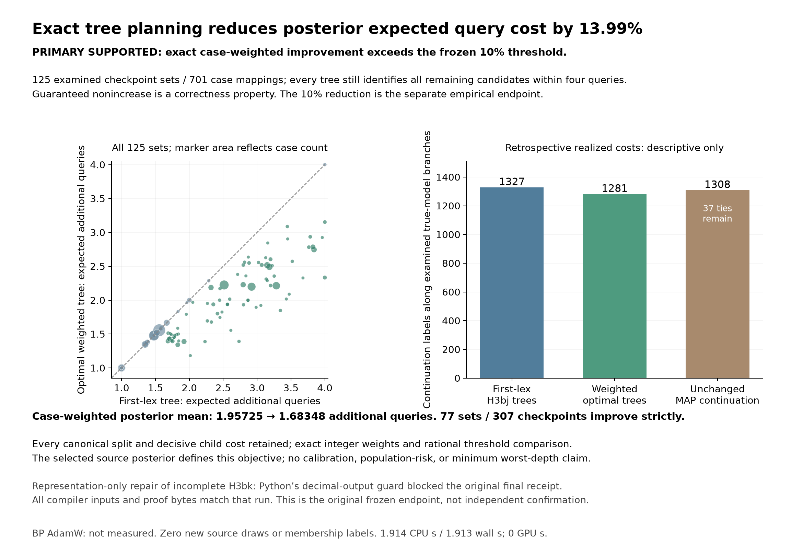

# H3bl: exact posterior-weighted trees reduce expected query cost

**The frozen 10% expected-cost hypothesis is supported: the checkpoint-weighted reduction is 13.987287%.** Across all 701 examined unresolved checkpoints, the posterior mean continuation cost falls from 1.95724648 to 1.68348079 queries. All 125 distinct candidate sets are retained, and every returned tree still identifies every remaining model within four queries.

H3bl is a representation-only repair of the incomplete H3bk run. H3bk computed all group proofs but failed while converting its final exact aggregate rational numbers to decimal strings: their numerators and denominators exceed 11,000 digits, above Python’s default 4,300-digit guard. The original frozen code and every failed receipt remain intact. H3bl explicitly permits trusted large-integer serialization while retaining the original algorithm, input scope, 10% threshold and all scientific resource limits. It is a rerun of the originally frozen endpoint, not independent confirmation. Every catalog, compiler input, weight receipt and proof is byte-identical to the failed run.

| Method or objective | Case-weighted expected additional queries |
|---|---:|
| BP AdamW | Not measured |
| H3bj first feasible lexicographic tree | 1.95724648 |
| Exact posterior-weighted optimum, depth at most four | 1.68348079 |

The aggregation weights each group by its number of mapped H3bj cases, not equally by group. For group g, let n_g be its case multiplicity, W_g the sum of its positive integer posterior weights, and C_g the weighted sum of candidate leaf depths. The old and optimized objectives are A = Σ_g n_g C_g / W_g. The primary compares **10 A_opt ≤ 9 A_old using exact rational arithmetic**. Dividing both by 701 yields the reported means and does not affect the decision. The complete exact fractions are retained in JSON; displayed decimals never determine the threshold.

The source posterior is unchanged. Candidate i has score d_i = C(55,k_i) C(M_i,16), where k_i is its orbit count and M_i its complete N12 population. The class prior and uniform-positive likelihood make the posterior proportional to 1/d_i within the remaining candidate set. Deterministic past membership observations remove incompatible candidates. For each root, L = lcm(d_i) and w_i = L/d_i provide exact positive integer weights; they are not fitted to realized true identities.

For subset S and remaining depth d, the dynamic program sets singleton cost to zero and rejects |S| > 2^d. Otherwise it considers every nontrivial signature-induced bipartition and minimizes w(S) + C(S_negative,d−1) + C(S_positive,d−1). Complement-equivalent queries use the first board in lexicographic order, and exact minimum-cost ties also choose that board. Every alternative, child-size bound, failed child and feasible candidate cost is recorded. The compiler accepts only candidate IDs, exact weights, the full signature catalog, depth and counters, with no truth or case identity.

The optimized search class contains the previous feasible tree, so nonincrease is a logical consequence and a correctness check. It is not counted as the scientific success. The separate 10% threshold is what could be falsified. Seventy-seven of the 125 sets improve strictly, covering 307 of the 701 checkpoint mappings; the remaining sets have equal expected cost. These trees minimize expected depth within the supplied complete N13 query universe and depth-four cap. They need not minimize worst-case depth or be globally optimal without that cap.

| Retrospective policy on the same examined truth branches | Continuation cost | Total cost including 5,339 shared labels | Exact cases |
|---|---:|---:|---:|
| BP AdamW | Not measured | Not measured | Not measured |
| Original first-lex hybrid | 1,327 | 6,666 | 1,408/1,408 |
| Weighted optimal trees | 1,281 | 6,620 | 1,408/1,408 certified |
| Unchanged MAP continuation | 1,308 | 6,647 | 1,371/1,408 |

The realized-truth costs are descriptive replays of already examined H3bj banks. No new oracle labels are acquired; these figures are not fresh confirmation of reduced cost. The MAP comparator retains thirty-seven ties, so its lower apparent cost than the old first-lex hybrid does not mean equal terminal accuracy. The 707 cases already identified after the shared MAP stage remain unchanged and receive zero tree continuation cost.

All 1,408 mappings, 701 unresolved checkpoints and 125 candidate sets remain explicit. Complete catalogs cover every one of the 73,712 ordinary N13 boards, retaining unanimous signatures, multiplicities and lexicographic representatives. Both original and optimized trees receive independent feasibility replay, and every remaining candidate is checked against its actual prediction row. All selected queries are nontrivial, avoid original shared queries, and never repeat along a branch.

The independent audit passed 89,200 checks in 1.287271 seconds. It verifies all 8,499 real proof states, all 50,394 real split alternatives, all 564 candidate branches, exact integer weights and lexicographic ties, all original feasible witnesses, exact case multiplicities, and the rational primary comparison. It also confirms all 125 input/catalog/weight/proof bundles are byte-identical to H3bk. Fresh independent graph-filter and score parity covers all 1,541 candidates; full population completeness and original source-history provenance remain inherited by pinned hashes.

The monitored repaired study used **1.913702 aggregate CPU seconds / 1.913222 wall seconds**, 8,558 states and 50,439 split attempts, including synthetic gates. The failed original run used a separate 1.864954 CPU / 1.873281 wall seconds and remains reported as incomplete. Frozen per-run ceilings were 600 CPU / 900 wall seconds, 2,000,000 states and 50,000,000 split attempts. Every intermediate LCM and integer weight is capped at 100,000 bits; measured maxima were 1,407 and 1,227 bits. Any cap would mean whole-study incomplete, never infeasibility. Zero GPUs, new draws or membership labels.

The supplied finite model class, complete predictions, selected hard-tail checkpoints and source posterior define this exact objective. The result is not a claim that the posterior is calibrated, that future sampled truth costs improve by the same amount, or that a source-only method receives equal supervision. Binary membership and uniform positive examples remain different information.

Run `upstream/.venv/bin/python research/20261114/loki/h3bl/verify_public.py --root SNAPSHOT`.

[Frozen repair protocol](protocol.json), [original failed protocol](../h3bk/protocol.json), [retained failure report](../h3bk/REPORT.md), [weighted compiler](compiler.py), [independent verifier](verify_public.py), [exact summary](../../../../results/research/loki/h3bl/summary.json), [group costs](../../../../results/research/loki/h3bl/group-costs.csv), [all checkpoint mappings](../../../../results/research/loki/h3bl/checkpoint-mappings.json), [retrospective truth costs](../../../../results/research/loki/h3bl/retrospective-truth-costs.json), [figure provenance](../../../../results/research/loki/h3bl/plot-provenance.json). Every `groupN` retains full weights, catalog, compiler inputs, all-alternative optimality proof and result receipt.
