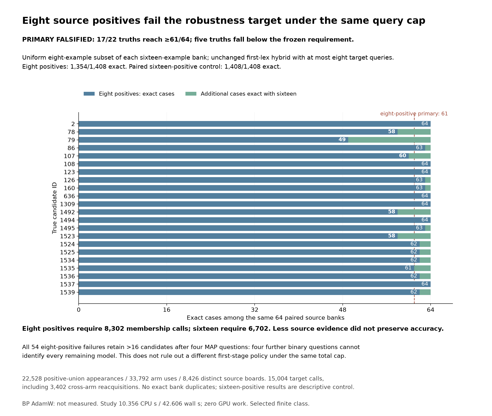

# H3bm: halving positive evidence fails the per-truth robustness target

**The single primary is falsified.** With eight source positives, seventeen of the twenty-two truths reach the frozen 61/64 exact-identification threshold; candidates 78, 79, 107, 1492 and 1523 reach only 58, 49, 60, 58 and 58. Overall the eight-positive hybrid identifies 1,354/1,408 cases. Its paired sixteen-positive descriptive control identifies 1,408/1,408.

| Method | Exact cases | Binary membership calls | Source-positive arm uses |
|---|---:|---:|---:|
| BP AdamW | Not measured | Not measured | Not measured |
| Eight-positive hybrid | 1,354/1,408 | 8,302 | 11,264 |
| Sixteen-positive hybrid, descriptive control | 1,408/1,408 | 6,702 | 22,528 |

The exact paired table is 1,354 both exact, zero eight-only, fifty-four sixteen-only and zero neither. The eight-positive arm makes 1,600 more membership calls while identifying fewer models. These descriptive differences do not replace the prespecified conjunction requiring every eight-positive truth to reach 61/64.

| Truth | Eight-positive exact /64 | Sixteen-positive exact /64 | Eight-primary decision | Eight calls | Sixteen calls |
|---:|---:|---:|---|---:|---:|
| 2 | 64 | 64 | supported | 270 | 251 |
| 78 | 58 | 64 | falsified | 381 | 334 |
| 79 | 49 | 64 | falsified | 346 | 283 |
| 86 | 63 | 64 | supported | 365 | 289 |
| 107 | 60 | 64 | falsified | 371 | 350 |
| 108 | 64 | 64 | supported | 328 | 283 |
| 123 | 64 | 64 | supported | 350 | 296 |
| 126 | 63 | 64 | supported | 323 | 284 |
| 160 | 63 | 64 | supported | 299 | 231 |
| 636 | 64 | 64 | supported | 316 | 246 |
| 1309 | 64 | 64 | supported | 279 | 217 |
| 1492 | 58 | 64 | falsified | 418 | 308 |
| 1494 | 64 | 64 | supported | 411 | 321 |
| 1495 | 63 | 64 | supported | 431 | 374 |
| 1523 | 58 | 64 | falsified | 423 | 312 |
| 1524 | 62 | 64 | supported | 439 | 328 |
| 1525 | 62 | 64 | supported | 406 | 355 |
| 1534 | 62 | 64 | supported | 449 | 269 |
| 1535 | 61 | 64 | supported | 409 | 339 |
| 1536 | 62 | 64 | supported | 427 | 328 |
| 1537 | 64 | 64 | supported | 435 | 338 |
| 1539 | 62 | 64 | supported | 426 | 366 |

For each of the same twenty-two selected truths, sixty-four sixteen-example banks are drawn uniformly without replacement using seed `2026400000 + 64*candidateID + bank`. A separate stream, seed `2026500000 + 64*candidateID + bank`, chooses eight indices uniformly without replacement from those sixteen. The eight examples are not a lexical prefix. All 1,408 paired banks are durably logged before any new target membership outcomes. No truth, bank or seed is excluded or redrawn.

Both arms keep the H3bj first-lex hybrid: at most four MAP-guided membership queries, followed by a truth-blind depth-at-most-four feasibility tree on the remaining candidate set. The newer posterior-weighted planner is not introduced, preserving the query-policy rule while changing positive evidence. Both arms use the same 1,541 supplied candidate definitions and all 73,712 ordinary N13 target boards.

The likelihood uses the arm’s actual positive count: the exact MAP score is C(55,k_i) C(M_i,m), with m = 8 or 16. The prior is unchanged. Source compatibility retains every model consistent with all observed positives, including any population with 8 ≤ M_i < 16 that could fit the smaller bank. No such small-population model happens to survive these actual eight-positive banks, but synthetic boundary fixtures explicitly verify its retention and correct likelihood. Both full score tables and all 1,541 source/target graph filters are independently checked.

All fifty-four eight-positive failures are certified at the root by the binary information bound. After their first four MAP queries they retain **17–107 candidates**, more than the sixteen leaves available to a depth-four binary tree. They map to thirty-six distinct infeasible sets; no failure requires a deeper exhausted-partition proof. All remaining cases and ties are preserved. This certifies failure of this continuation requirement from these checkpoints, not impossibility for a different first-stage policy or a policy optimized only for a realized truth.

The eight-positive arm has 1,121 unresolved four-query checkpoints, of which 1,067 admit a four-query tree. Its 287 earlier successes need no continuation. The sixteen-positive arm has 700 unresolved checkpoints, all feasible, and 708 earlier successes. Across both arms, 539 distinct remaining sets are compiled once and every case mapping remains explicit. Feasible trees identify every remaining model, not just the true one. An infeasible checkpoint receives no fallback or extra budget.

| Accounting quantity | Count |
|---|---:|
| Positive union summed across paired cases | 22,528 |
| Positive arm uses: 11,264 + 22,528 | 33,792 |
| Distinct N12 boards across the entire study | 8,426 |
| Eight-arm MAP / tree membership calls | 5,577 / 2,725 |
| Sixteen-arm MAP / tree membership calls | 5,341 / 1,361 |
| Actual membership calls across arms | 15,004 |
| Cross-arm repeated queries, reacquired and charged | 3,402 |
| Distinct queried boards summed within each paired case | 11,602 |

The eight-example source subset is shared information from the sixteen-example bank, not 11,264 extra source acquisitions. Global distinct source boards, per-pair union appearances and arm uses are different counts. Target queries are acquired independently in the eight arm then the sixteen arm; repeated same-case boards name prior query sequences and are charged again, with no free label reuse. The last table count is not the number of distinct target boards across the full study.

Each arm has sixty-four unique unordered banks per truth, and no exact bank repeats within either arm. No sixteen-example bank matches the pinned H3bf/H3be/H3bc/H3bj history. Individual boards overlap, and the seeds alone did not guarantee disjointness. Historical novelty is checked only against the declared sixteen-example bank registry; no broader eight-example-history claim is made.

The monitored study used **10.355696 aggregate CPU seconds / 42.605877 wall seconds**, 7,142 states and 4,465 split attempts, including compiler synthetic gates. Frozen limits were 600 CPU / 900 wall seconds, 250,000 states, 10,000,000 splits and 22,528 membership calls. Every global resource error would make the entire study incomplete. No GPU work was needed; persistent selection and shared-set compilation reduce useful work while durable ledger costs remain included.

The independent public audit passes 127,012 checks in 4.550784 seconds. It reconstructs all sixteen-example draws and independent eight-index subsets, both likelihoods and all source filters; replays all 15,004 sealed query/answer calls; validates all 539 proof groups, 7,091 real proof states, 4,440 split attempts and 3,779 feasible candidate branches; retains all failures; and recomputes the single primary, descriptive controls, positive unions and repeated-call accounting. Existing independent H3bi/H3bj verifier helpers are hash-recorded; the scientific compiler is not used to verify itself.

The exact durable ledger has 40,280 records, 45,970,840 raw bytes and 5,088,643 deterministic gzip bytes. Its decompressed SHA-256 is `dde733382c1c73eb9413016c9a4d1cec1a3008f08bd209d0a4540d837758de82`. Queries are flushed and fsynced before oracle calls; answers immediately follow and reference the committed query hash. Synthetic durability, corruption, finite-tree and eight/sixteen-boundary gates all pass before new draws.

The conclusion concerns this selected hard tail, known finite candidate class, noiseless binary membership and unchanged first-stage rule. It does not establish arbitrary-rule learning, whole-class reliability, global query-budget impossibility or equal-oracle fairness with source-only learning. Uniform source positives, complete candidate predictions and selected target membership are distinct information.

Run `upstream/.venv/bin/python research/20261114/loki/h3bm/verify_public.py --root SNAPSHOT`.

[Frozen protocol](protocol.json), [paired draw and likelihood implementation](evidence.py), [boundary gate](evidence_gate.py), [study](study.py), [independent verifier](verify_public.py), [summary](../../../../results/research/loki/h3bm/summary.json), [per-truth comparison](../../../../results/research/loki/h3bm/truth-comparison.csv), [all source pairs](../../../../results/research/loki/h3bm/source-pairs.json), [all paired results and failures](../../../../results/research/loki/h3bm/case-results.json), [exact ledger](../../../../results/research/loki/h3bm/query-ledger.jsonl.gz), [figure provenance](../../../../results/research/loki/h3bm/plot-provenance.json).
