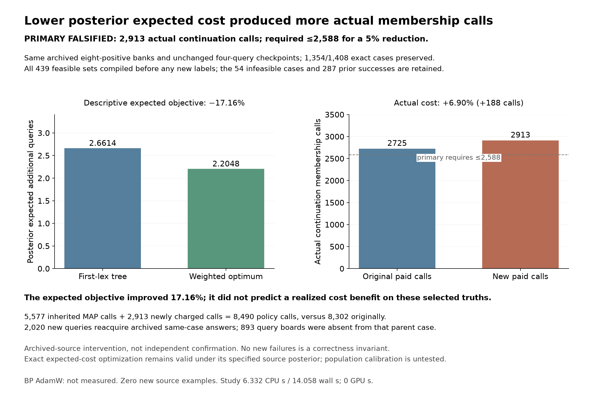

# H3bn: expected-cost optimization increases realized membership cost

**The actual-call primary is falsified.** Weighted-tree continuation uses 2,913 paid membership calls versus 2,725 for the original first-lex trees: **188 more calls, a 6.899083% increase**. The frozen primary required at most 2,588 calls, equivalent to at least a 5% reduction. Meanwhile the specified posterior expected-cost objective decreases by 17.156653%. These are different outcomes; the expected reduction is not evidence of a realized benefit.

| Method | Actual continuation calls | Total policy calls including 5,577 inherited MAP calls | Exact cases |
|---|---:|---:|---:|
| BP AdamW | Not measured | Not measured | Not measured |
| Original first-lex hybrid, archived H3bm | 2,725 | 8,302 | 1,354/1,408 |
| Posterior-weighted optimal trees, new execution | 2,913 | 8,490 | 1,354/1,408 |

The actual primary is evaluated by the integer comparison `100 * new_calls <= 95 * 2725`; the maximum passing integer is 2,588. The observed left side is 291,300 versus 258,875 on the right. Expected costs, per-truth differences and cumulative policy costs are descriptive. Preserving exactly 1,354 identified cases is a required correctness invariant, not a separate scientific success.

| Truth | Exact cases /64, unchanged | Original continuation | Weighted continuation | Difference |
|---:|---:|---:|---:|---:|
| 2 | 64 | 17 | 12 | -5 |
| 78 | 58 | 125 | 97 | -28 |
| 79 | 49 | 99 | 92 | -7 |
| 86 | 63 | 118 | 103 | -15 |
| 107 | 60 | 115 | 121 | +6 |
| 108 | 64 | 72 | 75 | +3 |
| 123 | 64 | 94 | 87 | -7 |
| 126 | 63 | 67 | 62 | -5 |
| 160 | 63 | 49 | 54 | +5 |
| 636 | 64 | 60 | 61 | +1 |
| 1309 | 64 | 36 | 33 | -3 |
| 1492 | 58 | 162 | 190 | +28 |
| 1494 | 64 | 155 | 181 | +26 |
| 1495 | 63 | 181 | 191 | +10 |
| 1523 | 58 | 167 | 188 | +21 |
| 1524 | 62 | 184 | 198 | +14 |
| 1525 | 62 | 154 | 172 | +18 |
| 1534 | 62 | 193 | 204 | +11 |
| 1535 | 61 | 154 | 191 | +37 |
| 1536 | 62 | 172 | 204 | +32 |
| 1537 | 64 | 179 | 214 | +35 |
| 1539 | 62 | 172 | 183 | +11 |

All 1,408 archived H3bm eight-positive cases are retained. The 1,067 feasible unresolved checkpoints map to 439 distinct candidate sets. Fifty-four previously certified infeasible checkpoints stay unresolved and acquire no new labels; the 287 prior successes also acquire no new labels. No source bank is changed or redrawn, and no fallback or expanded query budget is available. This is an intervention on examined archived sources, not independent confirmation.

Each feasible set uses the byte-identical H3bl weighted compiler with the correct eight-positive source score C(55,k_i) C(M_i,8). Exact integer weights are proportional to the reciprocal score. The optimizer enumerates every complete N13 signature-induced bipartition, minimizes weighted expected leaf depth subject to depth at most four, and resolves cost ties by the first lexicographic board. Its certificate preserves every alternative and decisive child. It receives no true identity or case input. The original feasible trees remain in the search class, so expected nonincrease is a correctness consequence.

All 439 complete catalogs and optimized trees are compiled and bound before the first new oracle label. Every remaining model is independently followed to its correct singleton leaf within four steps. Tree queries do not repeat a prior MAP query or any query on their own path. Missing, mismatched, capped or unexpectedly infeasible proofs terminate the entire study as incomplete; they cannot cause a silent fallback or reduced-scope success.

The controller then executes the trees through a new durable ledger. Each query is flushed and fsynced before a separate oracle invocation, followed immediately by an answer referencing that query hash. A parent ledger answer never substitutes for a new call: all 2,913 calls are independently charged. Of them, 2,020 repeat a board already asked somewhere in the same parent case, including either source arm; their parent query sequences are recorded. The other 893 boards were absent from that parent case. These counts do not describe distinct boards across the entire study.

The 5,577 archived eight-arm MAP labels are reconstructed and inherited once; they are not reacquired. The original 2,725 first-lex continuation calls remain the archived comparator and are not added to the new policy’s total of 8,490. There are zero new source draws or positive labels; the 11,264 historical eight-positive appearances remain separate from new membership calls.

The case-weighted posterior expected objective decreases 17.156653% across the 1,067 feasible checkpoints, yet the measured true-model branches cost more. The declared source posterior and the selected hard-tail evaluation distribution are different objects. This result establishes the finite discrepancy on these examined cases; it does not by itself establish a particular calibration mechanism or a population-level defect. Posterior-rank and calibration diagnostics require a separately frozen analysis.

Before freezing, synthetic gates tested C(M,8) integer weights, 5,001-digit exact serialization, weighted brute-force costs, lexicographic and depth behavior, resource exceptions, and rejection of missing, mismatched and nonfeasible proof files. The preflight independently checked all 439 archived feasible witnesses with 36,310 checks in 0.151918 seconds. That preflight is separate from the monitored study; runtime repeats the weighted fixtures and charges their states and splits to the study counters.

The monitored experiment used **6.331917 aggregate CPU seconds / 14.058229 wall seconds**, 67,882 states and 342,583 split attempts including runtime synthetic gates. Frozen limits were 600 CPU / 900 wall seconds, 2,000,000 states, 50,000,000 splits, 100,000 bits for every intermediate LCM and weight, and 4,268 new membership calls. Zero GPUs. Maximum audited LCM and integer-weight sizes were 1,086 and 987 bits.

The independent public audit passes 637,501 checks in 6.708386 seconds. It reconstructs all archived source banks; replays all 5,577 original MAP choices; verifies all 67,823 real weighted proof states and 342,538 alternatives plus all original witnesses; traverses 3,447 candidate branches; and replays all 2,913 new paid query/answer records. It checks both ledger hash/order/time chains, all case mappings, the unchanged 54 failures and 287 successes, exact integer primary and expected-cost calculations, and every reacquisition charge.

The new ledger has 9,711 records, 7,542,292 raw bytes and 1,247,732 deterministic gzip bytes. Decompression restores SHA-256 `5a2f8a37493e6352230d5324b86e39097f44c3b3dd96a9574efad5279bb66a37`. It references the immutable parent ledger, original case results, checkpoints, complete compiler-group registry and per-case proof hashes.

The supplied finite model class, complete target predictions, noiseless binary membership, source posterior and selected examined checkpoints define this result. It is not arbitrary-rule learning, a learned optimizer, a whole-class reliability claim or equal-oracle fairness with positive-only learning.

Run `upstream/.venv/bin/python research/20261114/loki/h3bn/verify_public.py --root SNAPSHOT`.

[Frozen protocol](protocol.json), [prefreeze gates](preflight.json), [proof availability gate](proof_gate.py), [study](study.py), [independent verifier](verify_public.py), [summary](../../../../results/research/loki/h3bn/summary.json), [per-truth costs](../../../../results/research/loki/h3bn/truth-costs.csv), [all archived checkpoints](../../../../results/research/loki/h3bn/checkpoints.json), [all cases including failures](../../../../results/research/loki/h3bn/case-results.json), [exact new ledger](../../../../results/research/loki/h3bn/query-ledger.jsonl.gz), [figure provenance](../../../../results/research/loki/h3bn/plot-provenance.json).
