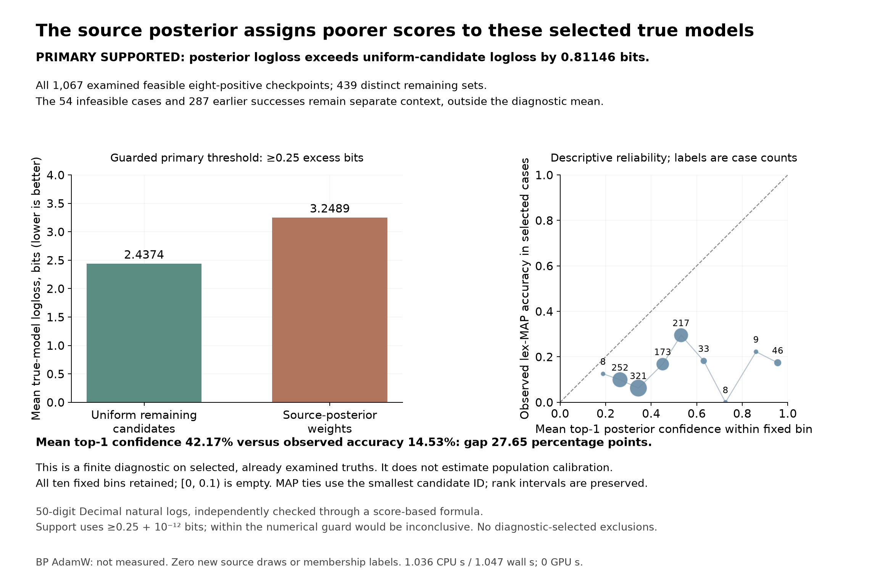

# H3bo: source-posterior logloss is worse than uniform on selected truths

**The guarded diagnostic primary is supported.** Across all 1,067 already examined feasible eight-positive checkpoints, mean true-model logloss is 3.24886204 bits under the source posterior versus 2.43740296 bits under uniform weights over current candidates. The mean excess is **0.81145908 bits**, above the frozen 0.25-bit threshold and its numerical guard.

| Distribution over the same remaining candidates | Mean true-model logloss, bits |
|---|---:|
| BP AdamW | Not measured |
| Uniform remaining-candidate probabilities | 2.43740296 |
| Existing source posterior | 3.24886204 |

This is a frozen diagnostic on selected, already examined truths, following H3bn’s observed expected-versus-actual cost discrepancy. It is not independent confirmation or an estimate of population calibration. All 1,067 feasible checkpoints are included without selecting by posterior rank, cost change or outcome. Their 439 distinct candidate sets share distributions, but the primary averages cases equally. The 54 known infeasible cases and 287 earlier singleton successes remain explicit context and are not pooled into the diagnostic mean.

The posterior is unchanged: candidate i has unnormalized probability proportional to 1 / [C(55,k_i) C(M_i,8)]. Exact integer weights reproduce those probabilities within the current candidate set. For each case, the primary quantity is `(ln(sum weights) - ln(true weight) - ln(candidate count)) / ln(2)`. All logarithms and averages use 50-digit Decimal arithmetic. Support requires mean excess ≥0.25 + 10⁻¹² bits; falsification requires mean excess <0.25 − 10⁻¹²; values inside the guard are explicitly inconclusive. No displayed rounded number determines the result.

The independent verifier recomputes the same logscore through a separate score-based identity: `ln(true score) + ln(sum reciprocal scores)`, subtracting `ln(candidate count)` for excess and dividing by `ln(2)`. It checks every case and aggregate within 10⁻⁴⁵ bits, well inside the decision guard. All exact rational true probabilities, integer weights, tie ranks and group normalization are independently reconstructed.

Descriptive lexicographic-MAP confidence averages **42.173306%**, while its observed accuracy among these selected cases is **14.526710%**. The overconfidence gap is 27.646596 percentage points, and the fixed-bin ECE is 27.646596 percentage points. These are finite selected-sample summaries, with no confidence interval, significance test or population-calibration claim.

The ten confidence bins are fixed at [0,0.1), [0.1,0.2), …, [0.9,1]. Assignment uses exact rational comparisons. A MAP tie predicts the smallest candidate ID; all tied IDs and true-model best/worst rank intervals remain visible. Empty bins retain null confidence/accuracy/gap and zero ECE contribution. The first bin is empty here; none is silently dropped.

| Actual continuation-call change in H3bn | Cases | Mean posterior-minus-uniform logloss, bits |
|---:|---:|---:|
| -3 | 0 | Empty stratum |
| -2 | 10 | -1.294170 |
| -1 | 111 | -0.372337 |
| +0 | 698 | 0.846567 |
| +1 | 179 | 1.280652 |
| +2 | 67 | 1.451319 |
| +3 | 2 | 1.359737 |

All seven prespecified change strata, including the empty −3 stratum, are retained. Costs improved in 121 cases, worsened in 248 and stayed equal in 698. The strata and all twenty-two per-truth diagnostic rows are descriptive; they introduce no additional scientific thresholds. The positive logscore excess in worsened cases is consistent with a weighting mismatch on the retained sample, but this analysis does not establish a causal cost benefit from changing weights. A uniform-tree intervention requires its own frozen policy and actual-call endpoint.

Each case records its exact true-model probability, best and worst posterior ranks under ties, midpoint rank fraction, log2 midpoint rank, posterior entropy, posterior and uniform logloss, excess logloss, MAP tie membership, lexicographic MAP correctness, and both actual continuation costs. Every original case also has an eligibility/context record. Complete source cardinalities and eight-positive score formulas are recomputed for all 1,541 supplied candidates; previously audited graph, source-history and tree evidence is inherited by pinned hashes.

The monitored diagnostic uses **1.035946 aggregate CPU seconds / 1.047322 wall seconds**, below the frozen 30 CPU / 60 wall limits. Zero GPU work, new source draws or membership labels. Synthetic gates cover exact uniform ties, a 3:1 posterior with an analytic low-probability logloss, empty aggregates and all numerical-guard boundaries.

The independent public audit passes 9,838 checks in 1.036627 seconds. It verifies all 1,541 score formulas, 1,067 case probabilities/ranks/logscores, 439 weight vectors/entropies, all 341 context cases, the guarded quarter-bit comparison, all ten confidence bins, all seven cost strata and all twenty-two truth rows. No compiler or scientific metric implementation is imported for verification.

The source posterior belongs to the declared finite model prior and likelihood. This selected hard-tail evaluation is not a random sample from that prior. The measured mismatch is therefore scoped to the examined checkpoints; it does not show that the posterior is mathematically incorrect or generally uncalibrated. Complete candidate predictions, source positives and binary membership remain distinct information.

Run `upstream/.venv/bin/python research/20261114/loki/h3bo/verify_public.py --root SNAPSHOT`.

[Frozen protocol](protocol.json), [metric definitions](metrics.py), [independent verifier](verify_public.py), [summary](../../../../results/research/loki/h3bo/summary.json), [exact case diagnostics](../../../../results/research/loki/h3bo/case-diagnostics.json), [compact diagnostic table](../../../../results/research/loki/h3bo/case-diagnostics.csv), [all case contexts](../../../../results/research/loki/h3bo/case-contexts.json), [fixed bins](../../../../results/research/loki/h3bo/calibration-bins.json), [cost strata](../../../../results/research/loki/h3bo/cost-change-strata.json), [truth diagnostics](../../../../results/research/loki/h3bo/truth-diagnostics.json), [figure provenance](../../../../results/research/loki/h3bo/plot-provenance.json).
