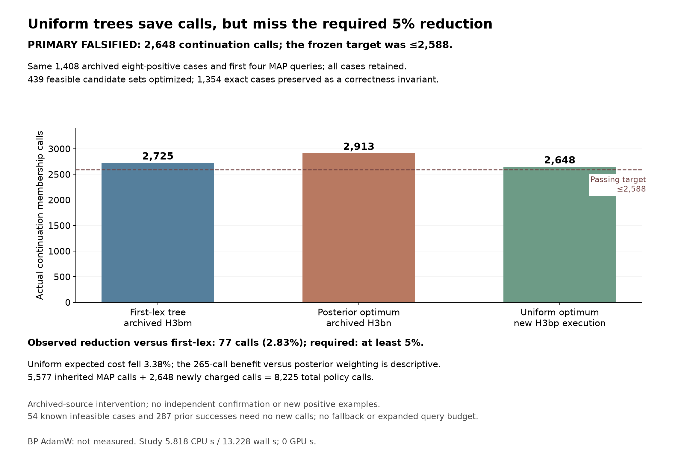

# H3bp: uniform trees save calls but miss the required 5% reduction

**The sole actual-call primary is falsified.** Uniform-tree continuation uses **2,648 paid membership calls versus 2,725** for the original first-lex trees: 77 fewer calls, a 2.825688% reduction. The frozen primary required at most 2,588 calls, equivalent to at least 5%. The 265-call benefit versus the archived posterior-weighted H3bn policy and the 3.384309% uniform expected-cost reduction are descriptive; neither replaces the failed primary.

| Method | Actual continuation calls | Policy calls including 5,577 inherited MAP calls | Exact cases |
|---|---:|---:|---:|---:|
| BP AdamW | Not measured | Not measured | Not measured |
| First-lex hybrid, archived H3bm | 2,725 | 8,302 | 1,354/1,408 |
| Posterior-weighted optimal trees, archived H3bn | 2,913 | 8,490 | 1,354/1,408 |
| Uniform optimal trees, new execution | 2,648 | 8,225 | 1,354/1,408 |

The unchanged primary uses `100 * new_calls <= 95 * 2725`: the observed left side is 264,800 versus 258,875 on the right. Its maximum passing integer count is 2,588. Exactly 1,354 identified cases is a correctness invariant guaranteed by preserving feasible depth-four trees, not a separate empirical success.

| Truth | Exact cases /64, unchanged | First-lex continuation | Posterior continuation | Uniform continuation | Uniform minus first-lex |
|---:|---:|---:|---:|---:|---:|
| 2 | 64 | 17 | 12 | 15 | -2 |
| 78 | 58 | 125 | 97 | 115 | -10 |
| 79 | 49 | 99 | 92 | 106 | +7 |
| 86 | 63 | 118 | 103 | 113 | -5 |
| 107 | 60 | 115 | 121 | 118 | +3 |
| 108 | 64 | 72 | 75 | 68 | -4 |
| 123 | 64 | 94 | 87 | 85 | -9 |
| 126 | 63 | 67 | 62 | 60 | -7 |
| 160 | 63 | 49 | 54 | 50 | +1 |
| 636 | 64 | 60 | 61 | 57 | -3 |
| 1309 | 64 | 36 | 33 | 36 | +0 |
| 1492 | 58 | 162 | 190 | 168 | +6 |
| 1494 | 64 | 155 | 181 | 157 | +2 |
| 1495 | 63 | 181 | 191 | 169 | -12 |
| 1523 | 58 | 167 | 188 | 166 | -1 |
| 1524 | 62 | 184 | 198 | 185 | +1 |
| 1525 | 62 | 154 | 172 | 142 | -12 |
| 1534 | 62 | 193 | 204 | 169 | -24 |
| 1535 | 61 | 154 | 191 | 157 | +3 |
| 1536 | 62 | 172 | 204 | 173 | +1 |
| 1537 | 64 | 179 | 214 | 181 | +2 |
| 1539 | 62 | 172 | 183 | 158 | -14 |

All 1,408 archived H3bm eight-positive cases remain in scope. The 1,067 feasible unresolved checkpoints map to 439 distinct candidate sets. Fifty-four previously certified infeasible checkpoints stay unresolved and acquire no new labels; 287 prior successes also acquire no new labels. No source bank is changed or redrawn, and no fallback or expanded query budget is available. This intervention reuses examined archived sources; it is not independent confirmation.

The first at-most-four MAP queries are inherited unchanged, including their correct C(M,8) source likelihood. Continuation assigns exact integer weight 1 to every remaining candidate, excluding none. The byte-identical H3bl compiler enumerates every complete N13 signature-induced bipartition and minimizes the sum of candidate leaf depths subject to depth at most four. Optimal-cost ties use the lexicographically first query board. The compiler receives the candidate set, full signature catalog and weights, without case or true-identity input. All alternatives and decisive children appear in the certificates. The original feasible trees remain in the search class, so nonincrease of the optimized uniform expectation is a correctness consequence.

All 439 catalogs and optimized trees are bound before the first new oracle label. Every remaining model is independently followed to its singleton leaf within four steps. Tree queries repeat neither a prior MAP query nor an earlier query on their own path. Missing, mismatched, capped or unexpectedly infeasible proofs terminate the entire study as incomplete; they cannot cause a fallback or a reduced-scope success.

Every continuation query is newly charged, flushed and fsynced before a separate oracle invocation; its immediate answer references the query hash. The new ledger binds both archived H3bm and H3bn ledgers. All 2,648 calls are paid again, including 2,523 that reacquire a board already asked somewhere in the same H3bm case (either source arm) or H3bn case. The remaining 125 query boards were absent from both archived cases. All matching query sequences and hashes are retained with their study names. These counts concern same-case overlap, not globally distinct boards.

The 5,577 original eight-arm MAP calls are reconstructed and inherited once. Original first-lex and posterior continuation costs are archived comparators, not charges added to the new policy total of 8,225. There are zero new source draws or positive examples; the 11,264 historical eight-positive appearances remain separate from new membership calls.

The case-weighted uniform expected-cost sum across feasible checkpoints falls from 2749.065495615 to 2656.028615829 (3.384309%). Actual true-branch cost falls by 2.825688%. Descriptively, changing from posterior weights to uniform weights recovers 265 calls on the same cases, but this does not prove a calibration mechanism, independent generalization or the original 5% target.

Before freezing, independent preflight validated all 439 original feasible witnesses using 36,310 checks in 0.143786 seconds. Synthetic fixtures cover uniform weights [1,1,1] with optimal cost 5 and lexicographic first board, inherited eight-positive score construction, exact long-integer serialization, exhaustive weighted and uniform costs, depth and resource exceptions, and missing/mismatched/infeasible proof rejection. Runtime repeats the compiler fixtures and charges their states and splits to study counters.

The monitored experiment used **5.818376 aggregate CPU seconds / 13.227630 wall seconds**, 67,882 states and 342,583 split attempts including runtime synthetic gates. Frozen limits were 600 CPU / 900 wall seconds, 2,000,000 states, 50,000,000 split attempts and 4,268 new calls. Optimized weights are all exactly 1. Zero GPUs were used; this finite exact-search workload does not use GPU kernels.

The independent pre-export audit passes 636,036 checks in 5.952217 seconds. It reconstructs all 1,408 archived source banks; replays all 5,577 original MAP decisions; checks every real optimality proof state (67,823) and split alternative (342,538) plus the original witnesses; follows all 3,447 candidate branches; and replays every new paid query/answer. It verifies all three ledger hash/order/time chains, case mappings, the unchanged 54 failures and 287 successes, integer primary, exact rational expected objectives and every reacquisition charge. The public verifier adds export and figure provenance checks.

The new ledger has 9,181 records, 8,044,334 raw bytes and 1,302,560 deterministic gzip bytes. Decompression restores SHA-256 `18475849f4a3fdd210bc58c5b738fcc32943c2b2928cf8b1d82c56cc1e703b60`. The protocol SHA-256 is `9d59a4af4237b1a36989903fc0deef8ec44223312dae3247808d941a6f865c06`.

The supplied finite model class, complete target predictions, noiseless binary membership and selected examined checkpoints define this result. It is not arbitrary-rule learning, a learned optimizer, whole-class reliability, or equal-oracle fairness with positive-only learning.

Run `upstream/.venv/bin/python research/20261114/loki/h3bp/verify_public.py --root SNAPSHOT`.

[Frozen protocol](protocol.json), [prefreeze gates](preflight.json), [uniform weights](weight_mode.py), [proof availability gate](proof_gate.py), [study](study.py), [independent verifier](verify_public.py), [summary](../../../../results/research/loki/h3bp/summary.json), [per-truth costs](../../../../results/research/loki/h3bp/truth-costs.csv), [all archived checkpoints](../../../../results/research/loki/h3bp/checkpoints.json), [all cases including failures](../../../../results/research/loki/h3bp/case-results.json), [exact new ledger](../../../../results/research/loki/h3bp/query-ledger.jsonl.gz), [figure provenance](../../../../results/research/loki/h3bp/plot-provenance.json).
