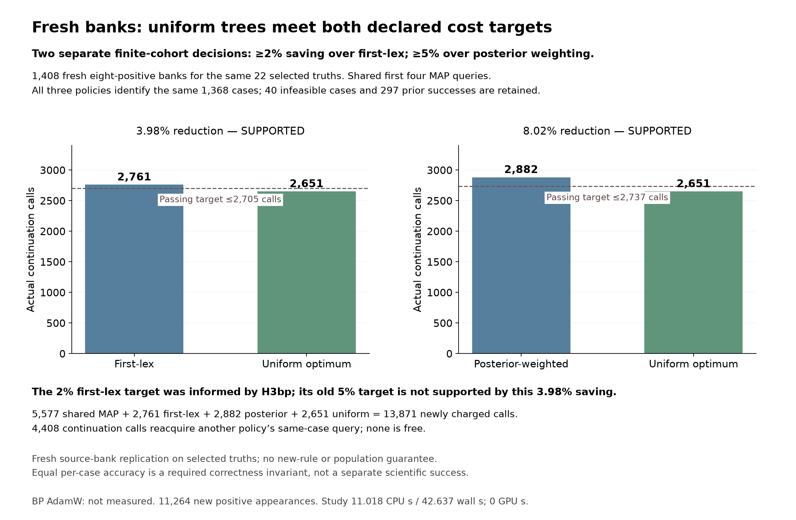

# H3bq: fresh eight-positive banks support two separate uniform-tree cost targets

**Both separately declared finite-cohort targets are supported.** Uniform trees use **2,651 continuation membership calls**, versus 2,761 for first-lex trees and 2,882 for posterior-weighted optimal trees. This saves 110 calls (3.984064%) against first-lex, above the frozen 2% target, and 231 calls (8.015267%) against posterior weighting, above its separate 5% target. This is a fresh source-bank replication for the same 22 previously selected truths.

| Method | Actual continuation calls | Policy calls including shared MAP | Exact cases |
|---|---:|---:|---:|---:|
| BP AdamW | Not measured | Not measured | Not measured |
| First-lex hybrid, newly executed | 2,761 | 8,338 | 1,368/1,408 |
| Posterior-weighted optimum, newly executed | 2,882 | 8,459 | 1,368/1,408 |
| Uniform optimum, newly executed | 2,651 | 8,228 | 1,368/1,408 |

| Separately frozen endpoint | Exact integer comparison | Largest passing integer count | Decision |
|---|---|---:|---|
| Uniform saves at least 2% vs first-lex | 265,100 ≤ 270,578 | 2,705 | supported |
| Uniform saves at least 5% vs posterior | 265,100 ≤ 273,790 | 2,737 | supported |

The 2% first-lex target was explicitly informed by the earlier H3bp 2.825688% archived-bank reduction and fixed before these fresh banks. It is a new target, not a revision of H3bp. H3bn and H3bp remain falsifications of their 5% target against first-lex. This fresh 3.984064% saving also falls below 5%; no such claim is made. The posterior comparison is a separate hypothesis with a different comparator. There is no omnibus test or claim of population significance. A zero-cost comparator was predefined as inconclusive for that endpoint.

All 22 selected truths receive 64 new banks. Each bank is eight distinct N12 positives sampled directly by `default_rng(2026600000 + 64*candidateID + bank).choice(M,8,replace=False)`. Direct uniform eight-sampling has the same sampling law as H3bm’s uniform sixteen-then-eight subset, using a new RNG namespace. All 1,408 sources are durably logged before any new target MAP label. There is no redrawing, filtering, deletion, seed tuning or suppression of ties, failures or duplicates. The seed audit found no collision with 7,456 explicitly recorded historical seed values; undocumented RNG streams are outside that audit.

All policies preserve the same 1,368 exact cases. The 1,071 feasible checkpoints map to 436 candidate sets. The 40 infeasible checkpoints and 297 prior successes remain explicit and acquire no continuation labels. There are 465 distinct unresolved candidate sets in total. Per-case equality is required by the common feasible depth-four tree class; it is a correctness invariant, not another scientific success or a reliability guarantee.

| Truth | Exact cases /64 | Infeasible cases | Prior successes | Shared MAP | First-lex continuation | Posterior continuation | Uniform continuation |
|---:|---:|---:|---:|---:|---:|---:|---:|
| 2 | 64 | 0 | 50 | 255 | 28 | 19 | 25 |
| 78 | 61 | 3 | 17 | 254 | 136 | 102 | 123 |
| 79 | 58 | 6 | 10 | 250 | 123 | 110 | 127 |
| 86 | 59 | 5 | 16 | 251 | 115 | 82 | 103 |
| 107 | 60 | 4 | 5 | 256 | 118 | 121 | 113 |
| 108 | 64 | 0 | 24 | 256 | 68 | 70 | 64 |
| 123 | 64 | 0 | 10 | 256 | 87 | 82 | 79 |
| 126 | 64 | 0 | 19 | 256 | 78 | 77 | 72 |
| 160 | 63 | 1 | 22 | 253 | 58 | 63 | 61 |
| 636 | 64 | 0 | 31 | 253 | 52 | 54 | 48 |
| 1309 | 64 | 0 | 43 | 243 | 29 | 30 | 28 |
| 1492 | 61 | 3 | 0 | 256 | 168 | 192 | 172 |
| 1494 | 64 | 0 | 6 | 255 | 168 | 178 | 162 |
| 1495 | 63 | 1 | 11 | 247 | 169 | 185 | 154 |
| 1523 | 59 | 5 | 0 | 256 | 173 | 179 | 165 |
| 1524 | 63 | 1 | 2 | 255 | 188 | 202 | 189 |
| 1525 | 63 | 1 | 11 | 251 | 157 | 170 | 146 |
| 1534 | 64 | 0 | 4 | 252 | 196 | 208 | 172 |
| 1535 | 59 | 5 | 0 | 256 | 162 | 194 | 167 |
| 1536 | 63 | 1 | 1 | 256 | 159 | 196 | 166 |
| 1537 | 63 | 1 | 4 | 255 | 168 | 195 | 167 |
| 1539 | 61 | 3 | 11 | 255 | 161 | 173 | 148 |

Each source bank is filtered against all 1,541 supplied candidates, including compatible models with source cardinality between eight and fifteen. The correct eight-positive score is C(55,k) C(M,8). The byte-identical MAP selector uses the lowest score, then smallest candidate ID, and the lexicographically first maximum-disagreement query. Up to four MAP queries are shared once. All shared checkpoints are completed before compiling any continuation trees.

The first-lex arm uses the unchanged first-feasible depth-four compiler. Both optimized arms use the byte-identical exact weighted compiler. Posterior weights are positive integers proportional to reciprocal eight-positive scores; uniform weights are exactly one for every remaining candidate. Complete N13 signature catalogs cover all 73,712 ordinary boards. Optimal cost ties use the first lexicographic board. All policy inputs bind the candidate set, weights, depth, catalog hash, predictions hash and compiler hash; grouping identical candidate sets occurs only within these fixed inputs. Compilers receive no case or true identity.

Every policy for every unresolved candidate set is compiled and bound in the ledger before any continuation label is acquired. Each candidate branch is checked to its correct singleton within four steps. Exact first-lex infeasibility certificates apply to the identical feasible class of both optimizers; these are shared certificates, not three independently executed infeasibility searches. Missing, capped or unexpectedly infeasible optimized proofs terminate the entire study as incomplete. There is no fallback, depth extension or reduced-scope claim.

The new ledger charges **13,871 membership calls**: 5,577 shared MAP plus 2,761 first-lex, 2,882 posterior and 2,651 uniform continuation calls. Each policy total in the table includes the same shared MAP cost, so summing policy totals would count MAP three times. The fixed execution order is first-lex, posterior, uniform within each case. Every query is fsynced before a separate oracle read and immediately followed by its hash-linked answer. All 4,408 cross-policy same-case reacquisitions are paid again; no answer cache or archived-study label substitutes for an invocation. The study contains 9,463 distinct case/query-board pairs.

There are 11,264 new positive source appearances shared across three policies, or 33,792 arm appearances; these are not 33,792 newly acquired examples. They contain 5,317 distinct N12 boards globally. There are 0 exact unordered bank duplicates within the fresh study and 0 matching H3bm eight-positive banks. Individual-board overlap is permitted and does not cause exclusions.

Prefreeze gates took 0.105675 seconds, separately from the monitored study. They checked source cardinality boundaries and exact eight-subset counts, direct-draw mechanics, weighted and first-lex brute-force costs/feasibility, lexicographic ties, depth limits, cap exceptions, long-integer serialization and explicit seed collisions. Runtime repeats scientific compiler gates with their states and splits charged globally, revalidates all 1,541 source/target masks and scores, and runs durable-ledger fixtures before drawing the fresh banks.

The monitored experiment used **11.018190 aggregate CPU seconds / 42.636631 wall seconds**, 131,189 states and 543,620 split attempts including runtime fixtures. Limits were 600 CPU / 900 wall seconds, 2,000,000 states, 50,000,000 splits, 100,000 bits for intermediate posterior LCMs and weights, and 22,528 calls. Maximum audited LCM/weight sizes were 1,082/983 bits. This is CPU exact search, using zero GPUs. Live monitoring showed 803 completed cases and 8,967 paid query/answer pairs after about 30 seconds; the wall/CPU difference reflects the required serial durable evidence writes, not idle numerical training.

The independent pre-export audit passes **1,080,349 checks in 15.509965 seconds**. It reconstructs every fresh source bank and every archived comparison bank used for duplicate accounting; independently computes all population masks and source scores; replays all 5,577 MAP selections and all 13,871 newly charged calls; and verifies the exact ledger hash/order/time chain. It checks all 131,079 real proof states and 543,550 split alternatives, follows 9,948 candidate/policy branches, checks all full cache identities, and reconstructs both endpoint decisions separately. No scientific compiler is called by the verifier. The final public verifier adds file and figure provenance checks.

The ledger has 39,528 records, 36,261,170 raw bytes and 4,255,199 deterministic gzip bytes. Decompression restores SHA-256 `bfaa3bd2399ca54d6b72c2b5499e40a6fdd8ca5ffcfc61febd505ce66f34b4c0`. The protocol SHA-256 is `60c52c49c1523f8ce61ae1612727acd4afce441d1ebb068c23f00f5bfe8d24e0`.

The evidence concerns fresh positive banks for the same selected hard-tail truths within a supplied finite model class. It does not establish arbitrary-rule learning, unseen-truth generalization, population calibration, a learned optimizer or equal-oracle fairness with positive-only learning. Complete candidate predictions and noiseless binary membership are stronger supervision.

Run `upstream/.venv/bin/python research/20261114/loki/h3bq/verify_public.py --root SNAPSHOT`.

[Frozen protocol](protocol.json), [prefreeze gates](preflight.json), [seed audit](seed-audit.json), [study](study.py), [independent verifier](verify_public.py), [summary](../../../../results/research/loki/h3bq/summary.json), [per-truth costs](../../../../results/research/loki/h3bq/truth-costs.csv), [all source banks](../../../../results/research/loki/h3bq/source-banks.json), [all cases including failures](../../../../results/research/loki/h3bq/case-results.json), [exact query ledger](../../../../results/research/loki/h3bq/query-ledger.jsonl.gz), [figure provenance](../../../../results/research/loki/h3bq/plot-provenance.json).
