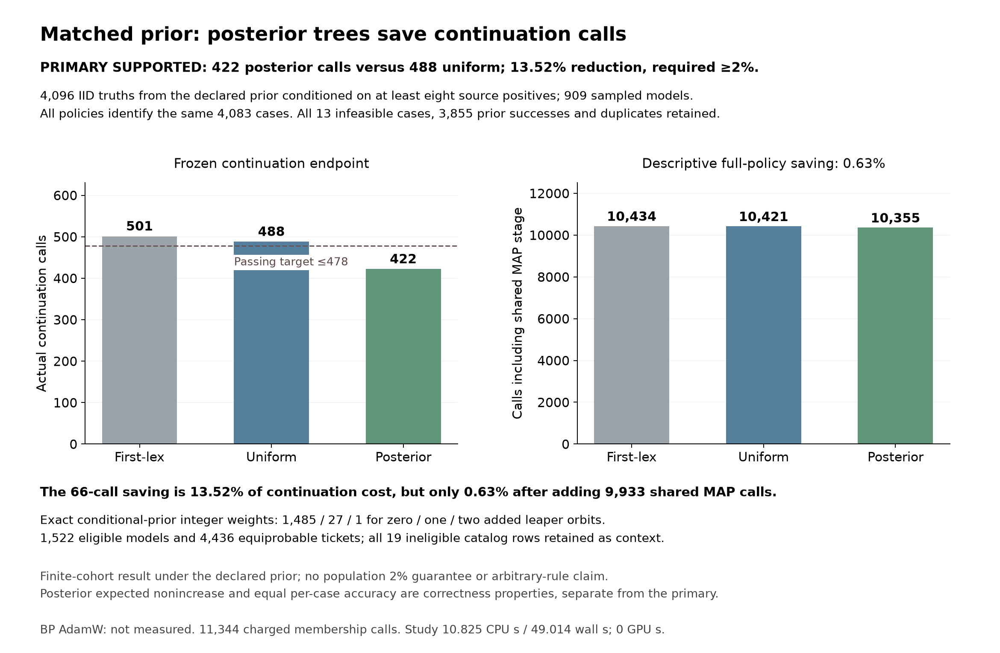

# H3br: posterior weighting saves continuation calls under its declared prior

**The sole finite-cohort primary is supported.** Posterior-optimal trees use **422 actual continuation membership calls versus 488 for uniform-optimal trees**, saving 66 calls (13.524590%) against the frozen 2% target. The exact test is `42200 <= 47824`, with at most 478 calls required. First-lex trees use 501 continuation calls as a descriptive control. Including the shared MAP stage, the posterior saving over uniform is only **0.633337%**.

| Method | Actual continuation calls | Calls including 9,933 shared MAP calls | Exact cases |
|---|---:|---:|---:|---:|
| BP AdamW | Not measured | Not measured | Not measured |
| First-lex hybrid, descriptive control, newly executed | 501 | 10,434 | 4,083/4,096 |
| Uniform optimum, newly executed | 488 | 10,421 | 4,083/4,096 |
| Posterior-weighted optimum, newly executed | 422 | 10,355 | 4,083/4,096 |

This cohort changes the truth distribution, not the MAP selector or tree optimizer. H3bq sampled fresh banks for the same 22 selected hard-tail truths and favored uniform weighting. H3br samples truths from the posterior’s declared prior, conditioned only on having at least eight source positives. The measured comparison reverses here. These finite distribution-specific results support a scope limitation for the earlier weighting discrepancy; they do not prove a unique calibration mechanism or a population effect size.

The fixed cohort contains 4,096 IID truth/source draws with no pilot outcomes or continuation-frequency requirement. For zero, one and two extra D4 leaper orbits, the declared prior assigns P(k)=1/3 and distributes that mass uniformly over C(55,k) models. After conditioning on M≥8, there are 1,522 eligible models: 1, 55 and 1,466 respectively. Their exact integer weights are 1,485, 27 and 1, totaling 4,436. The 19 ineligible models remain in the full catalog and frequency table with zero conditional mass.

Case `i` draws an integer ticket using `default_rng(2026700000+i).integers(4436)` and maps it through candidate-ID-ordered half-open cumulative intervals. An independent stream `default_rng(2026800000+i).choice(M,8,replace=False)` supplies eight distinct positives. No floating-point probabilities, rejection, resampling or outcome-dependent selection are used. All truth/source draws are logged before any new target label. Prefreeze checks enumerate all 4,436 tickets, independently recount every source cardinality from packed masks, and verify candidate/orbit/cardinality identity against the original catalog. All 8,192 new truth/source seeds are distinct and avoid explicitly recorded historical seed values.

| Added orbit count | Eligible models | Prior integer mass | Expected draws from fixed sampling law | Observed draws | Distinct sampled models | Exact cases | First-lex / posterior / uniform continuation |
|---:|---:|---:|---:|---:|---:|---:|---|
| 0 | 1 | 1,485 | 1371.181244 | 1,357 | 1 | 1,357 | 0 / 0 / 0 |
| 1 | 55 | 1,485 | 1371.181244 | 1,438 | 55 | 1,438 | 164 / 120 / 156 |
| 2 | 1,466 | 1,466 | 1353.637511 | 1,301 | 853 | 1,288 | 337 / 302 / 332 |

Expected class counts above follow the exact sampling law; observed class/cost breakdowns are descriptive. All 1,541 candidate rows are retained in [the full truth table](../../../../results/research/loki/h3br/truth-costs.csv), including unobserved eligible models and all ineligible models. The cohort sampled 909 distinct truth models, so it is not an exhaustive trial of every eligible model.

All 4,096 cases remain in scope. The 3,855 MAP-stage successes use no continuation queries. The 228 feasible checkpoints map to 207 distinct sets; 13 infeasible checkpoints remain unresolved. There are 220 unresolved candidate sets in total. All policies produce the same per-case exact flag and identify 4,083 cases. Equality is a required correctness invariant, not another empirical success criterion.

The unchanged source score is C(55,k) C(M,8). Conditioning the truth prior on M≥8 introduces only a common normalization factor, while eight distinct positives already exclude models with M<8. All other compatible models, including M from eight through fifteen, remain candidates. Deterministic MAP query answers filter the candidate set without changing relative posterior weights among survivors. The shared selector uses at most four queries, exact score/ID guide ties and lexicographic maximum-disagreement board ties.

All shared MAP checkpoints are completed before compilation. First-lex trees use the unchanged feasibility compiler; posterior and uniform trees use the byte-identical exact weighted optimizer with reciprocal-score integer weights or all-one weights. The full N13 query universe contains 73,712 ordinary boards. Every candidate set, weight vector, depth, catalog hash, prediction hash and compiler hash is bound in the cache identity. Compilers receive no case or true identity. All three policies for all sets are bound before any continuation label.

For every feasible set, the posterior-weighted objective of its optimal tree is checked to be no larger than that of the uniform-optimal tree. This is a pointwise optimization property. Under the matched sampling model, expected nonincrease follows from the stated posterior; a realized 2% saving in this finite cohort does not follow automatically and remains the scientific endpoint. If the uniform comparator had zero continuation calls, the primary would have been inconclusive. Exact infeasibility certificates are shared across the common depth-four class; missing/capped/unexpectedly infeasible optimized proofs make the entire study incomplete, with no fallback or partial claim.

The study newly charges **11,344 membership calls**: 9,933 shared MAP plus 501 first-lex, 422 posterior and 488 uniform continuations. Summing the three policy totals would count shared MAP three times. Each query is flushed and fsynced before its separate oracle read and immediate hash-linked answer. All 743 cross-policy same-case query reacquisitions are paid; no cached or archived answer replaces an invocation. There are 10,601 distinct case/query-board pairs.

The 32,768 positive source appearances are shared across three arms (98,304 arm appearances), with 12,455 distinct N12 boards globally. All 7 cases repeating a previously drawn unordered source bank remain included. There are 0 exact bank matches against H3bm/H3bq eight-positive banks; individual-board overlap is allowed. These bookkeeping counts do not alter the cohort.

Prefreeze gates took 0.292133 seconds separately. The monitored study used **10.824695 aggregate CPU seconds / 49.013987 wall seconds**, with 40,570 states and 162,615 split attempts including runtime scientific fixtures. Limits remained 600 CPU / 900 wall seconds, 2,000,000 states, 50,000,000 splits, 100,000-bit LCM/weights and 65,536 membership calls. Maximum audited LCM/weight sizes were 1,082/983 bits. This exact CPU workload uses zero GPUs. Live counters after about 44 seconds showed 3,020 completed cases and 11,071 paid query/answer pairs; required serial evidence writes dominated wall time.

The independent pre-export audit passes **402,072 checks in 11.867096 seconds**. It independently reconstructs the full conditional prior, all 4,096 truth draws and source banks, all 2,816 historical banks used for duplicate checks, all 1,541 source/target population filters, all 9,933 MAP selections and every newly charged call. It verifies 40,460 real proof states and 162,545 split alternatives, traverses 3,624 candidate/policy branches, checks full cache identities and the complete ledger hash/order/time chain, and separately reconstructs the actual endpoint and expected-objective correctness property. It never calls the scientific compiler. Final public verification adds export and figure provenance checks.

The ledger contains 47,992 records, 39,124,048 raw bytes and 5,644,860 deterministic gzip bytes. Decompression restores SHA-256 `d5bddc73e3b956a6b54c6bdb22ae7b45e6f5a92dd06c91bca5c46d09bb971e5a`. The protocol SHA-256 is `a2ecc723e83f52380be6c0f96ff0914578108c561bf155cfc2843bee2fc783ff`.

This is a finite-cohort test of unchanged posterior weighting under an explicitly matched prior and noiseless supplied candidate predictions. It does not establish a population 2% guarantee, arbitrary-rule learning, a learned optimizer, or equal-oracle fairness with positive-only supervision.

Run `upstream/.venv/bin/python research/20261114/loki/h3br/verify_public.py --root SNAPSHOT`.

[Frozen protocol](protocol.json), [exact prior sampler](prior.py), [complete ticket gate](prior-gate.json), [prefreeze gates](preflight.json), [seed audit](seed-audit.json), [study](study.py), [independent verifier](verify_public.py), [summary](../../../../results/research/loki/h3br/summary.json), [all 1,541 truth rows](../../../../results/research/loki/h3br/truth-costs.csv), [all source banks](../../../../results/research/loki/h3br/source-banks.json), [all cases including failures](../../../../results/research/loki/h3br/case-results.json), [exact ledger](../../../../results/research/loki/h3br/query-ledger.jsonl.gz), [figure provenance](../../../../results/research/loki/h3br/plot-provenance.json).
