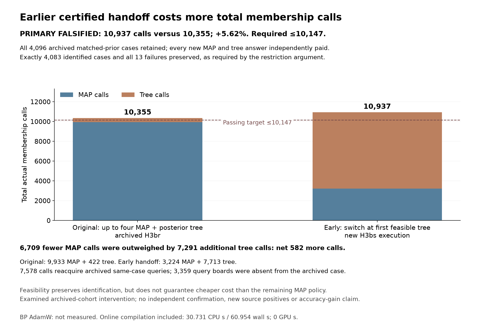

# H3bs: certified early handoff increases total query cost

**The sole total-call primary is falsified.** Switching to a depth-four posterior-optimal tree at the first feasible checkpoint uses **10,937 newly charged membership calls versus 10,355** for the archived four-MAP-plus-tree policy: **582 more calls, a 5.620473% increase**. The frozen hypothesis required at least a 2% reduction, or at most 10,147 calls. Preserving all exact-identification outcomes does not rescue the failed cost claim.

| Method | MAP calls | Tree calls | Total policy calls | Exact cases |
|---|---:|---:|---:|---:|
| BP AdamW | Not measured | Not measured | Not measured | Not measured |
| Up to four MAP + posterior tree, archived H3br | 9,933 | 422 | 10,355 | 4,083/4,096 |
| First feasible tree handoff, new execution | 3,224 | 7,713 | 10,937 | 4,083/4,096 |

The primary is the exact integer test `100 * new_policy_calls <= 98 * 10355`: 1,093,700 is greater than 1,014,790. This endpoint counts all new MAP and tree calls. The policy saves 6,709 MAP calls but adds 7,291 tree calls, leaving 582 additional calls overall. Continuation-only comparisons would omit the deliberately changed stage boundary and are not the scientific endpoint.

All 4,096 examined H3br cases remain unchanged, including the seven repeated source-bank cases and thirteen known baseline failures. The inherited source cohort sampled truths under the declared conditional prior; this experiment reuses those same truths and eight-positive banks. There are zero new truth/source draws or positive examples, and 32,768 historical positive appearances are reused. This is an archived-cohort intervention, not independent confirmation.

At zero, one, two, three and four MAP calls, the policy first stops if the candidate set is a singleton. Otherwise it tests the current set for a depth-four posterior-optimal tree. More than sixteen candidates immediately yield the exact binary-information bound. At most sixteen candidates use the unchanged exact weighted compiler, full 73,712-board N13 catalog, correct eight-positive score C(55,k) C(M,8), reciprocal-score integer weights and lexicographic optimal ties. The policy switches immediately whenever a feasible tree exists. Otherwise it continues the unchanged MAP selector while fewer than four MAP calls have been used, then retains certified failure at the limit. No informative MAP query also terminates unresolved.

| MAP calls before tree handoff | Cases |
|---:|---:|
| 0 | 1,493 |
| 1 | 2,081 |
| 2 | 342 |
| 3 | 81 |
| 4 | 17 |
| No tree handoff | 82 |

These handoff counts are descriptive. The 82 cases without tree handoff comprise 69 cases resolved by source/MAP filtering and the thirteen unchanged failures. There is no case selection based on whether handoff succeeds. Every case keeps its terminal exact flag, totaling 4,083 identified cases.

The [restriction lemma](LEMMA.md) explains this correctness invariant. A tree identifying every candidate in S can identify any nonempty subset T by pruning impossible branches and suppressing queries with only one possible branch. No path becomes longer. Because the new policy follows the identical deterministic MAP prefix until handoff, each later baseline checkpoint is a subset of the handoff set. An early feasible tree therefore implies a feasible depth-four tree for that later checkpoint; the exhaustive baseline compiler cannot fail there. With no early handoff, the new policy reaches the same four-MAP checkpoint and original posterior-tree decision. This argument establishes preserved identification, not a cost improvement.

The online compiler receives only the current candidate set and immutable candidate predictions/scores. Each cache miss builds its catalog and proof during the new execution, after any preceding new MAP labels. No future truth-conditioned checkpoint is precompiled from archived labels. Cache identities bind the policy, method, candidates, exact weights, depth, catalog hash, prediction hash and compiler hash. Predictions are read-only and scores immutable. Every use verifies the proof file hash/candidate identity/depth and binds its complete receipt in the durable ledger before routing or querying its tree.

Only archived query metadata is decoded before execution: case, board index, sequence, hash, policy and phase. Metadata is consulted after a new query is selected to annotate overlap. Archived answers never supply routing or an oracle answer. Baseline case outcomes and checkpoints are opened only after all 4,096 new policy executions have completed. The postexecution checks then verify every exact flag, every common MAP prefix and every restricted early tree on its later baseline checkpoint.

All **10,937** MAP/tree answers are independently queried and charged. This includes 7,578 queries previously asked somewhere in the same H3br case across its shared MAP or any of its three policy arms. The remaining 3,359 query boards were absent from that archived case. All matching archived query references are retained. These are same-case overlap counts, not globally distinct-board counts. Every query is flushed and fsynced before a separate oracle read and its immediate hash-linked answer; no free inherited MAP labels or answer cache is used.

A depth-four expected-cost optimum minimizes its declared tree objective, but the remaining baseline can use additional MAP steps before its own depth-four tree. Those are different policy classes. Feasibility alone does not compare their remaining costs. The measured replacement of MAP work by more tree work falsifies the proposed saving on this cohort; a separately frozen cost-based handoff rule is needed to test that mechanism.

Prefreeze gates took 0.064442 seconds separately. They verified all 47 nonempty subsets and 92 candidate paths across feasible small fixtures, including nonincreasing restricted depth; exact weighted costs/depth/lex ties/resource exceptions; an online four-candidate cost-50 fixture with weights 12,6,4,3; zero extra states/splits on an identical cache hit; read-only predictions; and a seventeen-candidate information-bound certificate. All 4,096 archive IDs and the fixed comparator/accuracy counts were checked before freezing. Runtime repeats scientific weighted and restriction gates, population/score parity, source-filter reconstruction and durable-ledger fixtures inside the monitored budget.

The experiment used **30.730794 aggregate CPU seconds / 60.954292 wall seconds**, including all online compilation, caches, gates, metadata loading, postexecution evaluation, serialization and monitoring. It compiled 5,090 distinct sets, of which 2,290 were feasible, consuming 396,875 states and 3,244,398 split attempts including synthetic fixtures. Limits were 600 CPU / 900 wall seconds, 2,000,000 states, 50,000,000 splits, 100,000-bit weights/LCMs and 32,768 calls. Maximum audited LCM/weight sizes were 1,110/1,015 bits. Zero GPUs. Live monitoring after about 23 seconds recorded 1,280 complete cases, 3,397 calls and 1,795 compiled sets; both CPU compilation and durable writes made forward progress. Timing is descriptive, not a compute-efficiency comparison with H3br’s three-policy run.

The independent pre-export audit passes **4,676,983 checks in 28.809237 seconds**. It reconstructs all 4,096 archived truth/source draws, every new online route, every newly charged call, and all 10,355 archived baseline MAP/posterior calls. It checks every one of 396,816 real proof states and 3,244,353 split alternatives, follows 18,725 candidate branches, and verifies 5,065 restricted later-checkpoint paths. Both ledger hash/order/time chains, all first-encounter compilation identities, proof-before-query bindings, reacquisition charges, per-case invariants and the total-call primary are checked. No scientific compiler or scientific restriction function is called by this verifier. Final public verification adds export and figure provenance checks.

The ledger has 37,321 records, 33,799,016 raw bytes and 5,619,780 deterministic gzip bytes. Decompression restores SHA-256 `50b4874db6f4736f811671d8ad9b9447314ee115c2608f852a1de2098b485478`. The protocol SHA-256 is `40878624cf3f651290415c4f50d222752ecbf9ecd5dae6596fbe5504893924cd`.

This supplied finite model class, noiseless binary membership and complete candidate predictions are stronger supervision than positive-only learning. There is no arbitrary-rule, learned-optimizer, equal-oracle fairness, population cost or independent-generalization claim.

Run `upstream/.venv/bin/python research/20261114/loki/h3bs/verify_public.py --root SNAPSHOT`.

[Frozen protocol](protocol.json), [restriction lemma](LEMMA.md), [prefreeze gates](preflight.json), [online compiler](policy.py), [study](study.py), [independent verifier](verify_public.py), [summary](../../../../results/research/loki/h3bs/summary.json), [all 4,096 paired costs](../../../../results/research/loki/h3bs/case-costs.csv), [full cases](../../../../results/research/loki/h3bs/case-results.json), [restricted-tree comparisons](../../../../results/research/loki/h3bs/baseline-comparison.json), [exact ledger](../../../../results/research/loki/h3bs/query-ledger.jsonl.gz), [figure provenance](../../../../results/research/loki/h3bs/plot-provenance.json).
