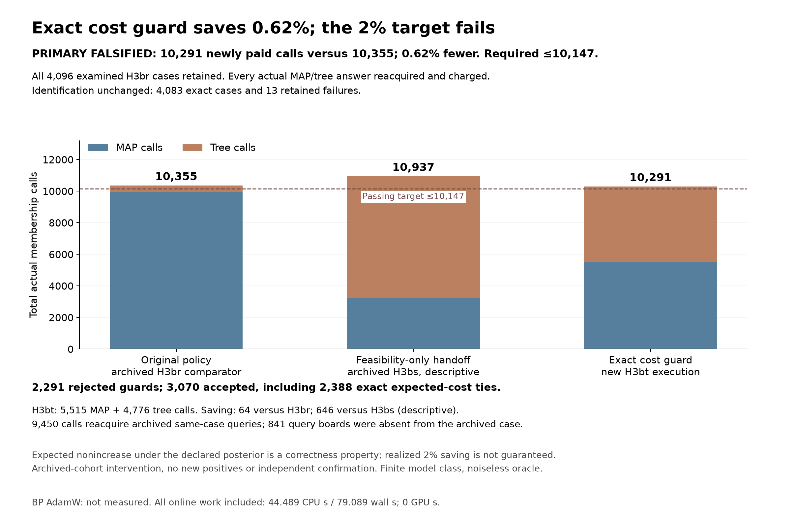

# H3bt: exact cost guard saves 0.62%, missing the 2% target

**The sole total-call primary is falsified.** Exact posterior expected-cost guarding uses **10,291 newly paid calls versus 10,355**, a saving of **64 calls / 0.618059%**. The frozen target required at least 2%, or at most 10,147 calls. The exact integer comparison fails: `1,029,100 > 1,014,790`. The 646-call reduction versus H3bs is descriptive and does not replace the original comparator or rescue this failed endpoint.

| Method | MAP calls | Tree calls | Total calls | Exact cases |
|---|---:|---:|---:|---:|
| BP AdamW | Not measured | Not measured | Not measured | Not measured |
| Up to four MAP + posterior tree, archived H3br comparator | 9,933 | 422 | 10,355 | 4,083/4,096 |
| First feasible tree handoff, archived H3bs descriptive | 3,224 | 7,713 | 10,937 | 4,083/4,096 |
| Exact cost guarded handoff, new H3bt execution | 5,515 | 4,776 | 10,291 | 4,083/4,096 |

All 4,096 examined H3br truth/source cases remain, including seven repeated source-bank cases, prior successes and all thirteen failures. There are zero new truth/source draws or positive examples: 32,768 historical positive appearances are reused. This is an intervention on the same examined archived cohort, not independent confirmation. The endpoint charges every actual MAP and tree query across every case.

At each current set after zero through four paid MAP queries, stop if singleton; otherwise obtain the unchanged depth-four posterior-optimal tree. Infeasible sets continue the unchanged MAP policy while its budget remains. For a feasible tree, the counterfactual evaluator computes the fixed baseline’s remaining cost for every candidate: the remaining `4 - used_MAP` MAP queries followed by the unchanged depth-four posterior tree. Exact integer posterior weights compare the current tree cost with the baseline cost. Handoff occurs if and only if the tree cost is no larger. Equality accepts; at MAP step four a feasible tree must tie exactly. Rejection takes the next unchanged MAP query.

The tree compiler, MAP selector and integer weighting are unchanged. Candidate sets above sixteen use the exact depth-four binary-information bound. Smaller sets use the full 73,712 ordinary N13 boards and all compatible models in the supplied 1,541-model class. The eight-positive posterior weights are proportional to `1 / (C(55,k) C(M,8))`; neither the true identity nor its orbit count is supplied to the selector or either compiler. Tree ties retain the lexicographically first optimal board.

Counterfactual recursion branches on both predicted labels, retains all candidates and records every candidate’s exact remaining call count. Its inputs are the current candidate set, sorted queried-board indices, remaining MAP budget, depth four, and immutable prediction/score/selector/compiler hashes. Terminal nodes reference full posterior-tree proofs. Computation over already supplied candidate predictions makes no actual oracle calls. Actual query answers are acquired separately and all are paid. Shared-prefix memoization does not omit a hypothetical branch or depend on the true candidate.

There are 5,361 actual guard evaluations: 2,291 rejected and 3,070 accepted, including 2,388 exact ties. The guard records its exact costs and root dependency hashes in the durable ledger before actual routing. Every actual tree receipt is likewise bound before querying. Archived answers are not used by routing; only prior query metadata annotates overlap after the query is selected. Archived baseline outcomes and checkpoints are opened after every new policy execution completes.

| MAP calls before handoff | Cases |
|---:|---:|
| 0 | 267 |
| 1 | 2,042 |
| 2 | 489 |
| 3 | 185 |
| 4 | 87 |
| No tree handoff | 1,026 |

The 1,026 cases without tree handoff comprise 1,013 cases resolved by source/MAP filtering and thirteen unchanged failures. Handoff timing, accept/reject counts and comparison with H3bs are descriptive mechanism measurements.

The [restriction lemma](LEMMA.md) preserves identification: prune impossible tree branches and suppress one-branch queries to identify any candidate subset at no greater depth. Every later baseline MAP checkpoint is a subset of an accepted early-handoff set, so a depth-four feasible early set implies a feasible later checkpoint. With no early handoff the original MAP prefix and final compiler are unchanged. All 4,096 exact flags remain equal, including all thirteen failures.

The [guard lemma](GUARD_LEMMA.md) gives conditional expected nonincrease under the prescribed posterior. Acceptance compares the two exact remaining expectations; rejection takes the same MAP query and backward induction bounds its subsequent guarded continuation. This is a correctness property under the stated model, not a guarantee of any finite-cohort saving or a population effect size. The 2% realized endpoint remains falsified even though every accepted guard satisfies its expected-cost inequality.

Every one of 10,291 actual answers is reacquired and charged. Of these, 9,450 repeat a board queried somewhere in the same archived H3br case, and 841 boards were absent from that case. These are same-case query overlap counts, not globally distinct boards. Every query is flushed and fsynced before the separate oracle read and immediate hash-linked answer. Each case uses at most four MAP plus four tree queries, hence at most eight actual calls.

Synthetic gates independently compare shared-prefix recursion with per-candidate baseline rollouts for remaining MAP budgets 0, 1, 2 and 4. Frozen examples exercise acceptance (74 ≤ 82), rejection (215 > 119) and equality (2 = 2). Every candidate cost agrees. Prefix sharing needs 16 selector calls versus 61 separate rollouts; cache hits add zero states, splits or selector calls. The existing restriction tests cover 47 nonempty subsets / 92 candidate paths. Combined runtime gates contribute 274 states / 314 split evaluations and remain inside the total scientific budget.

The monitored run used **44.488761 aggregate CPU seconds / 79.089420 wall seconds** and zero GPU seconds. It compiled 7,313 distinct tree sets (4,513 feasible), with 596,463 tree states and 4,297,720 tree split alternatives. The counterfactual graph has 22,364 memo nodes / 10,152 MAP partitions. Including gates, totals are 619,101 states / 4,308,186 split evaluations. Limits were 600 CPU / 900 wall seconds, 2,000,000 states, 50,000,000 splits, 100,000-bit integer weights/LCMs and 32,768 paid calls. A cap would mark the whole study incomplete, not justify exclusions or certified infeasibility. Timings include online preparation, compilation, gates, serialization, postexecution evaluation and monitoring; they are descriptive, not a matched compute comparison with the earlier studies.

The independent audit passes **6,612,408 checks in 42.910508 seconds** before summary/figure verification. It reconstructs all source populations, scores and all 4,096 archived truth/source draws; replays every actual new route and paid query plus all 10,355 archived baseline calls; verifies all 596,463 tree states / 4,297,720 alternatives, 31,119 candidate tree paths, and 4,121 restricted checkpoint paths. It independently reconstructs every counterfactual MAP selection, both branches, terminal tree references, 72,534 candidate cost entries, full input/cache identities, root reachability and all guards. It checks exact MAP-four equality and that no tree or counterfactual computation is unreferenced. The scientific compiler, selector, cost evaluator and restriction implementation are not invoked.

Lossless export preserves every raw logical proof identity while storing deterministic per-proof gzip (level 6, mtime zero). 7,321 proofs shrink from 1,877,008,325 to 229,081,103 bytes, with all roundtrips verified. Raw Loki scientific files remain unchanged. Both compressed and raw hashes/lengths are recorded in `proof-export.json`; the public verifier rejects ambiguous representations and independently checks both identities. The append-only ledger contains 42,737 records / 45,112,433 raw bytes / 8,014,822 gzip bytes, with decompressed SHA-256 `6aa084d73d5f6e4a899bb4fd028939e52e20979cab175cf9167f3d973b446c29`.

Frozen protocol SHA-256: `b4adce37c02d652e1cc8ef8d883826865e53bc0fa412be3f63368467905ae178`. Maximum independently audited LCM / weight sizes: 1,110 / 1,015 bits.

The finite candidate class, complete supplied predictions and noiseless binary membership provide stronger supervision than positive-only learning. This study does not establish arbitrary-rule learning, learned-optimizer superiority, equal-oracle comparison, accuracy improvement or independent generalization.

Verify with `upstream/.venv/bin/python research/20261114/loki/h3bt/verify_public.py --root SNAPSHOT`.

[Frozen protocol](protocol.json), [guard lemma](GUARD_LEMMA.md), [study](study.py), [independent cost audit](audit_costs.py), [public verifier](verify_public.py), [summary](../../../../results/research/loki/h3bt/summary.json), [all paired costs](../../../../results/research/loki/h3bt/case-costs.csv), [counterfactual registry](../../../../results/research/loki/h3bt/counterfactual-groups.json), [lossless proof identities](../../../../results/research/loki/h3bt/proof-export.json), [ledger](../../../../results/research/loki/h3bt/query-ledger.jsonl.gz).
