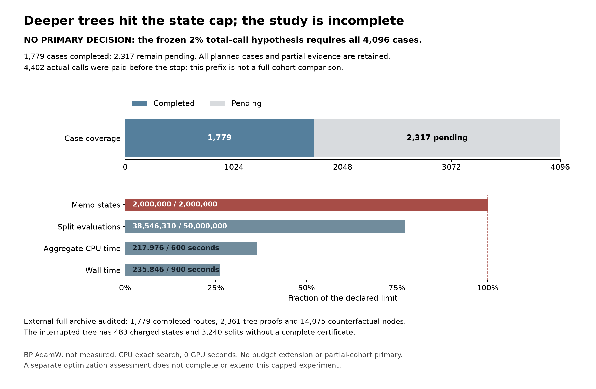

# H3bu: state cap reached; full-cohort hypothesis remains untested

**The whole study is incomplete. There is no primary decision.** The frozen 2% total-call hypothesis requires all 4,096 archived cases. The run reached its declared 2,000,000-state cap after 1,779 completed cases, leaving 2,317 pending. All 4,402 membership queries actually issued are charged and preserved. A partial-cohort cost reduction is not computed or substituted for the primary.



| Method or study | Coverage | Recorded calls | Scientific status |
|---|---:|---:|---|
| BP AdamW | Not measured | Not measured | Not measured |
| Original H3br policy | 4,096/4,096 | 10,355 | Archived comparator |
| H3bt exact depth-four guard | 4,096/4,096 | 10,291 | Its 2% primary falsified |
| H3bu deeper guard | 1,779/4,096 complete | 4,402, incomplete prefix only | Incomplete; no primary outcome |

The proposed intervention keeps the original maximum eight actual queries. After m paid MAP queries, sets of at most sixteen candidates request a posterior-optimal tree of depth 8-m. Larger current sets are ineligible for that compiler and continue the original MAP policy; this eligibility rule is not an infeasibility certificate. Baseline counterfactual branches still use 4-m MAP queries and the original depth-four terminal tree. Every hypothetical branch and candidate is retained. Any baseline candidate with an infeasible terminal tree contributes zero additional membership calls and exact=False, vetoing handoff. No branch, true candidate or experimental case is dropped.

If every baseline branch identifies, the complete baseline itself fits depth (4-m)+4. The optimized deeper tree must therefore pass the exact cost comparison. A pure cost rejection would be a correctness error; it is not a successful scientific endpoint. The all-branch admissibility rule and unchanged MAP continuation preserve the original exact flags in any complete execution. The completed prefix matches the archived exact flags; the unexecuted cases are not reported as measured successes. All actual labels are reacquired and charged, even when their same-case boards occurred in the archive.

The compiler normalizes each state depth to min(depth, subset_size-1). Every nonconstant binary query removes at least one other candidate along a path, so larger depth budgets add no candidate tree. Requested depth remains in all proof/input/cache identities. The source, [depth lemma](DEPTH_LEMMA.md), [admissibility lemma](GUARD_LEMMA.md), reference compiler, gates and full [protocol](protocol.json) are preserved. H3bu does not change H3bt or its failed 2% result.

Forty fixed synthetic depth cases preserved every weighted optimum, feasibility result and chosen lexicographic path, with 34,903 independent checks. On Loki, normalization reduced reference states 6,067→2,912 and splits 39,979→25,564; measured compiler CPU time was 0.154777→0.079360 seconds on these small fixtures. A weighted-six fixture improved cost 124→119 by allowing a deeper tree. Three admissibility fixtures retained all six failing baseline candidates at remaining MAP budgets 1, 2 and 4. Shared-prefix simulation matched per-candidate costs and exact flags with 30 selector calls versus 152 separate rollouts. These are synthetic correctness/performance checks, not new cohort results.

| Monitored resource | Used | Declared limit |
|---|---:|---:|
| Aggregate memo states | 2,000,000 | 2,000,000 |
| Aggregate split evaluations | 38,546,310 | 50,000,000 |
| Aggregate CPU seconds | 217.975628 | 600 |
| Wall seconds | 235.846244 | 900 |
| GPU seconds | 0 | CPU-only study |

The state cap, rather than CPU, wall or split limits, stopped the compiler while beginning the next case’s actual tree. The last ledger record binds source case 1779; no actual query was issued for that pending case. Live progress included 256, 512, 768, 1,024, 1,280 and 1,536 completed cases, with increasing state/split counters and an active CPU worker. Both Loki GPUs had no eligible work. The cap is a computational failure to complete the study, not a certificate that the candidate set is inseparable. There is no budget extension, resumed prefix or reduced-scope endpoint.

An independent full-archive audit passes **44,813,296 checks in 237.400320 seconds**. It verifies all 1,779 completed routes and 4,402 paid labels, every normalized child identity and lexicographic optimum in 2,361 completed tree proofs, all 14,075 counterfactual nodes, 53,901 candidate cost/exact entries, all baseline admissibility vetoes and complete depth-indexed reachability. No scientific compiler or counterfactual evaluator is called by the audit. Its source hashes and receipt are published separately from the portable checker.

Certified completed work comprises 1,974,388 tree states / 38,461,510 tree alternatives, 14,075 counterfactual nodes / 6,543 MAP partitions, and 11,054 gate states / 75,017 gate splits. The interrupted tree accounts for **483 charged states / 3,240 splits without a complete certificate**. These residual operations are explicitly not certified or treated as a completed proof.

The repository contains a compact incomplete-run package: all frozen source/protocol/gates, complete case/status output, the exact paid-query ledger, complete group and counterfactual metadata, runtime/cap receipts, the independent full-archive audit receipt, and raw/compressed hashes for every omitted proof. The full proof payloads are deliberately outside Git. The raw scientific artifacts and complete compressed export remain intact on Loki, and a complete compressed export is also retained locally.

The external archive contains 2,391 complete proof files: 20,060,679,872 logical raw bytes represented by 3,943,270,559 gzip bytes. Every compression roundtrip and both identities were checked. Counterfactual metadata uses a deterministic indexed ZIP with 28,308 logical JSON files and 17,828,989 physical bytes. Every raw input/result hash remains available. See [archive boundary](../../../../results/research/loki/h3bu/archive-boundary.json) and [all proof identities](../../../../results/research/loki/h3bu/proof-export.json).

**Portable verification does not replay the omitted optimality certificates.** From a checkout it checks frozen identities, metadata hashes, ledger chain, every paid query label/filter, deterministic MAP choices, and completed-case counts. Complete normalized-tree and counterfactual exact-flag proof replay requires the separately retained full archive:

```bash
upstream/.venv/bin/python research/20261114/loki/h3bu/verify_public.py --root SNAPSHOT
upstream/.venv/bin/python research/20261114/loki/h3bu/verify_public.py --root SNAPSHOT --archive-dir FULL_EXPORTED_ARCHIVE
```

Frozen protocol SHA-256: `67e7c580069e49cdae6b2eaa671742c9cee6f70fac941981aa2f12c0f30aba34`. Ledger SHA-256: `b2aaa71aba7a2b14a749fb035620a48287e05b95c525a4d8b73a1adbd3b418cc` across 16,847 records. The finite supplied model class, complete predictions and noiseless membership oracle do not establish positive-only learning, arbitrary-rule learning, population cost improvement or independent generalization.

[Design](DESIGN.md), [summary](../../../../results/research/loki/h3bu/summary.json), [all planned statuses](../../../../results/research/loki/h3bu/planned-case-statuses.csv), [cap receipt](../../../../results/research/loki/h3bu/capacity-gate.json), [full-archive audit receipt](../../../../results/research/loki/h3bu/full-archive-audit.json), [portable/full verifier](verify_public.py).
