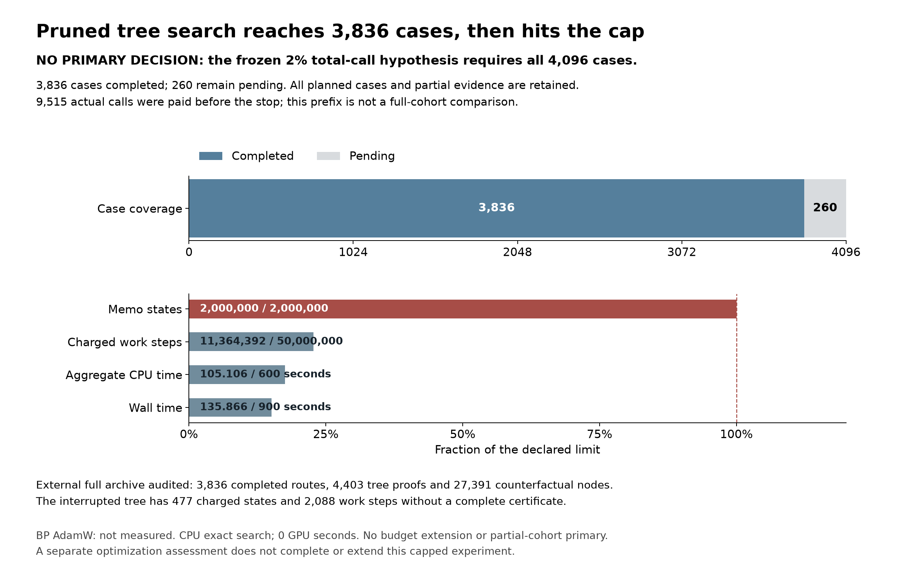

# H3bv: certified pruning extends coverage, but the study remains incomplete

**No primary decision.** H3bv stopped at the same declared 2,000,000-state cap after **3,836 of 4,096 cases**, leaving **260 pending**. All **9,515 actual membership queries** are paid and preserved. The frozen 2% total-call hypothesis requires the whole cohort, so neither a partial saving nor a scaled estimate is reported. H3bu remains incomplete separately; this was a new run from case zero with every actual label reacquired.



| Study | Completed cases | Recorded actual calls | Status |
|---|---:|---:|---|
| BP AdamW | Not measured | Not measured | Not measured |
| Original H3br comparator | 4,096 | 10,355 | Archived complete comparator |
| H3bt depth-four cost guard | 4,096 | 10,291 | Its 2% primary falsified |
| H3bu deeper handoff | 1,779 | 4,402, prefix only | Incomplete |
| H3bv exact-pruned deeper handoff | 3,836 | 9,515, prefix only | Incomplete; no primary outcome |

The scientific policy is unchanged from H3bu: after m newly paid MAP queries, current sets of at most sixteen candidates request a posterior-optimal depth-(8-m) tree. Every original-baseline counterfactual branch is retained, using the remaining 4-m MAP steps followed by the original depth-four tree. Any candidate whose baseline continuation fails vetoes handoff. Larger current sets continue the unchanged MAP policy without a false infeasibility certificate. All-case exact-flag equality and prescribed-posterior expected nonincrease are correctness properties; they do not prove the realized 2% endpoint.

Three computation changes preserve the optimized policy. First, exact Huffman prefix-code costs lower-bound each partition branch. Options are explored in increasing (lower bound, board index) order; the incumbent updates by (weighted cost, board index). A bound strictly above the incumbent prunes; equality prunes only when its board is later. All options, ordering bounds, incumbents, merge traces and tie decisions remain independently checkable. Second, complete proofs are serialized before RAM caches retain only their chosen routing states. Third, equal effective root depths reuse one hash-checked canonical computation while retaining separate requested-depth inputs, receipts and complete logical proof bodies.

Every persistent Huffman bound memo entry is charged as a state, and every actual two-smallest merge is charged as a work step. Work steps also include canonical tree partitions and counterfactual MAP partitions. No computation disappears from the budget because it is called a bound. Canonical reuse adds no nonexistent memo/merge work, but source-hash checks and complete serialization still count toward CPU/wall time. Logical proof sizes and actual charged work are reported separately. See the [bound and reuse lemma](BOUND_LEMMA.md).

Prefreeze tests covered 17,008 synthetic cases, including every canonical catalog for two through four models, all weights from {1,2}, forward/reversed catalog order and depths one through four. Larger full/singleton fixtures use six, eight and ten models, uniform/geometric weights and depths four, five, six and eight. Costs, feasibility and every chosen lexicographic candidate path matched unpruned reference enumeration. A separate serialized-artifact audit checked 1,859,756 conditions, including reference certificates, bound merges, ordering, strict/equal pruning, complete requested-depth reuse bodies and no unreferenced bound entries. These tests and the scientific runtime gates are charged and are not cohort outcomes.

On a fixed twelve-set synthetic memory benchmark, unpruned computation used 22,320 states / 642,432 work steps / 3.946 CPU seconds / 420,608 KiB peak RSS. Pruned compact computation used 12,492 / 55,788 / 0.075944 seconds / 46,976 KiB. Compacting alone reduced 61,292→46,976 KiB with byte-identical full proofs. Effective-root reuse on 105 requested-depth receipts produced 66 canonical hits, reducing 8,751→5,541 states and 27,783→19,269 work steps while CPU remained approximately 0.084 seconds. Small-case-heavy exhaustive fixtures can use more total memo entries because bound entries are honestly charged; no universal speed or state reduction was promised.

| Monitored resource | Used | Declared limit |
|---|---:|---:|
| Memo entries | 2,000,000 | 2,000,000 |
| Work steps | 11,364,392 | 50,000,000 |
| Aggregate CPU seconds | 105.105963 | 600 |
| Wall seconds | 135.866198 | 900 |
| GPU seconds | 0 | CPU-only exact search |

The cap occurred while creating a Huffman memo entry for the next case’s first tree. The last ledger event binds source case 3836, with no query issued for that pending case. Live counters advanced through 256-case milestones. At 512 cases, H3bv had 579,994 total states / 2,207,783 work steps and about 563 MB worker RSS, compared with H3bu’s 620,868 states / 11,424,505 splits and about 10.4 GB at its 512-case milestone. At 3,072 cases the H3bv worker used about 749 MB RSS. These are descriptive observations from distinct runs including different gate work; they are not a matched full-study efficiency result. Both Loki GPUs had no eligible work.

The independent external-archive audit passes **10,280,001 main replay checks in 121.929170 seconds**, plus its embedded serialized-gate checks. It replays every one of the 3,836 completed routes and 9,515 paid calls, verifies all 4,403 completed requested-depth inputs, and checks every bound trace/order/prune, normalized child identity, lexicographic choice and source-reuse proof body. It verifies 27,391 counterfactual nodes / 104,727 candidate cost/exact entries and every admissibility veto. All completed exact flags match their archived cases. Unexecuted cases are not represented as measured successes.

Completed compiler work charges 1,638,512 tree/bound memo entries and 10,524,974 work steps. There are 63 canonical computation reuse hits; the logical certificates contain 1,639,453 states and 10,525,890 work entries because reused complete bodies remain available. Runtime gates charge 333,620 states / 824,502 steps. Counterfactual evaluation adds 27,391 nodes / 12,828 MAP partitions. The interrupted tree accounts for **477 states / 2,088 work steps without a complete certificate**, explicitly uncertified.

The compact public package contains the frozen code/protocol/gates, all completed case records and all 4,096 statuses, exact query ledger, complete tree and indexed counterfactual metadata, cap/runtime receipts, full-archive audit receipt, and all raw/compressed proof hashes. Full proof payloads remain on Loki and in the local artifact archive, outside Git. This preserves the evidence while keeping the repository usable.

The retained external archive has 4,448 complete proofs: 9,953,369,926 logical bytes represented by 1,260,948,011 gzip bytes. Indexed counterfactual storage preserves 54,940 logical JSON files in 34,619,032 bytes. All roundtrips and logical/physical identities were verified. **Portable checkout verification does not replay omitted optimality proofs**: it checks metadata hashes, frozen identities, every paid label/filter, deterministic MAP selection, ledger chain and completed-case counts. Full replay additionally requires the external archive.

```bash
upstream/.venv/bin/python research/20261114/loki/h3bv/verify_public.py --root SNAPSHOT
upstream/.venv/bin/python research/20261114/loki/h3bv/verify_public.py --root SNAPSHOT --archive-dir FULL_EXPORTED_ARCHIVE
```

Protocol SHA-256: `35b762f0ed7773576864ed83717062da451ddd7aea823b1adee60fe65c273cc3`. The ledger has 36,369 records and raw SHA-256 `e4f9f2ed241043f10b22f39d9c3fef08b3ace178b44d9c09a6928601c5fcf6df`. No cap extension, prefix continuation, partial-primary substitution, population-cost claim or independent-generalization claim is made.

[Frozen protocol](protocol.json), [design](DESIGN.md), [summary](../../../../results/research/loki/h3bv/summary.json), [all planned statuses](../../../../results/research/loki/h3bv/planned-case-statuses.csv), [archive boundary](../../../../results/research/loki/h3bv/archive-boundary.json), [full-archive audit receipt](../../../../results/research/loki/h3bv/full-archive-audit.json).
