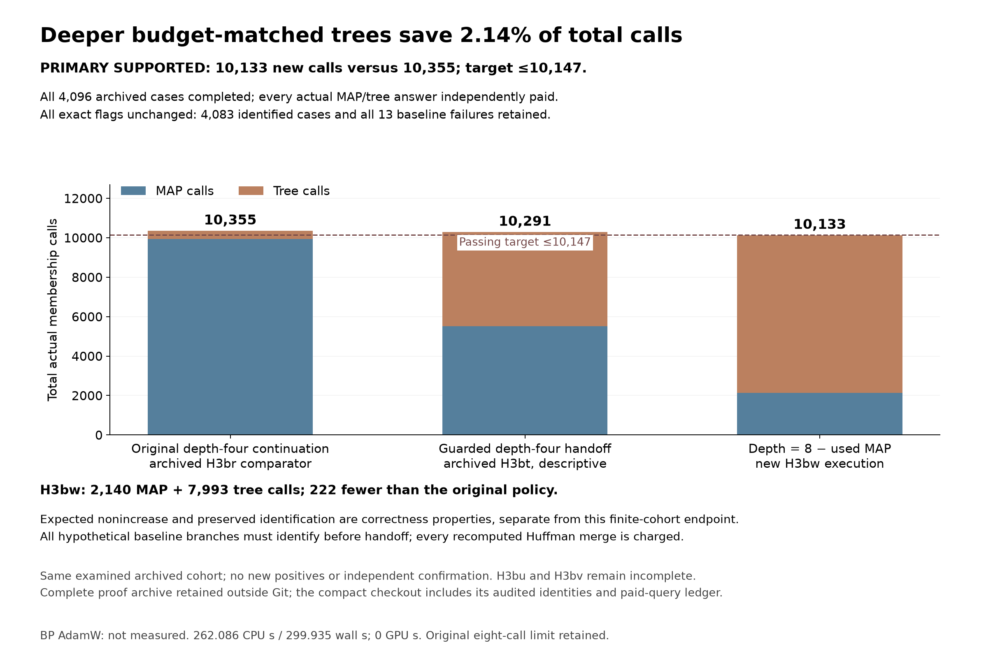

# H3bw: deeper budget-matched trees pass the 2% total-call target

**The frozen whole-cohort primary is supported.** The deeper posterior-optimal handoff uses **10,133 newly paid membership calls versus 10,355**, saving **222 calls / 2.143892%**. It completes all 4,096 examined archived cases within the original limits. The exact integer test is `1,013,300 <= 1,014,790`; the passing maximum is 10,147 calls. All 4,083 exact outcomes and thirteen baseline failures remain unchanged. This result concerns the same examined cohort; there is no new independent confirmation.



| Method | MAP calls | Tree calls | Total calls | Exact cases |
|---|---:|---:|---:|---:|
| BP AdamW | Not measured | Not measured | Not measured | Not measured |
| Original four-MAP/depth-four policy, archived H3br comparator | 9,933 | 422 | 10,355 | 4,083/4,096 |
| Guarded depth-four handoff, archived H3bt descriptive | 5,515 | 4,776 | 10,291 | 4,083/4,096 |
| Budget-matched deeper handoff, new H3bw execution | 2,140 | 7,993 | 10,133 | 4,083/4,096 |

The change replaces 7,793 original MAP calls with 7,571 additional tree calls, leaving 222 fewer calls overall. The 158-call saving versus H3bt is descriptive; the original 10,355-call H3br policy remains the sole primary comparator. The 14-call margin below the integer passing maximum should not be confused with evidence of a robust population effect size. The endpoint is a deterministic comparison on this complete finite cohort.

H3bu and H3bv remain incomplete at their original 2,000,000-state caps, after 1,779 and 3,836 cases respectively. Their partial paid calls are preserved and not promoted to full-cohort results. H3bw starts every case again, independently reacquires every actual query answer and pays for all of them. It is neither a prefix continuation nor a budget extension. The exact-pruning and cache changes alter computation while preserving the chosen optimal tree; the query-cost improvement comes from the deeper policy class.

All 4,096 original truth/source cases remain unchanged, including seven repeated source-bank cases, prior successes and all thirteen failures. There are zero new truth/source draws or positive examples: 32,768 historical positive appearances are reused. The supplied class contains 1,541 models; source likelihood uses eight distinct positive boards and reciprocal-score posterior weights proportional to 1 / (C(55,k) C(M,8)). The full 73,712-board N13 query universe and lexicographic query ties are retained. No true orbit count or actual true identity is supplied to the selector or compilers.

After m newly paid MAP queries, the policy stops if singleton. Sets of at most sixteen candidates may use an exact posterior-optimal tree of requested depth 8-m, preserving the original maximum eight actual calls. Larger current sets remain ineligible for that compiler and continue the unchanged MAP policy; no experimental case is excluded. For a feasible tree, the counterfactual evaluator follows every candidate through both hypothetical baseline label branches, using the remaining 4-m MAP queries and original depth-four terminal tree. A terminal infeasible baseline tree contributes zero additional calls and exact=False. Any such false flag vetoes handoff. Every branch remains recorded, independently of the actual true candidate.

If all original-baseline candidate branches identify, the complete baseline is itself a separating tree of depth at most (4-m)+4. The optimized new tree must therefore pass the exact integer expected-cost guard. Pure cost rejection would be a correctness error. At four MAP queries the guard must tie. All-case exact-flag preservation follows because accepted handoffs and their baseline continuations both identify every remaining model; absent handoff the original MAP prefix and final depth-four rule remain. These conditional properties are distinct from the measured 2% total-call hypothesis.

All 4,070 actual guards accepted, including 1,746 exact ties; no actual baseline-inadmissible guard occurred. Synthetic fixtures still exercise retained infeasible branches. The 2,153 candidate-count ineligibility events are checkpoints, not excluded cases. All 4,627 actual/counterfactual tree inputs were feasible. There are 26 cases without tree handoff: thirteen resolved by source/MAP filtering and thirteen retained baseline failures.

| MAP calls before handoff | Cases |
|---:|---:|
| 0 | 2,504 |
| 1 | 1,186 |
| 2 | 282 |
| 3 | 81 |
| 4 | 17 |
| No tree handoff | 26 |

Every one of the 10,133 actual MAP/tree answers is reacquired and charged. This includes 6,796 boards queried somewhere in the same archived H3br case; 3,337 boards were absent from that case. These are same-case overlap counts, not globally distinct boards. Queries are flushed and fsynced before separate oracle reads and immediate hash-linked answers. Archived query metadata only annotates overlap after selection; archived answers never provide free routing labels. Baseline case outcomes/checkpoints are opened after all new policy executions, for postexecution comparison.

The exact compiler uses three established computation reductions. State depth is normalized to min(depth, candidate_count-1). Exact Huffman prefix-code bounds order partitions by (lower bound, board index); incumbent updates use (cost, board). A branch prunes only when its bound strictly exceeds the incumbent, or equals it with a later board. Complete option orders, lower bounds, incumbents and merge traces remain available. Full proofs are serialized before RAM caches retain only the selected routing tree. Equal effective root depths may reuse one completed canonical tree computation while preserving distinct requested-depth receipts and complete logical proof bodies, with source proof/result hashes bound.

H3bw removes the persistent Huffman subset cache. Every bound is computed from scratch and both complete inline merge traces are retained at each ordering evaluation. Every actual merge, including repetitions of the same subset, is charged. The new compiler’s bound registry is independently verified empty. Inline proof-output records are not queried to accelerate future calculations. Tree-level canonical reuse remains separate and still charges its hash checks and complete serialization to CPU/wall time. This is an explicit state-versus-work tradeoff, not renaming retained memo entries.

All 17,008 synthetic cases preserve exact costs, feasibility and every lexicographic candidate path versus the full memoized reference. The 16,960 exhaustive small cases cover every canonical query catalog for two through four models, all weights from {1,2}, both catalog orientations and depths one through four. Forty-eight larger fixtures use six/eight/ten models, uniform/geometric weights and four depths. Independent serialized-artifact replay additionally checks reference certificates, every recomputed merge, empty bound registries, complete option orders and strict/equal ties. Cache fixtures include large 1,100-bit scores, full-body requested-depth reuse and identical compact-cache routes. The synthetic gates repeat inside the monitored run and are charged.

On eight fixed larger Loki fixtures including full JSON and deterministic gzip serialization, all-inline computation used 2,842 memo entries / 239,294 work steps / 0.710967 CPU seconds / 216,048 KiB peak RSS. The fully memoized comparator used 18,419 / 122,246 / 0.464980 seconds / 133,880 KiB; the singleton/pair-only variant used 17,855 / 138,170 / 0.625395 seconds / 159,972 KiB. These synthetic measurements motivated the wider state margin despite more work/time/transient memory. They are not a matched cohort speedup claim.

| Monitored resource | Used | Declared limit |
|---|---:|---:|
| Aggregate memo entries | 881,322 | 2,000,000 |
| Aggregate charged work steps | 33,823,906 | 50,000,000 |
| Aggregate CPU seconds | 262.085784 | 600 |
| Wall seconds | 299.934835 | 900 |
| GPU seconds | 0 | CPU exact search |

Actual compiler work charges 570,379 tree memo states, 6,247,590 canonical partition attempts and 26,972,849 recomputed Huffman merges. There are 64 canonical tree reuse hits; logical certificates retain 570,801 tree states, 6,248,001 partition entries and 26,973,549 inline merge entries, with zero new-compiler bound memo entries. Counterfactual computation charges 28,974 nodes / 13,584 MAP partitions. Runtime gates, including the separately memoized reference, charge 281,969 states / 589,883 steps. Preparation, hash validation, serialization, postexecution evaluation and monitoring are included in CPU/wall totals; post-run public compression and audit are separate.

The independent complete-archive audit passes **8,686,210 main replay checks in 312.776258 seconds**, plus its embedded serialized-gate checks. It verifies all 4,096 routes and exact flags, every one of 10,133 newly paid queries and all 10,355 archived baseline calls, all requested-depth tree proofs, complete bound traces/ordering/pruning, canonical source reuse and logical/charged accounting. It checks 28,974 counterfactual nodes / 111,080 candidate cost/exact entries, full dependency reachability, all exact guards and 5,121 restricted later-checkpoint paths. The scientific compiler, selector and counterfactual evaluator are not called by the verifier.

The compact repository package omits full proof payloads. The separately retained external archive contains 4,672 complete proofs with 28,924,497,957 logical bytes / 3,753,044,706 gzip bytes. All raw and compressed hashes, full-archive audit receipt, complete case/ledger metadata and source/protocol seals are public. Raw scientific files and full compressed exports remain on Loki and in local artifacts. **Portable checkout verification does not replay omitted optimality certificates**; it checks metadata, frozen identities, every paid label/filter, deterministic MAP selection, all-case counts/exact flags and total-call arithmetic. Full proof and counterfactual replay requires the external archive.

```bash
upstream/.venv/bin/python research/20261114/loki/h3bw/verify_public.py --root SNAPSHOT
upstream/.venv/bin/python research/20261114/loki/h3bw/verify_public.py --root SNAPSHOT --archive-dir FULL_EXPORTED_ARCHIVE
```

Protocol SHA-256: `b564fb588ebe82942a7d166c94c1100a7cce462a25ecec1b66530e9c78757cd1`. The ledger contains 38,755 records, with raw SHA-256 `e8b577ebc55a8172977af103786d1d087bfd4585bc8f1a20f63243fa7159fbfc`. This finite model class, complete supplied predictions and noiseless membership oracle provide stronger supervision than positive-only learning. The result establishes neither arbitrary-rule learning, learned-optimizer superiority, population cost improvement nor independent generalization. A fresh matched-prior cohort is a separate prospective confirmation experiment.

[Frozen protocol](protocol.json), [bound lemma](BOUND_LEMMA.md), [guard lemma](GUARD_LEMMA.md), [summary](../../../../results/research/loki/h3bw/summary.json), [all paired costs](../../../../results/research/loki/h3bw/case-costs.csv), [archive boundary](../../../../results/research/loki/h3bw/archive-boundary.json), [full-archive audit receipt](../../../../results/research/loki/h3bw/full-archive-audit.json).
