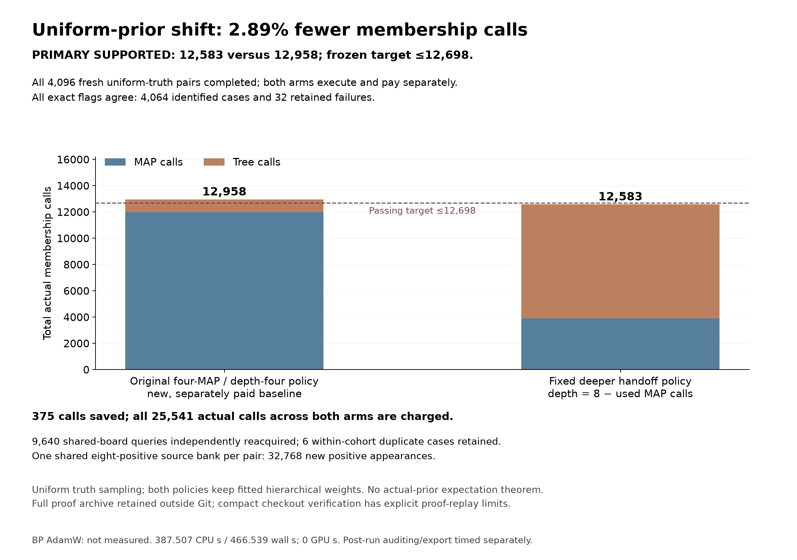

# H3by: uniform-truth prior shift with fixed hierarchical policies

**The frozen 2% total-membership-call primary is supported.** Across all 4,096 fresh paired cases, the fixed deeper policy used **12,583 actual calls versus 12,958** for the separately executed original baseline, saving **375 calls / 2.893965%**. The exact test is `1,258,300 <= 1,269,884`. The passing maximum derived from the freshly executed baseline is 12,698, passing by 115 calls. Every paired exact flag agrees: 4,064 exact identifications and 32 failures retained. The fresh success/failure count was reconstructed from the new routes and was not assumed from any historical cohort.



| Method | MAP calls | Tree calls | Total membership calls | Exact cases |
|---|---:|---:|---:|---:|
| BP AdamW | Not measured | Not measured | Not measured | Not measured |
| Original H3br four-MAP/depth-four policy, newly executed | 11,989 | 969 | 12,958 | 4,064/4,096 |
| Fixed H3bw deeper handoff policy, newly executed | 3,906 | 8,677 | 12,583 | 4,064/4,096 |

The deeper arm replaces 8,083 MAP calls with 7,708 additional tree calls. Both arms together pay 25,541 membership queries, including 9,640 independently reacquired same-case queries. No common MAP prefix, tree label, historical answer or source duplicate creates a free oracle call. The endpoint counts MAP/tree membership calls; the common eight-positive source budget is reported separately.

H3bw fixed this policy on the earlier examined H3br cohort. H3bx subsequently confirmed a 2.568861% saving on a fresh matched-prior cohort. H3by changes only the actual truth prior to uniform over eligible models while retaining the original hierarchical weights in both policies. The endpoint uses its own separately paid baseline and does not inherit either historical denominator. H3bu/H3bv remain incomplete at their original caps.

The supplied class retains all 1,541 ordinary-queen models with zero, one or two D4 leaper orbits from 1 <= a < b <= 11. The actual sampling prior is uniform over the 1,522 models whose complete N12 positive population has M>=8. Every eligible model receives one sampling ticket, so the zero/one/two-orbit probabilities are 1/1522,55/1522,1466/1522. The fitted inference prior remains the original hierarchy with integer weights 1485/27/1 and total 4,436. Its weights are never substituted into actual truth sampling. All 19 ineligible rows and zero-frequency eligible models remain in the reports. The query universe remains all 73,712 supplied N13 boards.

For case i in 0..4095, `default_rng(2027100000+i).integers(1522)` selects the truth via exact cumulative ticket intervals. An independent `default_rng(2027200000+i).choice(M,8,replace=False)` selects eight distinct positives. All 4,096 truth/source pairs are drawn and durably logged before any prospective membership query. The 8,192 seed values avoid the explicitly recorded seed integers in the pinned registry and an expanded conservative union of 515,668 prior Loki truth/source seed values. The frozen seed audit covers explicitly recorded seed integers and declared prior truth/source formulas. A broader post-run registry review found that 3,996 source-seed integers also occur in an older Ripper HiGHS solver-seed formula. These are different applications: NumPy source-bank sampling versus HiGHS internal solver randomization; no source bank or NumPy RNG state is reused. This numerical overlap is disclosed in [seed-scope-note.json](seed-scope-note.json). No globally unused integer-seed or cross-generator independence claim is made, and no draw was replaced.

Each pair shares one source bank: 32,768 newly drawn positive appearances, 65,536 arm appearances and 11,737 globally distinct N12 boards. All 6 within-cohort duplicate-bank cases and all 9 cases matching historical eight-board banks are retained. Repeated truths, ties, successes and failures are neither redrawn nor excluded.

The following true-orbit strata describe the fixed cohort only; they are not additional scientific endpoints.

| True orbit count | Cases | Deeper calls | Baseline calls | Calls saved |
|---:|---:|---:|---:|---:|
| 0 | 0 | 0 | 0 | 0 |
| 1 | 139 | 397 | 403 | 6 |
| 2 | 3,957 | 12,186 | 12,555 | 369 |

The deeper arm executes every case first. After m paid MAP calls, a nonsingleton set of at most sixteen candidates may use a posterior-optimal tree of requested depth 8-m. Larger sets continue unchanged MAP and remain in the experiment. Every hypothetical original-baseline branch is evaluated through its remaining 4-m MAP calls and terminal depth-four tree. Every candidate cost and exact flag is retained. An infeasible terminal baseline contributes zero additional tree calls and exact=False. Any false branch vetoes handoff; otherwise the new exact expected-cost comparison must pass, with equality accepted. Each arm retains its maximum of eight actual queries per case.

The baseline then starts every case again from its eight positives and an empty query history. It executes up to four original MAP calls, then the original full-enumeration posterior-optimal depth-four tree using the original firstlex feasibility compiler and lexicographic ties. Its compiler cache is separate from the deeper arm and counterfactual evaluator. Every baseline label is acquired again after selection. Query records are committed and fsynced before each separate oracle read and immediate hash-linked answer. Only true-source generation, oracle evaluation and result checking consume the actual truth identity; selection and compilation receive candidates, declared predictions, weights, depths and query history.

Both arms use the unchanged exact reciprocal source score `1 / (C(55,k) C(M,8))` over every compatible supplied model. With all baseline branches identifying, that complete baseline belongs to the deeper tree class, so the optimized tree must satisfy its prescribed-posterior expected-cost guard. This expectation uses the fixed fitted hierarchy. Under the actual uniform truth law, the posterior would instead be proportional to 1/C(M,8), and no expected-nonincreasing-cost theorem is asserted. Preservation of every exact flag remains a correctness invariant independent of the prior. These distinctions are separate from the measured finite-cohort 2% endpoint and do not establish a uniform population effect size.

| MAP calls before deeper handoff | Cases |
|---:|---:|
| 0 | 1,351 |
| 1 | 1,900 |
| 2 | 611 |
| 3 | 149 |
| 4 | 46 |
| No tree handoff | 39 |

The all-inline compiler preserves normalized depth `min(depth, subset_size-1)`, exact Huffman lower-bound ordering, and lexicographic ties. Every lower bound is recomputed, every merge is charged, complete inline traces are retained and the persistent bound registry remains empty. Full proofs precede compact routing caches. Canonical tree reuse preserves distinct requested-depth inputs and binds the complete original proof/result identities. These computation rules are unchanged from H3bw.

Before any new draws, the monitored run repeats 17,008 fixed inline/reference cases, 4,252 original-baseline depth-four comparisons, cost/admissibility and cache gates, four baseline-wrapper fixtures, source/prior checks and ledger durability tests. Runtime gates charge 409,517 states / 856,035 work steps. Independent prefreeze replay also rejects ten rehashed semantic mutations involving candidate sets, labels, boards, arm identities and inherited queries. No prospective outcome was used to choose the new seeds or gate fixtures.

| Monitored resource, both arms and all runtime gates | Used | Limit |
|---|---:|---:|
| Memo states | 1,282,170 | 2,000,000 |
| Charged work steps | 48,224,903 | 50,000,000 |
| Aggregate CPU seconds | 387.506750 | 600 |
| Wall seconds | 466.539413 | 900 |
| Actual membership calls | 25,541 | 65,536 |
| GPU seconds | 0 | CPU exact search |

The deeper compiler charges 792,318 states / 47,199,351 work steps, including 38,099,731 recomputed merges. It records 32 canonical reuse hits. Counterfactual evaluation charges 38,324 nodes / 17,635 MAP partitions; the separately executed original compiler charges 42,011 states / 151,882 work. Full process-lifetime monitor CPU, initial source hashing, selector descendants, preparation, serialization and both realized arms are included. Four bounded monitor probes verified initialization, descendant CPU and both resource guards before the run. No cap was extended. Post-run compression and verification are separately timed. This is a query-efficiency result, not a measured end-to-end speedup claim.

The complete independent scientific audit passes **12,868,730 main checks in 380.918438 seconds**, plus its embedded 1,241,564 inline and 666,061 original-baseline checks. It reconstructs every fresh prior ticket and sampled source index; replays all 25,541 separately paid calls; checks every case, exact flag, duplicate and cost; and independently verifies every original firstlex/weighted certificate, deeper certificate, counterfactual branch, input binding and resource counter. The verifier does not invoke any scientific tree compiler or policy evaluator.

A separate lossless export audit then matches all 112,635 immutable scientific files to their exported representation. The full archive retains 7,539 proofs totaling 38,740,762,594 raw bytes / 4,888,573,118 deterministic gzip bytes, plus every counterfactual document and the exact original ledger. Large proof payloads remain outside Git on Loki and in local artifacts. The compact package publishes all raw/compressed identities, source/protocol seals, complete cases and the full audit receipt. **Portable checkout verification reconstructs sources and replays paid labels, filters and MAP choices, but does not replay omitted optimality proofs.** Full proof replay requires the separately retained archive.

```bash
upstream/.venv/bin/python research/20261114/loki/h3by/verify_public.py --root SNAPSHOT
upstream/.venv/bin/python research/20261114/loki/h3by/verify_public.py --root SNAPSHOT --archive-dir FULL_EXPORTED_ARCHIVE
artifacts/plotting-venv/bin/python research/20261114/loki/h3by/plot_public.py
```

Protocol SHA-256: `16409bccadf54d896f8f6a1969ffbf05e59c24c8fe203eade831e75ad78007b1`. The ledger has 88,228 records and raw SHA-256 `184aa8970636b9feadffeb03d80dadfb217a5f0746bdbabe919a64942b6729cd`. The experiment concerns a supplied finite class, complete model predictions and a noiseless membership oracle. It establishes neither arbitrary-rule learning, positive-only learning, learned-optimizer superiority nor a uniform population saving. This is the prespecified uniform-truth prior-shift test; it does not cover arbitrary shifts or adaptively chosen effect thresholds.

[Frozen protocol](protocol.json), [prospective design](DESIGN.md), [summary](../../../../results/research/loki/h3by/summary.json), [all paired costs](../../../../results/research/loki/h3by/case-costs.csv), [full audit receipt](../../../../results/research/loki/h3by/full-archive-audit.json), [external archive boundary](../../../../results/research/loki/h3by/archive-boundary.json).
