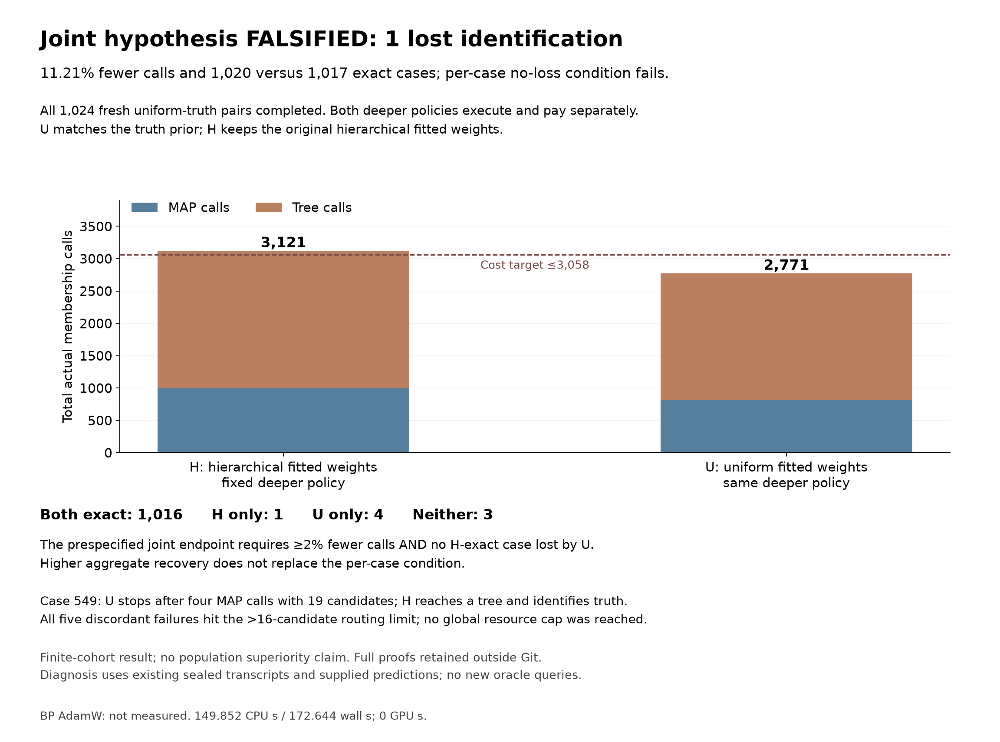

# H3bz: lower query cost, but the no-loss hypothesis is falsified

**The prespecified joint hypothesis is falsified.** Uniform-fitted U used **2,771 calls versus 3,121** for hierarchical-fitted H, saving 350 / 11.214354%. The cost condition passes `277,100 <= 305,858`, but **one H-exact case was lost by U**. U identifies 1,020 cases versus H’s 1,017; higher aggregate recovery does not satisfy the frozen per-case no-loss condition. All 1,024 fresh pairs, all failures and every duplicate remain.



| Method | MAP calls | Tree calls | Actual total calls | Exact cases |
|---|---:|---:|---:|---:|
| BP AdamW | Not measured | Not measured | Not measured | Not measured |
| H: hierarchical fitted weights, deeper policy | 994 | 2,127 | 3,121 | 1,017/1,024 |
| U: uniform fitted weights, same deeper policy | 815 | 1,956 | 2,771 | 1,020/1,024 |

| Exact-identification transition | Cases |
|---|---:|
| Both exact | 1,016 |
| H only: prespecified loss | 1 |
| U only: retained gain | 4 |
| Neither exact | 3 |

The sole scientific endpoint is the conjunction `100*U <= 98*H` and `H_exact implies U_exact` for every case. Cross-arm equality was never assumed. U-only successes were allowed; any H-only success falsifies the joint claim. The endpoint has not been relaxed after seeing the result.

Truth is uniform over all 1,522 source-eligible models in the supplied 1,541-model catalog. Each pair shares eight distinct uniformly sampled N12 positives; all 73,712 supplied N13 boards remain available for membership queries. H retains score `C(55,k) C(M,8)` and U uses `C(M,8)`, with exact reciprocal-score integer weights. Both tables have identical support: the 19 rows with M<8 cannot contain any bank of eight distinct positives, and initial candidates are always filtered across all 1,541 models.

The fixed deeper policy is otherwise unchanged: at most four MAP queries, a tree eligibility limit of sixteen candidates, requested depth `8 - used MAP calls`, the all-candidate admissibility veto, exact expected-cost guard and lexicographic ties. Each arm’s hypothetical original continuation uses its own fitted scores. There is no separately executed original-baseline arm in this experiment; counterfactual computation supplies no free actual labels.

All H cases execute first, then all U cases, using separate selector processes, score files, compiler/counterfactual caches and certificate directories. Every case starts from source-only candidates and empty query history. The study pays all 5,892 calls, including 1,921 reacquired same-case boards. Source appearances are counted separately: 8,192 new positive appearances and 16,384 arm appearances.

For i=0..1023, truth uses `default_rng(2027300000+i).integers(1522)` and source sampling uses independent `default_rng(2027400000+i).choice(M,8,replace=False)`. All sources are durably logged before any actual query. The scoped seed audit covers 281 protocol/proposal-protocol files, 17,463 explicit seed integers and an expanded union of 698,196 named truth/source and nearby solver seeds. No claim is made about every unexpanded or undocumented stream, or about PRNG independence merely from integer inequality.

All 0 within-cohort duplicate-bank cases and 1 historical bank matches remain; 5,721 distinct N12 boards occur. The full 1,541-row frequency table retains zero frequencies and ineligible rows.

After the full independent audit, existing sealed transcripts diagnosed every discordant case. The five failing arms all stop after four MAP calls with more than sixteen candidates. They make no tree query and return an unresolved candidate set; no wrong terminal model is selected. Every remaining model has a distinct prediction row over the full N13 universe, and the true model remains in support. The global CPU/state/work budgets are not exhausted. These are policy routing stops, not mathematical impossibility certificates from a tree compiler.

| Case | True model | Failed arm | Remaining candidates | Successful arm calls |
|---:|---:|---|---:|---:|
| 176 | 899 | H | 17 | 3 |
| 225 | 1517 | H | 21 | 5 |
| 329 | 1428 | H | 17 | 5 |
| 549 | 79 | U | 19 | 6 |
| 991 | 1146 | H | 26 | 3 |

The lost H success is case 549, truth model 79, starting from 137 candidates. H’s first MAP guide is model 1 and its first board is 4535; its three MAP calls leave 118, 18 and 14 candidates. It then hands off at depth five and identifies truth with three tree queries, six calls total. U starts with guide 95 and board 3662; its four MAP calls leave 31, 25, 21 and 19 candidates, so the sixteen-candidate gate prevents a tree handoff. Its four-call result remains unresolved.

As a descriptive check, four already-paid H labels resolve U’s final set in case 549. Replaying the successful arm’s existing labels resolves the other failed sets in three, five, four and two additional distinct labels. This is posthoc transcript analysis, not an executed rescue policy; one case would require five labels by this replay and no universal within-budget rescue is claimed. All four U-only successes are retained alongside the H-only loss.

These observations motivate isolating tree-objective weights from MAP guidance in a separate prospective experiment. They do not change the current endpoint or justify excluding the lost case. Matching the source posterior alone does not order the two routed policies’ per-case exact outcomes.

| Combined monitored resource | Used | Limit |
|---|---:|---:|
| Memo states | 781,017 | 2,000,000 |
| Charged work steps | 20,024,067 | 50,000,000 |
| Aggregate CPU seconds | 149.852172 | 600 |
| Wall seconds | 172.643585 | 900 |
| Actual calls | 5,892 | 16,384 |
| GPU seconds | 0 | CPU exact search |

The budget includes both arms, all counterfactuals, runtime gates, preparation, initial source hashing/imports, selector descendants, complete proof serialization and monitor lifetime. Runtime gates charge 409,531 states / 856,071 work; their disagreement fixture intentionally tests H-only and U-only recovery with separately paid shared queries. No cap was extended and no run was retried. Post-run audit and export are separately timed; query savings are not an end-to-end speedup claim.

The full independent raw audit passes **5,431,059 main checks in 158.020127 seconds**, plus its embedded original/inline certificate checks. It reconstructs every source ticket/index, both per-arm score tables, every paid label/filter/route, both exact flags, the joint endpoint and all resource counts. All 3,733 proofs and 41,440 counterfactual documents are replayed. A separate export audit matches 60,154 immutable source files. Full proofs total 17,038,550,648 raw bytes / 2,224,174,028 gzip bytes and remain outside Git. Per-arm prediction inputs and the fixed fixture’s ledger are retained in the export.

Portable checkout verification reconstructs source choices, scores, paid labels, MAP selections, exact transitions, the joint endpoint and the descriptive diagnosis. It explicitly omits full optimality-proof replay; that requires the retained full archive. This finite-cohort result establishes neither population superiority, arbitrary-rule or positive-only learning, nor learned-optimizer superiority.

```bash
upstream/.venv/bin/python research/20261114/loki/h3bz/verify_public.py --root SNAPSHOT
upstream/.venv/bin/python research/20261114/loki/h3bz/verify_public.py --root SNAPSHOT --archive-dir FULL_EXPORTED_ARCHIVE
artifacts/plotting-venv/bin/python research/20261114/loki/h3bz/plot_public.py
```

Protocol SHA-256: `10b9136f0eaa6ec531436ee527949f30f277da77196dde2f3af96ba816ac57a2`. Ledger: 23,823 records, raw SHA-256 `4a885d6fb5f805d4924b60e09b92030c5645fd4db010ad5a9358ba94cddc334b`.

[Frozen protocol](protocol.json), [design](DESIGN.md), [summary](../../../../results/research/loki/h3bz/summary.json), [all paired costs](../../../../results/research/loki/h3bz/case-costs.csv), [discordant cases](../../../../results/research/loki/h3bz/discordant-case-diagnosis.json), [full audit receipt](../../../../results/research/loki/h3bz/full-archive-audit.json).
