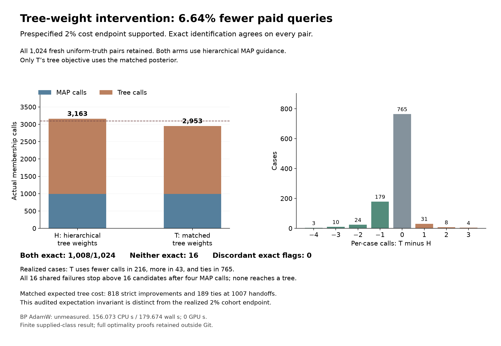

# H3ca: matched tree weights save calls with common MAP routing

**The prespecified finite-cohort 2% cost hypothesis is supported.** T used **2,953 paid membership calls versus H’s 3,163**, saving 210 calls / **6.639267%** across all 1,024 fresh pairs. Both identify the same **1,008/1,024** truths and both fail on **16** cases. There are zero discordant exact flags. Common MAP prefixes, handoffs and exact flags are prospective correctness invariants, independently audited under the design lemma; they are not a newly inferred empirical theorem.



| Method | MAP calls | Tree calls | Total paid calls | Exact cases |
|---|---:|---:|---:|---:|
| BP AdamW | Unmeasured | Unmeasured | Unmeasured | Unmeasured |
| H: hierarchical MAP and hierarchical tree weights | 991 | 2,172 | 3,163 | 1,008/1,024 |
| T: hierarchical MAP and matched tree weights | 991 | 1,962 | 2,953 | 1,008/1,024 |

The sole empirical endpoint is `H > 0 and 100*T <= 98*H`: **295,300 <= 309,974**. The passing integer maximum is 3,099 T calls. All cases, all duplicate banks and every unsuccessful outcome remain. No cohort was retried, no cap was extended, and no endpoint was changed after observation.

H3bz changed both MAP guidance and tree weights and lost one exact case, falsifying its joint cost/no-loss hypothesis despite cheaper aggregate cost. H3ca is a separately frozen intervention and fresh cohort that changes only tree weights. H3bz remains falsified. H3ca does not rerun or relax that result.

Truth is uniform over the 1,522 eligible members of the supplied 1,541-model zero/one/two D4 leaper-orbit class. Each pair shares eight distinct N12 positives sampled uniformly without replacement from its truth’s complete source population. Initial inference filters all 1,541 candidates. The nineteen models with fewer than eight source positives cannot survive that filter. The complete supplied 73,712-board N13 universe is available for membership queries.

For source population M and orbit count k, hierarchical score is `C(55,k) C(M,8)` and matched score is `C(M,8)`. Positive tree weights are exact reciprocal scores represented with integer arithmetic. Both arms use hierarchical scores in actual and counterfactual MAP selection. H trees use hierarchical weights; T trees and their guards use matched weights. Separate role-specific files, hashes, cache keys, selector processes and proof namespaces prevent a hidden MAP intervention.

At m paid MAP calls, a candidate set of at most sixteen can request a depth `8-m` exact tree. Handoff requires all candidates to be identified by the counterfactual continuation of `4-m` hierarchical MAP calls followed by a depth-four terminal tree, and requires the exact expected-cost guard. The admissible continuation belongs to the requested tree class, so its optimum must pass that guard; at m=4 costs must tie. A singleton stops; otherwise no more than four MAP calls and eight total actual calls are allowed.

All H cases run before all T cases. Actual labels are acquired independently, including 2,382 same-case cross-arm board reacquisitions. The 6,116 total excludes no paid failures. Source accounting is separate: 8,192 positive appearances prepared once and 16,384 arm appearances. Counterfactual computation supplies no actual free labels.

For i=0..1023, truth uses `default_rng(2027500000+i).integers(1522)` and sources use `default_rng(2027600000+i).choice(M,8,replace=False)`. All sources are durably logged before actual queries. The scoped seed audit covers 286 historical protocols, 17,479 explicit seed integers and 700,244 expanded named values, including all named Loki ranges and three nearby Ripper solver ranges. Numerical inequality is not a PRNG-independence proof or coverage of undocumented streams.

There is 1 within-cohort duplicate-bank case and 4 historical bank matches; all remain. There are 5,678 distinct N12 boards. Full truth frequencies include zero-frequency and ineligible rows.

The matched-posterior conditional expected tree cost is independently reconstructed from full certified leaf depths at all **1,007 common handoffs**: 818 strict improvements, 189 ties, zero increases. This is the mathematical expectation invariant for complete exact computations. It neither proves realized per-case dominance nor supplies a 2% population margin.

Realized T paths use fewer calls in **216 cases**, more in **43**, and tie in **765**. The entire difference distribution and all exact rational expectation receipts are retained. The 43 longer paths demonstrate why the conditional expectation statement cannot be substituted for a pointwise guarantee.

| T calls minus H calls | Cases |
|---:|---:|
| -4 | 3 |
| -3 | 10 |
| -2 | 24 |
| -1 | 179 |
| 0 | 765 |
| 1 | 31 |
| 2 | 8 |
| 3 | 4 |

All **16 shared failures** stop after four MAP calls with more than sixteen candidates and no tree query. Truth remains in each unresolved set; no wrong terminal singleton is selected. The final sets contain 17–102 models. The complete candidate sets are retained in summary and arm records. These are candidate-count policy stops, not compiler infeasibility certificates or global resource exhaustion. The seventeenth case without a tree reaches a true singleton through four MAP queries.

| Case | Truth model | Remaining candidates | Paid calls per arm |
|---:|---:|---:|---:|
| 47 | 1490 | 19 | 4 |
| 77 | 889 | 18 | 4 |
| 126 | 635 | 37 | 4 |
| 149 | 1518 | 19 | 4 |
| 206 | 1410 | 19 | 4 |
| 220 | 1535 | 17 | 4 |
| 285 | 95 | 102 | 4 |
| 441 | 1483 | 20 | 4 |
| 476 | 1158 | 19 | 4 |
| 540 | 1525 | 18 | 4 |
| 618 | 1538 | 17 | 4 |
| 627 | 75 | 18 | 4 |
| 642 | 1415 | 28 | 4 |
| 711 | 907 | 17 | 4 |
| 777 | 1410 | 18 | 4 |
| 861 | 1434 | 17 | 4 |

| Common handoff after MAP calls | Cases | H calls | T calls | Both exact |
|---|---:|---:|---:|---:|
| No tree handoff | 17 | 68 | 68 | 1 |
| 0 | 356 | 1,086 | 914 | 356 |
| 1 | 441 | 1,145 | 1,114 | 441 |
| 2 | 157 | 572 | 571 | 157 |
| 3 | 44 | 235 | 229 | 44 |
| 4 | 9 | 57 | 57 | 9 |

Handoff and orbit-count strata are descriptive only. The primary uses all 1,024 pairs. No further policy or oracle call was executed for this diagnosis.

| Method | Tree states | Tree work steps | Huffman merges | Counterfactual states | Counterfactual MAP partitions |
|---|---:|---:|---:|---:|---:|
| BP AdamW | Unmeasured | Unmeasured | Unmeasured | Unmeasured | Unmeasured |
| H | 213,249 | 11,991,640 | 9,699,974 | 10,393 | 4,748 |
| T | 151,280 | 7,493,355 | 6,023,615 | 10,393 | 4,748 |

| Whole-study monitored resource | Used | Limit |
|---|---:|---:|
| Memo states | 794,933 | 2,000,000 |
| Charged work steps | 20,350,848 | 50,000,000 |
| Actual membership calls | 6,116 | 16,384 |
| Aggregate CPU seconds | 156.073290 | 600 |
| Wall seconds | 179.674054 | 900 |
| GPU seconds | 0 | CPU exact search |

The monitor charges both arms, runtime gates (409,618 states / 856,357 work), preparation/imports/initial hashing, selector descendants, proof serialization and monitor lifetime. Integer size is capped at 100,000 bits. Six prefreeze monitor probes include late CPU/wall overruns after an internally complete result: a failed authoritative receipt suppresses the primary and retains the raw result as unaccepted evidence. This run passes the final receipt. Weight-dependent pruning can still change work or cause a future run to cap; same MAP routing is not equal computational effort.

The raw independent audit passed **5,379,056 main checks in 202.302819 seconds**, including every source draw, paid query/filter, role identity, route, common-prefix invariant, exact flag, expected-cost inequality and primary endpoint. It replays 3,935 complete proofs and 41,774 counterfactual documents. The separate lossless-export audit matches 61,513 immutable scientific files, original ledger bytes and every proof/document.

Four-thread deterministic export took 59.244056 seconds; the retained proofs contain 18,106,008,499 raw bytes / 2,402,222,532 gzip bytes. Auditing and export run after the monitored experiment and can overlap; their timings are not part of its scientific budget. Certified compact routing-cache reuse avoids repeated proof decoding in the producer pairing check; full independent audit still rereads the complete proofs. No end-to-end speedup is inferred from call savings or a cached-access microbenchmark.

The compact checkout retains every paid transcript, source bank, failed set, score file, expectation receipt, proof hash and audit receipt. Full raw and lossless compressed archives remain on Loki at paths recorded in `archive-boundary.json`. Portable verification reconstructs source choices, actual MAP selections, labels, filters, common handoffs/exact flags and the realized endpoint. It checks hash-bound expected-cost receipts; it does **not** independently reconstruct those costs from omitted leaf depths or replay full tree/counterfactual optimality. Those require the full archive.

This is a finite supplied-class, complete-source-population, noiseless-membership study. It establishes no population 2% margin, arbitrary-rule learning, positive-only recovery or learned-optimizer advantage. BP AdamW is unmeasured in this exact-search scope.

```bash
upstream/.venv/bin/python research/20261114/loki/h3ca/verify_public.py --root SNAPSHOT
upstream/.venv/bin/python research/20261114/loki/h3ca/verify_public.py --root SNAPSHOT --archive-dir FULL_EXPORTED_ARCHIVE
artifacts/plotting-venv/bin/python research/20261114/loki/h3ca/plot_public.py
```

Frozen protocol SHA-256: `6926bee871552ca4fd5671d9124b5b86c59457bba3e8400fb9ba7526688c72d9`. Ledger: 24,425 records, raw SHA-256 `8c41e9bf8945cd8b8487bf48bbca7f78b38e44c4f796838d48e11e874abba12c`.

[Frozen protocol](protocol.json), [prospective design](DESIGN.md), [conditional routing lemma](SAME_MAP_LEMMA.md), [summary and all shared failures](../../../../results/research/loki/h3ca/summary.json), [all paired costs](../../../../results/research/loki/h3ca/case-costs.csv), [full audit receipt](../../../../results/research/loki/h3ca/full-archive-audit.json). The frozen design documents retain their original prospective status wording; this report records the completed outcome.
