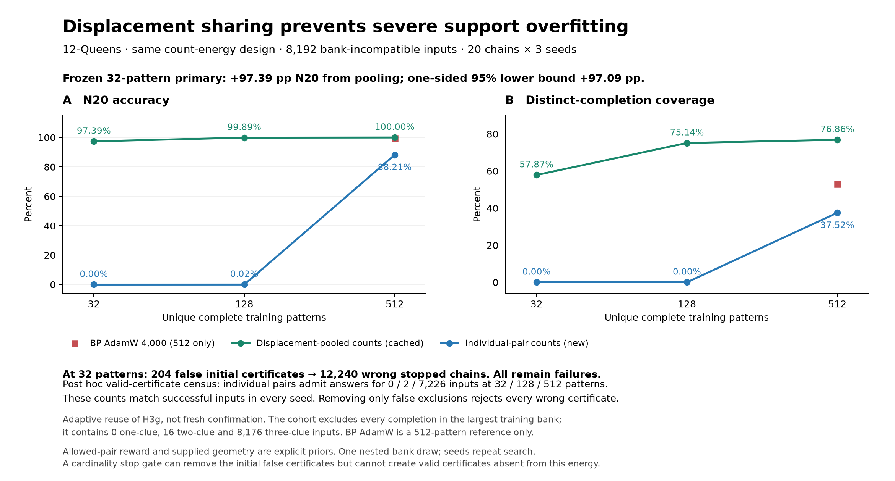

# H3h: removing displacement sharing from count energies

**The frozen primary hypothesis is supported.** With 32 training patterns, displacement-pooled counts achieved 97.387695% N20 accuracy, while individual cell-pair counts achieved 0%. The paired gain is 97.387695 percentage points; the one-sided 95% bootstrap endpoints are [97.094727, 97.680664], exceeding the preregistered 10-point margin. The bootstrap resamples 8,192 unique inputs, keeping all three search seeds in each input cluster. The displacement-pooled searches are hash-pinned H3g controls; all nine individual-pair searches are new.

| Training patterns | Method | Original N20 (%) | Certificate-first N20 (%) | Coverage (%) | Wrong stopped chains | Capped chains |
|---|---|---:|---:|---:|---:|---:|
| 512 | BP AdamW, 4,000 updates; cached H3g context | 99.507650 | 99.532064 | 53.103257 | 0 | 222,591 |
| 32 | Displacement-pooled count energy; cached H3g | 97.387695 | 97.387695 | 57.866327 | 0 | 18,152 |
| 32 | Individual-pair count energy; new H3h | 0.000000 | 0.000000 | 0.000000 | 12,240 | 479,280 |
| 128 | Displacement-pooled count energy; cached H3g | 99.890137 | 99.890137 | 75.144573 | 0 | 4,081 |
| 128 | Individual-pair count energy; new H3h | 0.024414 | 0.024414 | 0.001958 | 0 | 491,400 |
| 512 | Displacement-pooled count energy; cached H3g | 100.000000 | 100.000000 | 76.864761 | 0 | 3,469 |
| 512 | Individual-pair count energy; new H3h | 88.208008 | 88.208008 | 37.519418 | 0 | 63,908 |

BP AdamW is a reference at 512 patterns, not a matched control for the 32-pattern primary. All means pool three search seeds; wrong stops and capped chains are sums across 20 chains × 8,192 inputs × three seeds. Coverage counts distinct valid completions per input, with denominator min(number of exact completions, 20). Integer per-seed numerators and denominators are retained in the [tracked CSV](../../../../results/research/loki/h3h/per_seed.csv). Secondary displacement-minus-pair N20 differences were 99.865723 points at 128 patterns and 11.791992 points at 512 patterns. These secondary comparisons did not select a setting.

Both energies use the same fixed design rule, J = q × forbidden − 1, with q = 12 inferred from training cardinality, zero unary terms and training-only calibration. The intervention changes which observations share a coefficient: 264 displacements versus 10,296 individual unordered cell pairs. The latter stores a literal dense pair table, without displacement lookup. No puzzle rule determines coefficients. The reward for every allowed pair and the supplied displacement geometry remain explicit design priors; this is not recovery of optimized weights. The observed geometry effect is conditional on this fixed count-and-energy recipe.

The individual-pair model falsely excludes 5,840 / 2,691 / 233 permitted cell pairs at banks 32 / 128 / 512; none of the true forbidden pairs is missed. These rule comparisons were made after construction for diagnosis. At 32 patterns, 204 three-clue initial boards satisfy the model's local certificate immediately. Each produces 20 wrong stops for each of three seeds: all **12,240** wrong certificates occur at zero moves, return the unchanged three-queen input and remain failures in both accuracy and coverage. Recomputing the same boards after removing only the extra false exclusions rejects all 12,240. Float64 recomputation finds no numerical certificate deficit. Thus the wrong certifications arise from empirical extra exclusions, not numerical error. This is a same-state certificate intervention; it does not measure a counterfactual search trajectory.

An exact post hoc census checks every valid completion compatible with each evaluation input. Individual-pair local certificates exist for **0 / 2 / 7,226** of the 8,192 inputs at banks 32 / 128 / 512. The pooled models admit certificates for **7,978 / 8,183 / 8,192** inputs. These counts equal the observed successful-input counts in every search seed. The census includes 110,311 compatible input–completion pairs per model. It describes the ceiling on inputs that can receive a **valid local certificate**, not a general ceiling on the lowest-energy fallback's possible accuracy. The observed failure pattern is therefore consistent with support limitations; increasing this search budget cannot create a certificate for an excluded completion.

Adding only a q-queen stop gate would suppress the 204 false initial certificates but cannot restore the missing valid certificates. For M < q, any occupied free queen has removal margin at most M − 1 < q − 1, because the forbidden graph contains all true attack edges and every pair reward is at least −1. A false certificate below q can consequently contain only clamped queens, as observed. At M = q, any extra positive penalty touching an occupied free queen reduces its removal margin below q − 1. Softening positive false penalties while retaining the original exact threshold also need not repair certificate existence. A subsequent repair must be declared separately and tested with a control for any changed stopping rule; none was selected or run as part of H3h.

The cohort is deliberately conditioned on incompatibility with the largest 512-pattern bank: 0 one-clue, 16 two-clue and 8,176 three-clue inputs. Every valid returned completion is outside that bank, and there is no overlap with any expanded fitting input. This is adaptive reuse of H3g's cohort, not fresh confirmation or the original GRAM input distribution. The nested banks come from one training-pattern permutation; search seeds are not independent training replications. Earlier studies considered the full mathematical solution universe.

The independent CPU audit reconstructed all pair co-occurrences from training labels, checked 13 literal-pair energy fixtures and all 1,872 single-cell changes per model, verified calibration and initial decisions, and rescored **2,949,120** saved boards, including **1,474,560** new boards. It verified givens, full-universe membership, exclusion from the largest training bank, both output selectors, coverage, move caps, operation counts and exact saved energies. All invalid returned boards have fewer than 12 queens. New searches used 473.033 aggregate GPU-worker seconds on Loki's two RTX PRO 6000 GPUs, within the 20 GPU-minute envelope. No additional search was launched to occupy idle GPUs after the frozen queue completed.

[Frozen protocol](protocol.json), [runner and construction](driver.py), [independent auditor](analyze.py), [plot renderer](plot_public.py), [tracked summary and hashes](../../../../results/research/loki/h3h/summary.json), [per-seed counts](../../../../results/research/loki/h3h/per_seed.csv), [figure provenance](../../../../results/research/loki/h3h/plot-provenance.json). H3h calls H3g's unchanged search implementation: its result files therefore identify the H3g driver hash and the H3h protocol hash. Model construction identifies the H3h driver hash.
