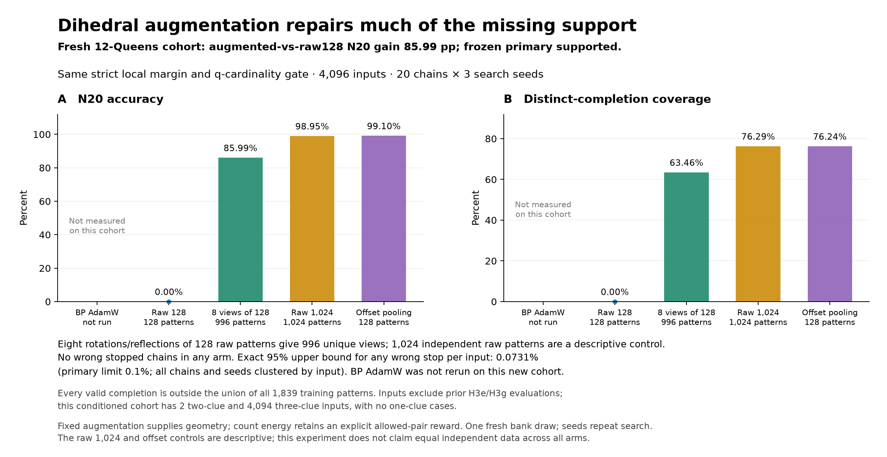

# H3i: a fixed dihedral repair on fresh evaluation inputs

**The frozen primary hypothesis is supported.** Eight rotations and reflections of 128 raw training patterns produce 996 distinct patterns and raise certificate-first N20 accuracy from 0% to 85.986328%. The paired gain is 85.986328 percentage points, with one-sided 95% bootstrap endpoints [85.083008, 86.865234], exceeding the 10-point criterion. No arm has a wrong stopped chain. The exact one-sided 95% upper probability that an input has any wrong stop across all 20 chains and three seeds is 0.073111%, below the primary 0.1% limit. This input-level bound is conservative for a per-chain wrong-stop rate.

| Method | Independent raw patterns | Unique training patterns | Original N20 (%) | Certificate-first N20 (%) | Coverage (%) | Wrong stopped chains | Capped chains |
|---|---:|---:|---:|---:|---:|---:|---:|
| BP AdamW | — | — | Not run | Not run | Not run | — | — |
| Individual pairs, raw 128 | 128 | 128 | 0.000000 | 0.000000 | 0.000000 | 0 | 245,760 |
| Individual pairs, eight views of raw 128 | 128 | 996 | 85.986328 | 85.986328 | 63.460757 | 0 | 36,959 |
| Individual pairs, raw 1,024 | 1,024 | 1,024 | 98.950195 | 98.950195 | 76.292705 | 0 | 7,685 |
| Displacement pooling, raw 128 | 128 | 128 | 99.096680 | 99.096680 | 76.242844 | 0 | 7,470 |

BP AdamW was not rerun on this fresh cohort. Its earlier H3g result uses a different bank, cohort and stopping rule, so no numerical comparison is imported here. The raw 1,024 and displacement-pooled arms are descriptive controls. The augmented arm's 996 correlated views do not provide 996 independent observations; it remains materially below the 1,024-pattern raw control. All accuracy and coverage values average three search seeds; failure counts sum across seeds. The [tracked CSV](../../../../results/research/loki/h3i/per_seed.csv) retains integer per-seed accuracy and coverage counts.

The 1,024-pattern raw bank was drawn before any new construction or inference, excluding the previous H3g bank's 512 complete patterns. Raw 128 is its fixed prefix. Applying all eight board symmetries yields 1,024 views before deduplication and 996 unique patterns, each weighted equally. The union of every pattern used by any arm contains 1,839 distinct complete solutions. The 4,096 evaluation inputs were sampled uniformly from 35,276 eligible unique inputs incompatible with that entire union and absent from both prior H3e and H3g evaluation cohorts. They contain two two-clue and 4,094 three-clue inputs. Every one of their 36,622 compatible complete answers is outside all four training banks. Earlier studies considered the full mathematical universe; freshness here refers to the new bank draw and unused partial evaluation inputs.

All four arms use J = q × forbidden − 1, zero unary terms, q = 12 inferred from training cardinality, training-only unit calibration and the unchanged strict local margin 11 − 0.001. All four additionally require exactly q occupied cells before stopping. The new backend differs from the frozen original solver by that one predicate. It matched all five original backend outputs exactly on 16 own-training partial inputs, three chains and 128 moves on both CPU and GPU, and rejected a synthetic three-clue initial false certificate that the original accepted. The q gate alone cannot manufacture a missing valid certificate. Original floating operation counts remain unchanged; the gate's 143 integer additions per initial or per-move check are reported separately.

After construction, comparison with the true attack graph found 2,772 false exclusions in raw 128, 128 in augmented 128, 25 in raw 1,024 and 21 in offset 128; no true forbidden pair was missed. An exact post hoc census of all compatible valid completions finds a possible valid local certificate for **0 / 3,522 / 4,053 / 4,059** evaluation inputs, respectively. Those counts equal the observed successful-input counts for every search seed. Augmentation repairs much of the missing support, but its remaining 574 failures are inputs with no possible valid certificate under that energy. This is a certificate-existence result, not a bound on an arbitrary decoder or the lowest-energy fallback's theoretical accuracy.

The independent prelaunch auditor reconstructed every literal cell-pair count, used coordinate maps independent of the augmentation implementation to verify all eight transformations, checked all transformed patterns against the exhaustive solution set, and verified every evaluation completion's absence from the entire training union. Construction checked 13 full energies and all 1,872 single-cell changes per arm against literal pair sums. The final CPU auditor checked all **983,040** saved boards, exact energy and float64 certificate margins, given preservation, exhaustive validity, both selectors, coverage, move limits, floating operation counts and cardinality-check integer counts. Every invalid returned board has fewer than 12 queens. The 12 new searches used 272.953 aggregate GPU-worker seconds on Loki, within the 20 GPU-minute envelope.

This is one fresh bank draw, not multiple independent training replications. The bootstrap clusters repeated search seeds within each unique input; it does not establish uncertainty over possible training banks. Symmetry augmentation, displacement sharing, the allowed-pair reward, target-cardinality gate and certificate-first selection are explicit priors or derivative conventions. The test distribution is conditioned by exclusion of all training-bank completions and does not reproduce the original GRAM distribution.

[Frozen protocol](protocol.json), [split and augmentation builder](prepare.py), [construction and runner](driver.py), [gated backend](backend.py), [independent prelaunch auditor](preflight.py), [saved-output auditor](analyze.py), [figure renderer](plot_public.py), [tracked summary and hashes](../../../../results/research/loki/h3i/summary.json), [integer per-seed counts](../../../../results/research/loki/h3i/per_seed.csv), [figure provenance](../../../../results/research/loki/h3i/plot-provenance.json).
